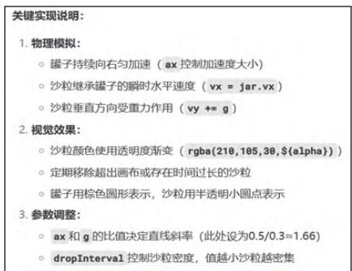
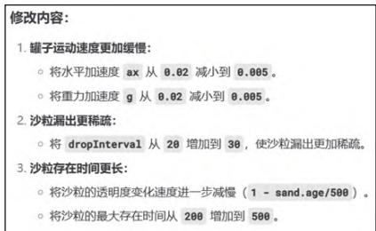
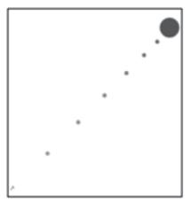
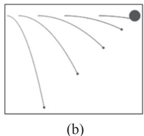
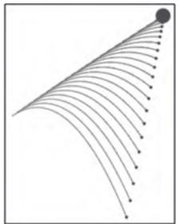

# 基于DeepSeek的高中物理教学情境动画生成策略研究

钟祺浩

浙江省湖州中学 浙江湖州 313000

摘 要：本研究针对高中物理教学中的情境动画生成方式，提出基于 DeepSeek的智能化生成策略，解决传统动画制作成本高、耗时长等问题。研究发现，DeepSeek能有效生成教学适配性强的情境动画，助力提升学生学习的专注度与理解能力。将生成式人工智能 (GAI) 与高中物理课堂教学结合，为教师提供了低成本动画制作工具，拓展了 GAI赋能教育的理论边界，对推动高中物理教学数字化转型具有重要实践指导意义。

关键词：DeepSeek；高中物理教学；动画生成策略；生成式人工智能；GAI

中图分类号：G623.7；G434 文献标识码：A 文章编号：1672-1438(2026)14-0043-02

DOI:10.13492/j.cnki.cmee.2026.14.012

近年来，从个性化学习系统到智能评估工具，AI在教育领域的应用迅速扩展。生成式人工智能(GAI)可助力生成教学资源，为复杂知识的可视化与动态化展示提供了新路径。目前，高中物理教学与GAI的深度整合仍面临诸多难题，特别是在情境动画生成领域。情境动画在高中物理教学中必不可少，能够直观呈现抽象概念(如电磁感应过程)和动态过程(如抛体运动)，从而显著降低学生的认知负荷。传统动画制作依赖专业技术人员，成本高且周期长，无法满足一线教师对高效、低成本教学工具的需求。现有动画资源在针对性和灵活性上有所欠缺，难以胜任多样化的教学场景。因此，开发GAI赋能的动画生成工具，成为解决这一问题的突破口。

## 一、DeepSeek在教育实践上的应用价值

DeepSeek作为GAI的典型工具之一，核心亮点在于高效性与灵活性。通过深度学习和大量数据训练，DeepSeek能够快速生成高质量内容(如文本、图像、程序等)，并根据用户实际需求动态控制输出效果。与传统AI工具相比，DeepSeek降低了资源开发的时间成本，提高了资源的个性化水平。

DeepSeek在高中物理教学中的适用性格外突出。物理学科的许多概念(如电场、磁场分布、波的传播)具有一定的抽象性与动态性，传统教学方式难以直观呈现。教师可通过DeepSeek生成动态动画程序，将抽象概念和动态规律转化为可视化的教学资源，助力学生更好地理解与掌握。例如，在“平抛运动”教学中，DeepSeek可以生成动态轨迹图，从而展示物体的运动规律。

## 二、实践案例分析

## (一)通过案例“达•芬奇手稿中的沙子实验”介绍操作流程

课上导入达•芬奇手稿中描述的实验[1]：一个罐子在空中沿水平直线向右做匀加速运动，沿途连续漏出许多沙子。若不计空气阻力，则空中沙子排列的几何图形是什么样的？

运动分解：将罐子的运动分解为水平方向的匀加速直线运动和竖直方向的静止状态（不计空气阻力），建立坐标系，以漏沙瞬间为原点 $O(0,0)$，$x$ 轴水平向右，$y$ 轴竖直向下。罐子运动的方程为：$x_P=v_0t+\frac{1}{2}at^2$；沙粒运动（平抛）的方程为：$x_Q=v_0t$，$y_Q=\frac{1}{2}gt^2$。由几何关系推导可知，关键点坐标：$P$ 点为罐子 $t$ 时刻的位置，即 $P(v_0t+\frac{1}{2}at^2,0)$；$Q$ 点为沙粒 $t$ 时刻的位置，即 $Q(v_0t,-\frac{1}{2}gt^2)$。连线斜率计算公式为

$$
\tan\theta=\frac{x_P-x_Q}{y_P-y_Q}=\frac{a}{g}。\tag{1}
$$

结论：沙粒排列的几何形状由 $\tan \theta = { \frac { a } { g } }$ 决定，表明当罐子加速度 恒定时，沙粒排列斜率与重力加速度成正比，是一条倾斜直线。

## (二)利用“DeepSeek+html”生成动画的过程

第一，指令输入。教师打开DeepSeek，输入上述实验题，要求其生成模拟运动轨迹的html代码，此过程不需要勾选深度思考和联网搜索。

第二，参数优化。点击运行html代码，可首先在网页上观看运动轨迹的动画效果，分析不足之处，如罐子运行速度太快、沙粒颜色选取不够鲜艳等。其次在DeepSeek给出的程序说明中直接修改参数(图1)，如可将罐子运动改为缓慢地运行、沙粒可换成红色等。最后经过多次修改，得到合适的参数(图2)。

图1 参数修改界面示意  
  
图2 合适的参数示意

第三，演示动画效果。可以清晰观察到，沙粒在空中排列出一条倾斜直线(图3a)。此时，可增加指令“把每个沙粒在空中的运动轨迹都描绘出来，然后再生成一遍”，效果则会如图3b所示。

  
图3 动画效果示意

第四，新建一个文本文档，把上述代码复制保存，右击把格式从txt改为html，双击运行即可观看沙粒排布情况。

此外，教师还可利用DeepSeek改编习题。例如，可输入指令“在此基础上帮我改编习题”，改变罐子的运动方式，如让罐子向右上方做匀加速直线运动，则运行效果显示，沙粒在空中依旧排布为

一条倾斜直线。

## (三)DeepSeek与专业可视化软件的优劣势分析

实践中发现，与专业可视化软件相比，“DeepSeek+html”的方法在精度和复杂度上确实存在一定不足。例如，当涉及微分方程、复杂过程及参数不明确的物理问题时，其生成结果往往不够精准，甚至答非所问。而专业可视化软件可通过严格的方程计算提供精度更高的结果(图4)，适用于高难度复杂教学领域、科研和工程领域。但就目前的展示需要而言，“DeepSeek+html”更适合高中物理教学中的基础可视化需求。

  
图4 专业可视化软件的生成效果

但同时，“DeepSeek+html”在易用性、灵活性和交互性方面又存在明显竞争优势。专业可视化软件如GeoGebra、MATLAB等，虽然能够精确绘制运动方程轨迹，但其操作复杂、学习难度大，难以满足大部分一线教师的教学需求。而DeepSeek作为语言大模型，能够通过处理自然语言与人类完成多轮连续对话，大幅降低了技术门槛。教师只需输入简单的语言文字，把物理问题描述清楚，即可快速生成直观的动画程序。并且，html程序页面可直接嵌入网页或PPT，支持跨平台使用，增强了教学的灵活性和适用性。

## 三、反思与展望

在实际教学设计中，需以规律解析为锚点，  
辅以可视化工具降低认知负荷，而不是一味注重动  
画呈现，忽略对学生物理思维的培养。例如，在平  
抛运动的教学案例中，沙粒排列图形是一条倾斜直  
线，斜率由水平加速度与重力加速度的比值决定，  
教师在分析曲线运动时，要注意从运动独立性原理  
入手，分析核心规律，其教学思想的重点在于通过  
数学推导与物理轨迹结合，提升学生对矢量分解与  
合成的思维能力。虽然“DeepSeek+html”能够直观

呈现沙粒轨迹的动态过程，但知识点的教学仍要依赖教师对物理规律的深度讲解。教师需通过符号运算与逻辑推演揭示斜率的含义，这一过程涉及物理建模与数学抽象的双重训练。可视化工具在此类问题中可作为现象展示的辅助，却不能替代学生对运动分解思想的内化。同时，过度依赖可视化可能削弱学生对物理本质规律的自主探究能力。

因此，在技术层面，期待DeepSeek的生成算法逐步优化，以拓展其处理复杂物理问题的能力，例如非线性动力学、量子力学等高阶领域，并以多模态形式输出，例如3D动画、虚拟现实、增强现实场景等，从而提升教学场景的沉浸感与交互性。在教学层面，希望大力开发AI框架下的智能教学系统，将智能生成的情境动画与交互式学习模块深度结合，构建以学生为中心的探究式学习环境。例如，通过虚拟实验室模拟电磁波的传递、光的干涉和衍射等复杂物理现象，使学生能够从多个维度、各个层次理解抽象的物理规律，锻炼其科学探究能力与批判性思维。

## 四、结语

将抽象物理量、多物理过程、物理模型、思维方法过程进行可视化呈现，有助于提升学生思维的深刻性、灵活性、独创性和敏捷性，促进学生物理核心素养的形成[2]。本研究通过探索基于DeepSeek的情境动画生成策略，为AI赋能教育理论提供了新的实践路径。实践案例表明，DeepSeek能够有效降低教学资源开发的技术门槛，生成适配性高、直观性强的动画内容，显著优化学生对抽象物理概念的理解。同时，这一应用也丰富了GAI在教育资源生成领域的应用维度，为一线教师提供了高效、低成本的动画生成工具。

## 参考文献

[1] 王伟明 , 高爱虎 . 沙粒在空中排列图案的形状研究 : 以2023 年全国高考江苏卷物理第 10 题为例 [J]. 物理教学 ,2025,47(1):59-61.

[2] 吴春良 . 高中物理可视化教学提升思维品质的研究 [J].物理教师 ,2024,45(10):18-21.
