> 来源：LIT-0082_原文.pdf；2026-08-12 依据二次 MinerU OCR 结果精校。图片路径已统一为本卡片目录下的 `assets/`。

# 基于 DIS 实验系统的衍生微开发与实验

——以“力传感器的应用”为例

吴志山

（江苏省南通第一中学，江苏南通 226001）

摘要：根据数字实验系统（DIS）中力传感器特点与物理问题探究的需要，以例说法，在原实验仪器的基础上进行了一些衍生微开发，拓展了器材功能以满足实验探究需要.

关键词：数字实验系统；力传感器；微开发；实验探究

数字实验系统（DIS）具有测量值精确、数据处理功能强大、结果呈现方式直观快捷等特点赢得了广大师生的喜爱.许多学校也都配备了相关器材.生产厂商的研发团队也根据教学需要研发了相关成品套件，如力学导轨、向心力演示仪、魔板、电学实验箱等，为实验教学提供了便利，也催生了广大师生实验探究的热情.不仅仅把该系统器材用在规定实验中，也常常用来探究一些物理问题.特别是一些疑难问题，用的也不一定是常规器材，可能需要一些改装或自制一些配件，在原实验仪器的基础上进行一些衍生微开发，拓展一些功能以满足实验探究需要.本文以山东朗威品牌力传感器衍生微开发为例结合实验探究与大家交流.

## 1 力传感器原理简介

力传感器是一种将力信号转换为电信号或其他易于测量和处理的信号的装置.其工作原理基于不同的物理效应有许多种类.DIS力传感器如图1所示，透过半透明外壳，可以看到内部力传感器形状与人教版物理教材选择性必修2“第5章 传感器”中介绍的力传感器形状相似，如图2所示，是基于“电阻应变片”力敏元件的一类力传感器，与常见的电子秤所使用的测力器件一样.在网上查找相关传感器厂家提供的资料可知，该种力传感器是由金属梁和电阻应变片组成，其结构原理如图3所示.横梁一端固定，将力F如图垂直施加在横梁自由端，则横梁发生弯曲，上表面拉伸，应变片的电阻变大，下表面压缩，应变片的电阻变小.力F越大，弯曲形变越明显，应变片的电阻变化就越大.将上下表面的4个应变片电阻接入如图4所示电桥电路，保持通过应变片中的电流恒定，则上表面R₁、R₄两端的电压变大，下表面R2、R₃两端电压变小.BC端输出的电压差值与F相关，该差值电压输出给A/D转换器（不同精度要求模块不同，称重一般使用HX711模块)进行处理，再用串口与单片机通信输出力F的值.

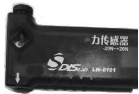

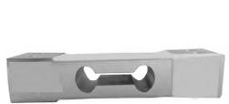  
图 1 DIS 力传感器  
图2 传感器元件

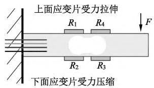

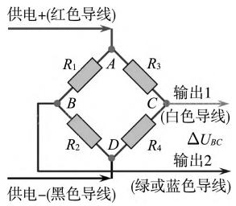  
图3 力传感器原理图  
图4 应变片接线图

通过以上实物和原理分析可知，力传感器主体是金属梁，在测量范围(传感器上均有标记)内的力作用在其自由端时引起梁的形变量实际测量很小，肉眼看不出变形.因为传感器应变片上下分布，当力F倾斜作用在传感器自由端时，垂直分力引起了梁上下弯曲，平行传感器的分力使4个应变片同时拉伸或压缩相同长度，4个电阻变化相同，所以平行横梁的力不影响输出电压差的大小.可见，力传感器实际只能测量垂直横梁作用的力.

了解力传感器的这些特征为我们进一步使用和微开发基于力传感器的相关应用提供了必要依据.

## 2 微开发案例及实验

DIS是一套精密实验系统，我们不可能对产品有本质性的升级和改变，但可以根据实验的需要DIY一些必要的配件拓展其功能，从而更好地为实验教学服务.观察力传感器，发现其测量挂钩是

通过一直径 3 mm的挂钩螺丝(如图5所示)与内部力传感器元件(如图2所示）相连接，挂钩螺丝上有一内嵌螺母的塑料可旋转紧固件.该紧固

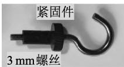  
图 5 力传感器挂钩

件与传感器元件间有较大接触面，一方面是为了让挂钩拧在传感器元件上不松动，同时较大接触面可以保证挂钩与传感器元件表面垂直，所以在后面紧固其他附件时也要用好该塑料紧固件.

## 2.1 细绳上的张力测量

通过前面分析可以知道，力传感器实际只能测量垂直传感器元件方向的力，所以直接拿一根绳子系在挂钩上所测的力并不一定是绳上的拉力，如图6所示圆锥摆或单摆模型中，力传感器测量的力实际为

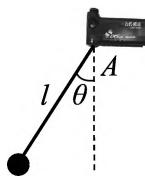  
图6 摆

T=Tcosθ，并不是绳上拉力 T.如何测 T 呢？ 只要保证绳上张力垂直传感器即可，可以在传感器前面加一个导引孔，忽略摩擦的情况下，传感器测

定的即为细绳上的张力.由图7可见，导引孔装置会受到绳侧向的力可能导致导引装置不稳定，所以导引孔

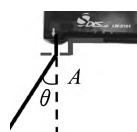

离传感器应近一些，可以拆除原挂钩，换3 mm带孔系线装置，也可以自己在 3 mm 平头螺丝顶端焊接一 2 mm 小螺母代替，如图8所示.导引装置可以根据传感器外壳尺寸用3D打印一个附件

图 7 导向示意图  
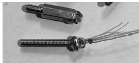  
图8 替换挂钩

装置固定在传感器外壳上，或直接用倒z字形铝合金等型材(或3D打印)打孔后用扎带固定在传感器上，注意导向孔的圆润并加一点润滑油.导引头内也可以嵌入水笔芯头增加硬度，根据线的粗细锉掉笔芯头部，还要注意去除笔芯头内部的微小弹簧，以便穿线并减小摩擦.根据传感器尺寸建模的导引外壳如图9所示，成品实验装置如图10所示.要注意传感器有一面是平整的，另一面有菱形条纹.建模时要根据不同传感器尺寸调整好套壳模型尺寸，以平整面作为尺寸参考，装配时要保证导向孔的共线性.用该装置测单摆细线拉力，小角度时相差不大，大角度时，有导向装置时力较大，与推理相同.

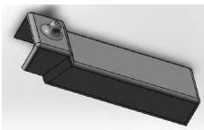  
图 9 导向孔建模

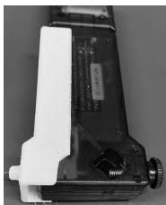  
图 10 导向装配

## 2.2 传感器“摆”

无线传输模块加入传感器后可以使传感器脱离数据线的牵绊，使传感器可以直接作为实验器材的一部分使用，可以让传感器和实验设备一起运动实时测量.如探究牛顿第二定律时，无线力传感器可以随车一起运动，不会因为数据线的牵绊影响加速度.无线模块的加入极大增强了实验的可操作性和实验设计空间.对于设计对称的力传感器，如朗威官

网发布的LW-F804 型力传感器(如图11所示)，可以直接悬挂做成摆类器材.我校现有的传感器 LW - F801 型中心偏移不可以直接悬挂，但可以卸下力传感器原挂钩，用一根

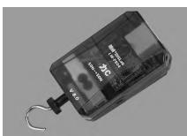  
图 11 力传感器

如图12所示3 mm×9mm的铜柱替换，在其上再用螺丝固定一根与传感器本体平行的轻质带洞硬杆，杆与传感器只通过铜柱连接.通过调节在硬杆上的两根悬线位置，可以让传感器水平，此时传感器的测量值就是自己的重力.可以把该装置做成摆动系统，也可以让其做圆锥摆、竖直面内圆周运动等等，运动过程中，等效摆长垂直传感器，力的测量值不需投影到等效摆长方向.考虑该装置无线配件等连接，也考虑传感器可能受伤害，故不适宜做大幅度运动.图13为其小幅度摆动时所得图像，基本满足振动规律，可以读出周期，大致求得重心离悬点的距离.

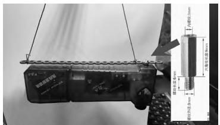  
图 12 悬挂力传感器

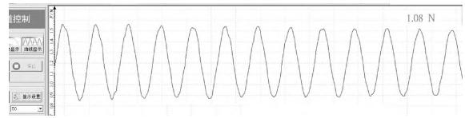  
图13 摆动力的图像

## 2.3 动态摩擦力测量

摩擦力的学习是高中力学学习中的重点和难点.对摩擦力的测量，我们侧重于对滑动摩擦力的研究，而对静摩擦力一般根据力的平衡知识进行理论推导，如斜面上静止物体受到的静摩擦力f=mgsinθ，斜面上静摩擦不容易直接测量.如图14所示，若将力传感器悬空固定在一个“L”形轻质物体上，传感器只能测量垂直方向也就是平行斜面方向的力，对轻质物体而言，重力沿斜面方向分力很小，而轻质物体沿斜面方向合力为0，所以传感器上力的示数大小就等于其底面受到的摩擦力.理论上讲，“L”形物体相对越轻则误差越小.要考虑传感器必须用无线模式，加上无线模块后传感器总体重心较高，一定倾角后容易翻倒，所以轻质物底座不能太小.另外，要保证传感器与轻质物的垂直固定和平行悬空，材料不能太薄，否则容易变形不能保证垂直关系.综上考虑，建模时采用局部加强的方式，整体厚度1.2mm左右，在传感器固定位置植入2.5mm厚度加强筋，也将Φ3 mm固定孔进行延伸与加强，切除多余部分，整体质量大概在11g.固定时，在较长螺丝上与传感器固定的一端放上带胶圈的螺母以保证螺丝与传感器元件垂直不松动，再用两个单螺母夹在固定孔的两边保证不松动，装配件如图15所示.力传感器装配后放置在水平长木板上，木板上固定一角度仪一起装配后如图16所示.

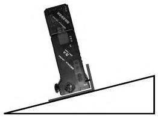  
图14 装配示意图

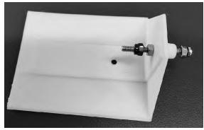

图 15 装配件  
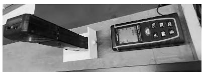  
图 16 实验器材装配

打开传感器通用软件，在木板水平放置时调零力传感器，传感器示数用图线显示.缓慢抬升长

木板的一端看到传感器上的力随角度的增大而增大，如图17所示.到某一角度时突然下降后开始下滑，静摩擦力变成滑动摩擦力，最大静摩擦力

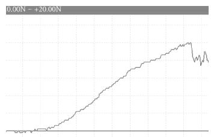  
图 17 摩擦力随倾角变化

大于对应滑动摩擦力.

打开角度测量仪器，缓慢抬升木板一端，“点击记录”对应的角度和力传感器示数，用公式算出角度的正弦值，图18(a)中下部分表格，选择绘制力和正弦值图线并进行直线拟合，如图18(a)上部分所示.可见拟合曲线斜率系数k=1.062.由理论推导f=mg sinθ可知，该处斜率的意义为 mg，经测量，传感器及装配件的质量为121.89g，若g取9.8m/s²，则理论值为 $k = 1 . 1 9 5$ ，实验误差达到11.1%，明显偏大.给传感器增加配重，将一个铁夹固定在固定孔，总质量达到344.11g，再次实验得到如图18(b)所示图线，拟合得到 $k = 3 . 4 1 1$ ，同理可得实验误差为1.18%，与理论值相近.可见配件相对质量对实验影响较大，若能运用更轻而坚硬的材料，如碳纤维等作配件材料，底面还可以更换一些不同材质，应该可以进一步小误差进行其他实验探索.

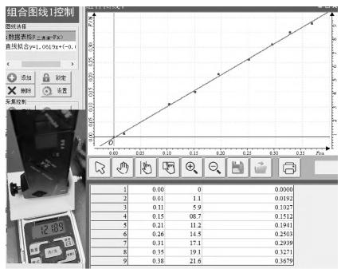

(a) 小质量时  
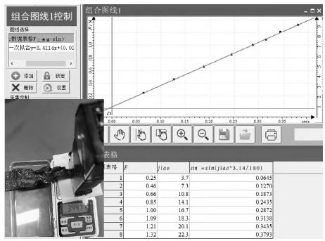  
(b) 大质量时  
图 18 f 与 sinθ 关系

另外，该装配件(如图15所示)底部还留有平头沉孔，可以将传感器平行底边固定后，测支持力随角度的变化.

## 2.4 竖直面内绳球模型竖直分力测量

竖直面内圆周运动问题是高中物理教学中的典型模型.有一个案例问题示意图如图19所示.一质量为M的人，手执一根长为l的细绳，细绳的一端拴有质量为m的铁球，使球在竖直面内做圆周

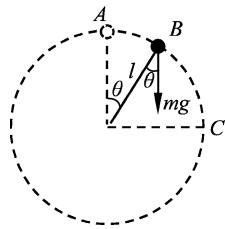  
图 19

运动，若球在最高点时速度为 $\boldsymbol { v } _ { 0 }$ ，则圆周运动过程中，地面对人的支持力最小值为多大？

对该问题的解答，许多学生认为球在最高点时，对人的拉力向上，所以认为此时地面对人支持力最小，但也有人认为，图19中小球从A到B的过程速度在增大，重力沿绳分力在减小，所以绳子上拉力在增大，但绳与竖直夹角在增大，所以难以判断绳在竖直方向分力如何变化.能不能用实验来探究一下呢？本实验要求力传感器能测量绳子在竖直方向的分力，所以要将传感器元件水平放置，绳子作用其上时传感器测得的力即为竖直分力，但传感器与竖直圆平面共面，不能完成完整圆周运动，所以笔者开发了如图20所示装置.在一个L型轻质铝合金材料上固定两个直径3 mm的轴，也可以直接用一个直径3 mm长螺丝弯折成L形，一端拧入传感器并紧固，另一端套两个轴承以减小摩擦，将一端系小球的细绳固定套在轴承上.打开DIS通用软件，在细绳松弛的情况下调零，采样率选择50 或 100 Hz，先让传感器先开始采集数据，然后给小球一个水平方向的初速度，让小球在竖直面内做圆周运动，力传感器数据用图像显示，截取两段图像如图21所示.

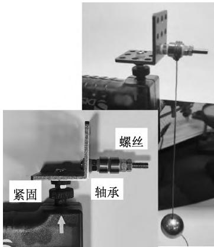

图 20 实验装置  
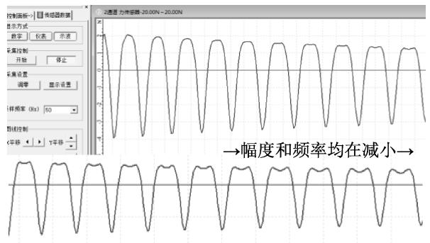  
图 21 力传感器采集图像

由图可见，因为阻力，图像幅度和频率均在减小，说明小球通过某固定点(如最高点)的速度在逐渐变小.随着速度的减小，原来在最高点单峰逐渐变成了双峰，说明随着最高点的速度逐渐减小，拉力竖直方向分力的最大值从最高点逐渐向两边转移，也即最大值并不一定总出现在最高点，这与相关文献的理论推导研究吻合.1,2进一步用可视化的理论计算得到的图线进行验证：在图19中，设A 点速度 $\boldsymbol { v } _ { 0 } , B$ 点绳子与竖直夹角为θ，速度为v，可得细绳在竖直方向的分力 $F _ { y } = F \mathrm { c o s } \theta =$ $- 3 m g \cos ^ { 2 } \theta + \biggl ( 2 m g + \frac { m { v _ { 0 } } ^ { 2 } } { l } \biggr ) \cos \theta$ ,其中 $_ { \mathscr { V } _ { 0 } } \geqslant \sqrt { g l }$ 可见该式对称轴对应的极值与 $\boldsymbol { v } _ { 0 }$ 取值有关.为了直观看出其变化关系，可以取 $m = 0 . 1 \mathrm { ~ k g } , v _ { 0 } =$ $\sqrt { n g l } \left( n = 1 , 2 , 4 , 6 \right)$ 分别代入上式，用在线函数FooPlot 分别画出 $y = - \ 3 \ * ( \cos \left( \it { \Delta } x \right) ) \ \cdot \mathrm { 2 }$ 十$3 \cos ( x ) , y = - 3 * ( \cos ( x ) ) \cdot 2 + 4 \cos ( x ) , y =$ $- 3 * ( \cos ( x ) ) \cdot 2 + 6 \cos ( x )$ 等，图像如图22所示.可见，当小球在最高点速度 $_ { \mathscr { V } _ { 0 } } \geqslant 2 \sqrt { g l }$ 时，在圆心上方是单峰，两侧单调减小.当小球在最高点速度$\sqrt { g l } \leqslant v _ { 0 } < 2 \sqrt { g l }$ 时，在圆心上方出现了对称的双峰.实验结果相当于是理论图像连续变化的贴图，二者十分吻合.

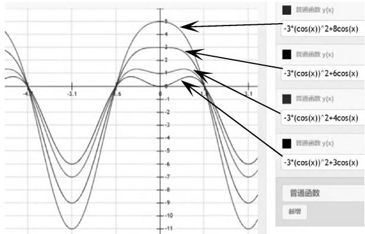  
图 22 Fᵧ 随角度变化图

## 2.5 竖直面内匀速圆周运动竖直分力测量

与以上案例类似的打夯机模型如图23所示，区别是轻杆连接在匀速转动的电动机上，地面何时支持力最小呢？是否与前面案例类似？

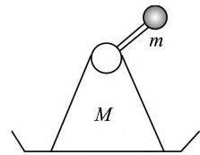  
图 23 打夯机模型

该案例也是讨论竖直方

向力的极值问题，也可以用实验探究。按问题需要的器材如图24所示，在L形底座上固定一个3 mm螺丝，套上紧固件用于与力传感器连接，在L形底座侧面固定一3～6 V减速电机，出轴可以加一个转接头，转接头上接一长螺丝.该螺丝上固定一个大螺母或小球作为重锤，长螺丝上加几个小螺母用于调节重锤到转接头的距离，从而改变转动半径.这里用减速电机是因其扭矩比较大，能保证重锤做匀速圆周运动.

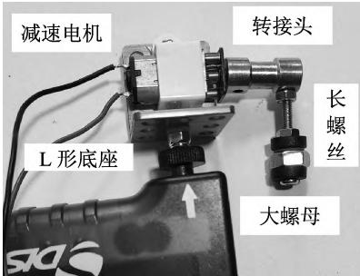  
图 24 打夯机模型装配

同样将传感器水平向上固定，电机接可调电源，用DIS 测量力，在系统静止时力传感器调零.这样可以使杆在轴心面以上时力显示为正，杆在轴心面下时为负，与杆位置对应.在电机转速稳定后，用 DIS 系统描绘传感器上随电机转动的力的变化图(如图25所示).从图像可见，周期一致说明电机匀速率转动，最高点只有一个峰值，说明在最高点时杆在竖直方向的分力最大，此时地面支持力最小.换用不同电压，电机转速不同时，图像基本与图25相似，说明打夯机模型与绳球模型不同，匀速转动的球处于最高点时地面支持力最小，与球速无关.实验结果与理论推导一致.[3]

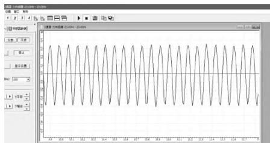  
图 25 匀速转动数据图形

## 3 小结

## 3.1 关于误差

DIS 系统是比较精密的仪器，笔者的微开发出的器件在测量过程中一定会有误差，如前2.3小节摩擦力测量中，因为装配件本身有质量，受重力，理论上摩擦力并不等于传感器示数，但当配件质量相对较小可以忽略时，仍可以继续探究相关变化规律.就像电流表理论上内阻为0，但实际一定会有内阻而导致测量误差，但仍然使用其进行测量，只是要控制好误差.

另外，在有加速度的问题探究中，传感器即使不挂物体，其也会有示数，这是因为力传感器元件(如图2所示)头部本身的质量，也需要力提供有加速度.若有其他装配件同样也需要力提供加速度，也会有误差，但这些质量如果为已知值时，应该可以在软件上进行补偿，请厂家形成专用软件，就像已知电流表内阻后进行理论补偿一样.

## 3.2 注意安全

在微开发过程中要注意人身安全、仪器安全等.如前例中力传感器量程为一−20～20 N，在量程内力传感器的梁(如图2所示)几乎看不出形变，但超量程的力可能造成传感器塑性形变而损坏.开发过程中可能需要切割、打孔、焊接等加工，要注意人身安全.

## 3.3 可以变通

根据自身探究需要进行微开发时，首先要熟悉其测量原理，再根据实际情况进行开发改造，可以就地取材，灵活变通.如在2.5节中，如果没有L形型材，也可以放在一个平台塑料板上，或者直接拿长螺丝折成L形，将电机固定其上也行，只要能达到探究要求即可.

## 参考文献：

[1] 李铁.对竖直平面内圆周运动绳子张力正交分量的极值讨论[J].湖南中学物理，2021,36(11):73—74.

[2] 李宁，丁庆红，肖伟华.一个竖直面轻绳模型圆周运动问题的深入分析[J].物理教师，2019,40(5):89—91.

[3] 罗定浩，辜振军.竖直平面内圆周运动的极值问题分析[J].物理之友，2016,32(9):45，48.

（收稿日期：2024-10-13）

