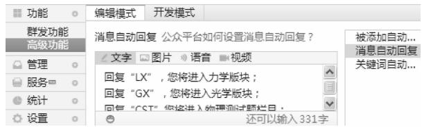
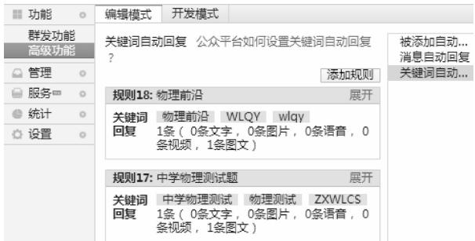
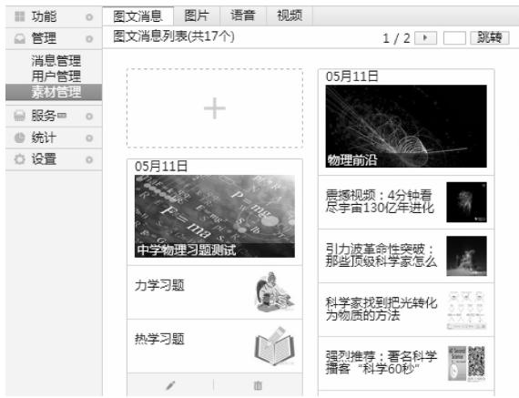
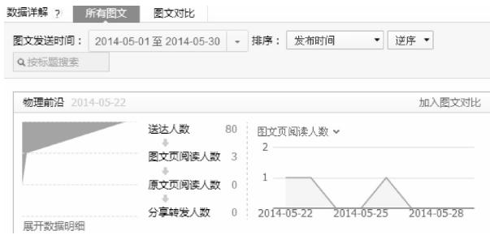

# 基于微信的中学物理教学互动平台设计＊

贾伟尧 杨珍珂

（西南大学物理科学与技术学院 重庆 400715）

摘 要 ： 随着网络通信技术和智能网络终端的发展 ，一系列以智能手机 平板电脑等为网络终端的社交软件已逐渐延伸到生活的每个角落．本文举例介绍了如何用微信这一社交软件来设计图 文 声 影并茂的物理教学互动平台 从而对中学物理教学的现代教育技术改革提供了一个新的方向．该平台对其他学科也有一定的借鉴意义

关键词 ： 社交软件 ；微信 ；辅助教学 ；互动平台

目前 中学物理课堂教学普遍是教师通过语言 肢体板书等多维度的教学方式将知识系统地呈现在学生面前课堂之外 师生往往通过电话沟通 除了需要昂贵的电话费外 仅通过电话语音这种一维交流方式 难以把一些较为抽象的物理问题表述清楚．视频电话虽然也是一个不错的选择 但是它也受到资费 位置和清晰度等各种因素的限制．因此 要实现富有成效的物理教学辅导 需要探求一种多维度 全方位的教学互动平台．随着网络技术的发展 ，基于无线网络的免费社交软件 具备了便携性 开放性 低成本等构筑理想教学互动平台许多优点等．目前主流的社交软件很多 这些软件虽然可以实现资源共享和教学互动 但存在诸多缺点 如用户管理过于开放 不利于虚假消息 广告等的过滤 ； 互加好友需设置访问权限 ， 导致验证维护等费时费力 不能预先进行顶层设计或规划平台基本结构．针对上述问题 微信运营商专门为用户打造一个免费公众号 在克服上述缺点的同时 实现和特定群体的文字 图片 语音 视频等多维互动．由此可见 ，微信具备了在互动教学中发挥重要作用的潜质

## 1 基于微信的公众平台在物理教学上的应用案例

我们以公众号“物理教学之家”为例 介绍如何利用“微信公共平台”搭建物理教学互动平台

## 1．1 巧用自动回复

教师可在平台的“高级功能→编辑模式”下设置自动回复．自动回复分为被添加自动回复 关键词和消息自动回复3种模式．教师可事先把回复内容设置好 在特定的情况下可自动回复给学生

被添加自动回复 ： 这里的设置很重要 ， 每当有新用户关注平台订阅号时 系统就自动发送事先设计好的内容给新关注用户．学生可以通过自动回复内容获取下一步操作的关键词 输入这些关键词后 就可接收教师设计好的教学素材 进行选择性学习

消息自动回复 ：若学生发送了教师未设定的关键字或无效信息 ，系统将发送这里的内容给学生 ， 用于提醒和引导学生使用正确的关键字进行查询 如图1

关键词自动回复 ：这里是微信公众平台的信息交换中心 ，所有需要双方交互的内容都能自动实现．教师可以把预设关键词的教学素材（例如图文 语音和视频等）自动回复给发送相应关键词的学生．学生发送关键词“WLQY”后就能收到物理前沿的图文消息 如图2

  
图1

  
图2

## 1．2 关键词回复与素材管理的珠联璧合

关键词回复功能在物理互动教学平台中担任了重要角色 ，它避免了教师重复劳动．教师可将教学内容做成素材库 通过关键词回复把练习题 好书推荐 专题讲座等多种形式的辅导素材展示给学生．但关键词回复要想充分发挥作用 必须建立一个强大的素材库 这就需要与素材管理功能联合使用．例如 图3中有两个素材 一个是“中学物理习题测试” 一个是“物理前沿” 要想让学生学习中学物理习题 首先通过关键词自动回复功能引导学生在微信客户端回复“中学物理测试”或者“ZXWLCS” 平台就会把物理测试题推送给学生．同样的方法 如果学 生 回 复“WLQY” 就能实时接收到有关物理前沿的图文消息回复．教师还可以根据教学计划 点击素材管理界面中的“＋”号 制作大量语音或视频素材 结合关键词回复推送给学生

  
图3

## 2 点对面的互动———消息实时群发功能

消息自动回复功能虽可节省大量时间 但教师设置的素材不能覆盖学生的所有问题．对不包含关键词的问题平台无法调用素材库自动回复 教师可进入消息管理模块 进行手动回复．还可以把比较典型的问题标记为星标消息进行收藏．这些都是点对点的回复 如果多数学生问同样问题 ，就要重复回复．其解决的办法有两个 ： 一是新建一个“常见问题解答”素材进行统一解答 学生在客户端输入“常见问题” 平台就会收到这个素材 ； 二是把问题详细的阐述 通过群发功能发送 实现点对面的交流

群发功能不但可以进行典型例题分析 常见错误分析常见问题解答等专题指导 还可以发布习题 布置作业等群发前 教师可在教学平台上通过用户管理功能 将学生按班级 专业 基础的好坏 性别或者地区等进行分类，设置特定的群发人群．群发内容可以是文字 图片 语音 视频等

## 3 巧用统计功能进行教学效果评估

## 3．1 用户分析

教师可以通过用户分析功能对所有学生 特定组别学生 个别学生的参与讨论次数等学习情况进行统计分析

## 3．2 图文分析

教师还能通过对图文的送达人数 阅读人数 分享转发人数等关键指标进行统计 了解学生对教学素材的关注程度 为后续教学素材的设计指明方向

## 3．3 图文对比

教师可以通过对不同素材的分析结果进行对比 筛选出学生感兴趣的教学素材．通过对消息的发送人数 次数和人均发送次数等关键指标进行分析 了解学生的积极性和参与情况等 从而对教学进行评估 如图4

  
图4

由于中学生自制力差 教师还可以利用上述分析功能 制作报表反馈给家长 让家长了解孩子参与互动学习的情况 ，督促学生学习

## 4 设计教学主题 师生共同讨论———朋友圈功能

在上述教学互动平台中 ，学生的问题只有教师才能看到 虽然可以避免虚假消息和广告 但学生之间缺乏交流学生和教师的互动也受到一定限制 ， 所以 ， 通过微信朋友圈对互动平台进行补充．教师可以在圈中发布各种形式的教学主题 引导学生参与讨论．师生共享评论内容 未评论的学生也能查看问题与回复 ， 从而提升参与率和互动效果

作为物理教育工作者 物理教学需持续地渗透到学生生活．教师不仅要对物理学知识有深刻的钻研 还应结合现代技术发展趋势 充分利用现代化社交软件具有的个性化 开放化 智能化等特点来服务教学．通过微信公众号和无线网络建立互动教学平台 以最有限的资源 实现教师教学成本的最小化和学生学习效率的最大化 使学生学习活动和教师教学活动更加多样化．另外 本文所提设计方案也适用于其他学科

（收稿日期 ：2014－06－03）
