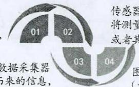
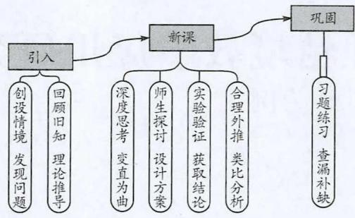
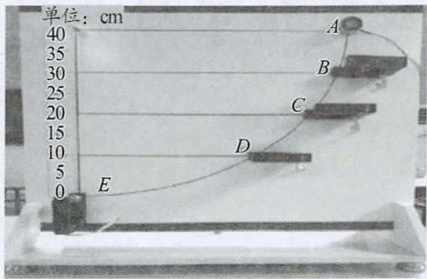

# 基于数字化的物理实验教学研究——以“机械能守恒定律”为例

张石磊

通 化 市 第 一 中 学 校 吉 林 通 化 1 3 4 0 0 1 ）

文 章 编 号 ： 1 〇 〇 2 2 1 8 X （ 2 0 2 1 ） 0 4 0 0 2 2 －0 2

中 图 分 类 号 G6 32 41

文 献标识 码 B

摘 要 对数字化信息系统构造与原理进行了分析，利用现代信息技术对物理实验课堂教学设计进行研究，推动物理实验向数字化发展，促进教学方式、学习方式、师生互动的改变，实现物理实验与信息技术的有机结合，构建高效率、高质量的实验课。数字化环境下的物理实验教学有助于学生理解、掌握物理知识，使学生把握现代科技与物理之间的联系，推动学生的全面发展。

关 键 词 数 字 化 信 息 系 统 物 理 实 验 教 学 设 计

数字化信息 系 统 已 渗透并 应用 于教育领域 数字化物理实验 紧 随数字 时代 孕 育 而生 课堂教学 活 动也体现 出 数字化特征 数 字 化 环 境下 的 物 理实 验课 堂是多元化 信息 化 高 效率 的课堂 实 现物理实验与 信息 系 统 的 有 机结合 促成物理学 习 走 向 深度

## 一、数字化信息系统的构造与原理

数字化信息实 验 系 统 分 为 图 像计算 器 与 计算 机辅助两大类 两大 类 型 实 验 统 的 核心 存 在 差 异 分别 为 图 形计算器 与 计 算 机 系 统 但 都 由 实 验仪 器 传感器 以 及数据采集 器组成 旨 在 获 取精 度 较高 的 物理数据 。 数字化信息 实验系 统 的 构成如 图 1 所示 。

被测 对象数字化 实 验需要数化方法测得的 “物理量”

处理传感器传输而来的信息并以数字 图像 形式呈现于数字 图像 屏幕

传 感 器将测量信息转化为 电信号他形式的信息输 出

图 1

可知 甄选实验系 统通 常 依据 数据采 集器处 理信息 传感 器传输 而 来 的 需 求 计算 机 系 统分为 硬 件与 软件两类 其 中 计算机软件 被广 泛地应 用 于物理 验 通 过专业 软件 处 理 数据 采 集 器 输 人号 并呈 现 于 屏 幕 上 这 无 疑 为 推 动 物 理 实验趋于 数字化 智 能化 的 推手 也是满 足“重 视信息 技术与教育改革影 响 ” 的 外显 。

## 二、数字化环境下物理实验教学设计研究

新课程背景下 实验课堂 中 教师与学生 的地位 发生 了 显著变 化 数字化物理实 验课堂更强调 突 出 学生的 主体地位 教师是学生学 习 活 动 的 指导者 参与 者点拨者 促成学生对物 理知识 的 理解与掌握 下 面 以“机械能守恒定 律” 为 例 研究数字化环境下物理实验课堂 的 引 人 新课 巩 固 形成“机械能守恒定 律” 的 教学流程 如 图 2 构 成 教 与 学 统一 的 教 学 过 程 促 使课堂从“关注教” 转 向 “关注学”

问 题的解决和 反思 改进等一系 列 的 过 程 从而实 现 概念 改 变 和 知 识 的 迁移 我 们 应 该 在 了 解 学 生 的 认知 特点 和 已 有 知识经验 的 基础 上 做 到 知 己 知 彼 百 战不 殆 也要精心设计教学环节 激发学 生学 习 兴趣 ． 注重培养学 生 科 学 思 维 科 学探 究 以 及 科 学 态 度 的 培养 从 而升 华 到 学 生 的 社会责任和 家 国 情怀

  
图 2

## 1．引入——以创设情境为关键

基于数字化 的 物 理 实验 教 学 设 计要 贯 彻 以 学 生为本 的 教 学 理 念 促 成 学 生 从 “ 知 之 者 ” 转 为 “ 乐 之者” 引 人实验 的 关 键 是创 设 情 境 创 设 情 境不 是 仅关注学生 的 兴趣点 而是要 寻找 实验 内 容 与 学生兴趣的 契 合点 “机 械能 守恒 定 律” 的 引 人 环 节 教师 播 放“蹦 极 ”视频 与 GIF 动 图 创 设生 活 化 的 情 境 让 学 生从生活 现象 出 发 ， 讨论 动 能 $( E _ { \mathsf { k } } )$ 与 势 能 $( E _ { \mathfrak { p } } )$ 之 间 的关系 ， 使学生 回 顾 动 能 定 理 与 功 能 关 系 ， 点 拨学 生 以“ 自 由 落体运动 ”为 例 进行理论推导得 出 新公式 即

$$
\begin{array} { c } { { \displaystyle { \frac { 1 } { 2 } } m { { v _ { 2 } } ^ { 2 } } - \frac { 1 } { 2 } } m { { v _ { 1 } } ^ { 2 } } = m g h _ { 1 } - m g h _ { 2 } } \\ { { \displaystyle { \frac { 1 } { 2 } } m { { v _ { 1 } } ^ { 2 } } + m g h _ { 1 } = \frac { 1 } { 2 } } m { { v _ { 2 } } ^ { 2 } } + m g h _ { 2 } } \end{array}
$$

${ \boldsymbol { v } } _ { 1 }$ $h _ { 1 }$ 分别为物体初状态的速度与高度，${ \boldsymbol { v } } _ { 2 }$ $h _ { 2 }$ 分别为物体末状态的速度与高度。

让学生就新公式给 出 一个定 义 生成一条新 的 规律 。 这样 ， 不仅强 化学 生 对 能 量 转 化 的 理解 与 掌 握还 能加 强对能量 守恒 的认知 潜 移默化地 提升学 生 的逻辑思维 与 推 理 的 能 力 物 理 实 验 课堂 生 活 化 很 大程度 上 消 除学生 与 知 识 的 隔 阂 使学生 深 刻 地 体 悟 物理与 生 活 的 密切关联

## 2．新课——以师生互动为核心

基于数字化 环境 的 物理 实 验课 堂 中 ， 师 生 生 生之 间 的 关 系 发 生 了 诸 多 变 化 ， 最 为 突 出 的 是 即 时 互动 ， 让学生 始 终 处 于 课 堂 的 中 心 ， 教 师 起 到 启 发 引导 、 点 拨 的作用 。 “机械能守恒定律”的新 课环节 教 师演示“荡秋千 ”运 动 让学 生 在 观 察 的 基 础 上 分 析 思考 $E _ { \mathrm { k } }$ 与 $E _ { \mathfrak { p } }$ 之间 的 相 互 转 化 ， 点 拨 学 生 从 运 动 前 、 后的 总 机 械 能不 变 的 视 角 进 行思 考 ， 提 出 “ 小 球 摆 动 过程 中 机械能是否守恒” 这一 问 题 引 导 学生认识到 “ 小球”摆动 会 因 空 气 阻 力 ， 产 生 能 量 损 耗 ， 鼓 励 生 生 交流 、 师生 探讨 ， 选 定 生长点 设计“测 量摆球机 械能大小”实 验 ， 进 而 明 确 需 测 量 的 物 理 量 选 定 实 验 器材 电 子秤 尺子 打点计时器（光电门），确定实验

装置，如图3。

  
图 3

在学生 明 确 实验器材 与实 验方 案 的 基础 上 教 师进 行规范化 的 演示实验 定量验 证 了 系 统 的 机械 能守恒 使学生更好地 理 解 机 械 能 助 力 他 们 掌 握 数字 化实验 的 方法与技巧

## 3．巩固——以迁移应用为重点

习 题练 习 是 检测 和 巩 固课堂知 识 的 有效措施 更是客 观 了 解 学 生 学 习 状 况 的 有 效 途 径 通 过 习 题 练习 有助 于教师总 结 归 纳 为 教 师 的 教 提 供 改 进 的 方向 教师设置 的 习 题不能 囿 于 知 识理解 与 掌 握 而是使生 活情境与 机械能 守恒知 识联 系 起 来 形 成实 际 问题 让学生从生活 走进物理 从物 理走 向 社会 加 强 学生对物理知识 的 迁 移应 用 以 生 活 实 际 为 背 景 的 问题 教 师要 注重拓 展 学 生 的 视 野 让 学 生 体 悟 物 理 知识与 生 产科技之 间 的 联系 同 时 渗 透 “ 节 约 资 源 ， 保 护环境 ”的 意识 推动学生全面 健康 发 展

## 三、结语

基于 数字化 的 物 理 实 验 为 学 生 提 供广 阔 的 思 考空 间 丰 富 的 学 习 资 源 促使教 师从“ 关注 教 ”转 向 “关注学 ” 学生在 师 生 探讨 生 生 交 流 过 程 中 理 解 掌 握物理知识 明 确 现代科 技 与 物 理 知 识 之 间 的 关 联 激发进一步学习 物理 的兴趣 与 欲望 促 成 物 理核 心 素养的 落实 达 到 “立德树人” 的 育 人 目 标

## 参 考 文 献

［1］郑秀玲，刘小兵.实验支持下的问题驱动式学习——机械能守恒定律的别样教学[J].物理通报,2020(10):31-34.

［2］杨远萍，高翔.基于学习心理和认知建构的逻辑确立学习进阶——理论推演和实验探究并重重构机械能守恒定律的实践路径[J].中学物理教学参考（上旬·高初中）,2020(9):1-8.

［3］孙宜峰.运用数字化实验方法优化探究性实验教学——以学生实验《探究影响浮力大小的因素》教学设计为例[J].理科考试研究,2020(04):51-53.

本文编辑：刘富民
