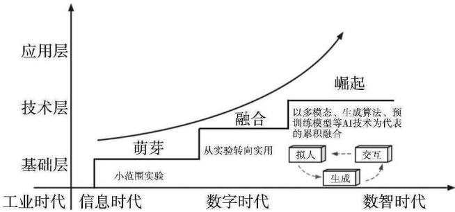
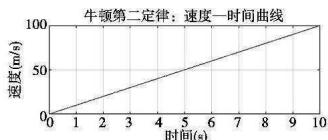
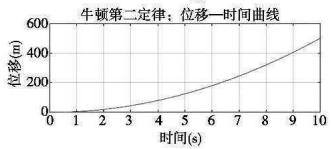
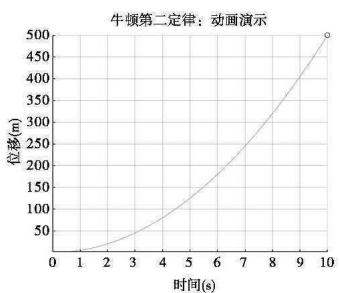
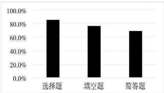
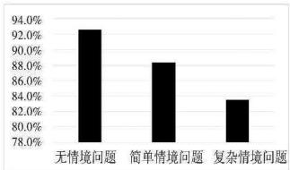

2024 年 5 月 第 09 期

# 张力与限界：生成式人工智能在物理教育中何以何能

荆鹏

（东北师范大学教育学部 吉林 长春 130024）

摘要：AIGC 技术基于漫长的研发历程，实现了从萌芽到融合再到崛起的范式转变。相较于人文社科领域的理论分析与意义探讨，关涉自然科学的对话，尤其是关于基础教育阶段物理教育领域内容时，AIGC 的现实表现亟需探查。研究选取搭载 GPT-4 的 BING AI 作为测试对象，从教、学、评三个维度进行多轮测试后发现，现阶段其在物理教学场景中已初具实践价值，但存在应答真实性缺失、易致思维惰化和诱发伦理安全等风险隐忧。在物理教育中使用 AIGC 应聚焦学科育人价值，警惕教学意义被技术侵蚀；明晰人技关系边界，防范教学主体的思维异化；延拓技术应用场景，革新教学过程的时空范式。

关键词：AIGC；物理教学；核心素养；教育数字化；物理教育

中图分类号：G633.7

文献标识码：A

文章编号：1008-4134（2024）09-0006-06

自 2022 年底 OpenAI 公司研发的 ChatGPT 问世以来，其凭借超乎预期的强大能力，在全球掀起了现象级的风暴。生成式人工智能（Artificial Intelligence Generated Content，以下简称 AIGC）爆火的当下，以文心一言、通义千问、星火认知、智谱清言等为代表的本土大语言模型也迈入蓬勃发展期。习近平总书记指出，要积极推动人工智能和教育深度融合，促进教育变革创新［1］。在教育领域，AIGC 其呈现出的认知性强、通用性高等强大能力引发了教育工作者和研究者的持续关注，为教育数字化转型携至来了新的机遇。纵观现有研究，主要集中在技术风险治理［2］、对传统教育模式的冲击与变革［3］、语言教育［5］等方面，在物理教育中的实践与理论研究尚存空白。鉴于此，梳理 AIGC 的迭代历程和呈现特征，立足物理学科属性探查 AIGC 在教学过程中的实然表现与现实挑战，旨在为 AIGC 赋能物理教学提供参考。

## 1 祛魅：AIGC 的迭代历程及其内涵属性

AIGC 被认为是继 PGC、UGC 之后的新型内容创作方式，经过半个多世纪的迭代发展，AIGC 技术和其产业生态步入了发展快车道。明晰 AIGC 的发展历程、内在机理与特征属性，是科学规范使用 AIGC 赋能教学过程的基本前提。

## 1.1 AIGC 的迭代演变

AIGC 技术基于漫长的研发历程，实现了从萌芽、融合再到崛起的迭代演变。如图 1 所示，在二十世纪中后期，从图灵（Alan Mathison Turing）提出图灵测试以判断机器是否具有人类智能［6］，到 1966 年的第一款对话型机器人 ELIZA 问世，再到上世纪 80 年代中期 IBM 的实验转录系统 Tangora，受限于技术水平，AIGC 此段时期仅在小范围进行调适实验。随后一段时期 AIGC 开始从实验性转向实用性研发并进行技术积累沉淀，如 2012 年微软展示全自动同声传译系统，可以将英文语音自动翻译为中文语音［8］。同时，机器深度学习算法持续迭代，加速了 AIGC 的蓬勃发展。从古德费洛（Ian J. Goodfellow）的生成式对抗网络（GAN）提出，到 StyleGAN、DCGAN 模型和 Stable Diffusion，AIGC 逐步在文字、图像、视频等多种形式内容的生产上发挥作用。近年来，资本市场的大量资金流入为全球范围内 AIGC 的颠覆式增长注入了动能，以多模态生成算法、预训练模型等技术为代表的累积融合，催生了 AIGC 的大爆发，刷新着包含教育领域在内的各行业的认知。

## 1.2 AIGC 的特征属性

作为新型内容生产形态，AIGC 利用机器学习、计算机视觉、自然语言处理、优化算法等技术来自动生产内容，并随着训练数据增长和模型的规模扩增，其正在进行从感知理解世界层转向创造生成世界层的跨越。从技术层面而言，AIGC 对数字内容的生产加工可分为三个维度：一是数字内容孪生，即将现有的数字内容从现有维度映射到另一维度，也就是说，对内容进行智能转译或现实增强；二是数字内容编辑，即通过在对内容的理解基础上进行属性控制和编辑修改；三是从海量数据中持续对抽象概念进行学习，并通过算法组合形成原创内容，典型的应用场景为文本、图像、音视频的生成，此维度也是在教育领域指涉最为广泛的应用。这一过程涵盖数据收集、数据处理、模型训练和内容生成四个环节。AIGC 在提高内容质量、效率和创意，以及形塑数字内容创生与交互新模式方面蕴含巨大潜能，呈现出交互性、生成性和拟人性的特征属性。具体而言，一是以对话应答革新叙事逻辑，具有交互性。AIGC 可根据用户在预设的不同语境和话题下的输入或目标来生成相应的内容，同时通过反馈来调整或改进对话内容，有效提升用户的交互体验。二是以预训优化革新叙事手段，具有生成性。AIGC 经由海量数据和科学模型来训练和优化，可获得包含且不限于文字、图像、视频等形式生成结果的持续改善。三是以共情神入革新叙事语法，具有拟人性。AIGC 的内容生成不啻为简单复制或模仿已有内容，而是要赋予内容一定的"情感"，在一定程度上，其可以模拟人的思想、情感、创造力等表征，继而创作生成具有"人情味"的内容。

  
图 1 AIGC 的迭代历程

## 2 入场：AIGC 在物理教育中的价值旨趣

AIGC 的内容生成、话语理解、知识问答、逻辑推理等维度的能力在物理教育领域具有巨大的应用潜能。本研究选取搭载 GPT-4 且具有联网功能的 BING AI 为对象，从教学层面、学习层面和评价层面对其进行多轮测试。

## 2.1 教学层面：AIGC 何以赋能教师专业发展

AIGC 的迅猛发展将对教师教学的各环节要素产生结构性影响，如在模拟课堂情境、创生教学资源等方面帮助教师开展差异化教学，并提升教师的工作效能，为其采用高效、开放、多元化的教学方式提供了可能。教师作为 AIGC 融入物理教育的关键利益相关者，亟待具备运用 AIGC 技术工具提升教学的知识技能与创新教学方式手段的素养。因此，厘清 AIGC 何以赋能教师专业发展，以探索构建赋能路径，既是当务之要亦是长远所需。

## 2.1.1 模拟课堂情境测试

AIGC 能实现根据教学需求定制化模拟课堂情境，包括但不限于学生的情感、互动和参与度。这种模拟具有针对性、灵活性和逼真性，可辅助教师多视域了解学生思维方式、常见问题和兴趣所在，为教学设计提供有益参考。本研究先对不同类型学生的划分标准予以说明，使 BING AI 模拟六类学生进行时长为 45 min 的"牛顿第二定律"的讲授课，发现其可以对不同类型学生的表现进行高效模拟（见表 1），并以学生身份提出了具有一定启发价值的问题，这为实现个别差异化教学提供了有效参考数据。

表 1 模拟不同类型学生在课堂上的表现
<table><tr><td rowspan=1 colspan=1>模拟学生类型</td><td rowspan=1 colspan=1>提问次数</td><td rowspan=1 colspan=1>回答问题次数</td><td rowspan=1 colspan=1>无法理解次数</td><td rowspan=1 colspan=1>参与度</td><td rowspan=1 colspan=1>兴趣度</td><td rowspan=1 colspan=1>自信度</td></tr><tr><td rowspan=1 colspan=1>知识水平高、高兴趣</td><td rowspan=1 colspan=1>5</td><td rowspan=1 colspan=1>5</td><td rowspan=1 colspan=1>1</td><td rowspan=1 colspan=1>高</td><td rowspan=1 colspan=1>高</td><td rowspan=1 colspan=1>高</td></tr><tr><td rowspan=1 colspan=1>知识水平高、低兴趣</td><td rowspan=1 colspan=1>2</td><td rowspan=1 colspan=1>3</td><td rowspan=1 colspan=1>2</td><td rowspan=1 colspan=1>低</td><td rowspan=1 colspan=1>低</td><td rowspan=1 colspan=1>高</td></tr><tr><td rowspan=1 colspan=1>知识水平低、高兴趣</td><td rowspan=1 colspan=1>4</td><td rowspan=1 colspan=1>1</td><td rowspan=1 colspan=1>4</td><td rowspan=1 colspan=1>中</td><td rowspan=1 colspan=1>高</td><td rowspan=1 colspan=1>低</td></tr><tr><td rowspan=1 colspan=1>知识水平低、低兴趣</td><td rowspan=1 colspan=1>1</td><td rowspan=1 colspan=1>1</td><td rowspan=1 colspan=1>5</td><td rowspan=1 colspan=1>低</td><td rowspan=1 colspan=1>低</td><td rowspan=1 colspan=1>低</td></tr><tr><td rowspan=1 colspan=1>知识水平中等、高兴趣</td><td rowspan=1 colspan=1>3</td><td rowspan=1 colspan=1>4</td><td rowspan=1 colspan=1>3</td><td rowspan=1 colspan=1>中</td><td rowspan=1 colspan=1>中</td><td rowspan=1 colspan=1>中</td></tr><tr><td rowspan=1 colspan=1>知识水平中等、低兴趣</td><td rowspan=1 colspan=1>2</td><td rowspan=1 colspan=1>2</td><td rowspan=1 colspan=1>3</td><td rowspan=1 colspan=1>中</td><td rowspan=1 colspan=1>中</td><td rowspan=1 colspan=1>中</td></tr></table>

## 2.1.2 教学资源生成测试

教学资源生产方式正从人工创造转向智能生成［9］。AIGC 可根据教学需求生成多样化的教学资源，包括文本、图像、视频、音频和互动式模拟等。这些资源可以提供个性化学习体验，培养问题解决能力，从而丰富教学手段，帮助学生从不同角度理解物理概念和原理。如向 BING AI 提出问题"能否设计一个 MATLAB 代码，将牛顿第二定律可视化，辅助教学"后，根据其所给答案运行代码得到相关图像以可视化抽象概念，运行结果如图 2 所示，既增强了学生对物理原理的理解，又提高了教学的互动性和趣味性。AIGC 所具有的这种教学辅助工具价值，实际上是对传统教学方法的补充和扩展，通过动态模拟和实时数据分析，辅助教师帮助学生更加直观地观察到物理现象，从而加深对物理定律的认识。

  
图 2 MATLAB 运行结果

## 2.2 学习层面：AIGC 何以赋能核心素养提升

AIGC 可依据学生的理解水平和学习风格，通过模拟教师启发引导、辅导答疑、针对性监测评估等形式提供个性化教学资源和指导，培养学生创新思维和批判性思维，促进学生核心素养发展。

## 2.2.1 模拟教师启发测试

AIGC 无法完全取代真实教师的个性化教学，但可通过模拟教师角色，采用开放式问题来引导学生进行思考和讨论，帮助学生组织和梳理知识生成思维导图，引导学生通过反思和自我评估等多种方式进行思维启发，提升学习效果。通过对 BING AI 进行多轮"法拉第电磁感应定律"一节的模拟教师测试，发现其能遵循学生的认知顺序逐步引导和准确地呈现法拉第电磁感应定律的概念、原理、相关公式，并根据学生的反馈调整其教学策略和语言表达（见表 2），同时其通过问题、案例等方式激发学生的思考，促进深度学习发生。在监测评估方面，其可以根据提问者的学习过程和表现，较为准确地监测并评估其学习水平，包括知识掌握程度、理解能力、应用能力、创新能力等不同方面，并给出相应的评分和建议。

表 2 模拟教师在不同课堂环节中的表现
<table><tr><td rowspan=1 colspan=1>课堂环节</td><td rowspan=1 colspan=1>语言表现分类</td><td rowspan=1 colspan=1>语言表现次数</td></tr><tr><td rowspan=1 colspan=1>引入</td><td rowspan=1 colspan=1>提问、启发、引导</td><td rowspan=1 colspan=1>3</td></tr><tr><td rowspan=1 colspan=1>新授</td><td rowspan=1 colspan=1>讲解、演示、示例</td><td rowspan=1 colspan=1>6</td></tr><tr><td rowspan=1 colspan=1>练习</td><td rowspan=1 colspan=1>布置、监督、评价</td><td rowspan=1 colspan=1>4</td></tr><tr><td rowspan=1 colspan=1>复习</td><td rowspan=1 colspan=1>总结、归纳、回顾</td><td rowspan=1 colspan=1>3</td></tr><tr><td rowspan=1 colspan=1>拓展</td><td rowspan=1 colspan=1>联系、延伸、探究</td><td rowspan=1 colspan=1>4</td></tr></table>

## 2.2.2 辅导答疑效果测试

AIGC 在辅助学习，尤其是在提供个性化学习路径和解决学生疑难问题方面显示出巨大潜力。使用 BING AI 对 2021—2023 年高考全国卷中的部分试题进行正确率测试，结果如图 3 所示，发现正确率存在"选择题 ＞ 填空题 ＞ 简答题""无情境问题 ＞ 简单情境问题 ＞ 复杂情境问题"的关系。正确率的高低排序说明 AIGC 在选择题和填空题方面较为擅长，而在简答题，尤其是涉及复杂情境的问题上准确性还有待提高。值得注意的是，图像作为信息的重要组成部分，在物理问题解决中均扮演着关键角色，遗憾的是，目前 BING AI 在图像处理方面的能力不足，多数场景需语言描述进行弥补，或与其他插件配合使用，但其交互式讲解和根据学生的具体学情提供定制化的教育服务，彰显了在辅导答疑方面所具有的独特优势。

  
图 3 习题测试正确率

## 2.3 评价层面：AIGC 何以赋能科学评估反馈

教学评价是教学的重要环节，是对教学效果的基本判断，为教学活动更有效地开展提供基本的依据［10］。然而，评价的主体多元、视角多样，导致评价过程复杂、标准不易把握。AIGC 的多源数据和多维分析技术，可实现对学习者学习历程的动态评估和精准诊断，纳入学生、教师、家长、社会等不同主体的评价需求，有助于生成多元化的评价指标体系，提高物理教学评价的科学性、客观性和规范性。

## 2.3.1 课堂话语评价测试

数字化转型的浪潮将使智能技术减负、提质、增效的功能属性持续放大，为创新课堂评价手段提供新动能［11］。AIGC 根据课堂中提取的对话数据文本，可利用自然语言处理技术进行分析评估话语要素的准确性、科学性与规范性；利用情感分析技术评估课堂氛围和学生情绪反应，通过可视化技术得以呈现，有助于教师了解学生的理解程度，并针对性地调整教学方法和内容。基于学生的学习情况和课堂表现，AIGC 还能生成个性化的学习建议，帮助学生针对性地改进。同时，还可评估教师的教学质量，提供教学改进的建议。在测试环节，先向 BING AI 表达了课堂评价的基本理念遵循，而后其对测试样本为"牛顿第二定理"的课堂录音进行转录和编码，从教学内容的准确性、教学方法的适用性、教学互动的有效性、学生的理解程度四个维度分析了师生的话语内容，包括对牛顿第二定理的定义、解释、例证和应用的准确性、完整性，以及学生的课堂参与度、情感态度，并给出了中肯的改善建议。

## 2.3.2 试题命制生成测试

AIGC 提高了试题生成的技术效率，通过算法自动化处理，能够迅速产生大量基于特定参数的试题，可根据学生的学习进度、能力水平和学习偏好，生成不同难度层次的适应性试题，促进个性化学习路径的实现。在向 BING AI 提问"生成 3 道关于高中力学方面的测试题，并要求兼顾上面的要求"后，BING AI 生成的习题见表 3，可以发现生成结果有效包含了高中力学部分的重难点内容，并注意将知识点融合在各类情境当中。但目前 AIGC 存在不确定性的算法偏见，以及在理解复杂教学目标和深层次的教学意图方面存在局限性，可能导致生成的试题无法完全契合评价的预期目标，需要教师进行额外的质量监控，以确保试题内容的准确性、适用性、科学性，避免误解教学内容对学习造成负面影响。

表 3 高中力学测试题生成结果
<table><tr><td rowspan=1 colspan=1>序号</td><td rowspan=1 colspan=1>题目</td><td rowspan=1 colspan=1>情境分类</td><td rowspan=1 colspan=1>考查内容</td></tr><tr><td rowspan=1 colspan=1>1</td><td rowspan=1 colspan=1>一辆汽车以匀速沿直线行驶，下列说法正确的是A. 汽车的加速度为零B. 汽车的动能不变C. 汽车的动量不变D. 汽车的机械能不变</td><td rowspan=1 colspan=1>生活实践情境</td><td rowspan=1 colspan=1>加速度、动能、动量、机械能</td></tr><tr><td rowspan=1 colspan=1>2</td><td rowspan=1 colspan=1>一个质量为m的物体，在重力加速度为 $g$ 的地方，从高度为h的地方自由落下，落地时的速度为v，则物体落地时的动能为？</td><td rowspan=1 colspan=1>学习探索情境</td><td rowspan=1 colspan=1>自由落体运动、动能定理</td></tr><tr><td rowspan=1 colspan=1>3</td><td rowspan=1 colspan=1>一个质量为 $m_1$ 的物体 A 和一个质量为 $m_2$ 的物体B，通过一个轻质绳子连接，绳子穿过一个固定在天花板上的轻质滑轮.开始时，A悬挂在空中，B放在水平面上，两者静止.然后释放 A，使其下落，B被拖动.忽略空气阻力和摩擦力，设重力加速度为 $g$，则 A 和 B 的加速度大小为？</td><td rowspan=1 colspan=1>学习探索情境</td><td rowspan=1 colspan=1>受力分析</td></tr></table>

## 3 审视：AIGC 在物理教育的限界风险

AIGC 在通用知识学习和内容泛化理解上有了标志性进步，其在教育场域的应用生态正逐渐繁荣。不论是内容生成的效率与样态、成本门槛，抑或是促进差异化教学的效果，AIGC 所携至的内容生产形式变革在某种意义上掀起了一场教与学的范式"革命"。但值得警惕的是，在物理教育中存在应答有真实性缺失、易致思维惰化和诱发伦理安全等风险隐忧。

## 3.1 对物理问题理解深度不够，应答有真实性缺失风险

物理问题的解决需要科学、合理地抽象出物理图景，并多因素、全方位地思考［12］。AIGC 面对常规的物理问题基本可以实现正确作答，但遇到稍有推理和复杂逻辑的问题，解决的能力尚显不足，并且需要通过文本对物理问题进行详尽、准确和科学的描述，这一过程中图像问题的转化亦十分繁琐。究其根本，源自于目前 AIGC 存在的模型理解力有限、复杂度低、随机性强。一是模型理解力有限。AIGC 作为通过对已有数据的学习和识别，以适当的泛化能力输出内容的技术，它的理解和生成能力主要依赖于训练数据的质量和数量。因此，面对某些要深度理解和过程推理的物理问题时，AIGC 模型可能无法给出准确答案。二是模型复杂度低。对物理概念的理解程度决定了物理学习的深度和维度［13］。物理问题通常涉及到一些复杂的概念和理论，这需要模型具有较高的复杂性和深度才能进行有效地理解。然而，囿于计算资源和训练效率，AIGC 模型的复杂性有一定的受限，这在一定程度上影响到模型理解物理问题的深度。三是模型随机性强。AIGC 模型在生成内容时可能存在稳定性的问题，即对于同一问题，模型在不同时间或在不同的训练状态下可能会生成不同的答案，这种不稳定性会影响到模型在理解和回答物理问题时的准确性。可以说，AIGC 提供信息的准确性和有效性仍待评估，尽管其在为各种应用程序生成内容方面展现出了良好前景，但它在具体的学科领域，尤其是以物理为代表的理工学科，面对复杂问题时还难以给出令人满意的解决方案。也就是说，在使用 AIGC 模型进行物理知识的学习和教学时，需要结合其他的教学资源和方法，而非单纯依赖目前还具有应答真实性缺失风险的 AIGC。

## 3.2 缺乏学习目标和过程控制，机器思考易致思维惰化

物理学习的过程，从根本上讲是一种认识过程，亦即学生的物理认知结构发生变化的过程［14］。这一过程中，学生感知物理现象，生成物理表象，进而在认知结构的重新组合中实现对关键能力和必备品质的发展以及经历科学思维的训练历程。目前来看，AIGC 是一个被动的模型，其模型系统基座不持有学科教学目标，也无法直接定向发起和维持指向特定教学目标的教学过程。也就是说，在主体体验快速生成的看似快餐式服务时，AIGC 并不会了解提问者的境况和出于何种目的进行的对话交互。因此，缺乏对学习目标和过程的控制，容易出现机器代替思考导致的思维惰性。具体而言，一方面，AIGC 缺乏对学习目标的控制，这是因为 AIGC 的生成过程是基于大量的数据进行训练，但并无明确的物理学科知识结构和基本逻辑，同时 AIGC 也会简化获取答案或信息的过程，这可能会对主动探索和自主创新的学习动机产生负面影响［15］。另一方面，机器思考容易导致思维惰性。在物理学习中，学生通常需要深入思考物理现象和具体模型，这种思考过程促进了深度学习和创造性思维培养。然而，AIGC 生成的内容可能趋于"假象完美"，在一定程度上会让学习者产生依赖满足感，且自动生成的文本存在一定的错误信息误导［16］，导致学生对物理问题的理解错误化、浅层化，不利于科学思维和批判性思维的培养。

## 3.3 模型普遍存在算法的缺陷，可能诱发伦理安全问题

用于训练模型的数据，在不同程度上缺乏多样性，常见的包括内容偏差、历史偏见、技术偏差等［17］。这需要我们警惕 AIGC 不可避免具有系统性偏见、价值观对抗、观点霸权、刻板印象、虚假信息等问题。在进行物理教学时，不加审辨地使用 AIGC 可能会触碰数据伦理安全底线，其主要涉及隐私泄露、系统偏见和透明度匮乏。在笔者尝试对 AIGC 进行个性化教学引导时，AIGC 提示需要获取更多个人信息，包括但不限于年龄、性别等，也就是说，AIGC 可能需要访问学生的个人信息和学习数据。可以说，AIGC 产品的爆发式增长和对其实现更优性能的热切期盼超越了数据伦理安全的算法界限。2023 年 7 月，国家网信办联合教育部等多部门颁布《生成式人工智能服务管理暂行办法》，进一步规范 AIGC 的服务要求，重申对个人信息安全的保护［18］，这在一定程度上为 AIGC 的发展生态提供了国家标准的保障。基础教育阶段的学生心智尚不成熟，对待 AIGC 的使用缺乏"边界感"，教师需要认识并从自身规范做起，科学引导学生对个人数据的保护与对 AIGC 的适度使用。

## 4 路向：AIGC 赋能物理教学的可能路径

AIGC 正在愈来愈多地参与人类生活的方方面面，并通过不限于人机协同的方式释放其巨大潜能。从效果上看，目前 AIGC 正处于技术与教育生态融合的起步阶段，在诸多方面尚不完备。面对 AIGC 这把技术"双刃剑"，在积极拥抱这一技术于教学中时，应聚焦物理学科育人价值，明晰人机关系边界，探索技术应用场景，从"能用""会用"到"用好"。

## 4.1 聚焦学科育人价值，警惕教学意义的技术侵蚀

技术应用于物理教学中，不能脱离对物理学科的育人价值理念的关照。学科核心素养是学科育人价值的集中体现，物理课程注重体现物理学科的本质，从物理观念、科学思维、科学探究、科学态度与责任等方面提炼学科育人价值，充分体现物理学科对提高学生核心素养的独特作用［19］。警惕 AIGC 对教学意义的侵蚀，就要在教育数字化转型的时代背景下坚守住深层次的物理文化基因和育人底线，即实现 AIGC 的技术价值向物理学科育人价值的转化，聚焦发展学生学科核心素养。从这种意义上说，AIGC 在物理教学中的应用的最本质功能，并不是也不应是一种取代教学或教师"喧宾夺主"，而是让学生能用、会用和巧用之来辅助物理学习，以促进核心素养的发展。可从教育行政部门、学校和教师三个层面进行把握，一是强化顶层设计，教育行政部门要洞悉 AIGC 技术的发展趋势与携至而来的伦理安全问题，积极参与 AIGC 技术在教学中的应用的规范和监督；二是学校还应加强对 AIGC 技术的培训和指导，促进教师数字素养发展，使其掌握 AIGC 的使用规范和基本逻辑，积极拥抱 AIGC 而非走向"崇奉"或"抵制"的两个极端，使其赋能自身的专业成长；三是教师应根据教学目标和学生特点，对 AIGC 生成的物理内容的正确性、适用性和创新性进行评估，合理使用 AIGC 丰富教学资源，设计和实施具有启发性和丰富性的物理教学活动，发挥物理教学的育人实效。

## 4.2 明晰人技关系边界，阻隔教学主体的思维异化

规约人与技术的理性边界，是阻隔教学主体的思维走向异化的基本保障。2023 年 7 月，联合国教科文组织发布《生成式人工智能与教育的未来》报告，呼吁加强对生成式人工智能的审查和监管，以确保生成式人工智能与教育的融合符合教育目标和人类价值观［20］。当前，人与技术衍生出的主体性关系问题，尤其是生成式人工智能尚存技术缺陷、"算法黑箱"、伦理风险等问题，使物理教学中主体性迷失的风险成为不可规避的话题。没有人与技术在物理教学中的实然边界，就极易陷入加塞特（Jose Ortega y Gasset）所言的"技术是人们为了省劲而费的劲"［21］的怪圈。这就要求，一方面在教学中要引导学生对 AIGC 有科学的认识，即让其知晓 AIGC 作为一种技术工具，可作为一种思维的"延伸"而绝非"代替"。物理学习中思维的批判性作为思维主体自主性的能动表现，是一种高水平的思维技能，也是思维趋向"单向度"的阻隔。不论 AIGC 的技术如何迭代升级进步，对其过度依附意味着缺失了独立思考判断和摒弃了思维品质的提升。另一方面，以 ChatGPT 为代表的 AIGC 超越了传统意义上时间和空间的限制，倡导互动式学习［22］。教师应在学生与技术工具互动时，提供科学指导和反馈，以确保其能够正确理解、分析和调用这些信息，以及学会如何自主解决问题。这是因为，AIGC 带来的学习时空的泛在化与学习过程的个性化是未来学习范式变革的重要路向，如 PISA 2025 也将"在数字世界中学习"作为一项重要的评判标准。帮助学生在思维的灵活性、批判性和深刻性以及在工具理性与价值理性、能动性与依附性之间探寻适宜的定位，明确人机边界，方能减少技术不利因素对其思维异化的可能，释放技术之于物理教学的巨大潜能。教师可以在进行教学设计时，前置好 AIGC 提供的所谓"答案"，要求学生分析和评估 AIGC 提供的信息、提出质疑，并探索不同的解决方案。

## 4.3 拓展技术应用场景，革新教学过程的时空范式

随着 AIGC 技术的不断迭代升级，不仅限于文本的交互应答，还可通过自然语言处理、机器学习和计算机视觉等技术不断强化生成图像、音频和视频的质量，具有丰富的可拓展性、趣味性和开放性，这为拓展其在物理教学的技术应用范畴提供了可能。教师可依据学情和授课内容经由 AIGC 辅助创新教学过程的时空范式。在实际操作层面，以下几点值得注意：一是要遴选合适的 AIGC 技术工具。当前，以 AIGC 技术为蓝本进行二次或多次开发的工具功能各异且良莠不齐，教师应积极承担起鉴定师的角色，使用高品质的适宜产品。二是关注 AIGC 生成内容的质量和安全性，结合传统教学方法进行有效整合。AIGC 生成内容目前准确性无法全然保证，需要教师及时检查和纠正。同时，也应注意 AIGC 生成内容的版权和隐私问题，避免泄露敏感信息或造成数据伦理风险。三是尊重学生的个体差异。AIGC 辅助创新教学过程可以为学生提供更多元的选择，但应置于尊重学生个体的差异化和选择前提下进行，谨防扩大数字鸿沟，加剧教育中数字不平等现象。以物理概念教学为例，AIGC 技术可以应用于实时反馈与个性化评估，帮助学生更好地理解和掌握物理概念，并进一步激发探索欲望，或应用于游戏化学习场景中，通过 AI 角色或虚拟伙伴的使用，提高学生的学习动机。在此场景下，学生不再只是被动地接受静态的概念话语文本等内容，转变成为主动参与知识建构的能动学习者，深化对物理概念的理解。

## 参考文献：

［1］ 新华社．习近平向国际人工智能与教育大会致贺信[EB/OL]．（2019-05-16）[2023-12-31]．http://www.moe.gov.cn/jyb_xwfh/s6052/moe_838/201905/t20190516_382241.html．

［2］ 王佑镁，王旦，王海洁，等．基于风险性监管的 AIGC 教育应用伦理风险治理研究[J]．中国电化教育，2023（11）：83-90．

［3］ 李政涛．ChatGPT/生成式人工智能对基础教育之"基础"的颠覆与重置[J]．华东师范大学学报（教育科学版），2023（07）：47-55．

［4］ 陈玉琨．ChatGPT/生成式人工智能时代的教育变革[J]．华东师范大学学报（教育科学版），2023（07）：103-116．

［5］ 周晶，向张玉洁，刘康龙．我国外语专业智慧教育研究现状及 AIGC 时代的发展态势[J]．外语电化教学，2023（03）：73-78，123．

［6］ Turing A. Computing Machinery and Intelligence[J]. Mind, 1950, 59(236): 44-72.

［7］ Weizenbaum J. ELIZA-a Computer Program for the Study of Natural Language Communication Between Man and Machine[J]. Communications of the ACM, 1966, 09(01): 36-45.

［8］ John Markoff. Scientists See Promise in Deep-Learning Program[N/OL]. The New York Times, 2012-11-24 [2023-10-26]. https://www.nytimes.com/2012/11/24/science/scientists-see-advances-in-deep-learning-a-part-of-artificial-intelligence.html.

［9］ 祝智庭，戴岭，胡姣．高教技术赋能高等教育数字化转型的新思路[J]．中国高教研究，2023（06）：12-19，34．

［10］ 牛瑞雪．教学评价研究 40 年回顾、反思与展望[J]．课程·教材·教法，2018（11）：60-66．

［11］ 谢幼如，高磊，邱艺，等．智能技术赋能高质量课堂的评价创新[J]．电化教育研究，2023（12）：73-79，94．

［12］ 胡炳元．物理课程与教学论[M]．杭州：浙江教育出版社，2003．

［13］ 荆鹏，李博，侯恕．指向学习迁移能力的高中物理教学范式与价值探讨[J]．物理教师，2022（12）：8-13．

［14］ 阎金铎，梁树森．物理学习论[M]．南宁：广西教育出版社，1997．

［15］ Farrokhnia M, Banihashem S K, Noroozi O, et al. A SWOT Analysis of ChatGPT: Implications for Educational Practice and Research[J]. Innovations in Education and Teaching International, 2023: 1-15.

［16］ 钟秉林，尚俊杰，王建华，等．ChatGPT 对教育的挑战（笔谈）[J]．重庆高教研究，2023（03）：3-25．

［17］ 陈昌凤，张梦．由数据决定？AIGC 的价值观和伦理问题[J]．新闻与写作，2023（04）：15-23．

［18］ 国家互联网信息办公室，中华人民共和国国家发展和改革委员会，中华人民共和国教育部，等．生成式人工智能服务管理暂行办法[EB/OL]．（2023-07-10）[2023-10-22]．https://www.gov.cn/zhengce/zhengceku/202307/content_6891752.html．

［19］ 中华人民共和国教育部．普通高中物理课程标准（2017 年版 2020 年修订）[S]．北京：人民教育出版社，2020．

［20］ UNESCO. Generative AI and the Future of Education[EB/OL]. (2023-07-10)[2023-10-22]. https://unesdoc.unesco.org/ark:/48223/pf0000385877.

［21］ Gasset O. Toward a Philosophy of History[M]. New-York: W. W. Norton & Company Inc, 1941.

［22］ 黄荣怀．人工智能正加速教育变革：现实挑战与应对举措[J]．中国教育学刊，2023（06）：26-33．

收稿日期：2024-01-05