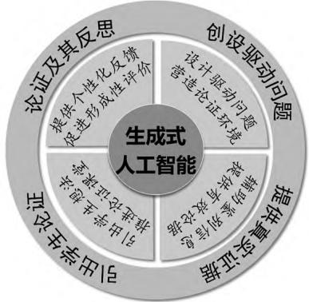
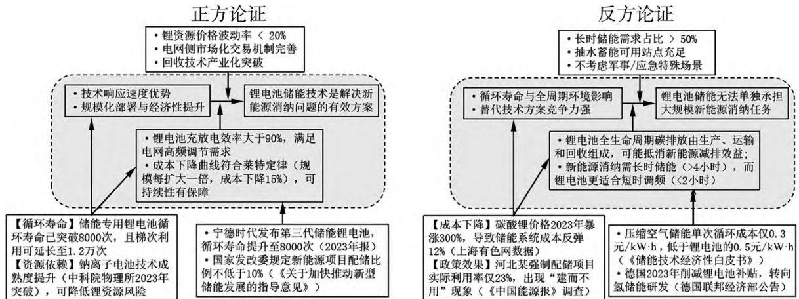
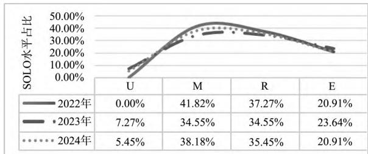

· 现代教育技术 ·

# 生成式人工智能在科学论证教学中的应用

———以DeepSeek开展“节约能源”议题教学为例

易楷昊 姚建欣（北京师范大学物理与天文学院 ，北京 100875）

摘 要 ： 生成式人工智能的发展与应用为课堂教学改进带来了新的动力．以物理学科核心素养中的科学论证为切入点 探索生成式人工智能助力论证教学设计．选择我国“深度求索”研发的通用人工智能 DeepSeek－R1模型 对 节约能源 这一社会性科学议题开展论证教学的设计辅助 发现其可在创设驱动问题 提供真实证据 引出学生论证和促进论证反思4个方面提升教师备课效率 显化学生思维 支持形成性评价．

关键词 ： 生成式人工智能 ； DeepSeek； 科学论证 ； 社会性科学议题

科学论证既是科学实践的关键环节也是科学思维的重要组成部分．培养学生的科学论证能力有助于培养其批判性思维 逻辑推理和表达能力 从而落实物理学科核心素养．当前生成式人工智能（Generative Artificial Intelligence， 简称 GenAI）正以前所未有的力度重塑着教育领域 为教学模式的创新和学生的培养方式带来全新的变革．［1］ 自OpenAI研发出 ChatGPT以来 类似的生成式人工智能产品涌入大众视野 近期我国“深度求索”研发的DeepSeek凭借其多模态认知架构 复杂逻辑推理能力和低训练成本刷新了对于 AI的认识为中国物理教师提供了优化教学的本土化 GenAI工具．本文将DeepSeek－R1应用于“节约能源”议题的论证教学，探讨其在创设驱动情境 提供真实证据 引出论证和促进反思方面的应用 ， 将 GenAI融入并赋能智能化的物理论证教学．

## 1 GenAI 支持论证教学

科学论证是利用科学证据和科学推理 对自己的主张进行支持 并对他人主张和论点进行考虑或反驳的活动．在哲学领域， 图尔敏提出了论证的基本模式（Toulmin’s Argument Pattern， 简称TAP） 包含资料（Data） 主张（Claim） 理由（Warrant） 限定 （Qualifier） 支持 （Backing） 和反驳（Rebuttal）6个要素．［2］ 在科学教育领域 以 TAP及其他衍生模式为基础 探索出了一系列培养科学论证能力的教学设计模型 如“启发式科学写作” （Science Writing Heuristic， 简称 SWH） ［3］“论证驱动探究”（Argument－Driven Inquiry， 简称ADI）等．［4］上述研究为在中学物理课堂中开展论证教学提供了理论支撑 ，教师应创设真实情境，以驱动问题引领课堂的讨论与探究 ， 营造适宜开展论证的课堂环境．在具体任务完成过程中 教师需明示科学论证的基本结构 训练学生获取或检索高质量的科学证据 并通过科学推理用证据支持其科学主张．最后给论证以细致的评价和反馈 促进学生下一次论证的优化．

国内外的研究均发现 在论证教学设计与实施过程中 教师常在设计有论证空间的驱动问题 提供丰富的高质量论据 设计引导性话语 评价论证并给出反馈等方面遇到困难和挑战．［5－6］ 近年来，研究者致力于挖掘基于计算机系统在论证教学中的潜力取得了一系列成果．例如，利用自动文本评分和实时可调反馈来支持对涉及不确定性的科学论点的修订 推进反馈进程 开发 HASbot系统来支持学生进行科学论证．［7］ 尝试使用基于机器学习 （Machine Learning，简称 ML）的自动反馈系统 支持学生使用来自已发布来源和模拟的数据修改科学论点．［8］但上述系统技术门槛和部署成本较高，难以为普通教师驾驭．以DeepSeek为代表的低成本GenAI的出现为回应上述挑战提供了新的思路．

GenAI基于海量数据训练 实时关联最新科研成果 政策文件和真实数据等跨时空知识 保证真实有效数据的高效搜索 丰富了师生的认知空间．教师据此设置挑战性 开放性驱动情境和问题来营造论证环境，收集资料构建论证素材库 ， 帮助学生甄别信息．根据形成性评价理念 在论证过程中 GenAI能辅助教师设计细节型 凝练型 反思回顾型等多种类型的推进式和引导式话语 促进学生思维可视化 推进论证进程．由此可以降低传统论证课堂中对教师专业知识和临场反应的要求，让更多的教师能驾驭高质量论证课堂．此外，GenAI还凭借严密的逻辑推理能力， 自动诊断学生论证谬误 细致评价论证的结构完整性 证据多元性 反驳精准度等 并给出个性化反馈来改进下一次论证 实现形成性评价．综合以上论证教学的关键要素和人工智能特点来看 GenAI能在“创设驱动问题”“提供真实证据”“引出学生论证”“论证及其反思”4个方面（如图1所示）支持论证教学．

  
图1 生成式人工智能赋能论证教学

## 2 GenAI 支持论证能力培养的案例实践

基于以上分析，本文展现应用 DeepSeek－R1模型于社会性科学议题 （Socioscientific Issues， 简称SSI）“节约能源”主题论证教学的案例 从创设驱动问题 提供真实证据 引出学生论证 促进论证及反思4个方面讨论GenAI的应用．

## 2．1 创设驱动问题

社会性科学议题可以训练学生的批判性思维培养创新能力从而实现论证能力的提升 ［9］ 其跨越了多个学科领域并且与社会生活紧密相关 在发展学生物理观念的同时增强其社会责任感．此外 SSI保证了问题的挑战性和开放性，需要丰富的数据和严谨的推理来支持，适合开展论证教学．与DeepSeek－R1开展对话，选择节约能源主题下适合的议题，输入的提示词 思考过程和输出结果如表1所示．

表1 提示词及修改后的SSI驱动问题和理由
<table><tr><td rowspan=1 colspan=2>提示词</td><td rowspan=1 colspan=2>你好，我是一名高中物理老师，想要以社会性科学议题(SSI)培养学生的科学论证能力，聚焦于“节约能源”主题，请你帮我想几个驱动性问题</td></tr><tr><td rowspan=1 colspan=2>思考过程(详细内容略)</td><td rowspan=1 colspan=2>理解SSI和科学论证；考虑问题的难度和开放性；联系生活和实际；激发学生收集数据并分析数据；问题的结构性，避免表层回答；问题是否具备争议性和讨论空间</td></tr><tr><td rowspan=1 colspan=3>设计的驱动问题</td><td rowspan=1 colspan=1>理由(详细内容略)</td></tr><tr><td rowspan=2 colspan=1>技术创新与能源效率争议类</td><td rowspan=1 colspan=2>大规模推广锂电池储能电站是否能解决新能源消纳问题？</td><td rowspan=1 colspan=1>2024年中国新能源消纳矛盾突出，储能被视为关键解决方案，但实际调峰效果有限.教师可从锂电池的储能效率(如充放电损耗计算)、全生命周期碳排放(需涉及锂矿开采与回收的能源成本）、经济负担、电网的稳定性等方面考虑</td></tr><tr><td rowspan=1 colspan=2>氢能源汽车是否比电动汽车更符合碳中和目标？</td><td rowspan=1 colspan=1>2025年全球氢能产业加速发展，中国提出“绿氢优先”战略.可考虑从灰氢(化石燃料制氢)与绿氢(电解水制氢)的能源消耗差异来比较.还要考虑发展中国家选择低成本灰氢的合理性与发达国家倡导绿氢的道德压力</td></tr><tr><td rowspan=2 colspan=1>政策设计与公平性冲突类</td><td rowspan=1 colspan=2>碳边境调节税（CBAM）能否促进全球能源公平?</td><td rowspan=1 colspan=1>欧盟2023年启动CBAM试点，中国高碳出口企业面临成本激增风险.可以量化钢铁、水泥等行业的单位产值能耗，对比发达国家历史排放数据.考虑气候责任的代际公平以及发展中国家的发展权</td></tr><tr><td rowspan=1 colspan=2>居民阶梯电价政策是否加剧了能源贫困?</td><td rowspan=1 colspan=1>2024年中国居民用电量分层显著，低收入家庭用电刚性需求与电价涨幅矛盾.可以计算不同家庭用电设备的功率一时间曲线，模拟阶梯电价对能耗行为的影响.考虑经济激励节能的有效性和社会福利保障的缺失</td></tr><tr><td rowspan=2 colspan=1>未来技术与伦理风险类</td><td rowspan=1 colspan=2>人工智能优化电网调度：提升能效还是制造新的“数字碳足迹”？</td><td rowspan=1 colspan=1>2025年AI算法广泛用于智能电网，但数据中心能耗激增.可以对比传统调度与AI调度的单位供电碳排放，引入“算法能效比”概念.最后反思技术精英主导的能源决策是否会忽视公众参与权</td></tr><tr><td rowspan=1 colspan=2>可控核聚变实现后，人类是否还需要节约能源?</td><td rowspan=1 colspan=1>ITER项目预计2035年实现净能量增益，引发“能源乌托邦”讨论.考虑熵增定律对能源品质退化的约束，即使能量总量充足，可用能仍会衰减.最后进行哲学思考即技术乐观主义与生态承载力极限的悖论</td></tr></table>

此外 它还设计了“日产生活决策类”“全球治理与本土实践类”和“材料科学与可持续发展”等能源议题，涉及的关键词如“一带一路”海外煤电项目 虚拟电厂 阶梯电价选择 量子计算 高温超导等．可以看出 这些问题充分考虑了问题的时代性 开放性和跨学科性 ，给教师提供了丰富的教学素材和选择空间．

结合课标对必修3的学业要求 即要求学生认识能源开发与利用对人类生活和社会发展的影响，关注科学 · 技术 · 社会 · 环境的关系．［10］ 人教版教材也在必修3中设置了“能源与可持续发展”板块并且要求学生收集资料后对环境污染 能源节约 垃圾分类等问题进行研究和讨论．可见，无论是从时代背景还是课标教材要求来看 能源节约及其对环境的影响都是极为重要的话题．从学情来看 能源话题贴近生活 且学生已经学过了功 功率 效率和电容等概念 有一定的知识基础．因此 本文以“大规模推广锂电池储能电站是否能解决新能源消纳问题？”为议题 确保挑战性和辩论空间．

## 2．2 提供真实证据

在问题的驱动下 论证的质量取决于是否有高质量的证据和推理 因此教师要提供部分资料和数据 学生进行真伪判断后根据需要选择作为论据．与 DeepSeek－R1开展对话 提示词及优化后的双方论据如表2所示．

表2 提示词及优化后的正方反方论据
<table><tr><td>提示词</td><td colspan="2">请你为正方和反方都列举一些资料和数据作为论证 的依据，要求有真实的参考资料</td></tr><tr><td colspan="2">正方资料(详细内容略) 技术响应速度优势.宝塘储能站等新型锂电池 储能项目已实现“毫秒级”响应电网调节需求，</td><td>资料来源</td></tr><tr><td colspan="2">显著缓解新能源发电的随机性和波动性.锂电 池的充放电效率（&gt;90%）远高于抽水蓄能 (70%～80%)，且能量密度更高，适合短时高频 调节需求 规模化部署与经济性提升.2023年锂电池储</td><td rowspan="3">中国政府网 国家能源局 国际新能源网 新浪财经 其他媒体</td></tr><tr><td colspan="2">能系统中标价格同比下降30%，最低至 0.635元/W·h，成本优势逐步显现.国家能源 局提出2025年新型储能装机目标3000万千瓦 以上，强制配储政策加速电源侧项目落地(如河 北储能电站满足承德50%新能源需求）</td></tr><tr><td colspan="2">灵活性适配多场景需求.锂电池储能可灵活部 署于电源侧(新能源配储)、电网侧(独立储能电 站)及用户侧(工商业储能)，覆盖“弃电”消纳、 峰谷套利、应急供电等场景</td></tr><tr><td colspan="2">反方资料(详细内容略) 循环寿命与全周期环境影响.锂电池循环寿命</td><td>资料来源</td></tr><tr><td colspan="2">约6000次(对应15年)，远低于抽水蓄能电站 的50年寿命；生产环节每吨锂需消耗190万升 水，回收技术尚未成熟 电源侧配储经济性困境.强制配储政策下，新能 源发电企业需承担额外投资(如100MW光伏</td><td rowspan="3">国家能源局 国家电网 新浪财经 搜狐网 其他媒体</td></tr><tr><td colspan="2">电站配储成本增加约1.2亿元），但缺乏市场化 收益机制(仅依赖调峰补偿难以覆盖成本).山 东电力现货市场2022年出现176天负电价，新 能源发电企业收益受损，削弱配储动力</td></tr><tr><td colspan="2">替代技术方案竞争力强.抽水蓄能单位造价低 (约5～7元/W)、寿命长(50年)，且不依赖稀 有金属资源，更适合承担基荷调峰任务.压缩空 气储能、液流电池等技术在长时储能领域更具 优势，可能挤压锂电池应用场景</td></tr></table>

可以看出 DeepSeek提供的论据中 正方聚焦于强调锂电池储能的技术迭代速度与政策驱动效应 反方聚焦全周期成本与市场机制缺陷．通过对比抽水蓄能 压缩空气储能等替代方案 引导学生理解新能源消纳需依赖技术组合而非单一方案最终培养其基于证据的系统思维与批判性论证能力．提供的证据围绕议题展开， 具有真实性和有效性．

## 2．3 引出学生论证

在论证教学中 教师要通过询问学生找出他们在有限的或开放的空间上可能的论证 ， 引出学生论证 推进论证课堂的进程．因此 接下来利用GenAI辅助引导性话语的设计 助力开展形成性评价．输入的提示词及润色后的结果如表3所示．

表3 提示词及引出学生论证的教师用语和目的
<table><tr><td colspan="2">基于以上对话，假设你正在开展论证教学，课堂上如 提示词 何引出学生论证?</td></tr><tr><td>引导话术</td><td>目的</td></tr><tr><td>你们提到锂电池能量密度高，但具体比抽 水蓄能高多少？能否用公式  $E = { \frac { 1 } { 2 } } C U ^ { 2 }$  计算典型储能系统的能量存储量?</td><td>迫使学生在数据层 面精确化表述，并 量化分析</td></tr><tr><td>有同学认为强制配储政策有效，请具体说 明“有效”的标准是什么？是减少弃电率? 还是提升电网稳定性？</td><td>将笼统观点转化为 可验证的具体指标</td></tr><tr><td>当前争议涉及技术、经济、环境3个维度， 请各组用3句话分别概括各方核心论点</td><td>将抽象概念转化为 可操作分析框架</td></tr><tr><td>正方认为锂电池成本持续下降，但反方指 出山东负电价削弱企业收益.这两条数据 是否矛盾？如何用供需曲线模型解释这种 现象？</td><td>揭示学生未察觉的 逻辑断裂点</td></tr></table>

可以看出 生成的引导话术有以下特征 ： 避免“高效”等泛化表述 强制要求量化指标（如效率百分比 碳排放克数） ；当学生陷入细节争论时 提供其他分析思路；引导学生关注双方的矛盾信息（如同时展示锂电池成本下降曲线与新能源企业亏损报告）．这些引导话术涵盖了详细了解（教师持续追问学生如何看待某些特定的细节） 凝练 （教师通过关注核心要素来降低问题的复杂性） 反思与回顾（教师对学生的发言进行总结 使学生继续建立想法）等类型．这些推进话语打开了辩论空间 显化了学生思维 推进了论证的进程．

## 2．4 论证及其反思

有了证据的积累和教师引导语的支持 ， 就可以进行完整的论证．正反方均可以选择支持主张的资料作为论据 选择支援和反驳的素材 最后按照TAP的论证框架进行论证．结果如图2所示．

  
图2 基于TAP的正反方论证过程

对于科学论证的评价可以考虑从证据 论证过程 主张的科学性等方面进行．由于本论证基于SSI展开，故不需评价其主张．DeepSeek对以上的论证评价为 （详细内容略） ： “对于证据 双方均引用权威机构报告（如国家能源局 宁德时代企业报表） 增强了论据的可信度 并且具有良好的时效性．”如果这些资料全部依靠学生或者教师人为收集，需要耗费大量的时间精力 ，使用GenAI搜索并生成资料 师生就只需辨别真伪 判断可信度后自主选择，大大提升了课堂效率．此外，它还指出了正反方的缺点，如 ： “正方未考虑低温环境效率衰减、反方考虑抽水蓄能的地理限制 双方均应通过量化标准界定 多变量敏感性分析与跨学科整合提升结论的科学稳健性等．”教师可以据此反馈推进学生下一轮的论证改进 实现评价的形成性功能．

## 3 总结与反思

生成式人工智能与课堂教学的深度融合将逐渐成为物理教育发展的趋势．本文探索DeepSeek在论证教学设计中的应用．以节约能源议题下“锂电池储能电站与新能源消纳问题”创设驱动性的情境 构建起了具有开放性和挑战性的论证空间； 运用GenAI快速检索和整合信息的优势，提供丰富精准的数据资料作为有效论据；再生成符合教学逻辑和学生认知水平的引导用语 自然引发学生论证并适时推进，助力正反双方深入分析问题，促进思维显化 以TAP为理论框架 借助GenAI辅助学生展开严谨的论证后 提供形成性评价和反馈用于下一轮论证改进．实践证明 上述方式能将GenAI融入论证教学设计 为论证教学实践提供了参考．

研究过程中也生发出一些新问题值得大家共同思考．在教学实践方面 应用 GenAI时应秉持什么样的原则？目前 笔者建议坚持“技术增强而非替代”的立场．即将GenAI作为支持工具和素材来源 仍需以教师为主导 在把握素养理念和课标要求的基础上遴选 优化GenAI提供的内容 帮助学生理解和掌握科学论证．同时 提升人机协作能力探索GenAI融入同伴协作 人机互辩等教学模式实现对学生论证的智能评价和推进反馈．

在教学研究方面，未来的研究应探索GenAI对科学推理 模型建构 证据获取 建构解释等其他素养要素的教学支持．研究者也要加强对于以上要素的理论研究 提供清晰成熟的教学策略 设计框架作为与GenAI对话的基础 实现高水平的教学与技术融合．还可以基于不同GenAI的特点和优势 探索不同 AI产品在各类场景下的使用方式 开展设计对比分析和教学改进研究．还需要重新设计教师专业发展课程 将物理教育理论与人机协同实践紧密结合，培养适应技术变革的智慧型教师．

## 参考文献 ：

1 中共中央 ， 国务院．教育强国建设规划纲要 （2024－2035年） ［EB／OL］．［2025－01－19］．中华人民共和国中央人民政府网，https：／／www．gov．cn／zhengce／202501／content＿6999913．htm

2 Toulmin SE．The uses of argument［M］．Cambridge university press，2003

3 Keys CW，Hand B，Prain V，et al．Using the science writing heuristic as a tool for learning from laboratory investigations in secondary science［J］．Journal of Research in Science Teaching，1999，36（10）：1065－1084

4 Clark DB，Sampson V．Assessing dialogic argumentation in online environments to relate structure，grounds，and conceptual quality［J］．Journal of Research in Science Teaching，2008，45（3）：293－321

（下转第73页）

<!-- 存疑：以下为期刊同页另一篇文章（高考物理试题SOLO分析）的正文余文及图4，非本文（LIT-0090）内容 -->

考．该题可以从不同角度进行拓展 充分体现了物理试题的情境性 真实性以及开放性．高中教学要帮助学生完成知识体量和难度上的进阶 ，［9］ 高考试题的变化是物理考试和日常教学的重要指引物理教学应以课程标准为基本遵循 注重必备知识的积累 思维能力的提升以及核心素养的达成

  
图4 2022—2024年高考物理试题SOLO水平分布

## 4 总结与展望

新课标发布后 我国新高考改革进入全面推进的关键时期 把握学科高考试题的演变趋势和发展特征 有助于跟进高考改革趋势 落实新课标要求．研究发现高考试题具有“坚持素养立意 强调学以致用 重视思维品质”的基本特征 在内容上通过更加开放真实的问题情境考查必备知识与关键能力 深化物理学习的价值意义 促进物理核心素养的发展； 在解题要求上注重知识的积累与综合运用， 从单纯考查知识转向重视知识 思维 方法的融合与创新 体现“基础性 综合性 应用性创新性”的四翼要求．在变化趋势上 高考试题在保持结构稳定的基础上持续优化 ， 通过融入多样化问题情境 解题思路和作答方法提升试题的开放性，为物理教学改革提供重要指引

总而言之 本研究在构建了学科试题分析的编码体系的基础上 ， 选择近3年7套物理高考试题进行编码分析 ， 提炼高考物理试题的基本特征与演变趋势 研究成果可以为物理学科试题分析和物理教学改革与实践提供借鉴．另外 研究构建的学科试题编码分析工具能够为其他学科的试题研究提供参考 为相关研究提供思路．学科高考试题的分析研究仍有较大的发展空间 未来会关注多个学科 跨学科的高考试题分析 以期推进学科高考试题分析领域研究的拓展 助力高考发挥立德树人 服务选才 引领教学的重要作用 为学科教育教学改革创新提供支撑

5 Martin A M．Factors affecting the Implementation of argument in the elementary science classroom．A longitudinal case study［J］．Research in Science Education，2009（1）：17－38

6 Knight－Bardsley A，McNeill KL．Teachers’ pedagogical design capacity for scientific argumentation［J］．Science Education，2016（4）：645－672

7 Lee H S，Pallant A，Pryputniewicz S，et al．Automated text scoring and real-time adjustable feedback：Supporting revision of scientific arguments involving uncertainty［J］．Science Education，2019，103（3）：491－526

<!-- 存疑：以下为同页另一篇文章（高考物理试题SOLO分析）的参考文献，非本文（LIT-0090）参考文献 -->

## 参考文献 ：

1 国务院．国务院关于深化考试招生制度改革的实施意见［EB／OL］．（2014－09－04） ［2024－08－03］．https：／／www．gov．cn／zhengce／content／2014－09／04／content＿9065．htm

2 潘怀宇 曾秀 李春密．基于核心素养的高考试题分析研究———以2020年全国高考物理 Ⅰ 卷试题为例［J］．物理教师，2020，41（11）：81－87

3 张健 ， 王华 ， 李春密．核心素养视角下的高考试题评析———以2018年北京高考理综物理试题为例［J］．物理教师 ，2019，40（10） ：89－93

4 梅家烨 张辉．高考试题在落实服务选才与引导教学方面的效能分析———以“2023年重庆高考物理压轴题”为例［J］．物理教师，2024，45（4）：87－90

5 王振超 李建彬 胡象岭．基于SOLO 分类理论的高考物理试题能力层次分析———以2016年全国卷 Ⅰ 为例［J］．物理教师 ，2018，39（2） ：86－91

6 王智航，陈红君，魏鑫．基于SOLO分类理论的物理试题思维层次分析及教学启示———以2023年全国物理高考新课标卷为例［J］．物理教师，2024，45（5） ：77－81

7 中华人民共和国教育部．实现高考由“解题”到“解决问题”的转变［EB／OL］．（2022－09－15） ［2024－09－02］．http：／／www．moe．gov．cn／fbh／live／2022／54835／mtbd／202209／t20220915＿661469．html

8 中华人民共和国教育部．普通高中物理课程标准（2017年版2020年修订）［S］．北京：人民教育出版社，2020

9 徐瑞璟．基于学习进阶的初高中物理教学衔接———以“电路和电能”教学为例 ［J］．物理教学，2024，46（3）：17－20 （收稿日期 ：2025－01－06）

<!-- ref [7] 期刊信息已合并至上方参考文献[7]，原pypdf提取时被同页另一篇文章内容截断 -->

8 Lee H S，Gweon G H，Lord T，et al．Machine learning-enabled automated feedback：Supporting students’ revision of scientific arguments based on data drawn from simulation［J］．J Sci Educ Tech，2021（30）：168－192

9 Bächtold M，Pallarès G，De Checchi K，et al．Combining debates and reflective activities to develop students’ argumentation on socioscientific issues［J］．Journal of Research in Science Teaching，2023，60（4）：761－806

10 中华人民共和国教育部．普通高中物理课程标准（2017年版2020年修订） ［S］．北京 ：人民教育出版社 ，2020

（收稿日期 ：2025－01－19）