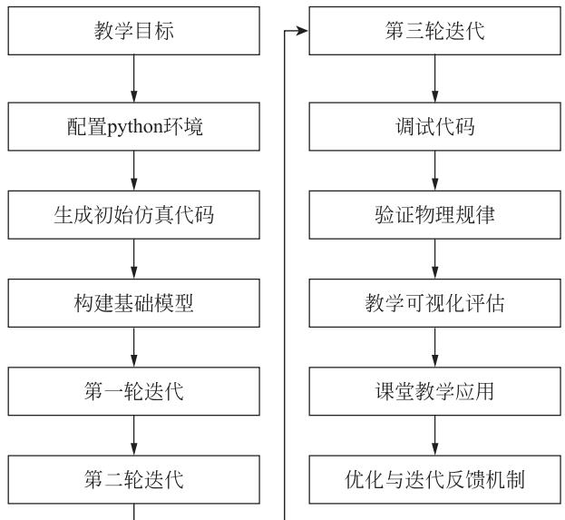
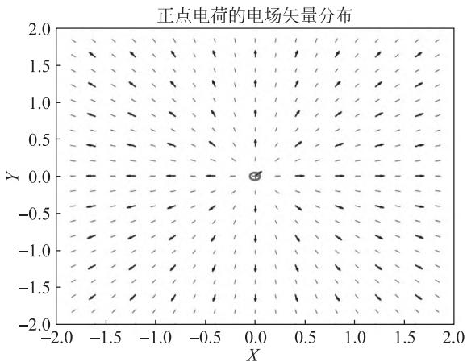
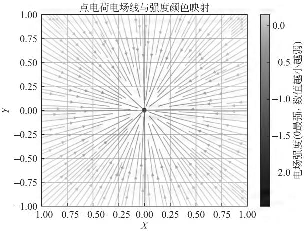
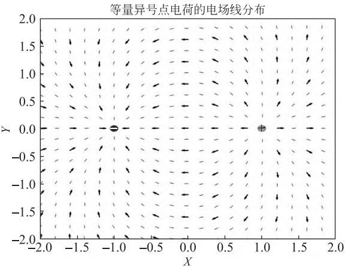
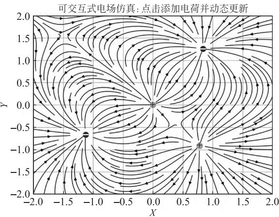

> 来源：LIT-0091_原文.pdf；2026-08-12 依据二次 MinerU OCR 结果精校。图片路径已统一为本卡片目录下的 \`assets/\`。

# 生成式人工智能在物理教学中的应用研究：以 Python 编程实现静电场仿真为例

叶张胜、杨树林（黄冈师范学院物理与电信学院，湖北黄冈 438000）

## 摘要

本文探讨生成式人工智能与 Python 编程在物理教学中的应用。作者借助生成式人工智能 DeepSeek，历经三轮迭代生成和优化 Python 代码，开发静电场仿真案例，展示借助生成式人工智能完成静电场仿真和可视化的过程。实践表明，人工智能能够有效降低仿真实验的编程门槛，但生成的仿真系统可能与实际物理规律不符，仍需人工验证和调整。

关键词：生成式人工智能；DeepSeek；Python 编程；静电场；可视化

# APPLICATION OF GENERATIVE ARTIFICIAL INTELLIGENCE IN PHYSICS EDUCATION: A CASE STUDY OF ELECTROSTATIC FIELD SIMULATION USING PYTHON PROGRAMMING

## YE Zhangsheng, YANG Shulin

(School of Physics and Telecommunications, Huanggang Normal University, Huanggang, Hubei 438000)

### Abstract

This paper explores the application of generative artificial intelligence (AI) and Python programming in physics education. With the assistance of the generative AI tool DeepSeek, the authors carried out three iterative cycles to generate and refine Python code, ultimately developing an electrostatic-field simulation case. This demonstrates how generative AI can be leveraged to create and visualize such simulations. Practical experience shows that while AI can substantially lower the programming barrier for simulation experiments, the results it produces may deviate from actual physical laws and therefore require human verification and adjustment.

Key words: generative artificial intelligence; DeepSeek; Python programming; electrostatic field; visualization

在《教育强国建设规划纲要（2024—2035 年）》的政策背景下，人工智能技术在教育领域的应用成为当前教育变革的重要方向之一。随着人工智能技术的快速发展，教育的数字化转型也受到广泛关注。以人工智能为代表的新兴技术正在加快推动全球数字化教育环境转型。如何利用人工智能提高教育质量、促进教育公平、推动教育数字化转型，是人工智能能否达成育人目标的重要问题[1]。作为新一代智能化工具，生成式人工智能在教学内容生成、辅助学习和课堂互动提升等方面均呈现出显著潜能。

静电场是高中电磁学的核心内容之一，学生理解电场、电势及其空间分布特性并非易事。传统静电场模拟实验随着仪器使用年限的增长，实验误差呈增大趋势[2]。由于实验设备限制和可视化效果较差，学生很难直观理解这些抽象的物理概念。

随着编程语言在教育领域的不断应用，Python 因其简洁的语法和强大的科学计算功能，被各高校广泛应用于数学和物理仿真教学。Python 的相关模块为物理现象建模和数据展示提供了有力支持。将生成式人工智能引入 Python 仿真实验开发，可以提高编程自动化水平，简化物理仿真设计的实现过程。基于 Python 的仿真实验能够兼容 Windows、Linux 等操作系统，并可以在 IE、Chrome 等浏览器中直接操作，有效解决原有实验教学效率较低、课时不足以获取大量实验数据等问题。此外，得益于仿真实验系统的开源性与可扩展性，学生可以方便地开展进一步的探究性学习、自主实验和创新实验[3]。

但在实际教学过程中，Python 编程门槛较高，不易上手。高中教学任务繁重，教师很难投入大量时间学习编码。因此，引入具备代码生成功能的生成式人工智能，有助于简化数据分析和物理仿真建模流程，降低技术难度，使没有编码经验的物理教师也能够完成 Python 仿真实验开发，更好地服务物理教学。

## 1 技术基础

### 1.1 Python

Python 是一种开源的软件开发平台，目前大量机器学习和人工智能系统都基于 Python 开发。Python 中的数值计算模块 NumPy、科学计算模块 SciPy、数据处理模块 Pandas 和数据可视化模块 Matplotlib，为 Python 实现数值计算提供了有力支持[4]。在静电场仿真实验中，可以使用 NumPy 进行多维数组构建和向量化运算，快速计算电荷位置、电场分量和电势函数等物理量。通过空间网格化处理和向量叠加操作，Python 能够快速完成复杂场结构的数值表达；再结合 Matplotlib 的二维可视化工具，可以绘制电场线分布、电势等值线图，并标识电荷位置。Python 支持多种图形元素及坐标轴的绘制，便于在教学情境中直观展示场强方向、电场叠加规律等抽象概念。教师可结合具体教学需求调整图像密度、颜色梯度及符号标注，提高可视化图像的辨识度，辅助学生理解电场方向、电场强度及矢量叠加等抽象概念。

### 1.2 生成式人工智能

生成式人工智能的起源可以追溯到自然语言处理技术的早期阶段。当时的模型多数借助基于统计的 n-gram 方法及简单的循环神经网络，完成初步的文本生成任务。随着神经网络技术不断发展，2014 年生成对抗网络（GAN）模型的提出，标志着生成式人工智能进入实质性发展阶段。2017 年提出的 Transformer 结构在上下文建模能力上实现了飞跃性进步，生成式人工智能在语言理解和生成能力上取得了巨大突破。随后，生成式人工智能在制造、医疗、教育、军事和金融等多个领域展现出广泛的应用前景[5]。

就编程辅助而言，带有自然语言解析能力的生成工具可根据用户描述自动生成结构上合理的程序片段，支持函数搭建、语法修正与注释补全等功能。在教学领域，生成式人工智能已逐渐被引入 STEM 学科，成为编程和科学教学中的辅助工具之一。例如，DeepSeek 智能辅助系统已在计算物理教学中展现出多维度的范式重构潜力，其技术特征与课程教学目标高度契合。在认知维度，DeepSeek 通过语义感知驱动的智能代码生成引擎，有效解构了程序设计语言的学习壁垒[6]。

以 DeepSeek 为代表的生成式大模型支持自动代码生成，还具有上下文适应及连续迭代改进能力，可配合教学要求完成仿真建模及算法构建任务。在高中或大学物理课程中，教师能借助这类工具快速搭建针对电场、电势等抽象概念的模拟程序，增进实验教学的直观性与技术效率，为新型教学场景的搭建提供有效工具支持。

## 2 Python 静电场仿真实验开发流程

物理仿真实验系统的开发首先需要进行需求分析，明确系统功能和教学目标。确定教学目标后，再进行 Python 环境配置与仿真环境搭建。Windows 系统需要下载安装 Python、配置系统环境变量，并使用 pip 安装 NumPy 和 Matplotlib 库，这一流程对部分教师而言存在一定技术门槛。为降低使用难度，笔者选用 PyCharm 社区版作为开发工具。该集成开发环境支持图形化界面，结合 DeepSeek 的辅助，可以快速完成 Python 环境初始化配置。

随后组织自然语言提示词“帮我生成一个基于 Python 语言的静电场仿真实验代码”，输入 DeepSeek 生成仿真代码，明确仿真模型的核心功能与预期图像形式。如果不符合需求，可再次与 AI 交互，仿真程序可以多次迭代优化，最终达到预期目标。代码调试在 PyCharm 中进行，通过不断测试电场方向、电荷标记和图像呈现效果，逐步优化图形参数，使仿真结果符合教学标准与学生认知水平的双重要求。

最终，该实验模型被用于课堂教学，作为辅助演示与自主探究资源，并根据教学使用过程中的反馈持续完善。整体流程如图 1 所示，包括教学目标制定、代码生成、仿真模型构建、多轮优化与课堂教学应用等步骤，形成较为完整的教学实验开发路径。

  
图 1 设计思路流程图

## 3 代码生成与仿真优化结果

本设计的教学目标，是将 2019 年人教版高中物理教材必修三“电场与电场强度”章节中图 9.3-7 点电荷的电场线呈辐射状、图 9.3-8 等量异种点电荷的电场线和等量同种点电荷的电场线，用 Python 编码的方式呈现，以调动学生的学习兴趣。为增强视觉效果，笔者计划将课本中的静态图动起来，开发一个可交互的静电场仿真程序：用户可以点击添加任意数量的电荷，实时更新电场分布，便于探究静电场规律。

### 3.1 第一轮生成

第一轮生成构建了一个正电荷在二维平面上的电场分布 Python 仿真模型。提示词为“帮我生成一个正电荷静电场仿真，以 Python 编码形式输出”。DeepSeek 生成的仿真代码主要采用 NumPy 建立电荷所在空间的二维网格结构，随后计算每个空间点的电场向量值；绘图则采用 Matplotlib 将电场的方向和强度信息输出为图像。

在图形构建过程中，以灰色中心加号的小圆圈表示正电荷，使用箭头展示电场方向，通过箭头密度和颜色深浅变化表示电场强度大小。系统运行后图像如图 2 所示，电场线由中心正电荷向四周均匀发散，形成辐射结构。中心灰点为正电荷位置，周围向外分布的箭头描述单个正电荷的电场方向。这些箭头从正电荷中心指向远处，反映正电荷电场方向由内向外发散的特点。整体而言，第一轮生成基本满足静电场的基本性质，但可视化图像采用黑、白、红色，表现较为简陋。

  
图 2 第一轮生成

### 3.2 第一轮迭代

为了改善图像细节，笔者进行了第一次迭代，输入提示词“帮我优化上述 Python 仿真，使其仿真效果更精准，颜色表达更丰富”至 DeepSeek。迭代完成后，使用 streamplot 函数替换原始离散箭头，以连续曲线表示电场线，电场方向表达更为流畅。图像颜色也进行了调整，在原有基础上加入电场强度颜色映射机制，使用电场模值的对数值作为颜色映射基础。颜色明暗表示电场强度范围，电场强度越大，颜色越明亮。

仿真系统运行结果如图 3 所示。系统将原本分辨率较低的网格替换为 400×400 的高密度网格，使计算更精准。图像箭头颜色由暗至明，右侧添加色带表示颜色与强度的对应关系，正电荷位置以灰色圆点标记。迭代后仿真系统在视觉表现上有所提升，但电场方向表达出现偏差：正电荷的电场应沿径向向外发散，而图中箭头方向却朝向电荷内部，违背了静电场方向的基本规律。这说明人工智能生成仿真代码时也会出现知识性错误，需要人工校正。

  
图 3 第一轮迭代

### 3.3 第二轮迭代

为解决电场方向表达错误，笔者再次进行迭代，输入提示词“帮我优化上述 Python 仿真，电荷分别为正电荷和负电荷，以浅色‘+’号表示正电荷，以深色‘一’表示负电荷”。随后，人工智能构建了一个空间对称的电偶极子模型。该模型由两个点电荷组成，其中一个为正电荷，另一个为等量负电荷，两电荷在空间中对称分布。

如图 4 所示，系统再次采用初始模型的离散箭头，第一轮迭代加入的颜色映射电场强度功能也被人工智能去除，视觉效果有所降低，但电场方向基本符合物理规律。根据静电场基本规律，电场线总是从正电荷出发，指向负电荷。在该模型中，电场线从正电荷指向负电荷，从左向右贯通；靠近电荷处电场线密度较高，远离电荷区域则逐渐稀疏，也体现了电场强度随距离平方反比减弱的规律。

该仿真适合用于讲解电偶极子场的基本特征。在讲解电场叠加时，不同电荷的电场会相互影响，使电场方向发生偏转，有时不会完全朝向某一个电荷，而是两个电荷叠加后的方向。该轮仿真系统基本符合教学需求，但仍有改进空间。

  
图 4 第二轮迭代

### 3.4 第三轮迭代

经历两轮迭代后，仿真系统在结构与功能上均得到改进。第一轮优化提高了图像分辨率，引入颜色映射电场强度机制以增强可视化效果，但存在电场方向表达错误的问题。第二轮在物理逻辑上进行修正，引入等量异号电荷构成电偶极子模型，电场线方向符合基本规律，但失去了颜色映射电场强度的可视化效果。因此，笔者尝试引入用户交互机制，进行了第三轮迭代。

第三轮迭代的提示词为“帮我优化上述 Python 仿真，在原有模型的基础上加入用户交互机制，鼠标左键添加正电荷，右键添加负电荷”。随后，DeepSeek 生成了一个具备实时响应功能的电场仿真系统。运行图像界面后，用户可以通过点击鼠标添加任意数量的电荷：左键添加正电荷，右键添加负电荷。每次点击都会在坐标区域内记录新的电荷位置；完成添加操作后，程序立即根据当前所有电荷的位置和正负重新计算空间内每个网格点的电场向量。

系统初始界面为空白平面。鼠标点击图中任意位置后，系统根据鼠标左右键在点击位置添加电荷：左键点击为正电荷，以浅色“+”表示；右键点击为负电荷，以深色“—”表示，如图 5 所示。每次点击都会触发电场重新计算和图像重新绘制。电场计算包括方向和大小两个部分；鼠标事件交互后，系统在后台自动执行所有电荷电场的矢量叠加，生成新的仿真图像，动态呈现新增电荷对整体电场分布的影响。

虽然最终未能成功将颜色映射电场强度机制引入仿真系统，但用户交互功能在一定程度上弥补了视觉表达上的不足。交互功能的提升有助于辅助学生理解电场方向、电场强度及矢量叠加等抽象概念。

  
图 5 第三轮迭代

## 4 结语

本研究将 Python 编程与生成式人工智能技术结合，设计并完成静电场仿真实验的开发与多轮优化，构建了涵盖电场强度计算、矢量叠加与可视化呈现的仿真系统。系统从单电荷模型逐步扩展至电偶极子场，再到可交互式操作。第一轮构建基础模型，实现电场方向的初步可视化；第一轮迭代提升网格精度，并引入电场强度颜色映射，增强图像表现力；第二轮虽未采用电场强度颜色映射，但构建了空间对称的电偶极子模型，展现矢量叠加的空间结构特性；第三轮实现用户交互功能，用户可通过点击添加电荷并动态更新电场分布。各阶段生成模型各具优势，逐步拓展了仿真系统的功能。

生成式人工智能的引入使物理仿真实验程序开发过程更加简化。在教学情境中，借助其代码生成能力，即使不具备编程基础的教师，也可以较为顺利地生成功能完整、贴合教学需求的仿真模型。本研究初步探索生成式人工智能在物理教学中的应用，希望为人工智能赋能教育实践提供参考。

## 参考文献

[1] 吴霓，郭嘉. 智能时代的教育选择及应对[J]. 中国电化教育，2025，(2)：92-99。

[2] 谢莉莎，邓小玖. 基于创新教育的静电场模拟实验教学研究[J]. 实验技术与管理，2020，37(1)：205-207，211。DOI：10.16791/j.cnki.sjg.2020.01.049。

[3] 潘崇佩，李文华，徐音. 基于 Python 的密立根油滴仿真实验设计与实现[J]. 中国现代教育装备，2024，(17)：64-67。DOI：10.13492/j.cnki.cmee.2024.17.002。

[4] 韩帅，许家华，张思齐，等. 基于 Python 的电磁场仿真实验系统设计[J]. 山西电子技术，2022，(1)：30-31，37。

[5] 查昶玮. 生成式人工智能赋能 Python 编程在医学数据分析中的应用研究[J]. 科技创新与应用，2025，15(6)：1-5。DOI：10.19981/j.CN23-1581/G3.2025.06.001。

[6] 蒙之森，徐毓贤. 将 DeepSeek 辅助编程融入《计算物理基础》课程的教学改革探讨[J]. 科技视界，2025，15(9)：93-96。
