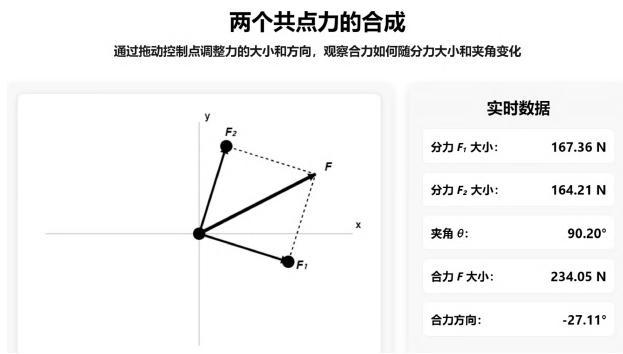
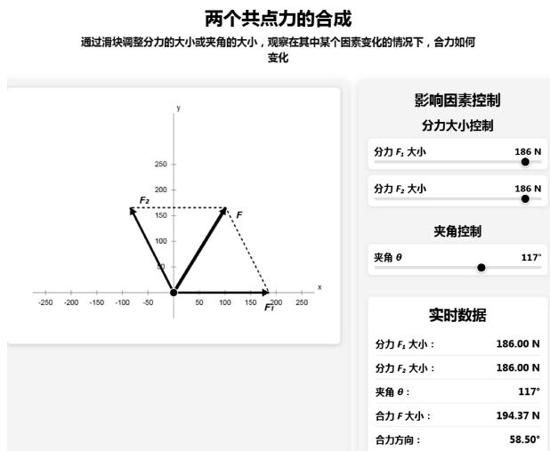

> 来源：LIT-0092_原文.pdf；2026-08-12 依据二次 MinerU OCR 结果精校。PDF 双栏跨页内容已按“下转/上接”标记重组，已排除同页相邻文章。

·现代教育技术·

# 生成式人工智能支持下的物理数字化教学演示资源开发路径初探

——以“共点力的合成”为例

郭雅洁

（上海市浦东教育发展研究院，上海 200125）

摘要：从当前物理数字化教学演示资源的局限性出发，以“共点力的合成”为例，探索利用生成式人工智能开发物理数字化教学演示资源的方法，形成了生成式人工智能支持下的物理教学演示资源开发路径，

关键词：生成式人工智能；教学演示；数字化教学资源

2025年4月和8月，教育部等九部门及国务院相继发布了《教育部等九部门关于加快推进教育数字化的意见》《国务院关于深入实施“人工智能+”行动的意见》等一系列重要文件，提出促进人工智能助力教学变革，尤其提到要推动大模型在物理等基础学科的应用.可见将人工智能融入物理教学是响应国家政策的必要举措.另一方面，从实践层面来看，将生成式人工智能技术与物理教学深度融合也是解决当下问题的重要途径.物理学以实验为基础，数字化教学资源已成为教学情境和实验教学的重要辅助手段.然而，多数现有的物理教学资源较为封闭、陈旧、固定，有些资源不易获取，还有一些技术门槛要求高，很难满足不同的教学需求，亟须通过新的技术对物理教学资源进行补充.随着人工智能技术的不断升级，生成式人工智能技术迅速发展并逐渐体现出其在教育教学领域的优势与巨大潜能.因此，利用生成式人工智能技术开发建设物理数字化教学资源，是教育数字化转型的必经之路，也是落实物理学科核心素养的重要支撑.

## 1 生成式人工智能的内涵、功能与优势

生成式人工智能（Generative Artificial Intelli-gence，简称GAI)是人工智能领域的重要分支，不同于传统的AI.它是一种能基于算法和模型创造性地生成文字、图片、视频、代码等内容的技术，其功能主要包括：生成多模态内容、对已有信息进行总结、分析、推理，提供启发性的人机对话服务等.[1,2]

以DeepSeek为代表的生成式人工智能与传统的人工智能及其他智能技术存在一定差别，对于中学物理教师而言，其主要优势有：获取及使用方便、免费，对于一线教师来说可用、易用；多模态信息处理及生成功能，不同格式间的文本转化，可以为教师教学资源开发提供极大的便利；技术门槛要求低，一线教师不需要掌握编程技术，明确生成内容需求或提供相应提示词即可实现内容生成；推理可视化，这为教师对人工智能输出内容准确性的识别及决策提供依据，也为其提供更广阔的思路.

## 2 生成式人工智能支持下的物理数字化教学演示资源开发路径

生成式人工智能的功能与优势，为教师利用其开发符合自己教学需求的教学资源提供了重要前提.本文从当前物理教学演示资源的局限性出发，探索形成了利用生成式人工智能开发物理数字化教学演示资源的路径：“对照核心素养目标，分析教学难点”→“明确资源需求，破解教学困境”→“找到合适工具，设计提示词”→“生成演示资源，测试演示效果”→“系统排查问题，优化资源功能”，如图1所示.

  
图1生成式人工智能支持下的物理数字化教学演示资源开发路径

## 3 生成式人工智能支持下的物理数字化教学演示资源开发案例

《力的合成》是高中物理必修1的学习内容，“共点力的合成”动态分析问题是这部分教学中的常见习题，举例如下.

不在同一直线上的两个力在只有以下所述条件变化的情况下，合力的大小的变化情况如何？

（1）当两个分力之间的夹角增大时；当两个分力之间的夹角减小时；

## （2）当其中一个分力增大时.

对于这类问题，将习题转化为真实的实验情境，是培养学生核心素养的最直接最有效的方式然而有时受实验资源和时空限制，教师常用平行四边形动态作图法进行板书或PPT进行演示.由于涉及平行四边形的作图，还须呈现不同初始状态下力或夹角动态变化的过程，所以板书会较为复杂，且不一定有较好的呈现效果；PPT演示一方面需要花时间进行繁琐的动画设计，对于部分教师而言有一定的制作难度；另一方面在课堂教学时多数情况教师只是根据自己预设的PPT动画顺序进行推进，学生的自主思维在问题研讨中难以发挥作用，课堂中的“动态生成”的价值也难以体现.3因此，本文利用生成式人工智能开发相关演示资源，具体过程如下.

## 3.1对照核心素养目标，分析教学难点

物理教学的目的是要促进学生核心素养的养成和发展.在教学设计时，要明确教学内容所对应的核心素养目标，结合教学内容及学情，分析学生在目标达成的过程中会遇到哪些实际的困难.

“共点力的合成”是学生进入高中阶段后初次较为系统地学习不在同一直线上的矢量运算.学生在这一部分的学习中需要形成矢量运算的观念，掌握“平行四边形定则”矢量运算的方法.对于“共点力的合成”的问题研究，应培养学生运用分析综合、推理论证的科学思维及解释、交流等方面的科学探究能力.据此，这类问题困难点主要有以下两个方面.（1）力的合成遵循矢量运算的平行四边形定则，合力大小和方向都会因分力的大小与夹角的变化而变化.这种非简单的代数加减和非线性的变化分析对刚刚进入高中的学生来说存在着一定的挑战.（2）这类问题虽然不涉及定量分析，但是由于问题中两个分力初始状态下的大小关系及它们的夹角大小不确定，学生自己通过简单的作图法很有可能考虑不全面，需要辅以教学演示或探究性活动为学生提供分

析问题的情境.

## 3.2 明确资源需求，破解教学困境

结合现有资源的不足与教学实践中的难点，明确演示资源开发的需求，为问题的解决找到突破口.

结合“共点力的合成”的教学难点和现有演示方式的局限性，所开发的教学演示资源需要具备以下功能：能够以动态的“平行四边形”即时呈现合力随分力和夹角的变化情况；能够调节两个分力的大小及在180°范围内任意调节分力的夹角，让学生能直观观察到不同初始状态下的合力随其他因素的变化情况；能够显示各状态下的力的大小和夹角等.因此所生成的资源类型应具备动态可视化、交互性等特征，常见的资源形式则为交互式网页.

## 3.3 找到合适工具，设计提示词

目前可供免费使用的 GAI工具包括 DeepSeek、豆包、腾讯元宝、Kimi等.教师一方面可结合自己偏好选择，另一方面可以尝试多个工具，根据实际效果选择合适的工具.笔者经几次尝试发现，相较而言，DeepSeek生成的教学类动态交互式网页资源一般情况下更符合教师的需求.

打开对应的网页后，即可输入提示词.提示词的主要结构包括：你的身份+资源的主题与格式十主要功能要求.提供身份是为了能让它更理解你的意图.教师在首次尝试时，可能不能完全准确表达所有需求，也可先输入大致要求，根据后续生成的资源再提出修改需求.

本文使用DeepSeek进行资源开发.打开网站并登录后，一般需要打开对话框下面的“深度思考”按钮，以便能看到它的推理过程以及在它“思考”的过程中产生的疑问，为后续优化提供参考.接下来，便可在对话框输入提示词，例如：我是一名高中物理教师，请帮我做一个“两个共点力合成”的html格式的网页.要求：（1）力的合成遵循平行四边形定则，要将平行四边形以虚线的形式可视化；(2）两个分力的大小可用拖动的方法调整，且夹角可变；(3）动态呈现变化的合力；(4）以数据实时呈现两个分力的夹角、分力的大小和合力的大小.(不是最终提示词，后续需要根据生成内容再优化)

## 3.4生成演示资源，测试演示效果

在发送提示词后，GAI会进行一段时间的深度思考，其过程主要包括分析用户需求、规划设计思路、明确实现方式、步骤及完整的实现代码等.代码一般较为复杂，教师并不需要读懂代码，可以先了解其思路及实现方式，如没有偏离自己的需求，可直接点击代码框上方的“运行”按钮，就会很快生成交互式网页.

交互式网页是一种能够实时更新数据信息并允许用户与其互动的网页，教师或学生可通过拖拽箭头或点击按钮来体验网页的交互功能，并可实时动态呈现相关变量及数据.初次生成的资源部分截图如图2所示.

  
图2“两个共点力的合成”动态演示资源初版

## 3.5系统排查问题，优化资源功能

教师要对生成的资源的各种功能反复体验测试，检验是否能满足自己的教学演示需求.例如，两个分力大小是否能随意调整，分力夹角能否变化，力的合成是否遵循平行四边形定则，以及在改变分力大小或夹角时是否能清楚呈现合力大小的变化等.当然，也要特别关注界面中的所有内容是否科学、规范，如公式、数据、标题、问题描述、变量名称、使用说明等.

图2对应的资源中，通过拖拽分力矢量箭头端点可以调整力的大小及两分力夹角.虽然这样的设计实现了分力大小和分力夹角在需求范围内的变化、能动态呈现力的平行四边形，但是通过多次试验发现，在调整分力大小时，两分力夹角可能会随之变化，并不能独立控制单一变量，导致该演示资源不能很好地契合教学需求.除此以外，在“实时数据”的呈现上，还存在合力方向角度为负等一系列问题.这时，需要在提示词框中提出问题以及你期待呈现的效果.

通过不断发现问题、补充提示词，逐渐完善资源.经过多轮修改后，生成的资源截图如图3所示.

在“影响因素控制”区域，通过滑动右边3个滑块，可改变分力大小或夹角大小，同时在“实时数据”区域会实时呈现各自变量及因变量.

根据题意，第(1)问，当分力大小不变时(无论分力的初始大小如何)，滑动“夹角控制滑块”改变分力夹角，可以清晰看出合力F的大小随着夹角θ增大而减小，随着夹角θ减小而增大.

  
图3“两个共点力的合成”动态演示资源改进版

第(2)问，夹角θ不变时，只改变其中一个分力(如力 $F₂$ )的大小，研究合力的变化.滑动“分力大小 $F _ { \textrm { 2 } }$ ”滑块时发现，不同的初始条件会得出不同的结论，因此需要分情况讨论：当两分力夹角 $\theta \leqslant$ $9 0 ^ { \circ }$ 时，随着分力 $F _ { \textrm { 2 } }$ 变大，合力变大.当两分力夹角$\theta > 9 0 ^ { \circ }$ 时,若 $F₂$ 的初始大小 $F₂₀ \mathcal { \ge } F₁ \cos { ( \pi - \theta ) }$ 合力将随F₂增大逐渐增大；若 $F₂$ 初始大小 $F₂₀ <$ $F _ { \mathrm { 1 } } \cos ( \pi - \theta )$ ，随着 $F₂$ 增大，合力将先减小后增大，且在当 $F₂$ 增大到等于 $F₁ \cos ( \pi - \theta )$ ，即 $F₂$ 矢量与合力F矢量垂直时，合力F取得最小值.

通过这一方式，更加直观地呈现了不同初始状态下合力随各因素的变化情况.

## 4 总结与思考

物理是一门以实验为基础的学科，传统的实验演示教学在教学中承担着重要作用。生成式人工智能技术具有优势，但不能取代传统实验教学。教学中教师应根据教学目标和实际需求，综合考虑实验资源基础、时间、空间等因素，有机整合不同类型资源[4]，让生成式人工智能技术更好地发挥其在物理教学中的作用。

本文利用生成式人工智能开发的物理数字化教学演示资源，能够实时、连续、动态地呈现过程及变化情况，弥补传统 PPT 等演示方式的不足。同时，与其他数字化资源或技术平台相比，交互方式更有利于促进学生自主体验、深度观察以及独立思考，发展其科学思维及科学探究能力。利用生成式人工智能开发物理数字化教学演示资源的技术门槛较低，教师不需要掌握编程技术，便能根据自身需求开发、调整和优化资源。本文提炼形成的开发路径，可为中学物理教师自主开发满足自身教学需求的演示资源提供参考。

值得关注的是，虽然生成式人工智能为教学带来便利，但教师利用其辅助教学时不能完全依赖它，必须保持独立思考并在使用过程中发挥主导作用。在运用生成式人工智能开发物理教学资源时，教师还需要关注资源内容的科学性和学科规范性。有时生成的资源并不符合物理规律，或在功能实现、呈现效果上不符合教学规律和教学习惯。这需要教师对生成的资源进行甄别与优化，最终还要在教学实践中验证、评估资源的应用效果。

## 参考文献：

1顾小清，王成梁，王培均，等.生成式人工智能赋能教学的机制、需求与路径[J].中国教育学刊，2025(4):15—22.

2魏非，杨可欣，祝智庭.协同探究智创：生成式人工智能时代的学习新模式[J].开放教育研究，2025,31(2):14—23.

3 段玉文.高中物理课堂教学的有效预设与调控[J].物理教师,2013,34(10):2—3,6.

4 徐旭光，肖雨桐，李丁，等.利用信息技术突破学习难点的教学设计流程—以“带电粒子在匀强磁场中的运动”为例[J].物理教师，2025，46(6)：38—40，44.

5易楷昊，姚建欣.生成式人工智能在科学论证教学中的应用——以DeepSeek开展“节约能源”议题教学为例[J].物理教师，2025(6)：63—66，73.

（收稿日期：2025-09-12)

