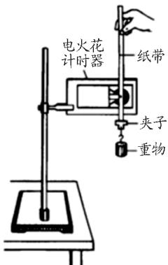
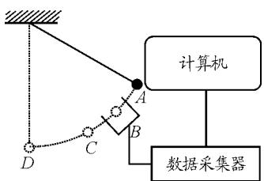

# 验证机械能守恒定律的实验改进

郑 康 陆建隆

（南京师范大学教师教育学院 江苏 南京 210097）

（收稿日期 ：2016－02－15）

摘 要 ：在验证机械能守恒定律实验中 ，针对人教版教材中实验方法存在的较大误差提出利用DIS设计摆球法方案进行实验改进 ，得出实验结果误差在1％ 以内 ，并将DIS实验方法与传统实验方法相比较 ，总结其存在的优势

关键词 ：机械能守恒定律 摆球法 DIS 实验教学

## 1 引言

验证机械能守恒定律是高中物理中重要的实验内容 通常只要测出物体在竖直方向上下落的高度和速度的大小 即可验证机械能守恒定律．在人教版高中物理“实验 验证机械能守恒定律” 一节中 通过让物体做自由落体运动 采用纸带法验证机械能守恒定律 但笔者通过实验发现结果存在较大误差．本文利用DIS实验系统创新设计摆球法 当忽略空气阻力时 验证小球在竖直平面内自由摆动时机械能守恒 实验误差在1％ 以内

## 2 原实验方案

在原实验方案中 物体的质量 m 用天平测出重物下落的高度 Δh 等于纸带上某两点A B 间的距离 这样就能得到重物下落过程中势能的变化．速度的测量可以根据匀变速直线运动的规律 纸带上某点的瞬时速度等于前后两点之间的平均速度 ， 因而可以知道各点的瞬时速度 如第 n 点的瞬时速度为$\ v _ { n } = { \frac { h _ { n + 1 } - h _ { n - 1 } } { 2 \Delta T } }$ ．最后通过比较重物在某两点间的动能变化和势能变化 ： $ m g \Delta h$ 与 $0 . 5 m v _ { B } ^ { 2 } - 0 . 5 m v _ { A } ^ { 2 }$ 从而验证机械能守恒定律．实验装置示意图如图1所示

实验过程简单易操作 但存在较大的误差 ： （1）重物和纸带在下落过程中要克服各种阻力做功 除了空气阻力之外 ，纸带和打点计时器之间还存在着一定的摩擦．（2） 纸带上的点存在拖痕 在取点和测量时影响实验精度．（3） 计数点选择不好及纸带放置方法不正确产生的摩擦也会造成实验误差

  
图1 教材中验证机械能守恒的实验装置示意图

  
图2 改进后的实验装置示意图

## 3 实验改进

为了改进实验效果 ， 采用DIS系统设计摆球法验证机械能守恒定律．实验装置示意图如图2所示

## 3．1 实验器材

计算机 朗威 DIS 光电门传感器 铁架台 天平 千分尺 摆球 细线 米尺

## 3．2 实验原理

把一个摆球用细线悬挂起来并拉到一定的高度 然后放开 摆球在摆动过程中 动能和势能发生相互转化，如果忽略空气阻力的影响 ，则只有重力对其做功 所以机械能守恒

本 实验中 选取地面为零势能点．从A点 （h＝0．70m） 释放摆球 选定摆动过程中高度 h 不同的$B ( h = 0 . 5 3 \mathrm { ~ m } ) , C ( h = 0 . 4 2 \mathrm { ~ m } ) , D ( h = 0 . 2 8 \mathrm { ~ m } )$ 点 ，先后在每一点处放置光电门传感器 使摆球恰好穿过．在每一点处摆动6次，测出6个时间值 $t _ { 1 } , t _ { 2 } , t _ { 3 } , t _ { 4 } , t _ { 5 } , t _ { 6 }$ 取平均值 以减小误差

用天平测得摆球的质量m＝0．0539kg，用千分尺测得摆球的直径d＝0．02372m，则每点处摆球的速度 $v = { \frac { d } { t } }$ ，在该点处摆球的机械能为

$$
E = m g h + 0 . 5 m v ^ { 2 }
$$

比较4点处机械能的大小

## 3．3 实验过程与数据分析

（1） 打开计算机进入DIS系统 放置好铁架台将摆球用一定长的细线系在铁架台上．用另一只铁架台把光电门传感器固定在 B 处 移动光电门传感器固定臂 使用测平器观察并调整光电门的透光孔正好在 B 点 使得此时摆球的直径穿过光电门传感器的发射端和接收端的连线．将光电门传感器接入数据采集器的第一通道

（2） 将摆球从 A 点释放 当摆球通过光电门传感器后 阻止摆球摆动 记录下摆球通过光电门传感器的时间，重复做6次，记录数据，算出平均时间 t

（3） 移动光电门传感器 调整光电门传感器使其分别位于 C 点 D 点 重复步骤2

（4） 分别计算摆球在A B C D4点的势能 动能和机械能

得到实验数据如表1所示

表1 摆球在4个点的相关数据
<table><tr><td rowspan=1 colspan=1>点</td><td rowspan=1 colspan=1> $h / \mathrm { m }$ </td><td rowspan=1 colspan=1> $t _ { 1 } / \mathrm { s }$ </td><td rowspan=1 colspan=1> $t _ { \textrm { 2 } } / \textrm { s }$ </td><td rowspan=1 colspan=1> $t _ { \textrm { 3 } } / \textrm { s }$ </td><td rowspan=1 colspan=1> $t _ { 4 } / \mathrm { s }$ </td><td rowspan=1 colspan=1> $t _ { 5 } / \mathrm { s }$ </td><td rowspan=1 colspan=1> $t _ { \textrm { 6 } } / \textrm { s }$ </td><td rowspan=1 colspan=1> $t / \mathrm { s }$ </td><td rowspan=1 colspan=1> $v / ( \mathrm { m } \cdot \mathrm { s } ^ { - 1 } )$</td><td rowspan=1 colspan=1> $E _ { \mathrm { p } }$ </td><td rowspan=1 colspan=1> $E _ { \mathrm { ~ k ~ } }$ </td><td rowspan=1 colspan=1>E</td></tr><tr><td rowspan=1 colspan=1>A</td><td rowspan=1 colspan=1>0.70</td><td rowspan=1 colspan=1>/</td><td rowspan=1 colspan=1>/</td><td rowspan=1 colspan=1>/</td><td rowspan=1 colspan=1>/</td><td rowspan=1 colspan=1>/</td><td rowspan=1 colspan=1>/</td><td rowspan=1 colspan=1>/</td><td rowspan=1 colspan=1>0</td><td rowspan=1 colspan=1>6.8600m</td><td rowspan=1 colspan=1>0</td><td rowspan=1 colspan=1>6.8600m</td></tr><tr><td rowspan=1 colspan=1>B</td><td rowspan=1 colspan=1>0.53</td><td rowspan=1 colspan=1>0.012 73</td><td rowspan=1 colspan=1>0.01302</td><td rowspan=1 colspan=1>0.012 87</td><td rowspan=1 colspan=1>0.01274</td><td rowspan=1 colspan=1>0.013 36</td><td rowspan=1 colspan=1>0.01280</td><td rowspan=1 colspan=1>0.012 92</td><td rowspan=1 colspan=1>1.835 9</td><td rowspan=1 colspan=1>5.1940m</td><td rowspan=1 colspan=1>1.6853m</td><td rowspan=1 colspan=1>6.8793m</td></tr><tr><td rowspan=1 colspan=1>C</td><td rowspan=1 colspan=1>0.42</td><td rowspan=1 colspan=1>0.010 25</td><td rowspan=1 colspan=1>0.00984</td><td rowspan=1 colspan=1>0.01001</td><td rowspan=1 colspan=1>0.010 27</td><td rowspan=1 colspan=1>0.01005</td><td rowspan=1 colspan=1>0.00994</td><td rowspan=1 colspan=1>0.010 06</td><td rowspan=1 colspan=1>2.357 9</td><td rowspan=1 colspan=1>4.1160m</td><td rowspan=1 colspan=1>2.779 8m</td><td rowspan=1 colspan=1>6.8958m</td></tr><tr><td rowspan=1 colspan=1>D</td><td rowspan=1 colspan=1>0.28</td><td rowspan=1 colspan=1>0.00817</td><td rowspan=1 colspan=1>0.00813</td><td rowspan=1 colspan=1>0.008 29</td><td rowspan=1 colspan=1>0.008 22</td><td rowspan=1 colspan=1>0.00828</td><td rowspan=1 colspan=1>0.00819</td><td rowspan=1 colspan=1>0.008 21</td><td rowspan=1 colspan=1>2.887 2</td><td rowspan=1 colspan=1>2.7440m</td><td rowspan=1 colspan=1>4.173 7m</td><td rowspan=1 colspan=1>6.9177m</td></tr></table>

＊ 表格中 m 表示物体质量

（5） 由结果可知，摆球在4个点处的机械能变化范围小于 $n { = } \frac { 2 ( E _ { \mathrm { m a x } } - E _ { \mathrm { m i n } } ) } { E _ { \mathrm { m a x } } + E _ { \mathrm { m i n } } } { = } 0 . 8 4$<!-- 存疑：原PDF此处符号可能为 η（相对误差常用符号），pypdf识读为 n，建议核对原PDF图 --> ％，误差较小，可以得出结论 ： 在只有重力做功的情况下 ， 机械能守恒

## 4 总结

相比于教材中验证机械能守恒定律的方法 用DIS系统进行实验有效避免了采用纸带法所带来的与打点计时器之间的摩擦 同时DIS系统中的光电门传感器可以精确测量微小的时间 ， 并可灵活添加公式计算出速度 动能等物理量．运用计算机软件处理数据 同时也省去了纸带法中繁杂的描点 计算和作图等过程 实验效率有所提高．另外 DIS实验系统功能强大 应用范围广 测量精度高 数据处理快速准确 操作便捷 学生可以运用DIS系统将具体的学科知识和实践操作相结合 增强设计实验方案 动手操作 观察思考以及分析处理数据的能力 ，同时数字化实验工具的运用也改善了教学环境 增强了学生学习的兴趣．因而在传统的实验教学中 教师不妨多思考是否能够运用如DIS系统的数字化工具进行实验的改进与创新 以期促进我们的实验教学