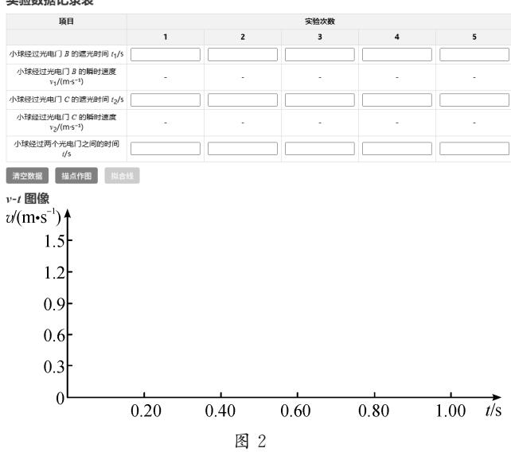
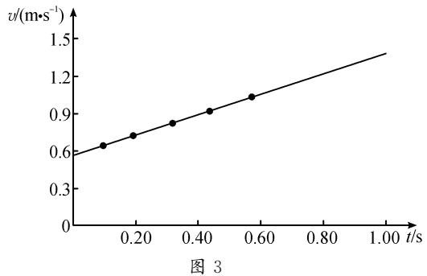
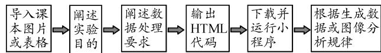

# 生成式人工智能在物理实验教学中的应用—以“探究匀变速直线运动的速度特点”为例

> 精校说明：已用 MinerU 3.4.4 二次 OCR 转换，并依据本地 PDF 逐页核对（2026-08-12）。PDF 第1页为上一篇“曲线运动”残页，正文从第2页起；下文已删除混入的上一篇文字。

陈煦(广州市第十六中学广东广州510000)

摘要：为突破传统实验教学在数据处理与即时反馈方面的瓶颈，以“探究匀变速直线运动的速度特点”为例，探索生成式人工智能作为“工具生成者”赋能实验教学的创新模式。教师引导学生依据实验原理设计提示词，驱动生成式人工智能生成数据处理程序，辅助其理解物理规律，让学生经历“设计—反馈—迭代”的过程，完成实验工具的开发。实践表明，该模式以实际教学问题为导向，有效深化了科学探究与计算思维的融合培育，为人工智能与实验教学的深度融合提供了可迁移的实践范式。

关键词：生成式人工智能；高中物理；实验教学；匀变速直线运动

文章编号:1002-218X(2026)10-0010-04

## 1 生成式人工智能与物理教学融合的现状

近几年，生成式人工智能发展迅速，应用前景广阔。目前其在中学物理教学领域多应用于以下方面：构建智能辅导系统，实现个性化教学资源推荐与全天候答疑解惑；辅助阅卷与作业批改，并进行数据分析统计；建立虚拟仿真实验室，生成多样情境、动画等，让学生获得沉浸式实践体验；让学生扮演科学家角色辅助探究，实现“经验一映射一关联—系统—整合”的认知进阶[1-2]；通过视频动作捕捉辅助建模[3]；通过多模态分析精准诊断课堂，优化教学[4]。

现有研究表明，生成式人工智能正从“辅助工具”逐渐发展为“创造型学伴”，其在情境设计、探索赋能和个性化学习等方面有广阔的应用前景。然而，当前生成式人工智能与中学物理教学的融合侧重于人工智能生成内容(AIGC)在资源生成与情境互动中的应用。在利用AI生成个性化数据处理工具方面，无论是实践探索还是理论建构，都有待探索。本文以“探究匀变速直线运动的速度特点”实验教学为案例，深入探讨将生成式人工智能作为“工具生成者”应用于高中物理实验教学的应用模式与实践效果，以期为现有研究提供新的视角与实践依据。

## 2 实践案例

## 2.1 实验方案

“探究匀变速直线运动的速度特点”实验方案如下所示。

实验装置如图1所示，带凹槽的倾斜基座、小球(直径D=0.015m)、数字计时器、光电门（B与C)、学生电源、笔记本电脑(或平板电脑)。

  
图 1

实验步骤将小球从倾斜基座上方一端由静止释放，用数字计时器分别采集小球经过B、C两个光电门的时间 $t _ { 1 }$ 与 $t _ { 2 }$ ，计算得到小球通过光电门B、C的瞬时速度 $\mathcal { V } _ { 1 }$ 与 $\mathcal { V } _ { 2 }$ ，这两个瞬时速度就是小球在B、C之间运动时的初速度和末速度。从同一位置再次由静止释放小球，通过数字计时器测量小球经过两个光电门之间的时间t，完成一次测量。改变光电门C的位置，重复上述操作过程，将多次测量获得的实验数据填入表格。以小球经过两个光电门之间的时间t为横轴，小球经过光电门C的速度vv₂为纵轴，作出小球运动的v-t图像。

## 2.2 生成式人工智能赋能实验教学的操作流程

## 2.2.1 课前准备与程序生成

课前学习任务中，学生预习本节内容，根据实验原理，针对需要处理的数据设计提示词。学生利用DeepSeek或豆包等AI平台，选择“深度思考”，上传教材对应页码图片，输入提示词，定制数据分析工具。提示词应包含以下要素：①实验目的、实验原理的描述或图片；②实验数据处理需求，如生成表格，根据表格作图等；③必要参数；④以HTML格式输出。参考示例如下：

上传的图片是粤教版高中《物理》必修第一册第二章第1节的截图。实验目的是探究小球沿粗糙程度均匀的倾斜直槽运动时速度随时间变化的特点。可参考教材表2-1-1生成表格，表格内的数据可输入、可修改，可按物理意义实时计算。可参考教材图2-1-2，根据表格数据生成v-t图像，纵轴为小球经过光电门C的瞬时速度τv(单位m/s)，横轴为小球通过B、C光电门之间的时间t(单位s)。数据点用蓝色显示，横轴和纵轴用红色显示。生成一个“清空数据”按钮，点击后可清空数据重新填写。生成一个“描点作图”按钮，点击后可根据数据描点，点一下描一个数据点。生成一个“拟合线”按钮，用趋势线拟合数据，拟合线需与纵轴相交。修改教材图片数据，设定小球直径D=0.015m。请生成一个辅助处理实验数据的交互式小程序，输出完整可运行的 HTML代码。

基于对上传图片的理解，生成式人工智能根据学生的提示词生成个性化数据分析程序。学生下载并运行小程序，AI生成的数据分析程序界面如图2所示。

## 2.2.2 AI辅助数据分析

学生将实验测得的“小球通过光电门的时间”数据输入数据分析程序中，程序会自动计算小球的瞬时速度。观察数据表格(表1），可知小球速度随时间增加而增大，但无法直观看出定量规律。

## 匀变速直线运动实验模拟

实验目的：探究小球沿倾斜直槽运动速度变化的特点  
小球直径：D = 0.015 m  
实验原理：小球通过光电门的瞬时速度v = D/t，其中D为小球直径，t为遮光时间

表1
<table><tr><td rowspan=2 colspan=1>物理量</td><td rowspan=1 colspan=5>实验次数</td></tr><tr><td rowspan=1 colspan=1>1</td><td rowspan=1 colspan=1>2</td><td rowspan=1 colspan=1>3</td><td rowspan=1 colspan=1>4</td><td rowspan=1 colspan=1>5</td></tr><tr><td rowspan=1 colspan=1> $t _ { 1 } / \mathrm { s }$ </td><td rowspan=1 colspan=1>0.02607</td><td rowspan=1 colspan=1>0.02606</td><td rowspan=1 colspan=1>0.02607</td><td rowspan=1 colspan=1>0.02616</td><td rowspan=1 colspan=1>0.02612</td></tr><tr><td rowspan=1 colspan=1> $v _ { 1 } / ( \mathrm { m } \cdot \mathrm { s } ^ { - 1 } )$ </td><td rowspan=1 colspan=1>0.575</td><td rowspan=1 colspan=1>0.575</td><td rowspan=1 colspan=1>0.575</td><td rowspan=1 colspan=1>0.573</td><td rowspan=1 colspan=1>0.574</td></tr><tr><td rowspan=1 colspan=1> $t _ { \mathrm { 2 } } / \mathrm { s }$ </td><td rowspan=1 colspan=1>0.02333</td><td rowspan=1 colspan=1>0.02067</td><td rowspan=1 colspan=1>0.01825</td><td rowspan=1 colspan=1>0.01639</td><td rowspan=1 colspan=1>0.01457</td></tr><tr><td rowspan=1 colspan=1> $v _ { 2 } / ( \mathrm { m } \cdot \mathrm { s } ^ { - 1 } )$ </td><td rowspan=1 colspan=1>0.643</td><td rowspan=1 colspan=1>0.726</td><td rowspan=1 colspan=1>0.822</td><td rowspan=1 colspan=1>0.915</td><td rowspan=1 colspan=1>1.029</td></tr><tr><td rowspan=1 colspan=1> $t / \mathrm { s }$ </td><td rowspan=1 colspan=1>0.09617</td><td rowspan=1 colspan=1>0.19073</td><td rowspan=1 colspan=1>0.31626</td><td rowspan=1 colspan=1>0.43343</td><td rowspan=1 colspan=1>0.57034</td></tr></table>

学生分析表1发现，小球通过光电门B的速度大致恒定，这一现象让学生认识到“从同一位置无初速释放小球”是为了获得一个“初速度和加速度基本保持不变的直线运动”作为研究对象。利用小程序绘制数据点，可帮助学生观察数据点变化趋势，点击“拟合线”按钮后，程序生成一条拟合直线，如图3所示。

将表1中的 $\mathcal { V } _ { 1 }$ 值与 $_ { v - t }$ 图像纵轴截距进行对比，使学生进一步加深对本实验原理的理解：实验探究的是以小球经过光电门B时为起始时刻，其速度随时间变化的规律。学生通过观察拟合出的直线得出结论：小球的运动速度随时间均匀增加，即在相等时间内速度变化量相等，该运动为匀变速直线运动。

## 3 教学成效

## 3.1 AI从“辅助工具”转变为“工具生成者”

随着AI的迭代，目前AI交互界面友好，功能强大，使用便捷。在本实验中，教师引导学生依据物理实验原理，设计包含实验目的、数据说明、作图坐标轴设置及具体动作指令等要素的提示词，并上传教材插图，成功驱动AI生成定制化的数据分析工具。若程序运行有误，学生可通过自然语言反馈，引导AI调试修正代码，直至功能完善。实践表明此路径切实有效，在4个班级共52个样本组中，所有学生均成功运用该方法生成了可正常运行的数据分析程序。在后续教学过程中，学生熟练掌握了此种问题处理方法，能够主动利用AI生成工具辅助解决实际问题，实现了方法的有效迁移应用。

## 3.2 构建“教—学—评一体化”闭环

学生在填入数据后，可即时生成v-t图像并进行自我评估。在学生输入数据后产生了大量有效样本，教师通过实时投屏，引导学生对比分析(如数据点集中问题、拟合线精度差异等），进而优化实验或小程序，有效提升了学生的思辨能力。例如，要解决图像比例失调或因生成的坐标轴最大值小于测量数据导致无法正常描点等常见问题，学生只需追加提示语，如“变更纵轴最大值为……，变更横轴最大值为……，并重新输出完整代码”即可引导AI修正小程序。同时，学生也能因数据处理便捷及时分析误差较大的原因，通过优化实验方案(如变更光电门C的位置)来提升数据质量与测量精度，实现“实验操作—数据处理一评估改进”的闭环。

## 3.3 深化科学探究与计算思维融合

本案例中基于真实情境问题进行实验和程序的“设计—反馈—迭代”的过程，既训练了学生的计算思维，也深化了学生对物理实验原理的理解。

学生利用生成式人工智能生成数据分析工具的过程，是以对实验原理的深刻理解为前提，通过自然语言精准表述数据处理逻辑的过程。从设计提示词、调试程序，到依据图像归纳物理规律，该流程强化了学生的模型建构、科学推理与证据意识，同时计算思维中的分解、模式识别、抽象和算法设计也被自然融入科学探究的过程中。这个融合提升了学生获取和处理信息、基于证据得出结论并做出解释的能力。

相比之下，若采用教师预设公式的Excel进行数据处理，学生只需输入数据并观察结果即可，难以建立起原始数据与物理图像之间的深层逻辑关联。

## 3.4 提升课堂效率与数据精确度

本实验使用数字计时器与光电门组合测量时间，并据此计算瞬时速度，数据处理的计算量非常大，这些重复运算对学生物理学科核心素养的提升作用有限。利用AI生成的工具实现了数据的即时计算，有效减轻了学生的认知负荷。在引导学生完整经历描点、作图、拟合等探究过程的基础上，AI生成的工具将学生的注意力从烦琐的计算中解放出来，转向图像分析与规律总结等高阶思维活动，实现了过程体验与思维深化的有机统一，有效提升了课堂教学效能。

## 3.5 激发学习兴趣与创新意识

从课堂效果看，“利用AI生成数据处理工具”这一新颖的学习任务，激发了学生的好奇心与成就感。学生在此过程中不仅学习了物理知识，更体验了用先进技术解决实际问题的乐趣，培养了其创新意识。

## 3.6 践行“人机协同”教学新范式

生成式人工智能作为辅助工具，承担了程序代码生成与大量计算工作，因此，教师得以将更多精力投入到提升学生高阶思维能力的教学中，实现了真正意义上的“人机协同，师导生创”。学生由此掌握的“利用工具生成工具”的方法论，可迁移至其他物理实验的数据处理，并可进一步拓展为利用生成式人工智能解决各类问题的通用范式，如图4所示。

  
图 4

## 4 面临的挑战与对策

由于生成式人工智能生成的内容存在一定的不确定性，在应用过程中可能需要多次调试，这一过程可能分散学生对物理本质的关注，但该过程亦是解决实际问题所遵循的“分析—设计—实践—迭代”逻辑的核心环节。为应对这一矛盾，教师需提前开展预演，梳理典型错误模式，进而优化提示词设计与指引策略。通过具有逻辑关联性的物理问题串联各环节，使程序调试过程也能成为探究物理规律的进阶路径，确保课堂思维主线不被技术操作环节割裂。教学设计中需强化对“为什么要这样设计提示词”“图像斜率与截距的物理意义是什么”等核心问题的追问与研讨，规避学生仅聚焦程序运行结果、忽视物理原理本质理解的现象。

这一教学模式对教师提出了更高的要求。教师不仅要扎实掌握物理知识，还需掌握有效运用信息技术的能力，特别是提示词设计能力。因此，教师应增强跨学科意识，通过持续学习与相关培训，提升人机协同教学能力。

## 5 结束语

在国家“人工智能+”战略的推动下，生成式人工智能将更快更深地融入高中物理实验教学。它在将抽象的物理规律可视化、让学生获得交互性数字化学习体验及个性化学习资源开发等方面都有巨大潜力。本研究实践表明，生成式人工智能作为“工具生成者”的应用模式，能显著提升教学效率并激发学生的创新思维。

未来，生成式人工智能有望在跨学科项目学习、复杂实验的动态模拟及学生科学探究能力的智能化评估等领域发挥更大作用。与此同时，教师也需要在积极采用新技术的过程中坚守学科教育初心，时刻提醒自己“AI是工具，并不能替代学科教育本身”，从而使人工智能真正成为助力学生理解物理本质、提升学科素养的有效工具。

## 参考文献：

[1]陈其裕，庄伟.生成式人工智能赋能物理教学的实践突破[J].中学物理，2025，43(17)：32-37.

[2]全杰锋.生成式人工智能赋能的学习进阶教学设计：以“动量定理”为例[J].中学物理，2026，44(3)：52-56.

[3]李晓晴，蒋炜波，张玉峰.生成式人工智能赋能中学 物理创新能力培养的探讨与启示[J].中学物理， 2026,44(3):11-15.

[4]陈怡帆，汪盼.人工智能技术在物理教学中的协同增效：以“机械能及其转化”为例[J].中学物理教学参考，2025，54(21)：25-27.

\*基金项目2025年广东省教育科学规划重点课题“科学教育协同育人路径的探索与实践”，课题编号：2025ZQJK008。

(本文编辑：王一鸣、王怡菲)
