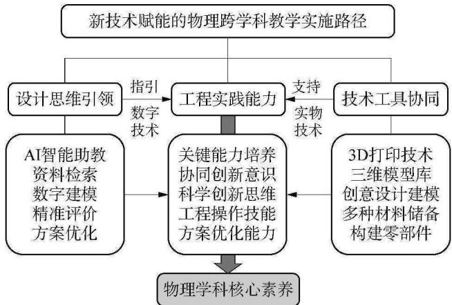
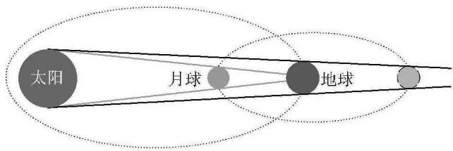
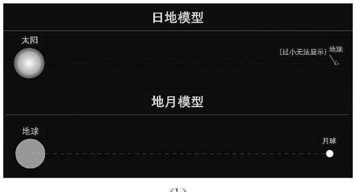
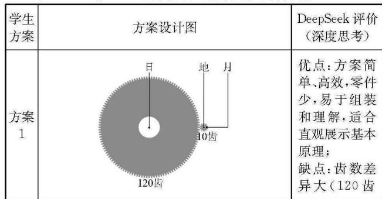
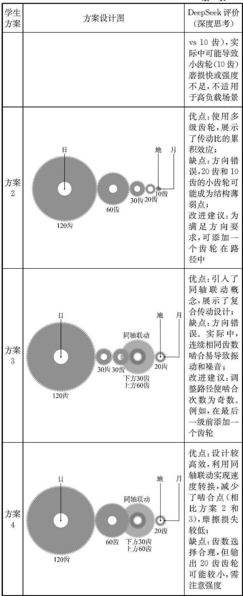
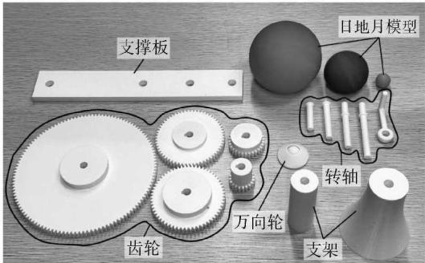
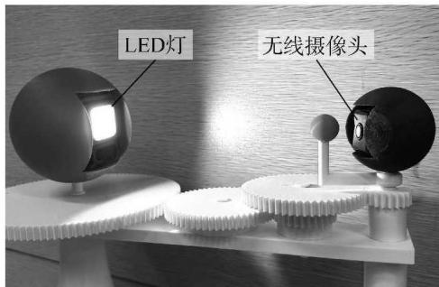
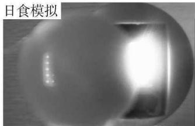
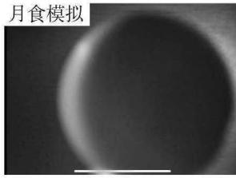
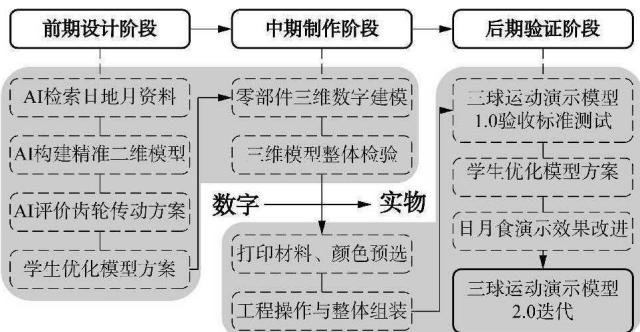

教研员论坛

# 融合生成式人工智能与3D打印技术的初中物理跨学科实践研究——以“制作三球运动演示模型”为例

> 精校说明：已用 MinerU 3.4.4 二次 OCR 转换，并依据本地 PDF 逐页核对（2026-08-12）。PDF 文末混入下一篇“弯槽模型”文章，已删除该混文，仅保留本文正文和参考文献。

吴利文(宁波市江北区教育局教研室浙江 315000)李经宇吴盼盼(宁波大学附属学校 浙江 315000)

摘 要在信息化和智能化背景下，将生成式人工智能与3D打印技术融合于初中物理跨学科教学，可有效提升学生的工程实践能力和物理学科核心素养。文章以“制作三球运动演示模型”为例，探讨生成式人工智能在数字建模和方案评价中的辅助作用，以及3D打印技术在模型零部件的构建与装配中的应用。结合实践案例，从新技术与跨学科融合、跨学科技能协作、探究模式构建及教师发展方向提出了教学建议。

关键词生成式人工智能 3D打印 跨学科实践工程实践

文章编号 1002-0748(2026)4-0038

中图分类号 G633·7

文献标识码 B

教育部等十八部门在《关于加强新时代中小学科学教育工作的意见》中明确提出：“推进人工智能、大数据、虚拟现实等新技术在科学教育中的应用，提高学生科学探究能力。”[1]《义务教育物理课程标准(2022年版)》也在课程理念中指出：合理运用信息技术等各种资源，设计以探究和实践为主的多样化学习方式[2]。因此，在初中物理跨学科教学实践中，一线教师应充分融合人工智能等新技术，结合技术与工程实践的学习形式，突出实践性和可操作性。例如，运用3D打印技术自制简单装置及实物模型，验证并展示物理原理、现象和设想，培养学生的探究能力、创新意识、实践能力和社会责任感，让学生在主动参与、动手动脑、积极体验中培养物理学科核心素养。

本文从剖析新技术在教学中的应用方向切入，以2024年浙教版《科学》教材(以下简称“教材”)七年级上册第5章第2节“像工程师那样实践”一节中“制作三球运动演示模型”实践活动为例，利用DeepSeek生成二维模型以呈现太阳、地球和月球之间的大小和距离的比例，引导学生对各因素进行综合分析，充分发挥创新思维。融合生成式人工智能的评价和检验，讨论和设计三维模型，从系统、动态的角度，展现地球、月球的公转规律及关系，模拟可能发生的日食和月食现象，利用3D打印技术制作和组装三维模型，完成工程产品的最终制作，以增强学生的工程实践能力，贯彻发展核心素养的要求。

## 1 生成式人工智能与3D打印技术在教学中的应用方向

## 1.1 生成式人工智能在教学中的应用定位

当前，生成式人工智能在跨学科教学领域的应用日益广泛，而其“生成性”并不具备对知识的逻辑检验和价值判断能力，本质是基于概率和模式的语言输出，无法替代学生的独立思考和教师的专业引导。人工智能应作为教学活动的技术工具，提供辅助性的教学资源支持，帮助学生开展科学论证[3]，而非成为知识主体或认知主体。因此，在教学实践中应遵循如 DeepSeek等平台所秉持的“AI for Human”的理念，将其定位为“智能助教”，为科学探究及模型建构提供信息支持和精准分析，达成促进学生深度思考、发掘创新思维、培养核心素养的目标。

## 1.2 3D打印技术在教学中的应用目的

在物理跨学科实践中，例如拆解、粘接、校准等工程操作技能的培养亦是促使学生关键能力进阶的必要途径。而在教学中应用3D打印技术的目的并非取代此类基础工程技能的锻炼，学生可利用其三维建模和快速成型的优点精准地获取所需的模型零部件，再通过粘接和组装等操作完成复杂实物模型的最终构建。在此过程中，传统工程技能需与现代3D打印技术协同配合，不仅体现了跨学科实践的多元工具观，还能推动学生在“从图纸到实物”转化过程中发展综合性的工程实践能力[4]，促成其对物理知识的深度理解和对工程世界的真实感知，为物理学科核心素养的发展提供高效支持。

## 1.3 新技术赋能的教学实践路径

在新技术与跨学科实践融合的背景下，物理教学应向“数字技术指引[实物技术支持”的模式创新改革。生成式人工智能可辅助学生进行资料检索、数字建模、精准评价和方案优化5]，成为其创新思维培养的“智能助教”；3D打印则可承担零部件快速构建的任务，将学生的创意构想高效地转化为现实工具，进而推动学生置身于“像工程师那样思考与实践”的真实任务情境中，实现新技术赋能下的深度学习。笔者基于上述理念，设计了如图1所示的教学实施路径，旨在推动学生协同创新意识、科学创新思维、工程操作技能和方案优化能力的统整培养，实现发展核心素养。

  
图1 新技术赋能的物理跨学科教学实施路径

## 2 AI辅助下三球运动演示模型的制作分析

## 2.1 理想模型的验收标准与 AI 辅助构图

三球运动演示模型的设计应基于对科学知识与科学事实的正确分析，在一线教学中，可先引导学生将构想转化为具体图形，再通过空间比例协调性、材料选取合理性和现象呈现可行性等综合分析，促使学生经历理想标准到现实标准的进阶。在工程实践的前期设计阶段，基于严谨、正确的科学知识进行设计，笔者引导学生利用DeepSeek进行资料检索(开启“联网搜索”功能)并结合现有研究[6]，提出了三球运动演示模型的理想验收标准(见表1)。

表1 三球运动演示模型的理想验收标准
<table><tr><td rowspan=1 colspan=1>评价维度</td><td rowspan=1 colspan=1>评价标准</td><td rowspan=1 colspan=1>评分(★★★)</td></tr><tr><td rowspan=1 colspan=1>三球大小比</td><td rowspan=1 colspan=1>日地月模型的直径比约为400：4:1</td><td rowspan=1 colspan=1></td></tr></table>

续 表

<table><tr><td rowspan=1 colspan=1>评价维度</td><td rowspan=1 colspan=1>评价标准</td><td rowspan=1 colspan=1>评分(★★★)</td></tr><tr><td rowspan=1 colspan=1>三球大小和距离比</td><td rowspan=1 colspan=1>“太阳”直径与日地模型的距离比约为1：100；“月球”直径与地月模型距离比约为1：100</td><td rowspan=1 colspan=1></td></tr><tr><td rowspan=1 colspan=1>三球运动规律</td><td rowspan=1 colspan=1>“地球”与“月球”的公转周期比约为12：1</td><td rowspan=1 colspan=1></td></tr><tr><td rowspan=1 colspan=1>模型功能</td><td rowspan=1 colspan=1>能演示日食和月食现象</td><td rowspan=1 colspan=1></td></tr></table>

教材从三球大小比、三球大小和距离比等维度呈现了日地月的图例(见图2)，该图例本质上属于一种二维模型。在教学实践中，有学生对该模型的合理性提出了质疑，认为其大小、距离的比例明显不符合实际情况。对此，教师可采取常用的专家提示(EP，Expert-Prompting)策略，输入提示词以引导DeepSeek输出形象、准确的日地月二维模型构图。由于DeepSeek是一个专注于文本交互的AI模型，不支持直接生成图片，可提示其将相应的内容以html的格式输出，再利用网页运行即可生成图片，日地月二维模型的文生图提示词与DeepSeek生成图如图3所示。

  
图2 教材中日地月的图例

你是一位科学教育专家，拥有多年教学和模型绘制经验，请根据以下内容分别绘画日地模型和地月模型，日地月的直径比约为400:4:1，太阳直径和日地的距离比约为1:100；月球直径与地月距离比约为1:100。要求严格按照比例绘制，分别调整模型大小使其容纳在同一画布中，过小或不可见的模型也要加以标注和指示，以html的形式输出，所有的内容都保存在同一个html之中。深度思考(R1) 联网搜索 0

(a)  
  
(b)  
图3 日地月二维模型的文生图提示词与 DeepSeek生成图

由于生成式人工智能存在输出结果不稳定，概念理解有偏差的固有弊端，使用者需建立“人工智能初评十教师复核”的机制，即明确其“智能助教”的辅助地位，由教师对其输出结果进行决策。上述的提示词在前期备课阶段已经过多次优化，旨在从认知水平层面缩小人机之间的差异，使其为教学构建精准的可视化模型。

## 2.2 现实模型的验收标准与 AI辅助评价

生成上述图例后，DeepSeek还做出了形象的比喻：如果太阳是一颗像教室一样大的巨型气球，地球只是它旁边4个首尾相连的足球场外的一颗乒乓球，乒乓球旁边1米处再跟着一颗小弹珠，代表着月球。根据DeepSeek呈现的二维模型和比喻，学生在科学观念中构建了日地月之间现实的大小比、大小和距离比。通过对材料选取、现象呈现等多方面因素综合分析，一致认为无法精准达成理想验收标准中上述比例的要求。在各组内和组间重新讨论交流后，学生对理想验收标准进行了部分调整和补充，得出了制作上更基于现实情况、操作上更具有可行性的三球运动演示模型的课堂验收标准(见表2)。

表2 三球运动演示模型的课堂验收标准
<table><tr><td rowspan=1 colspan=1>评价维度</td><td rowspan=1 colspan=1>评价标准</td><td rowspan=1 colspan=1>评分(★★★)</td></tr><tr><td rowspan=1 colspan=1>三球比例</td><td rowspan=1 colspan=1>三球大小比、三球大小和距离比的关系均合理</td><td rowspan=1 colspan=1></td></tr><tr><td rowspan=1 colspan=1>三球运动规律</td><td rowspan=1 colspan=1>“地球”与“月球”的公转周期比为12：1，两者的公转方向一致</td><td rowspan=1 colspan=1></td></tr><tr><td rowspan=1 colspan=1>可靠程度</td><td rowspan=1 colspan=1>模型转动流畅，无打滑、卡顿现象</td><td rowspan=1 colspan=1></td></tr><tr><td rowspan=1 colspan=1>制作工艺</td><td rowspan=1 colspan=1>模型整体美观、精致</td><td rowspan=1 colspan=1></td></tr><tr><td rowspan=1 colspan=1>演示效果</td><td rowspan=1 colspan=1>能演示日食和月食现象，光源无遮挡</td><td rowspan=1 colspan=1></td></tr></table>

依据上述的验收标准中“三球运动规律”的公转周期比，学生受到生活中常见的齿轮传动方式的启发，通过各小组组内的初步交流和讨论，提出了4种传动设计方案。教师再将各学生小组的设计图拍照上传至DeepSeek，提示其从科学性和可行性做出评价分析，评价结果如表3所示。

表 3 DeepSeek 对传动设计方案的评价分析  

续表  

## 3 3D打印支持下三球运动演示模型的制作过程

## 3.1 三维模型的打印与组装

以表3中的方案4为例，教师引导学生利用三维建模软件(如 SOLIDWORKS 或 Tinkercad)进行齿轮、支架和球体等核心零部件的数字建模。在此过程中，学生需结合前期制订的课堂验收标准，对三球比例、齿轮啮合关系及整体结构再次进行检验，以确保实物模型的可靠性和科学性。验证完毕后，再将数字建模文件上传至3D打印程序，并选择合适的材料(如PLA或ABS)和参数进行分件打印，依次获得三球运动演示模型的全部零部件。在教师的技术协助和指导下，学生再通过粘接支架、套接转轴、校准齿轮等工程操作最终完成模型的整体组装。3D打印出的三球运动演示模型的零部件如图4所示。

  
图4 三球运动演示模型的零部件

## 3.2 三维模型的测试与优化

模型组装完成后，学生仍需依据课堂验收标准检查各齿轮间啮合是否紧密，传动效果是否良好，三球的比例关系和转动规律是否符合预设标准，并对模型结构稳定性和整体美观度进行综合评定。从建模、组装到测试的过程中，学生不仅锻炼了工程实践能力，还经历了“从图纸到实物”转化的完整过程。

在测试环节中，学生提出由于太阳模型缺少光源，以及无法还原地球模型上的视角，因此日食和月食的演示效果并不理想。教师可引导学生小组继续讨论和交流，大胆发挥创新思维以优化现有的模型。有学生提出，可在太阳模型中嵌入LED灯以模拟发光效果，在地球模型中嵌入无线摄像头来模拟观测的第一视角等，优化后的模型结构与日食、月食的演示效果如图5所示。在优化迭代的过程中，学生在真实的工程情境中培养了反思和改进的意识，提升了创新实践能力。

  
(a)

  
(b)

  
(c)  
图5 优化后的三球运动演示模型和演示效果

## 4 融合新技术背景下的教学建议

## 4.1 注重新技术与跨学科实践的有机融合

教师在教学过程中应积极引导学生将新技术的使用与物理概念的理解、科学探究的方法、工程设计的流程以及创新能力的培养有机结合，同时明确其“智能助教”的定位，仅将其作为辅助跨学科实践的技术工具，而非取代学生独立思考的捷径。

## 4.2 推动跨学科技能发展的高效协作

以“制作三球运动演示模型”工程实践活动为例，物理学科可为模型前期的设计和构建提供理论依据；信息技术学科可在课前帮助学生熟悉AI的应用场景和3D打印技术的使用技巧；通用技术学科可训练学生安全使用工具和规范装配零件的日常技能；美术学科可长期培养学生对模型的整体构造、外观设计和色彩搭配等审美能力。这种高效协作机制不仅能提高学生制作出的工程产品的科学性和美观度，也能培养学生综合运用多学科知识解决复杂问题的关键能力。

## 4.3 形成“数字—实物”双轮驱动的探究模式

以“制作三球运动演示模型”探究实践活动为例，在前期设计阶段，学生借助生成式人工智能进行资料检索、数字建模、精准评价和方案优化，主动而高效地调动了数字资源，提升设计起点；在中期制作阶段，学生利用三维建模软件与3D打印机将数字模型转化为可测试的实物模型；在后期验证阶段，学生通过对实物模型的测试与评价，自主地从呈现效果和科学性等专业角度进行优化迭代。笔者根据上述工程探究的设计理念与教学实践，提炼了“数字—实物”双轮驱动的探究流程(见图6)，这种虚实结合、层层深入的探究模式不仅充分利用了前沿技术资源，精准地帮助学生分析知识遗漏和认知偏差，还为学生科学创新思维和工程实践能力的发展创造了有效路径。

## 4.4 新技术背景下物理教师的发展方向

在新技术发展的背景下，物理教师应主动更新教学理念，树立数字素养修炼的主体意识，从单纯的工具使用者转变为融合生成式人工智能与3D打印技术的教学设计者。课后，教师还可结合课堂视频回放、AI课堂行为分析与学生反馈进行深度的教学反思，将实践经验整理为可推广的案例，在校本研训或线上平台交流，形成与时俱进、不断创新的专业发展路径。

  
图6 “数字—实物”双轮驱动的探究流程图

## 参考文献

[1]教育部，科技部等十八部门.关于加强新时代中小学科学教育工作的意见[EB/OL].(2023 - 05 -17). http://www.moe.gov.cn/srcsite/A29/202305/t20230529\_1061838.html.

[2]中华人民共和国教育部.义务教育物理课程标准(2022年版)[S].北京：北京师范大学出版社，2022.

[3]戴荣彬，于一真，刘波，等.人工智能赋能中学物理教学初探以“匀变速直线运动的位移与时间的关系”教学为例[J].物理教学，2025(9):9 12.

[4]吴盼盼，李经宇，吴利文.指向“技术与工程实践能力”的物理实验创新研究以“自制内置式密度计”教学为例[J].物理教学,2025(3):2628,40.

[[5]黎小鹿，夏万根，李霹.AI赋能的中学物理“问题·实验·深度思维”研究[J].物理教学，2025(9):25-28,24.

[6]沙立国，夏承俊，杨封友.验收标准进阶取向的初中科学跨学科实践教学研究以“三球运动演示模型的制作”为例[J].地理教学，2025(4):4851.
