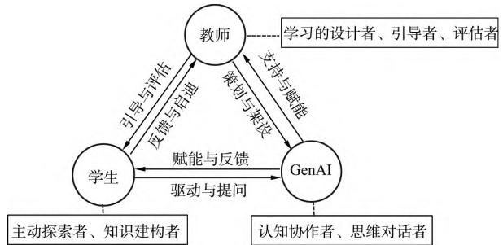
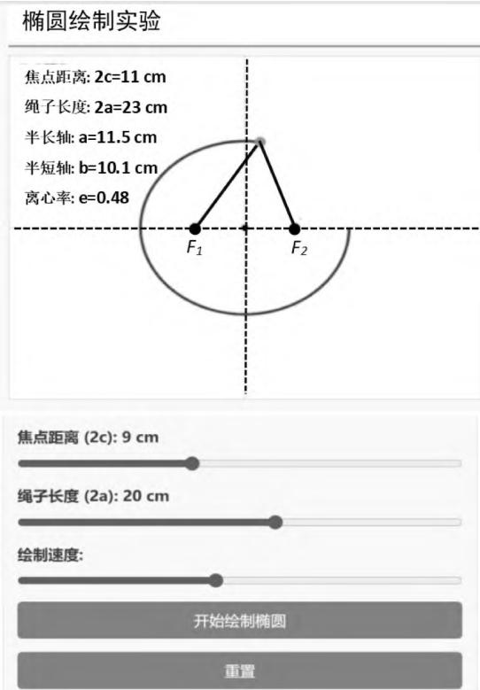
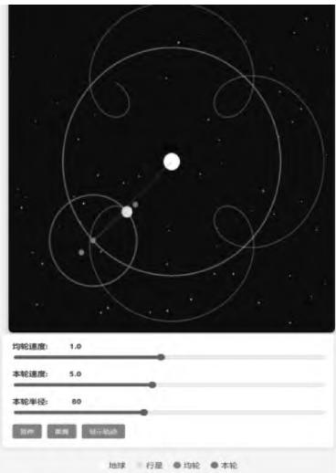
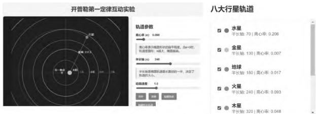
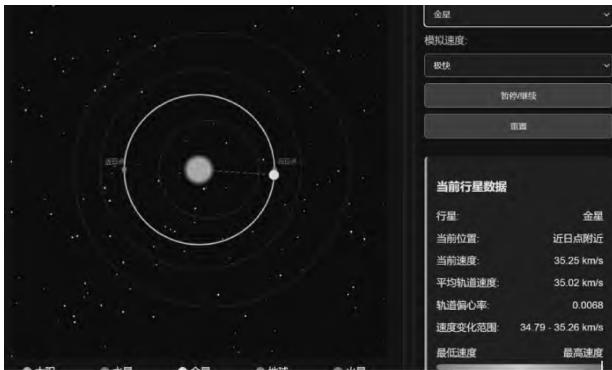
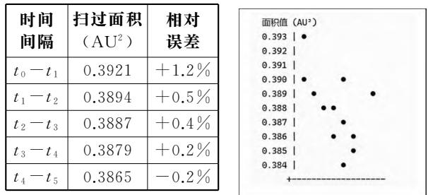
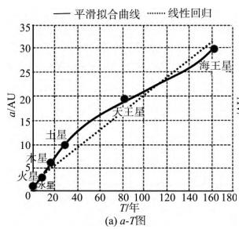
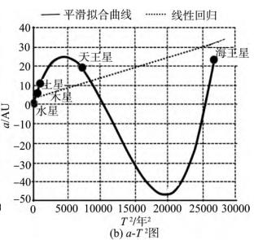
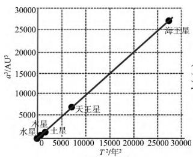
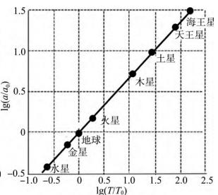

· 现代教育技术 ·

# 基于生成式人工智能中学物理课堂教学新样态——以粤教版高中物理必修2《认识天体运动》为例

> 精校说明：已用 MinerU 3.4.4 二次 OCR 转换，并依据本地 PDF 逐页核对（2026-08-12）。PDF 第1页和文末夹有相邻文章的栏内容，已删除相邻“弹道导弹进动”文章，仅保留本文正文与参考文献。

余建刚1 郑海棠2

（1．佛山市南海区石门中学 广东 佛山 528248； 2．佛山市三水区教育发展中心 广东 佛山 528100）

摘 要 以粤教版高中物理必修2《认识天体运动》为例 系统探讨了基于 DeepSeek生成式人工智能的中学物理课堂教学新样态 研究聚焦于GenAI赋能下课堂教学从“知识传授”向“能力建构”的转型 构建了以“教师—GenAI—学生”三元协同为核心的“知识生成共同体”模型．通过课前自主探索 课中协作探究 课后个性拓展3个环节 深度融合GenAI工具 实现对学生个性化学习路径的支持 科学发现过程的重现 抽象概念的动态可视化以及高阶思维能力的培养 为人工智能与基础教育的深度融合提供了可操作的实践模式

关键词 ： DeepSeek 教学新样态 认识天体运动 AI赋能 探究式学习

## 1 引言

人工智能技术 （ArtificialIntelligence 简称AI）正以突破性的迭代速度推动教育领域在组织形态 运行机制与支撑体系等方面实现深层变革与系统性重构．《国务院关于深入实施“人工智能＋”行动的意见》明确提出 要将人工智能全面融入教育教学全过程 推动育人模式从“知识传授为重”向“能力提升为本”转型 ［1］ 在核心素养导向的教育改革与教育数字化战略的双重驱动下 课堂教学作为最具实践性的关键场域 已成为 AI赋能教育落地的核心着力点 《教育强国建设规划纲要（2024—2035年） 》进一步强调 应以教育数字化开辟发展新赛道 借助人工智能助力教育变革 加速推进教育现代化进程

然而 传统中学物理课堂长期受 “教师—教材—板书（或PPT）”灌输式教学模式的局限 学生多处于被动接受知识状态 难以深度参与知识建构过程．例如 本文案例《认识天体运动》这类融合物理学史 抽象概念与科学方法的章节中 传统教学模式的短板更为突出——学生仅能通过静态文本了解科学发展历程 无法亲身体验科学发现的曲折过程 难以体验知识的生成过程 也难以深入理解抽象概念背后的逻辑关联 最终导致对科学本质的认知流于表面

DeepSeek等大语言模型的出现 ， 其价值远超传统的信息检索工具或问答机器 这类技术的核心潜力在于构建“认知协作”关系 能够触发课堂教学从流程到本质的结构性 系统性变革 因此 本文的研究重点并非停留在“AI工具应用”的浅层层面 而 是 致 力 于 超 越 工 具 属 性 系 统 构 建 以DeepSeek深度融合为核心的中学物理课堂教学新样态 并以高中物理必修2《认识天体运动》为实践载体 详细阐述该新样态的运作模型 实施路径与实践成效 为生成式人工智能（GenAI）与基础教育的深度融合提供可复制 可推广的实践模式

## 2 GenAI 赋能下教学新样态的核心特征

GenAI赋能下的物理教学出现了前所未有的新样态 其核心特征可以概括为以下5个方面

（1） 从“标准灌输”到“个性化探究”

GenAI可以为不同认知水平和兴趣方向的学生提供定制化的学习路径．GenAI能够实现“一对一”的因材施教 将课堂从“齐步走”变为“个性化探索”．GenAI能够提供自适应学习路径 GenAI能根据学生与 GenAI的对话 提出的问题和解决的习题 判断其知识薄弱点和兴趣方向 动态推荐下一步的学习内容 挑战性题目或拓展阅读材料真正实现“按需学习”

（2） 从“结论记忆”到“过程体验”

GenAI可以引导学生重走科学家的探索之路．学生可以像第谷一样“观测”数据 像开普勒一样尝试用不同模型去“拟合”数据 亲身经历从观察到假设 再到数学建模的科学发现全过程

## （3） 从“学生实验”到“无限实验”

GenAI能突破传统实验室在时间 空间 成本和安全性上的限制 充当无限可能的“虚拟实验室”与“AI科研助手” 它能将物理世界中那些看不见的力 抽象的场和微观的规则 转化为可触摸可交互 可探究的生动体验 例如 生成太阳系八大行星的运动轨迹 探索其轨迹是不是圆形”或“观察光在引力场中弯曲的路径 GenAI可以快速模拟出结果 并与经典理论进行对比验证

其次 GenAI具有强大数据处理与模型拟合能帮助学生进行复杂的数据分析 绘制专业图表甚至基于数据建议可能的物理模型并进行拟合让学生体验从数据到结论的完整科研流程 例如可以将8大行星的周期和半长轴等庞大的天文数字 拟合出半长轴立方与周期平方的线性关系

## （4） 从“单向传递”到“多维互动”

课堂互动不再局限于师生 生生之间 而是拓展到“学生 GenAI” “小组 GenAI” “教师GenAI”的多维互动 教师将从知识的单向讲授者转变为学习情境的设计者 探究活动的引导者和人机协同的协调者．学生从被动的接收者 转变为主动的探索者 边做边学的实践者和富有好奇心的提问者 GenAI作为智能认知伙伴 能持续激发学生的思考 使探究活动不断走向深入

## （5） 从“预设流程”到“生成性课堂”

借助GenAI强大的生成能力 课堂走向不再是教师完全预设的 学生的一个奇思妙想 通过GenAI的即时反馈和拓展 可能衍生出新的 有价值的探究方向 使课堂充满动态生成的活力

## 3 教学新样态下师生关系的重塑

传统课堂的师生关系为“教师—学生”的二元结构 知识流动主要是单向的“教师—学生”教师是知识的权威和唯一源头 学生是接受者GenAI赋能下学生不再被动等待灌输 而是主动向 GenAI提问 探究 学生不再是单一的“知识的接受者” 而是“主动的探索与建构者” 教师从“知识的唯一权威”到“学习的设计师与成长的引导者” 生成式人工智能从辅助工具演变成强大的“智能认知伙伴”和“教学协作者” 他们3者形成了“教师—GenAI—学生”的三元协同关系 3者互为支撑 形成一个稳定的 “知识生成共同体” 知识在其中多向流动 循环创生 其核心结构与互动循环如图1所示

  
图1 新样态下“师—生—AI”核心结构

在新的教学样态下“教师—学生—AI”存在以下3种循环

## （1） 设计引导循环（教师——学生）

教师基于对学生认知规律和课程标准的理解 为学生设计基于GenAI的探究性学习任务 并对学生的学习成果进行评估和指出改进方法 学生则在任务中进行体验和创造 其表现和成果为教师优化教学设计提供了依据和灵感．此循环是教学互动的核心

## （2） 探索赋能循环（学生——GenAI）

学生作为主角 主动向AI发出指令 提出问题驱动AI为其学习服务AI通过提供无限的知识 数据和脚手架 AI以其模拟与计算引擎 能极大地扩展了学生的认知边界和实践能力 赋能其完成原本难以企及的学习任务．此循环是学习发生的中心

## （3） 策展支架循环（教师——GenAI）

教师作为驾驭者 精心策划和设计 GenAI的使用方式 为其“投喂”高质量的任务指令 并为GenAI生成的内容搭建呈现给学生的 “支架”GenAI则通过其强大的信息处理能力 为教师提供丰富的教学资源 数据分析和支持 辅助教师进行决策．此循环是教学效率的保障

这3种循环形成了一个稳定的“知识生成共同体” 知识 指令与情感在其中多向流动 循环创生．在新的教学样态下 教师 GenAI和学生的角色发生了根本性的转变 其关系对比如表1所示

表1 教学新样态与传统课堂下教师 学生角色的对比
<table><tr><td>课堂 要素</td><td>传统课堂</td><td>教学新样态</td></tr><tr><td>教师</td><td>知识的权 威传授者、 课堂的中 心控制者</td><td>学习的设计师与引导者. 设计者：设计探究任务、学习情境和 AI互动流程. 引导者：在关键节点进行点拨，组织 高阶思维活动. 情感联结者：关注学生状态，提供机 器无法替代的人文关怀与价值引领</td></tr><tr><td colspan="1" rowspan="1">GenAI</td><td colspan="1" rowspan="1">无</td><td colspan="1" rowspan="1">强大的认知工具与协同伙伴.海量知识库：提供即时、准确的多模态信息.个性化导师：针对不同学生提供差异化解释和练习.模拟与计算引擎：快速处理数据、模拟物理情景，化抽象为具体.思维对话者：通过与学生的问答，促进其元认知发展</td></tr><tr><td colspan="1" rowspan="1">学生</td><td colspan="1" rowspan="1">被动的知识接收者、信息的容器</td><td colspan="1" rowspan="1">主动的探究者与知识建构者.主体地位回归：在真实任务的驱动下，主动检索、筛选、应用信息.协作学习：在小组中与同伴、与AI协同解决问题.批判性思考者：不仅从AI获取答案，更要学会质疑、验证AI提供的信息，形成独立判断</td></tr></table>

## 4 教学新样态实践案例解析

本文研究和展示的案例为高中物理必修2（粤教版）第3章第1节《认识天体运动》．传统课堂教学目标 “了解地心说到日心说的发展历程 理解开普勒三大定律的内容和意义 认识中国古代天文学成就 ”教学方式多以“教师讲 学生听”为主其核心不足在于将一部充满质疑 批判与逻辑思辨的科学史诗 简化为了需要被动记忆的知识点清单 具体表现为 缺乏探索体验 科学精神被架空 学生只是被动地“被告知”从地心说到日心说的结论 却无法切身感受那个时代天文观测数据与旧理论之间日益尖锐的矛盾 定律与过程割裂思维方法缺失 开普勒三大定律作为最终结论被直接呈现 学生记住了“椭圆”“面积相等”“周期与半长轴关系” 却不了解第谷长达数十年的精密观测数据基础 以及开普勒如何尝试了多种模型后才发现椭圆轨道 这导致学生只记住了“是什么”却不理解“为什么”和“怎样发现”的 错失了科学方法论的培养

基于DeepSeek的GenAI教学新样态 旨在构建一个人机协同 动态生成 深度探究的学习生态本节课可以让学生运用GenAI工具进行物理学史探源 认识“日心说”和“地心说”之争．作GenAI驱动的太阳系真实数据支持下的互动仿真实验 再通过数据拟合与可视化工具“验证”或“发现”行星运动定律 发展批判性思维和科学论证能力 创作个性化的天文学习成果 培养创新思维．以《认识天体运动》为例 “GenAI赋能的探究式智慧课堂”模式贯穿课前 课中 课后全过程 形成一个闭环的学习流程 其详细设计如下

4．1 课前 自主探源——从“被动预习”到“主动建构”

## （1） GenAI化身自学好帮手

本节课涉及到“椭圆”的诸多知识点 但学生对“椭圆”及其几何性质（焦点 半长轴 偏心率）完全陌生 “椭圆”对学生而言只是一个“压扁的圆”的模糊概念 如何让“椭圆”从一个陌生的数学图形变成一个直观 可测量的物理模型？GenAI化身自学好帮手 通过 GenAI动态仿真和即时数据测量 让学生跳过复杂的椭圆方程 直接感知其核心几何性质

GenAI输入指令示例 “我是一名中学生未学习椭圆的知识 请您简要介绍椭圆知识 并设计互动实验演示椭圆的定义和重要概念 ”

GenAI输出示例．可控变量椭圆绘制互动实验（如图2所示） 可以通过控制参数绳子长度和焦点的距离 来绘制椭圆 以此理解椭圆的定义及焦距 半长轴对椭圆形状的影响

  
图2 可控变量椭圆绘制

通过 GenAI赋能 学生亲手实验理解椭圆的定义及其核心性质 这比仅仅在书本上看到公式要深刻得多 同时也激发学生对数学和几何图形的兴趣

（2） GenAI作为资深史学顾问

在课前 学生已有“地心说”“日心说”的前概念 但是学生被动接受“日心说正确 地心说错误”的结论 认为科学是静态事实的集合 这不利于对科学本质的理解 教师可以发布“科学法庭”辩论预备任务 学生选择扮演“地心说辩护律师”或“日心说检察官” 学生借助GenAI海量的知识库及思维助手功能 了解和理解“地心说”和“日心说”这两种科学学说的优点和弊端 体验到科学革命不是简单“对”与“错”的替换 而是“范式”的转移 理解科学的本质是建立在证据 模型和不断修正的基础之上的

任务设计 发布“科学法庭”辩论预备任务 学 生选择扮演“地心说辩护律师”或“日心说检察官”

## GenAI输入指令示例

地心说方提问 “我是一名托勒密体系的支持者 请告诉我如何用 ‘ 本轮—均轮’ 模型清晰地向陪审团（同学们）解释火星的逆行现象？并准备3条反驳日心说的论据．”

日心说方提问 “作为哥白尼的追随者 请为我准备一份陈词 用日心说模型直击火星逆行问题的本质 并指出地心说模型在哲学和科学上的3个根本缺陷．”

地心说辩护者通过GenAI深入了解托勒密的“本轮—均轮”模型 他们会发现 在当时的观测精度下 地心说是一个相当复杂且有效的“数学模型” 能很好地解释行星逆行 昼夜交替等现象 这打破了“地心说纯粹是迷信”的简单化认知 通过GenAI模拟托勒密本轮—均轮系统展示了托勒密宇宙模型中的本轮－均轮系统如何解释行星逆行现象（如图3所示）

  
图3 模拟托勒密本轮－均轮系统

日心说举证则需通过GenAI梳理哥白尼体系的简洁性 以及第谷的精密观测 开普勒的椭圆定律等如何作为“呈堂证供” 最终“证伪”地心说

教师评价 要向“地心说”致敬 托勒密的体系 不是一个简单的错误 它是一个符合时代观测数据 逻辑自洽的伟大数学模型 但是它不够简洁 为了解释行星逆行等现象 它引入了多达80个 “本轮” 和 “均轮” 日 心说则体现 简洁 之美 它用“地球运动”一个核心假设 优雅地解释了行星逆行 使得宇宙图景瞬间变得无比简洁和谐

设计意图 课前让 GenAI化身自学好帮手和为史学顾问 不仅能弥补学生在自身知识缺陷 更是让学生从被动的知识接受者 转变为主动的知识建构者．GenAI提供了超越教材的 多视角的沉浸式的背景知识 实现了深度“情境感知”

4．2 课中 协作探究——从“听讲识记”到“建构 发现”

《认识天体运动》这节课中开普勒行星3大定律的教学核心难点在于其高度的抽象性与验证的复杂性 具体难点为 第一定律的“椭圆轨道”模型与学生“圆形轨道”的前概念剧烈冲突 且缺乏椭圆几何知识作为支撑 ； 第二定律的“面积速率”概念难以动态想象与定量验证 第三定律要求从混沌的行星数据中发现 3 与 T2 的隐藏规律 计算繁琐且规律不直观 传统的课堂往往只是让学生机械记忆结论 而非理解定律的发现过程与物理本质

GenAI赋能通过“动态仿真 数据探究 可视化”三位一体的策略 实现教学形态的创新转变利用GenAI生成动态行星轨道仿真打破“圆形”前概念 引导学生在真实数据中自主“发现”行星椭圆轨迹特征 通过实时计算相等时间扫过的面积将抽象的“面积速率”转化为可验证的数据 瞬间完成多组行星周期和半长轴数据的复杂运算与绘图 让学生亲历从数据中总结出 a3／T2 为常数的完整探究过程 将课堂重心从繁琐计算重新回归到科学思维的本质

探究1 验证轨道定律——从“史料记载”到 “数据实证”

如何让学生直观感受和理解教材中的“开普勒发现第谷观测数据与圆周模型存在8′的偏差”利用GenAI构建动态轨道模拟平台 学生输入不同轨道参数（圆形 椭圆） 实时观察轨道形状与理论位置的偏差 可视化呈现“8′偏差”对轨道拟合的

影响

探究任务 古人认为“天体的运动是完美的圆周” 这一定律统治了天文学近2000年 然而 开普勒在分析他的导师第谷留下的精密火星轨道数据时 发现无论用什么样的圆 都无法与观测数据吻合 今天 我们将作为开普勒的助手 利用 AI来重新审视这个问题 行星的真实轨道究竟是什么形状？

## GenAI输入指令示例

指令1 请根据开普勒第一定律 生成互动模拟动画 HTML代码 要求演示行星的运动 控制参数包括椭圆的离心率 半长轴 行星运动速率可以选择是否显示路径 是否显示焦点 是否显示半长轴等 并给出八大行星的轨道特征

GenAI输出示例 如图4所示 AI输出8大行星的半长轴和离心率 学生可以手动调节这两个轨道参数 形成行星的运动轨迹

  
图4 开普勒第一定律互动模拟实验

指令2 请根据火星运行轨道 请生成轨道上12个等分点 按“地心说”和“日心说”分别观察值是多少 并计算这两者的偏差

GenAI输出示例．火星运行轨道12个等分点偏差 如表2所示

表2 火星轨道12等分点 “地心说”“日心说”观测值对比
<table><tr><td rowspan=1 colspan=1>轨道位置</td><td rowspan=1 colspan=1>地心说预测黄经1°</td><td rowspan=1 colspan=1>日心说实际黄经1°</td><td rowspan=1 colspan=1>偏差度数</td><td rowspan=1 colspan=1>备注说明</td></tr><tr><td rowspan=1 colspan=1>位置1(近日点)</td><td rowspan=1 colspan=1>0°</td><td rowspan=1 colspan=1>0°</td><td rowspan=1 colspan=1>0°</td><td rowspan=1 colspan=1>起始点校准</td></tr><tr><td rowspan=1 colspan=1>位置2</td><td rowspan=1 colspan=1>45°</td><td rowspan=1 colspan=1>46.8°</td><td rowspan=1 colspan=1>1.8°</td><td rowspan=1 colspan=1>偏差开始出现</td></tr><tr><td rowspan=1 colspan=1>位置3</td><td rowspan=1 colspan=1>90°</td><td rowspan=1 colspan=1>93.5°</td><td rowspan=1 colspan=1>3.5°</td><td rowspan=1 colspan=1>偏差明显增大</td></tr><tr><td rowspan=1 colspan=1>位置4</td><td rowspan=1 colspan=1>135°</td><td rowspan=1 colspan=1>140.2°</td><td rowspan=1 colspan=1>5.2°</td><td rowspan=1 colspan=1>接近最大偏差区域</td></tr><tr><td rowspan=1 colspan=1>位置5(冲日点)</td><td rowspan=1 colspan=1>180°</td><td rowspan=1 colspan=1>186.3°</td><td rowspan=1 colspan=1>6.3°</td><td rowspan=1 colspan=1>最大偏差点</td></tr><tr><td rowspan=1 colspan=1>位置6</td><td rowspan=1 colspan=1>225°</td><td rowspan=1 colspan=1>230.1°</td><td rowspan=1 colspan=1>5.1°</td><td rowspan=1 colspan=1>偏差开始减小</td></tr></table>

教师点评

设计意图 学生让 GenAI根据真实天文数据绘制8大行星的轨迹图与精确圆形对比 视觉冲击直接打破“圆形轨道”前概念 通过对比火星轨迹“地心说”理论的推测值与实际真实观测值的偏差 学生自主发现与分析偏差模式特征 最小偏差在轨道起始点和某些对称点接近0° 最大偏差在冲日点附近达到6.3°这相当于12个满月并排的宽度 实际的历史观测中 第谷 · 布拉赫的测量精度已达到2角分（0.033°） 远高于这里显示的最小偏差 使得这些系统性错误无可辩驳．通过 GenAI图形绘制和数据测量对比 验证行星的轨道是椭圆 而不是被动接受结论

探究2 揭秘“面积定律”——从“感性猜想”到 “GenAI验证”

开普勒第二定律（面积定律）不仅揭示了行星速度变化的规律 其背后更蕴含着深刻的角动量守恒思想 但“面积速率”是一个抽象的概念 学生难以在脑海中动态构建“面积”与“速率”的瞬时关系 传统教学多通过静态图示并直接陈述定律 缺少数据支持 学生理解不深 GenAI赋能新样态下采用“猜想－验证－归纳”的科学探究范式 借助GenAI强大的数据处理能力快速 准确地完成学生指定的复杂面积和弧长计算 克服课堂时间与计算能力的限制 将抽象的“面积速度”守恒律 转化为可计算 可验证的数据任务．GenAI作为数据实验室 实现学生在课堂上“验证”开普勒第二定律的科学历程 实现学生从“记忆定律”转向“验证规律”进阶转变

探究任务 以火星为例 通过分析了其在椭圆轨道上不同区域的运动数据 验证“行星与太阳的连线在相等时间内扫过的面积相等”这一猜想 并最终归纳开普勒第二定律

阶段1 观察现象 提出猜想

教师引导 我们已经知道行星运动轨迹并非完美的圆形而是椭圆 那么对某一行星其运动速率有什么规律呢？

学生活动 观察行星绕太阳运行椭圆轨道不同点运动的速率

GenAI输入指令示例 为探究行星运动规律请生成互动实验ht l代码 要求能显示行星在轨迹上各点的速率 数据要求真实

GenAI输出示例．生成行星轨道速度模拟器（如图5所示） 它可以实时动态显示不同行星在不同位置的速度及行星对应运动的位置

  
图5 行星轨道速度模拟器

阶段2：设计方案——聚焦“面积”

教师引导 我们发现行星确实不是在匀速运动 那么 这种‘时快时慢’的背后 是否隐藏着一个不变的‘节奏’ 或 ‘规律’ 呢？思考除了“速度” 还有哪些物理量可以用来描述这种运动请猜想并验证

学生活动 在教师和GenAI的启发下 通过小组讨论 学生将关注点从“弧长”转向“面积” 形成“通过计算相等时间内扫过的面积是否相等来验证规律”的初步方案．设计验证方案 利用 AI计算“扫过面积” 比较验证

GenAI输入指令示例 设计开普勒行星运动第二定律验证方案 形成“通过计算相等时间内扫过的面积是否相等来验证规律”的初步方案并列出实际的天文观察数据以验证开普勒第二定律

GenAI输出示例．火星每隔30天扫过面积数据研究 如图6所示

  
图6 火星每隔30天扫过面积数据研究

阶段3 数据分析 揭秘规律

教师活动 引导学生关注数据 提出问题链“观察“扫过面积”一列 你发现了什么规律？为什么在近日点线速度最大 远日点线速度最小？用自己的语言总结开普勒第二定律

学生活动 思考回答 并用自己的语言组织总结规律

设计意图 GenAI技术将火星“扫过面积”这抽象概念转为可测量的数据 化抽象为具体 突破了教学难点 GenAI技术实现传统课堂难以实现的任务 在短时间内完成多次 高精度的“面积”计算 使得学生能将主要精力集中于数据分析 规律探寻和物理本质的思考上 提升探究深度与效率实现了高层次的思维培养

探究3 发现“周期定律”——从“数据拟合”到 “定律发现”

在传统教学模式下 开普勒第三定律的教学面临两大核心难点 首先 从数据中归纳规律的路径受阻 学生面对多组行星的轨道半径与周期数据 难以自发想到探究 a3 与 T2（a 为半长轴 T 为周期 下同） 这一非直观的数学关系繁琐的乘方计算过程不仅耗时费力 更淹没了寻找物理规律的核心思维 其次 对定律的理解停留在公式表面 学生往往只记住了 3／T2 k这一结论 但对常数 k 的物理意义 （与中心天体质量相关） 缺乏感知 定律的发现过程及其承上启下的桥梁作用被弱化 从而沦为又一个需要记忆的考点

GenAI的赋能彻底改变了这一局面 它将课堂从“计算场”转变为“发现场” 采用“数据驱动AI辅助 猜想验证”的探究模式 先通过让 AI（例如DeepSeek）扮演“第谷天文数据库”和“数据分析助手”的角色 能瞬间完成所有行星 a3 T2 值的精确计算并生成对比表格 然后让学生洞察 a3／T2比值为常数的惊人规律 还可以将数字转为图线输出 任意调节 am 和 Tn 的指数 当调节到 m 3＝2时 拟合成无规则的曲线突变为一条直线呈现 惊讶 感慨自然之和谐 隐藏在这复杂的数据里面的规律昭然若揭

探究任务．太阳系中众多行星 它们的轨道大小（A）和公转周期（T）都各不相同 是否存在一个隐藏的数学公式 能够将所有行星的运动统一起来？

第1阶段 数据获取与初步观察

学生活动 向 DeepSeek发出指令 获取原始数据

GenAI指令示例 “请提供太阳系八大行星的轨道半长轴 a（以天文单位 AU 为单位）和公转周期T（以地球年为单位） 的精确数据 并以表格形式列出

GenAI输出示例 如表3所示

(a) a3-T2图  
表3 火星每隔30天扫过面积数据研究
<table><tr><td rowspan=1 colspan=1>行星名称</td><td rowspan=1 colspan=1>轨道半长轴(a)/天文单位</td><td rowspan=1 colspan=1>公转周期(T)/地球年</td></tr><tr><td rowspan=1 colspan=1>水星</td><td rowspan=1 colspan=1>0.387098</td><td rowspan=1 colspan=1>0.240846</td></tr><tr><td rowspan=1 colspan=1>金星</td><td rowspan=1 colspan=1>0.723332</td><td rowspan=1 colspan=1>0.615198</td></tr><tr><td rowspan=1 colspan=1>地球</td><td rowspan=1 colspan=1>1.000001</td><td rowspan=1 colspan=1>1.000000</td></tr><tr><td rowspan=1 colspan=1>火星</td><td rowspan=1 colspan=1>1.523710</td><td rowspan=1 colspan=1>1.880816</td></tr><tr><td rowspan=1 colspan=1>木星</td><td rowspan=1 colspan=1>5.203363</td><td rowspan=1 colspan=1>11.86155</td></tr><tr><td rowspan=1 colspan=1>土星</td><td rowspan=1 colspan=1>9.537070</td><td rowspan=1 colspan=1>29.44750</td></tr><tr><td rowspan=1 colspan=1>天王星</td><td rowspan=1 colspan=1>19.19126</td><td rowspan=1 colspan=1>84.02059</td></tr></table>

第2阶段 数据处理与关系猜想

教师引导 “直接观察 a 和 T 两组数据有什么规律 它们成正比吗？它们之间可能是什么更复杂的关系？”

学生活动 提出数学猜想（如 $a ^ { 2 } \infty T ? a ^ { 3 } \infty T ?$ $a \infty T ^ { 2 } \Im a ^ { 3 } \infty T ^ { 2 } \Im )$ 并指令AI进行计算验证

GenAI输入指令示例 “请根据上面的数据计算每个行星的 $a ^ { \mathrm { ~ 2 ~ } } , a ^ { \mathrm { ~ 3 ~ } }$ T2 的值 并计算 $a ^ { 3 } / T ^ { 2 }$ 的比值 生成一张新表格 ”

GenAI输出示例 如表4所示

表4 太阳系八大行星数据
<table><tr><td rowspan=1 colspan=1>行星名称</td><td rowspan=1 colspan=1>轨道半长轴(a/AU)</td><td rowspan=1 colspan=1>公转周期(T/年)</td><td rowspan=1 colspan=1> $a ^ { 2 }$ </td><td rowspan=1 colspan=1> $a ^ { 3 }$ </td><td rowspan=1 colspan=1> $T ^ { 2 }$ </td><td rowspan=1 colspan=1> $a ^ { 3 } / T ^ { 2 }$ </td></tr><tr><td rowspan=1 colspan=1>水星</td><td rowspan=1 colspan=1>0.387098</td><td rowspan=1 colspan=1>0.240846</td><td rowspan=1 colspan=1>0.14984</td><td rowspan=1 colspan=1>0.05801</td><td rowspan=1 colspan=1>0.05801</td><td rowspan=1 colspan=1>1.0000</td></tr><tr><td rowspan=1 colspan=1>金星</td><td rowspan=1 colspan=1>0.723332</td><td rowspan=1 colspan=1>0.615198</td><td rowspan=1 colspan=1>0.52321</td><td rowspan=1 colspan=1>0.37845</td><td rowspan=1 colspan=1>0.37847</td><td rowspan=1 colspan=1>0.9999</td></tr><tr><td rowspan=1 colspan=1>地球</td><td rowspan=1 colspan=1>1.000001</td><td rowspan=1 colspan=1>1.000000</td><td rowspan=1 colspan=1>1.00000</td><td rowspan=1 colspan=1>1.00000</td><td rowspan=1 colspan=1>1.00000</td><td rowspan=1 colspan=1>1.0000</td></tr><tr><td rowspan=1 colspan=1>火星</td><td rowspan=1 colspan=1>1.523710</td><td rowspan=1 colspan=1>1.880816</td><td rowspan=1 colspan=1>2.32170</td><td rowspan=1 colspan=1>3.53746</td><td rowspan=1 colspan=1>3.53747</td><td rowspan=1 colspan=1>1.0000</td></tr><tr><td rowspan=1 colspan=1>木星</td><td rowspan=1 colspan=1>5.203363</td><td rowspan=1 colspan=1>11.86155</td><td rowspan=1 colspan=1>27.0750</td><td rowspan=1 colspan=1>140.851</td><td rowspan=1 colspan=1>140.736</td><td rowspan=1 colspan=1>1.0008</td></tr><tr><td rowspan=1 colspan=1>土星</td><td rowspan=1 colspan=1>9.537070</td><td rowspan=1 colspan=1>29.44750</td><td rowspan=1 colspan=1>90.9557</td><td rowspan=1 colspan=1>867.921</td><td rowspan=1 colspan=1>867.155</td><td rowspan=1 colspan=1>1.0009</td></tr><tr><td rowspan=1 colspan=1>天王星</td><td rowspan=1 colspan=1>19.19126</td><td rowspan=1 colspan=1>84.02059</td><td rowspan=1 colspan=1>368.304</td><td rowspan=1 colspan=1>7068.17</td><td rowspan=1 colspan=1>7059.46</td><td rowspan=1 colspan=1>1.0012</td></tr><tr><td rowspan=1 colspan=1>海王星</td><td rowspan=1 colspan=1>30.06896</td><td rowspan=1 colspan=1>164.7954</td><td rowspan=1 colspan=1>904.142</td><td rowspan=1 colspan=1>27181.5</td><td rowspan=1 colspan=1>27157.5</td><td rowspan=1 colspan=1>1.0009</td></tr></table>

学生活动 通过观察新表格 会惊奇地发现所有行星的 $\alpha ^ { 3 } / T ^ { 2 }$ 比值都近似等于1

第3阶段 数据可视化与规律确认

教师引导 图像可以使数据间的关系更加清晰直观 请同学们根据行星的天文数据生成图像并找出规律

学生活动 为了更直观地确认规律 指令 AI绘制图表

GenAI指令示例．“生成一开普勒第三定律交互式验证工具 以纵坐标为半长轴 a 的m 次方 横坐标为周期 T 的 n 次方 m n 数据为控制条 可以调节 将行星数据点在改坐标轴中描出 并标上行星的名称 最后将这些数据线用平滑曲线连接此外增加另一坐标轴 纵坐标为 $\log ( a / a _ { 0 } )$ 横坐标为 $\log ( T / T _ { 0 } )$ 其中 $a _ { 0 }$ 为地球的轨道半径 $T _ { \mathrm { ~ 0 ~ } }$ 为地

球的公转周期．”

GenAI输出示例．DeepSeek生成实时动态表格 如图7所示 可以任意调节半长轴 a 和周期 T的指数 并实时拟合平滑的曲线 由图可知数据点不存在线性关系

图7 行星轨道图  

  
(b) 1g(a/a0)-1g(T/T0)图  
图8 行星轨道图

图8为行星轨道 a3－T2 图．数据点几乎完美地分布在一条通过原点的直线上！对数坐标下数据点应该呈线性关系 斜率为2／3 即 $a ^ { 3 }$ 与 T2成正比 这便是“发现”开普勒第三定律

设计意图 本节探究主题是发现行星“周期定律 GenAI承担了所有繁琐的计算任务 将学生的认知资源解放出来 用于提出问题 分析数据和进行科学推理 从“数据拟合”到“定律发现”．这种即时的数据验证与直观呈现 不仅破解了计算的瓶颈 更引学生将认知重心从机械计算提升至高阶思维 体验“从数据中提炼物理规律”的科学方法

## 4.3 课后 个性作业——从“统一 刷题”到“个性多样”作业

传统课后作业通常是统一的练习题 旨在巩 固和检测知识．GenAI赋能的课后样态 其核心优 势在于将作业从“知识的重复”转变为“能力的生 成与素养的积淀”

（1） 让 GenAI做个性化学科导师 提供个性化分层作业

教师可以指导学生与 GenAI对话 生成适合每个学生的个性化分层作业 并让 GenAI对学生表现评价和指导．如

基础巩固层 让 DeepSeek生成一份“开普勒三大定律”的思维导图 并用自己的语言向 AI复述 由GenAI评判其理解的准确性 并做指导

能力训练层 让DeepSeek生成本节课的分层作业 学生作答后让 DeepSeek批改点评 对错题生成变式题加以巩固

（2） GenAI助力项目学习 拓宽视野 实现素养提升

通过项目学习作业设计 学生完成的不仅是一份“答案” 而是一个小小的 完整的科学研究项目 在这个过程中 DeepSeek成为了他们探索宇宙的第一个智能伙伴．举例如下

能力应用层：项目式学习——“寻找第二地球”

任务 “假设你是一名天文学家 发现了一颗围绕类日恒星Gliese 581运行的行星 其公转周期为37地球日．请利用DeepSeek辅助 计算其轨道半长轴 并分析其位于 ‘宜居带’的可能性 撰写一份简短的发现报告 ”

文化自信与创新层 ： 探究任务——“对比中西天文学智慧”

任务 “深度研究郭守敬的《授时历》与开普勒定律 利用DeepSeek 从研究方法 数学工具 历史影响等维度 准备一份对比报告 阐述中国古代天文学的卓越成就与独特智慧．”

设计意图：GenAI作为创造平台，支持了从知识巩固到科学探究，再到文化理解的多元发展，真正实现了因材施教和素养的广泛迁移。

## 4 结束语

以《认识天体运动》这一课的教学实践为镜，可以清晰地窥见GenAI赋能课堂的革新路径。在本节课中，学生不再是背诵开普勒三大定律的条文，而是在DeepSeek的辅助下，亲历了从分析“观测数据”到“验证”椭圆轨道、面积定律，再到发现开普勒周期定律、理解其物理内涵的完整探究过程。这一过程成功地将抽象的天体运行规律转化为可感知、可交互的数学模型，将学生的思维从繁复计算中解放出来，聚焦于更高层次的科学推理与质疑。

GenAI驱动下的教学范式正在经历一场变革，从“告知结论”走向“自主发现”，从“抽象想象”走向“具象感知”，从“机械计算”走向“高阶思维”。这就需要我们主动学习GenAI技术，转变观念、调整教学策略和思路，借力GenAI工具，将课堂的核心从“知识的传递”转向“思维的培育”，构建出一种以学生发展为中心、以核心素养为导向的智慧教学新样态。

## 参考文献

[1]中共中央、国务院.国务院关于深入实施“人工智能+”行动的意见[EB/OL].国发〔2025〕11号，2025-08-27.

(收稿日期：2025-10-17)
