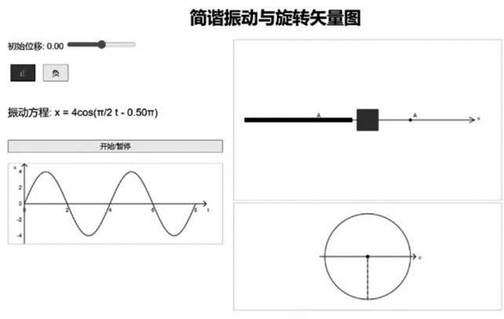
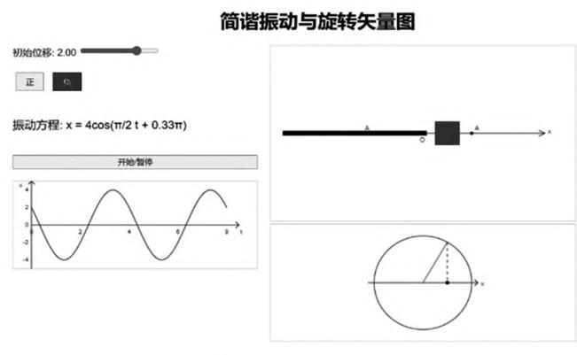
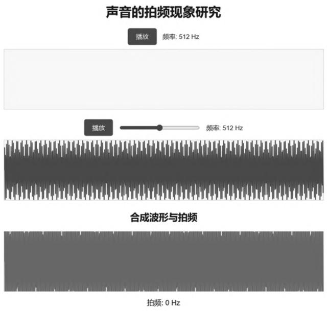
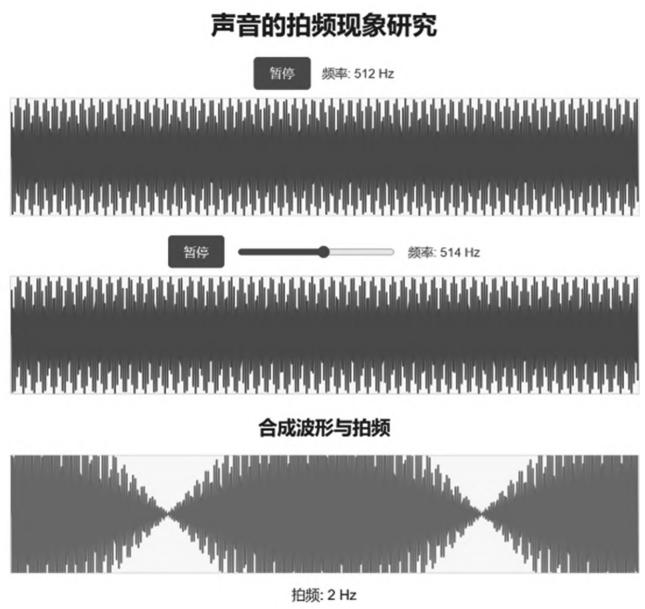
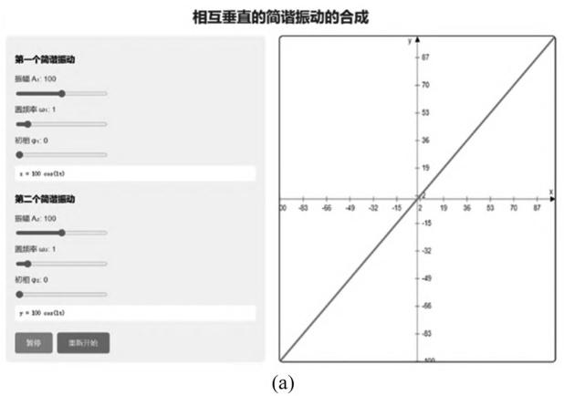
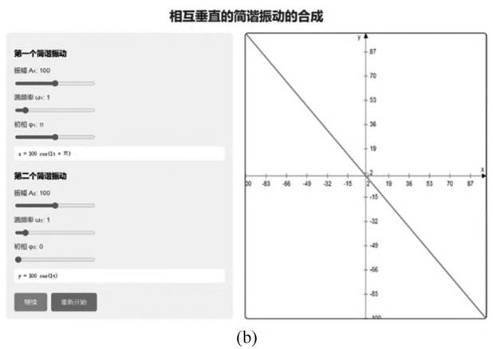
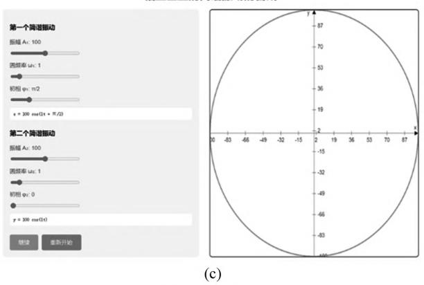
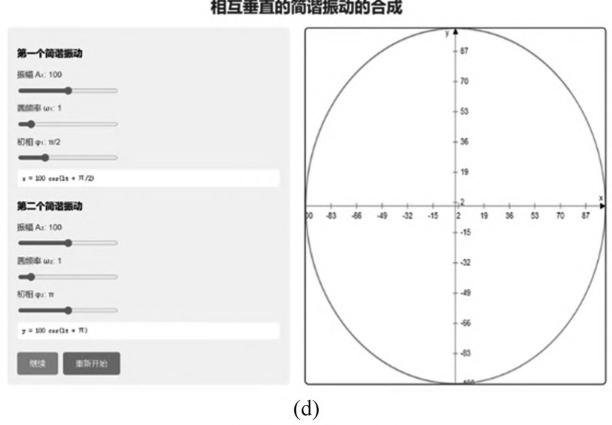
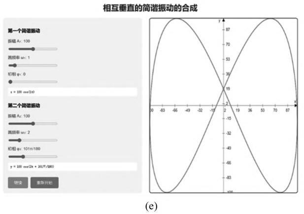
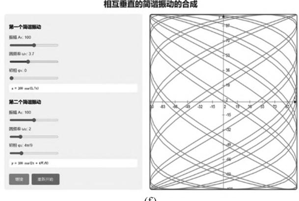

# 生成式人工智能在大学物理可视化教学中的探索与应用

马海霞顾晓蓉杨玉娥李晋斌（南京航空航天大学物理学院，江苏南京211106)

> 精校说明：已用 MinerU 3.4.4 二次 OCR 转换，并依据本地 PDF 逐页核对（2026-08-12）。已补回摘要、交互参数、问卷样本量及图号等 OCR 漏识内容。

## 摘 要

随着人工智能技术的飞速发展，生成式人工智能在教育领域的应用逐渐受到关注。大学物理作为一门基础学科，其教学过程中面临着一些挑战，如物理概念抽象难懂、教学方式缺乏互动等。生成式人工智能具有强大的数据生成能力，有望为物理概念的可视化提供新的途径。本文以简谐振动的教学内容为例，利用DEEPSEEK大语言模型生成了旋转矢量图、拍现象、李萨如图形等网页版交互动画，能够有效地将复杂的物理概念转化为直观的可视化图像和动画，提高学生的学习效果和教学质量。将生成式人工智能技术与大学物理教学相结合，能够为物理教学改革提供新的思路和方法，具有一定的应用价值。

关键词大学物理；可视化教学；生成式人工智能

# EXPLORATION AND APPLICATION OF GENERATIVE ARTIFICIAL INTELLIGENCE IN COLLEGE PHYSICS VISUALIZATION TEACHING

MA Haixia GU Xiaorong YANG Yu-E LI Jinbin

(College of Physics, Nanjing University of Aeronautics and Astronautics, Nanjing, Jiangsu 211106)

Abstract As artificial intelligence (AI) technology advances rapidly, generative AI is gaining attention in education. College physics teaching faces challenges like abstract concepts and lack of interaction. Generative AI, with its strong data-generation capability, can visualize physical concepts. This paper focuses on simple harmonic motion teaching. Using the DEEPSEEK large language model, it generates web-based interactive animations like rotating vector diagrams, beat phenomena, and Lissajous figures. These tools effectively simplify complex physics into intuitive visuals and animations, enhancing learning outcomes and teaching quality. Integrating generative artificial intelligence technology with college physics teaching can provide new ideas and methods for physics education reform, demonstrating certain application value.

Key words college physics; visualized teaching; generative artificial intelligence

随着人工智能技术的飞速发展，生成式人工智能在教育领域的应用逐渐受到关注[1-4]。大学物理作为一门基础学科，其教学过程中面临着一些挑战。大学物理课程中包含许多抽象的概念和复杂的物理现象，如电磁场的分布、量子力学中的粒子态叠加等，这些内容对于学生来说往往难以直观理解。此外，传统的教学方法多以课堂讲授为主，缺乏互动和实践，学生的学习兴趣和主动性较低。

生成式人工智能具有强大的数据生成能力，有望为物理概念的可视化提供新的途径。本文以简谐振动的教学内容为例，利用DEEPSEEK大语言模型生成了旋转矢量图、拍现象、李萨如图形等网页版交互动画，能够有效地将复杂的物理概念转化为直观的可视化图像和动画，提高学生的学习效果和教学质量。将生成式人工智能技术与大学物理教学相结合，能够为物理教学改革提供新的思路和方法，具有一定的应用价值。

## 1 生成式人工智能技术概述

生成式人工智能是一种基于深度学习和机器学习技术的人工智能分支，能够通过学习大量的数据和模式，生成新的内容，如文本、图像、音频、视频、代码等。其核心技术主要包括生成对抗网络(GANs)、变分自编码器(VAEs)和大语言模型(LLMs)等。近年来，随着计算能力的提升和数据量的增加，生成式人工智能取得了显著进展，尤其在自然语言处理(NLP)和计算机视觉(CV)领域表现突出。大语言模型（LLMs）：如ChatGPT、DEEPSEEK等，通过学习大量的文本数据，能够生成高质量的自然语言文本。这些模型在语言生成、文本补全、问答系统等方面表现出色，为教育领域提供了新的工具和方法，如大语言模型能够生成教学资源，智能辅导与答疑，为学生制定个性化的学习路径，对教学数据分析和预测，为教师的个性化教学提供依据。

## 2 生成式人工智能在大学物理可视化教学中的应用

机械振动是自然界中最普遍的运动形式，其中最简单、最基本的机械振动是简谐振动，任何复杂的振动都可看作是由若干个简谐振动叠加而成，因此简谐振动也是各大高等院校大学物理课程的必修内容。简谐振动的合成是研究机械波的干涉和光波干涉、衍射的基础。利用旋转矢量法分析物体的谐振动状态是这部分的教学基本要求，“拍”现象和李萨如图形在工程实践中有重要的应用价值，在这部分学习中要求学生要了解“拍”现象，了解李萨如图形。旋转矢量图能够清晰地展示简谐振动的位移、速度和加速度的变化规律，帮助学生更好地理解简谐振动的物理本质，但是旋转振幅矢量的概念对于学生来说比较抽象，传统的教学方法很难将这一概念生动地呈现出来；学生对于拍现象缺乏直观感受，缺乏应用场景的关联；李萨如图形的学习对于空间几何思维要求高，数学基础薄弱的学生难以建立方程与图形的直接联系。利用动画演示旋转矢量图、拍的形成过程、动态生成李萨如图形对于达成该部分的学习目标是一种可行的方法。

本文利用DEEPSEEK大语言模型生成了旋转矢量图、拍现象、李萨如图形等网页版交互动画，提高学生对简谐振动的理解和学习效果。

## 2.1 旋转矢量图的可视化教学

作者通过DEEPSEEK大语言模型，生成了旋转矢量图的网页版交互动画（见图1）。DEEPSEEK生成的网页版交互动画不仅提供了丰富的视觉效果，还支持学生与动画之间的交互操作。学生可以通过滑块选择初始时刻的位移，通过按钮选择初始时刻的速度方向，实时观察简谐振动图像、旋转矢量、振动方程，以及振动曲线的变化。图1(a)表示初始位移为0，初始速度方向为正时所对应的各种图像；图1(b)表示初始位移为2，初始速度方向为负时所对应的各种图像。按动开始/暂停按钮，弹簧振子开始振动，同时旋转矢量动态旋转，两者一一对应。这种动态的可视化方式能够帮助学生直观地理解旋转矢量与简谐振动之间的对应关系，能够满足不同学生的学习需求，使学生在主动探索中加深对物理概念的理解。

## 2.2 拍现象的可视化教学

通过DEEPSEEK大模型生成的拍现象网页版交互动画如图2所示。通过网页端交互动画直观呈现两个频率相近的声波叠加产生的拍现象。学生可固定一个声源频率为512Hz（模拟标准音叉频率），并通过滑块实时调节另一声源的频率(范围设定为492～532Hz)。双声波同步播放时，学生可清晰听到音量周期性起伏的“拍音”，同时观察到合成波形的动态变化。该动画结合听觉(实时声音反馈)、视觉(波形动态图)与触觉(滑块操作），突破传统公式教学的抽象性。学生可亲手调节频率差，直接感知拍频与频率差的关系，深化拍现象的概念理解。进一步地，教师可结合乐器调音等工程应用场景分析拍现象的应用价值。

(b)  
  
(a)

  
图1 旋转矢量图的网页版交互动画界面

  
(a)

  
(b)  
图2 拍现象的网页版交互动画界面

## 2.3 李萨如图形的可视化教学

通过DEEPSEEK大模型生成的李萨如图形网页版交互动画如图3所示。该网页端交互工具通过动态模拟两个相互垂直简谐振动的合成轨迹，直观展示李萨如图形的形成过程。学生可通过实时调节两个相互垂直的简谐振动的振幅、频率、相位等参数，观察不同条件下合成轨迹的演变规律。该动画突破传统教材局限，可设置任意频率比；通过按钮触发可实现动态绘制，完整呈现轨迹形成过程。频率相同、相位差为零时的合成轨迹如图3(a)所示；频率相同、相位差为π时的合成轨迹如图3(b)所示；频率相同、振幅相同、相位差为π/2时的合成轨迹如图3(c)所示，其动态轨迹显示为逆时针；频率相同、振幅相同、相位差为−π/2时的合成轨迹如图3(d)所示，其动态轨迹显示为顺时针；当频率之比为1/2时合成轨迹如图3(e)所示；当频率之比没有简单整数比时合成运动比较复杂，如图3(f)所示。该动画能够将抽象的数学方程转化为具象运动轨迹，解决传统教学中“纸上谈兵”的困境。通过实时调节参数，可以对比不同条件下的轨迹差异，学生可通过自主探索发现频率比与图形闭合性的关系。该动画的使用，能够提升学生对振动合成的理解程度，通过将抽象的物理过程转化为可操作的探索实验，有效培养了学生的科学思维与创新意识。

相互垂直的简谐振动的合成  
相互垂直的简谐振动的合成  
  
相互垂直的简谐振动的合成

  
图3 李萨如图形网页版交互动画界面

## 3 教学实验

生成式人工智能开发的大学物理可视化教学动画，作者通过教学活动在大学物理教学团队内部进行了分享，同行老师一致认为动画准确呈现了物理原理、设计符合教学逻辑，能够补充教学资源，为教学带来新的活力。双重编码理论表明图像和文字同时编码能够增强记忆与理解，提升记忆留存率。作者将教学动画分享给106名大二学生，采取问卷调查的方式收集学生的反馈，收集信息包括动画内容，交互功能，学习效果，总体评价几个方面。作者收集到102份调查问卷，结果表明学生对这些可视化教学动画总体非常满意，他们认为教学动画能够以通俗易懂的方式清晰呈现物理原理；内容深度和广度能够很好满足学习需求；操作流畅，很好地提高了学习兴趣和参与度；观看这些教学动画后，对相关知识点的理解程度有了很大的提升，是一种非常有效的学习辅助工具。

## 4 结论及展望

利用生成式人工智能制作的可视化资源能够直观地展示复杂的物理现象，帮助学生更好地理解抽象概念，提升学生对物理概念的理解，激发学生的学习兴趣。通过学生和动画的实时互动，能够引导学生主动探索和思考，提升学生学习体验，激活课堂活力，提高学习效率，推动教育教学质量的提升。

传统计算机辅助教学亦能开发大学物理可视化动画，开发时需专业物理教师与技术人员的紧密协作，开发周期较长，技术门槛以及制作成本较高。其制作的动画多为通用版本，个性化定制，实时交互更新方面存在一定局限。在数字化教育不断发展的背景下，生成式人工智能在教学应用领域展现出了显著的优势。其能够凭借先进的代码生成功能，助力教师群体高效地编写代码，进而制作出具有较高教学价值的可视化教学动画。具体而言，教师无须具备专业的编程知识与技能，仅需精准地输入与教学内容紧密相关的合适提示词，如明确教学动画的主题、期望呈现的风格、具体场景设定以及关键教学元素等，生成式人工智能便能迅速解析并生成相应的代码，将教师的教学创意转化为直观、生动的可视化动画作品。这一应用模式极大地降低了教师在制作教学动画时对编程技术的依赖程度，对于那些缺乏编程基础或不擅长编程的教师来说，具有极高的实用性和友好性。此外，利用生成式人工智能制作的教学可视化资源，系统根据提示词，可以短时间内产出完整动画，内容生成效率高；可根据学生的学习情况、教师的需要，个性化定制动画：结合智能交互技术，生成式人工智能能实时响应用户需求，动态更新动画内容。

大学物理课程内容多，教学团队应全面梳理课程的重点和难点内容，制定合适的动画制作脚本，结合生成式人工智能的优势，开发出具有高度交互性的动画。对制作好的动画邀请学生和教师参与测试，收集反馈意见，不断优化动画的交互性和教学效果。建立大学物理课程网页互动动画库，并建立动画库的分类索引，方便教师和学生根据教学和学习需求快速查找所需的动画资源。同时，应建立教师审核小组，确保内容的科学性和准确性。本文的研究只是生成式人工智能在大学物理可视化教学方面的初步探索，希望能够给广大一线教师提供一些参考，引发更多关于生成式人工智能在教育教学中应用的研究和实践，共同推动大学物理教学的创新与发展。

## 参考文献

[1]朱炎军，黄志兵，吕春辉．英属哥伦比亚大学生成式人工智 能教学战略[J]. 高教发展与评估，2025，41(2)：69-76. ZHU Y U, HUANG Z B, LV C H. Strategic Initiatives to Advance the Use of Generative Artificial Intelligence in the Teaching at the University of British Columbia[J]. Higher Education Development and Evaluation, 2025, 41(2):69- 76. (in Chinese)

[2]沈苑，房斯萌，柳晨晨，等．生成式人工智能教育应用治理： 案例与反思[J].开放教育研究，2024,30(6)：39-47. SHEN Y,FANG S M, LIU C C, et al. The Governance of Generative Artificial Intelligence in Educational Applications: Cases and Reflections[J]. Open Education Research, 2024, 30(6):39-47. (in Chinese)

[3]徐晓飞，张策.生成式人工智能赋能工程教育和学生能力培 养、测评与认证体系[J/OL].高等工程教育研究. Xu X F, Zhang C. Generative AI empowers Engineering Education and Student Ability Cultivation, Assessment and Certification systems[J/OL]. Research in Higher Education of Engineering. (in Chinese)

[4]黄星云，焦建利，曾君，等.GenAI重塑课堂活动：应用路径 与实践样态[J]. 现代教育技术 2025,35(2):26-34. HUANG X Y, JIAO J L, ZENG J, et al. GenAI reshaping classroom activities: Application paths and practice patterns, modern educational technology[J]. 2025, 35(2) : 26- 34. (in Chinese)

[5]周瑞冬，谢超凡.生成式人工智能对高等教育人的主体性的挑战及应对[J].高教发展与评估，2025，41(2)：100-110.ZHOU R D, XIE C F. Reshaping human subjectivity: Higheducation in the background of generative artificial intelli-gence[J]. Higher Education Development and Evaluation,2025, 41(2): 100-110. (in Chinese)

[6]周春鸣，曹月，张乐．生成式人工智能技术在物理教学中的应用[J].电子技术，2024，53(9)：357-359.ZHOU C M, CAO Y, ZHANG L. Application of generativeartificial intelligence in teaching of physics[J]. ElectronicTechnology, 2024,53(9):357-359. (in Chinese)
