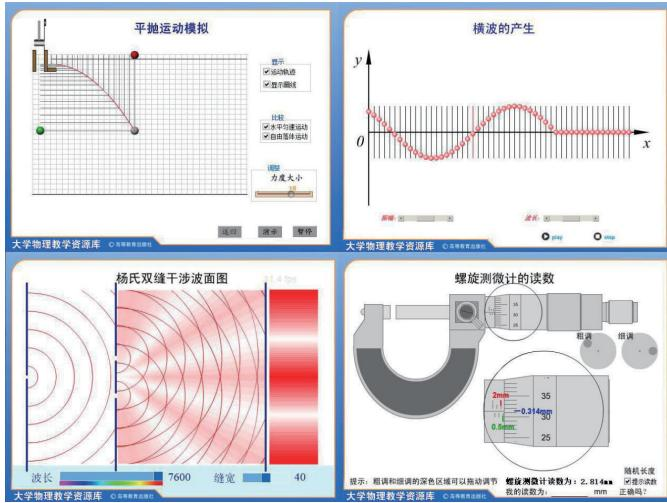
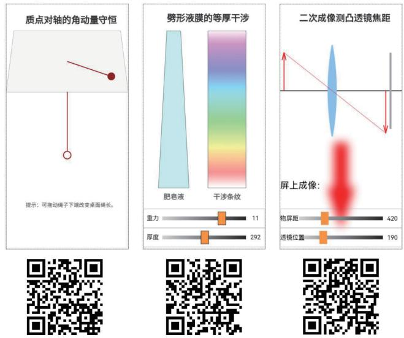

> 来源：MinerU 转换（stem-exact rebuild 2026-08-08）

# 从电脑到手机 从 Flash 到 HTML5

—— 大学物理交互动画开发工具的变革与探索实践

山东大学物理学院，物理国家级实验教学示范中心　　宋洪晓　　刘建强

【摘要】Flash 是一种重要的多媒体开发技术，曾经是大学物理交互动画的主要制作工具。随着信息技术的发展和前端技术的更迭，Flash 逐渐被 HTML5 所取代。回顾 Flash 技术发展壮大到逐渐衰落的过程，介绍大学物理课程使用主流前端技术制作交互动画的探索实践。

【Abstract】Flash is an important multimedia development technology. It used to be the main production tool for college physics interactive animation. With the development of information technology and the change of front-end technology, Flash is gradually replaced by HTML5. Reviewing the development and growth of Flash technology to its gradual decline, and introducing the exploration and practice of using mainstream front-end technology to make interactive animations in college physics courses.

【关键词】Flash；HTML5；交互动画；动画课件；大学物理

【Keywords】Flash; HTML5; interactive animation; animation courseware; college physics

在大学物理线上和线下教学中，交互动画是重要的一类学习资源。通过调整交互动画的参数变量，可以展示不同参数下的物理现象和物理过程，还可以模拟简单的物理实验等。大量教学实践表明，学生自主与动画进行前端交互，动画即时做出响应，可以让学生对物理现象的变化过程和因果关系有更直观的认识，加深概念理解，提高学习效率，增强学习效果。这种自主交互性是音视频、图像等其他媒体形式难以提供的，也是实现由教师引领学习到学生自主学习的一项重要支撑技术。

从 21 世纪初到现在，大学物理交互动画的开发工具经历了重要的变革，回顾这段历程，Flash 在其中占有重要的一席之地，然而随着硬件技术的高速发展和网络应用环境的巨大改变，前端技术也发生了更迭，Flash 行将告别历史舞台，取而代之的是 HTML5。大学物理教学资源建设也应紧跟信息技术发展潮流，尽快适应技术变革。回顾总结这段技术变革与探索实践的历程，对于信息技术与教育教学深度融合，转变教育理念和教学方式，提高大学物理教学质量具有重要的参考借鉴意义。

## 一、Flash 的兴起

1998 年，Macromedia 公司推出了 Flash3，这是 Flash的第三个版本，作为多媒体动画软件功能已经比较成熟完善。此后几年里，Flash 得到了迅猛发展，成为首屈一指的计算机多媒体动画软件。在 Flash 出现之前，计算机网络WWW技术刚刚普及，伴随着Windows取代DOS，网页排版完成了从文字字符界面到图文并茂的进化。

在上网方式以 modem 拨号为主，最快网速只有几十k 的情况下，网速制约了网页媒体的使用。传统的音、视频等多媒体数据动辄几十兆到几百兆，一般需要使用光盘为媒介进行传播。Flash 使用矢量图形格式，传输字节量小，可以随意放大不会产生锯齿，同时支持高压缩率的 MP3 音频和音画同步绑定，一个页面动画广告只有几十 K，一分钟的音乐 MV 短剧也只有一两兆，非常适合网络传播，可以说 Flash 完全是为互联网而生的多媒体技术。有了 Flash，网页实现了从静态到动态的跃迁，内容一下子丰富起来，诞生了各种嵌入页面的动画广告、贺卡、小游戏，还能实现在线音、视频播放等功能，产生了所谓富网页 (Richweb) 的概念。

Flash 入门容易，开发简单，支持嵌入多种媒体，能制作各种动画效果，设置时间轴上两个关键帧之后能够自动补充中间帧，这种“补间动画”大大降低了传统需要逐帧绘制的动画制作门槛。其内嵌的脚本语言：ActionScript 入门简单、功能强大。简单易用，效果炫酷的 Flash 吸引了喜欢计算机和上网的年轻人，国内的Flash 爱好者群体日渐壮大，他们通过网络聚集在一起，自称为“闪客”。2001 年是国内 Flash 发展历程中一个重要的年份，这一年“闪客”文化从网上火到了网下，引起了 CCTV 等众多传统媒体的关注，有人在回顾这段发展历程时，将2001年称为 Flash年。

## 二、Flash动画在教学中的应用

闪客们除了使用 Flash 制作电子贺卡、音乐短剧，也将 Flash 应用在教学课件的开发中。通过知网检索，最早Flash 应用于教学的文献发表于 2000 年。在 2001 年，开始有 Flash 在物理教学中应用的报道。Flash 迅速击败其他对手成为开发多媒体教学课件的首选工具，直到今天仍然广泛应用在课堂教学中。

Flash 在教学中的应用有两种典型用法，一种类似于动画短剧，主要使用时间轴动画，通过声音配合画面讲故事、再现场景对话等；另一种则借助 FlashActionScript 的编程功能，使用程序控制 Flash 的屏幕绘制，在每一帧都按照计算结果实现运动效果的准确显示，克服补间动画形似但不准确的缺点。

山东大学在 2001 年开始承担教育部“新世纪网络课程：物理学”的建设，尝试使用 Flash ActionScript 编程开发课程动画，替代以虚拟机模式解释执行、运行缓慢的 Java Applet，取得了很好的效果。此后又在“大学物理电子教案”“大学物理教学资源库 ——动画库”“物理学国家精品课程”等后续项目建设中开发了大量Flash编程动画。例如在“大学物理教学资源库——动画库”中，共完成Flash动画200个，其中力学99个，热学11个，电磁学 58 个，光学 27 个，近代物理 5 个，建立起比较完善的Flash交互动画教学资源体系。

## 三、Flash编程动画的表现形式及演化

山东大学探索使用 Flash 编程开发物理学交互动画的过程，也伴随着 Flash 版本的升级和 ActionScript 语言的进化。Flash4获取和设置属性还只能采用get和set方式；Flash5 前面引入了面向对象编程，内嵌了 Math 等对象；Flash MX（Flash6 的正式商用名）提供了在屏幕上绘制线段、曲线和填充区域的功能。这些新功能的升级，有“山重水复疑无路，柳暗花明又一村”的惊喜；也有辛苦编写的拓展功能，被新版本里内置函数轻松实现“众里寻他千百度”的感慨。按照对 Flash 编程功能挖掘探索的过程和动画实现原理分类，大学物理课程中常见的 Flash 编程动画主要有三种形式。

1. 改变“影片剪辑”的属性。“影片剪辑”是 Flash中特有的一种动画单元，类似于一个独立的动画，可以多层嵌套。大学物理课程中 Flash 编程动画基本的原理就是通过程序计算设置“影片剪辑”的位置、大小等属性，使其准确显示到屏幕上。这种动画方式弥补了 Flash 补间动画只能定性演示、不能精确定量的缺点，让课件的科学性得到了保证。

例如“平抛运行模拟”动画（图 1 左上），使用Flash 补间动画的方法借助引导线动画，轨迹和速度变化都难以做到完全符合实际运动，更不要说自主改变初速度大小观察运动过程的变化。而 Flash 编程课件显示的效果是根据公示计算得到小球准确的位置。

  
图1　典型Flash编程动画截图

2. 复制“影片剪辑”。Flash 可以通过复制“影片剪辑”的方式，批量生成“影片编辑”的多个分身，并单独访问各分身的属性和变量。例如“横波的产生”动画中使用复制“影片剪辑”功能沿波传播的方向排列一系列的小球，模拟波列中每个质点的运动（图 1 右上）。还可以用类似的方法显示运动的轨迹，绘制公式曲线等。使用复制“影片剪辑”的方法，结合数值与色彩渐变映射的编程技巧，可以用来显示可见光的衍射、干涉条纹（图1 左下），还可以用色彩将电场强度分布、密度分布等不可见量进行可视化渲染。

3. 使用交互控件调整变量。自主交互是 Flash 编程动画最重要的特色之一，Flash 编程动画中的初始变量可以根据需要修改，以对比观察物理现象的改变。Flash 提供了多种交互方式，早期版本主要是使用动态文本框和输入文本框显示和输入变量的值，使用“按钮”进行事件响应；在较晚一些的版本中又提供了滚动条、下拉菜单、单选框、复选框等表单组件。借助这些交互操作方式，可以设计丰富的物理交互动画，甚至模拟实验流程、对实验仪器的操作进行仿真等（图1右下）。

## 四、Flash 的衰落和 HTML5 技术的兴起

2005 年，图像巨头 Adobe 公司以在当时可以称之为天价的 34 亿美元换股收购 Macromedia 公司，标志着Flash走向巅峰。俗话说盛极必衰，Flash动画在电脑上占据了动画软件统治地位，但也遇到了进一步扩张的瓶颈。

为了增强功能和扩展应用范围，Flash 开发工具经历多次革命性的升级，从播放器前端向服务器后端扩展；ActionScript 语音从 as1.0 发展为 as2.0 直到 as3.0，每一次在语法规则等方面都差异巨大。与Photoshop 等软件升级但 PSD 源文件尽量兼容不同，Flash 的源文件格式不能向下兼容。因为历史素材积淀等原因，Flash 开发者往往需要在电脑上安装多个版本开发工具，经常为源文件版本转换而焦头烂额。山东大学在开发大学物理相关教学资源时，就在相当长时间锁定 FlashMX 版本，以保持源文件一致性。

在 Flash 开发者使用体验下降的同时，Flash 动画的用户体验也越来越差。因为需要兼容所有版本开发工具制作的动画，导致 Flash 播放器越来越复杂臃肿，容易出现安全漏洞，需要频繁升级补丁，运行速度也越来越慢。浏览器在打开 Flash 较多的页面时容易出现短暂的 CPU占用率极高、鼠标键盘响应缓慢的“假死”现象。Flash除了用户体验变差以外，受商业公司垄断、不开放授权源文件等方面也广受诟病，业界提出了开放的前端动画标准HTML5与其竞争。

2007 年 1 月，苹果公司发布了第一代 iPhone 手机，引领了手机的全新变革，开启了智能手机的时代。2010年 4 月，时任苹果公司 CEO 的乔布斯发表了一封题为“Thoughts on Flash（关于 Flash 的思考）”的公开信，明确表示 iPhone、iPad 等产品上不会使用 Flash。苹果IOS 系统和安卓系统都选择抛弃 Flash，支持为移动设备优化的HTML5。HTML5是一系列现代富网络（RichWeb）开发技术的总称，其中最重要的是 HTML5 核心规范、CSS3 和 JavaScript 三项技术。

随 着 2011 年 微 软 在 浏 览 器 IE10 中 正 式 支 持HTML5，电脑端各大浏览器均已实现对HTML5的支持。使用HTML5制作网页和动画能在电脑和移动设备两个平台运行，而 Flash 则只能在电脑端运行，显然 HTML5 优势巨大。Flash失去了移动市场，发展前景黯淡，形同鸡肋。2012年7月，Adobe公司正式宣布停止安卓市场Flash播放器下载，电脑端也不再发布新的 Flash 开发工具。短短7 年，从高调并购到黯然收场，Adobe 公司在 Flash 上始乱终弃、败走麦城，也让广大闪客们扼腕叹息。

“沉舟侧畔千帆过”，替代 Flash 的 HTML5 技术得到迅猛发展，在网站开发等领域迅速普及。微信、手机淘宝等应用已经支持在 App 内直接运行 HTML5，HTML5 的动画功能也逐渐被重视，例如微信的小游戏跳一跳、淘宝的芭芭农场等前端都是使用HTML5开发。随着移动设备上网成为主流和HTML5技术的普及，维持电脑端 Flash 播放器的更新也逐渐从鸡肋变成了包袱。2017年，Adobe公司宣布在2020年底之后停止对电脑端Flash播放器的更新支持。

## 五、HTML5动画在教学中的应用

近年来，新形态教材建设在高校开始流行。新形态教材指的是将教学相关的各种资源如音视频、动画、习题等上传配套网站，然后将其访问地址使用二维码的方式印刷在教材中，学生学习时使用手机扫码访问，解决了教材和配套学习资源连接不畅的问题。早期的新形态教材建设者受到移动设备不支持 Flash 的困扰，但是又难以舍弃 Flash 交互动画，有的教材采用了音视频用手机扫码访问，但Flash动画使用电脑登录网站访问的变通方法。

与此同时，在高校教学中，电脑等多媒体教学设施早已普及，老师授课时演示操作 Flash 动画课件成为课堂教学常态。但是这种演示性教学模式学生缺乏参与性，学生渴望自己操作动画的愿望强烈，虽然可以通过使用笔记本电脑访问课程网站的方式满足这个需要，但是携带笔记本电脑到课堂仍不够方便。

HTML5 技术的兴起和手机的普及给解决上述问题带来了契机。使用HTML5制作能在手机上播放的动画课件，既能满足新形态教材扫码访问的需要，也能满足课堂上学生亲自动手操作的需要。在《物理学》（第五版）新形态教材的建设中，作者首次尝试使用HTML5开发编程动画，共编写了77个动画，使用二维码形式嵌入到教材中。HTML5 动画也应用在《简明物理学》（第二版）、《大学物理实验》（第三版）等后续新形态教材中，均取得了很好的教学效果。图2是典型HTML5交互动画的界面截图和访问二维码，使用手机扫码即可运行。

  
图2　典型HTML5交互动画截图及二维码

除了将HTML5动画二维码印刷在新形态教材中，也可将二维码图片插入 PPT 中，或者用在讨论群中发送动画地址等方式共享动画。这样在授课时，老师在电脑上使用动画地址打开进行演示，学生在手机上扫码自主操作。课堂上这种既有交流互动，又给学生自主性探索方式，体现了信息技术与教育教学的深度融合，这种教育理念转变和教学方式变革，有助于促进学生学习和成长。

## 六、现存Flash 教学动画课件的使用和未来

2021 年初，很多人在电脑更新补丁之后不能再打开Flash 动画，才发现 Adobe 已经停止了对 Flash 播放器的支持，一时手忙脚乱。在大学物理教学中，因为大学校园手机的普及率较高，HTML5 动画推广水到渠成，研究开始较早，也已经有大量实际应用。但是在中小学，多媒体授课以电脑为主，学生使用电子设备也受诸多限制，之前推广 HTML5 替代 Flash 的需求不够强烈。因为课程设置的惯性，有些职业培训学校和师范院校仍然开设Flash 制作的课程；在知网上搜索，2021 年上半年仍然有几十篇 Flash 在教学中应用的教学研究文章发表。但是随着Adobe公司停止对Flash播放器的更新，现在仍在大量使用的Flash 动画课件处境尴尬。

Adobe 公司一方面建议 2021 年以后卸载 Flash 播放器，但另一方面又把中国地区的 Flash 发行权卖给了一家网络公司，现在下载新的播放器已经是内置弹窗广告的“中国特供”版本，可以想象严肃的课堂上播放 Flash 教学课件时先弹出一个广告的情景。有研究显示，将现有Flash 动画使用第三方软件批量转换成兼容 HTML5 的格式效果不够理想。

作者认为 Flash 被逐渐弃用难以避免，虽然重新开发工作量巨大，但几乎是唯一的解决方案。现存的 Flash 动画课件仍然可以在课堂教学中发挥余热，待 HTML5 教学资源逐渐丰富，完成替代。

## 七、物理教学资源中从 Flash 编程动画到 HTML5 动画的转换

作为前期开发、使用 Flash 交互动画较多的用户，山东大学在大学物理课程相关的HTML5动画教学资源开发过程中，对 Flash 交互动画到 HTML5 动画的转换进行了大量的探索和实践。

考虑到HTML5动画开发比较复杂，部分交互性较少、故事性为主的 Flash 动画，可以转换成视频等格式。在网速较慢的时代，Flash 矢量动画字节量较小，使用网络传播优势巨大。但是在网速飞速发展的今天，网速已经不是制约数据传输的瓶颈。将已有的 Flash 动画转换为视频有多种途径，如果计算机性能允许，屏幕捕捉就是非常简单有效的方式。

但是若要实现学生能自主交互操作的动画，HTML5技术是目前唯一选择。从课程设计和动画设计上来说，已有的 Flash 交互动画教学体系为 HTML5 动画教学资源建设提供了重要的参考，尤其在知识体系建立、知识点的重点难点筛选以及教学方法设计、交互性设计和界面设计等方面。在具体动画上，Flash 交互动画对物理现象的建模分析、公式推导和数值模拟与HTML5也是相通的；由 于 ActionScript 与 Javascript 两 种 语 言 都 基 于 ECMA-262标准，甚至部分算法和函数稍加修改就可以使用。

但是在开发、编码上，Flash 和 HTML5 语言仍有非常大的区别。Flash 基于时间轴动画，并且具有强大的媒体整合能力，很多 Flash 动画的制作技巧反而成为转变到HTML5 的阻力。Flash 中精美逼真的手绘素材在 HTML5中使用要么需要转换为绘图函数描述，要么生成图像文件进行调用，调用文件就必须考虑意外，判断是否成功加载等，增加了复杂性；Flash 中基于时间轴运行的触发指令，需要转变为触屏事件或者计时事件；在交互性设计上，也需要考虑计算机和手机使用习惯上的不同。

## 八、小结

回顾总结大学物理交互动画技术变革与探索实践的历程，尽管应用环境在变：从电脑到手机；开发工具在变：从 Flash 到 HTML5，但交互动画课件的设计思想和开发理念却始终保持不变，就是通过交互和程序计算，展现不同参数下的物理现象和物理过程。这种交互性和即时运算能力，正是音视频等其他媒体格式难以提供的，也正是交互动画课件在大学物理教学中的价值所在。

大学物理交互动画教学资源建设中紧跟信息技术发展变化进行的探索和尝试，促进了信息技术与教育教学的深度融合。将交互动画应用到线上和线下教学中，对大学物理课程的转变教育理念和教学方式产生了深远影响，也将继续推动大学物理课程教学改革的进一步发展。

## 【参考文献】

[1]Flash 推动 Internet 动画设计 [J]. 每周电脑报，1998(18):61.

[2] 中国互联网信息中心，第三次中国互联网络发展状况调查统计报告，1999.1.

[3] 孔肖阳 .Flash、应用及闪客现象杂谈 [J]. 管理信息系统，2001(09):55.

[4] 仲武 .Flash 在小学教学中的应用 [J]. 中国电子出版，2000(04):32-33.

[5] 王珂 .FLASH 在物理教学中的应用 [J]. 物理教师，2001(03):28-29.

[6]Adobe 换 股 收 购 Macromedia 总 金 额 34 亿 美 元[N]. 新浪科技，2005.4.18.

[7]奇虎360开发“不死”浏览器[J].计算机与网络，2011,37(23):66.

[8] 陆鹏 . 苹果 iPhone 引发手机全新变革 [J]. 数码世界，2007(02):14-15.

[9]Steve Jobs. Thoughts on Flash. 2010.04.

[10] 微 软 发 布 IE10 首 个 平 台 预 览 版 支 持HTML5[J]. 硅谷，2011(09):42.

[11]8 月 15 日起 Adobe 将正式停止安卓市场 Flash下载 [N].IT 之家，2012.7.1.

[12]Adobe 宣布到 2020 年停止开发和更新 Flash[N].CBF 聚焦网，2017.7.26.

[13] 马天魁，高建 . 高校物理新形态教材建设的思考与实践探索 [J]. 大学物理，2016.7.

[14]刘克哲，张承琚，刘建强著，《物理学》（第五版）[M]. 高等教育出版社，北京，2018.8.

[15] 宋洪晓 . 移动设备端物理演示程序的算法研究与设计实现[D].济南：山东大学，2018.

[16]宋洪晓，张琦玮，刘建强.基于HTML5技术的物理动画开发与应用 [J]. 大学物理，2021,40(07):51-54.

[17] 闫 慧仙， 吴 天 刚， 王 祖 源 . 基 于 HTML5Canvas 的跨平台物理模型构建 [J]. 物理与工程，2014(S1):19-20+23.

[18]Adobe 官网发布 Flash Player 停止支持问答：建议卸载，到期后不能再使用 Flash[N].IT 之家，2020.6.21.

[19]钟岑岑，魏蔚.面向数字化教育资源的 Flash到HTML5 转换研究 [J]. 中国教育信息化，2015(18):79-83.

【基金项目】中国高等教育学会“基于一流课程建设的教学改革与实践研究”专项（2020JXD02），山东省本科教学改革研究项目 (P2020046)，山东大学教育教学改革研究项目 (2021Z05，2021Y046)。

【作者简介】宋洪晓（1979—），男，汉族，山东临沂人，山东大学物理学院实验师，主要从事大学物理实验教学及现代教育技术、物理科学摄影等方面的研究