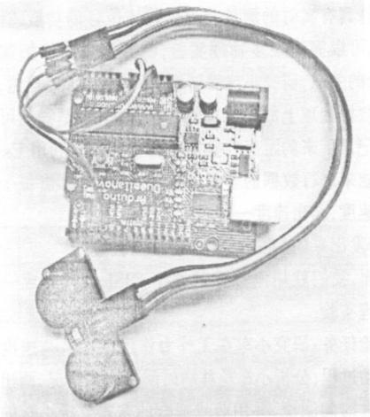
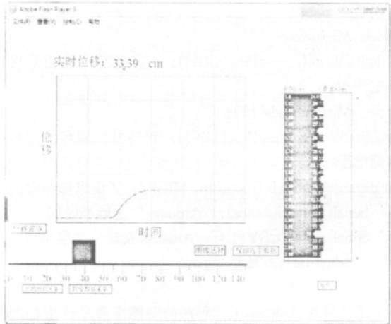
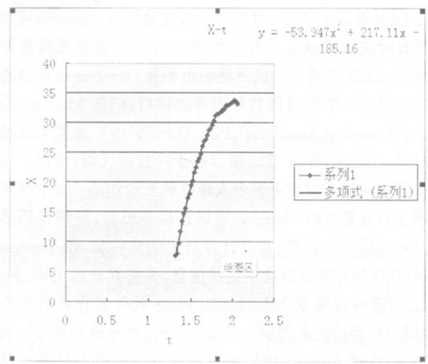
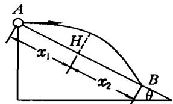
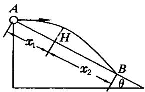
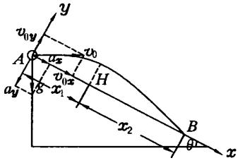

·现代教学技术·

# 利用 Arduino 和 Flash 开发 DISLab

翁浩峰

（浙江省宁波中学，浙江 宁波 315100）

## 1 Arduino 与 DISLab 简介

Arduino，是一个基于开放源代码的软硬件平台，构建于开放源代码 simple I／O 接口版，并且具有使用类似 Java、C 语言的 Processing／Wiring 开发环境．让您可以快速使用 Arduino 语言与 Macromedia Flash、Processing、Max／MSP、PureData、SuperCollider 等软件作出互动作品．Arduino 可以使用开发完成的电子元件例如 Switch 或传感器或其他控制器件、LED、步进马达或其他输出装置．Arduino 也可以独立运作成为一个可以跟软件沟通的接口，例如 Macromedia Flash、Processing、Max／MSP、PureData、VVVV 或其他互动软件等．Arduino 开发 IDE 接口基于开放源代码，可以让您免费下载使用开发出更多令人惊艳的互动作品．"以上这段文字来自维基百科．Arduino 可以连接传感器，并将传感器的信号传输至计算机，并由计算机上的软件如 Macromedia Flash 软件制作的动画接受这些信息，并将其显示出来．Arduino 甚至可以接受 Macromedia Flash 软件制作的动画发送的信号，并由此来控制一些动作器件（如步进马达等）．由此可知，通过 Arduino 我们可以实现外部世界与计算机的互动．

DISLab———（Digital Information System Lab）数字化信息系统实验室，其基本的构造是传感器、数据采集器和计算机软件．基本原理是由数据采集器采集传感器上的数据，并传输到电脑上通过软件显示出来．近几年，DISLab 在中学物理实验中应用比较广泛，使用的 DISLab 产品也有很多，例如国内的朗威 DISLab 系统，GQY DISLab 系统等等．

对比 Arduino 与 DISLab 系统，可以发现 Arduino 完全可以实现 DISLab 的各项功能，并且还可以通过软件反过来控制一些动作器件，加上其构建于开放源代码，可以实现许多现在的 DISLab 无法实现的功能．所以用 Arduino 进行 DISLab 的开发，能创造出更多独特的实验，开发出界面更好的互动课件．

## 2 利用 Arduino 与 Flash 制作 DISLab

笔者下面利用 Arduino 和做互动课件常用的软件Macromedia Flash 来制作一个 DISLab 实验．

本实验需要1个 Arduino 开发板和1个超声波传感器元件（如图1所示），以及1台安装了 Flash cs3和 Arduino软件的计算机．

首先对 Arduino 开发板写入一下程序（此处省略若干定义语句）．

```
void loop（）｛　／／主程序
digitalWrite（outputPin，LOW）；／／发出超声波信号接口低电平2μs
　delayMicroseconds（2）；
　digitalWrite（outputPin，HIGH）；／／发出超声波信号接口高电平10μs
　delayMicroseconds（10）；
　digitalWrite（outputPin，LOW）；／／保持发出超声波信号接口低电平
int distance＝pulseIn（inputPin，HIGH）；／／读出脉冲时间
　　Serial．print（distance）；／／Arduino 发送脉冲时间
　　Serial．print（0，BYTE）；／／Arduino 发送一个空字节
　　　delay（val）；／／延时10ms
｝
```

上述写在 Arduino 里的程序的功能主要是读出超声波传感器发射超声波到接受反射回来的波所经过的时间差，然后将这个时间差发送出去，让电脑接收．

  
图1

写入程序后，将超声波传感器的输入输出端连接到 Arduino 的端口4和端口5，电源输入端连接到 Arduino 的高电平输出端，接地端连接到 Arduino 的接地端．这样超声波传感器与 Arduino 的连接就完成了．接下去开始写计算机端的 Flash 程序．

Arduino 与 Flash 并不能直接通信，必须通过一个服务器转接，这里选择 Serproxy 进行转接．Serproxy 的作用在于它会建立一个 xml 服务器，将来自 Arduino 的数据转换为 xml 格式，储存在它临时建立的虚拟服务器上．然后 Flash 便可以从 serproxy 建立的虚拟服务器中读取 xml 格式的数据．Serproxy 服务器从国外的网站 www．arduino．cc 上直接下载得到．下面编写 Flash 端的程序，因为代码过多，此处省去，如有需要，可以向笔者索取．

程序完成了将得到的从 Arduino 发送的时间间隔转换为距离值，并且完成将距离值实时显示出来，以及用屏幕上的物块来实时模拟实际物体的移动．在按下记录按钮后能够每 5ms 读取一个数据，然后对每 4 个数据取平均，以每 20ms 记录一次将这些数据依次记录到数组中，并依次显示出来，同时画出距离—时间图像（如图2所示），还可以通过对图像的选择来保留选中的数据．

  
图2

通过上述程序，可以看到通过 Arduino 和 Flash 开发的这个课件具有实时的测量并记录物体位移的功能．有了这个功能，可以完成很多物理实验，例如研究物体加速度与力、质量的关系，研究小球简谐运动的图像等等．当然，这个课件在数据处理上的功能可能并不强大，但是我们可以将课件中记录下来的距离数据复制到 Excel 中，利用 Excel 强大的功能来进行数据的分析和处理，甚至计算出每个时刻物体的速度，画出速度—时间图像等等．

## 3 用开发出来的 DISLab 进行物理实验

下面，我们就用刚开发的这个 DISLab 来完成一个简单的物理实验．

实验任务：研究小车在无外力作用下从某一速度减为零的运动过程，分析小车位移随时间变化的情况，画出小车的位移—时间图像，并用曲线拟合的方式分析小车的运动情况．

首先放置好器材，打开 serproxy 服务器，打开刚制作完的课件，如果显示出小车的距离，说明连接成功．试着移动小车，观察课件中小车的运动情况，如正常，点击开始采集数据按钮，然后马上推动小车给小车一个初速度．观察课件中的图线的变化情况，待小车停止后，点击暂停数据采集按钮．接下去点击图像选择按钮，在图像上点下鼠标左键并拖动鼠标，选择你所要保留的图像范围，最后点击保留选中数据按钮，在课件的数据表格内便得到了我们这次实验的数据．

然后将课件中数据表格内的数据全部复制到 Excel 表格中，注意使用文本导入向导，选择分隔符号，点击下一步，再选择空格，点击完成．这样就将课件中的数据复制到了 Excel 表格中了，这些数据有两列，第1列为时间，第2列为该时间对应的位移值，单位是 cm．接下去便可以利用 Excel 强大的图像数据处理功能来分析数据了．选择插入—图表里面的 XY 散点图，选择平滑线散点图，点击下一步，再点击完成即可．这样就将得到的数据又复原成了位移—时间图像了（如图3所示）．然后再对图像进行研究，右击图像中的图线，选择添加趋势线，在趋势线里面选择多项式，阶数选择 2，然后在选项里面将显示公式前面的框里打上钩，最后点击确定．这样就完成了对图线的研究，观察趋势线与图线是否吻合，如果不吻合，则需要重新添加其他的趋势线，如吻合，则说明位移与时间满足这样的关系．通过位移与时间的关系，我们可以得出小车做的是匀减速直线运动，从关系式也可以得到小车的加速度的大小．

  
图3

虽然笔者写的这个 Flash 课件功能并不强大，但是因为 Arduino 的开源性，Flash 的强大互动功能，相信可以开发出更多更有新意的实验课件．也可以一改以往使用传感器只能够使用厂商提供界面来操作的缺点，开发出更利于学生接受的全新的界面，并且融入课件与人的互动功能，甚至可以通过课件来控制一些互动器件，来完成一些远程的实验操作．

虽然现在传感器在中学课堂已经普及，但是一些农村学校或者经济状况不是很好的学校还是没有能力采购一整套的传感器设备．而利用 Arduino 和 Flash 开发的 DISLab 不仅功能上可以达到商用 DISLab 的功能，并且价格上有着很大的优势．唯一的不足是对教师的要求过高，但是也可以通过会编程的教师预先制作各个 Flash 程序模块，普通教师在制作时将各个模块拼接便可制作有个性的实验界面、甚至远程控制的实验项目等等．

随着科技的飞速发展，教师的教学工具乃至教学方法都在不断的发生着变化．对于一名普通的教师来说，是一直守着自己的那点知识不变还是不断的学习新的知识，决定了一名教师能否适应未来的教学．在一些商用 DISLab 不断在中学普及的时候，我们当然需要努力的学习这种新的教学工具带来的新的教学方法，并不断思考如何更好的利用这样新的教学工具．在应用的时候，也需要带着一种批判的眼光，毕竟并非科技含量越高的就越好．笔者也是因为在使用这些商业 DISLab 软件时感觉软件界面不是很适合课堂教学，所以才想到用 Flash 来开发 DISLab 的界面．但是自己制作的一些传感器精度上却很难达到预定的目标，所以 Arduino 和 Flash 开发 DISLab 的路其实非常艰难．笔者非常希望那些商业的 DISLab 厂商能够公开其传感器接口的具体参数，让我们教师也能使用自制的课件来读取商业传感器的数据，毕竟这是一个崇尚创新、崇尚个性的时代．

（收稿日期：2009—11—20）

<!-- 存疑：以下内容来自同篇 PDF（第3页）的另一篇文章《对斜面上的平抛运动图像的修正》（邹俊，江苏省丹阳市吕叔湘中学），由期刊版面排版与本文（LIT-0095 翁浩峰《利用 Arduino 和 Flash 开发 DISLab》）共页所致，不属于本文内容，仅作随 PDF 提取的副产物保留。 -->

# 对斜面上的平抛运动图像的修正

邹 俊

（江苏省丹阳市吕叔湘中学，江苏 丹阳 212300）

本刊2009年第9期刊出了“从高难到口算————巧用求异思维妙解难题”一文中给出了斜面上平抛运动的4种巧妙解法，读后深受启发．笔者经过推敲后感到原文所配图有所不妥．在此提出我的意见，供大家参考．

原题．如图1所示，在倾角为 θ的斜面顶端 A 处以初速度 v0 水平抛出一个小球，小球最后落在斜面上的另一点B 上，空气阻力不计，求运动过程中小球离开斜面的最大距离 H 是多少？



  
图1  
图2

笔者认为图1所示的平抛物体的运动轨迹是错误的．读者可以注意到，小球在空中运动的轨迹以最高点为界的话，左右两段弧线几乎是对称的．该示意图不能反映小球真正的运动情况，小球的实际运动应该是离开斜面阶段沿斜面的位移 x1 小些，靠近斜面阶段沿斜面的位移 x2 大些，较为精确的的图应该如图2所示．

  
图3

我们可以借助原文解法分析，如图3小球经过速度和加速度的分解之后，小球的平抛运动就可以看作两个方向运动的合运动．y 方向的运动为初速度 $v _ { 0 y } = v _ { 0 } \mathrm { s i n } \ \theta$ ，加速度 $a _ { y } = g \cos \theta$ 的先匀减速后匀加速运动，当 $v _ { y } = 0$ 时，小球离斜面最远，x 方向的运动为初速度 $v _ { 0 x } = v _ { 0 } \mathbf { c o s } \theta , a _ { x } =$ gsinθ的匀加速运动．设小球抛出经过时间 t 距离斜面最远，由于 y 方向是类竖直上抛运动，所以小球从离斜面最高点落到斜面上的时间也等于 t．同时注意到小球 x 方向有初速度，即得小球从运动到距离斜面最远过程中 x 方向位移为

$$
x _ { 1 } { = } ( v _ { 0 } { \cos \theta } ) t { + } \frac { 1 } { 2 } ( g { \sin \theta } ) t ^ { 2 } .\tag{1}
$$

小球从距离斜面最远回到斜面过程中 x 方向的位移为

$$
\boldsymbol { x } _ { 2 } = \big [ ( v _ { 0 } \cos \theta + ( \boldsymbol { g } \sin \theta ) t \big ] \mathrm { t } + \frac { 1 } { 2 } ( \boldsymbol { g } \sin \theta ) \boldsymbol { t } ^ { 2 } .\tag{2}
$$

由平抛运动不难解出

$$
\scriptstyle t = { \frac { v _ { 0 } \tan \theta } { g } } .\tag{3}
$$

把（3）式代入（1）、（2）式化简得

$$
\scriptstyle { \frac { x _ { 1 } } { x _ { 2 } } } = { \frac { 1 + { \frac { \tan ^ { 2 } \theta } { 2 } } } { 1 + { \frac { \tan ^ { 2 } \theta } { 2 } } + \tan ^ { 2 } \theta } } .\tag{4}
$$

从（4）式中不难看 $\frac { x _ { 1 } } { x _ { 2 } }$ 的比值只与斜面倾角θ有关．当θ $\neq 0$ 时 $x _ { 1 }$ 与 $x _ { 2 }$ 就不会相等 $\frac { x _ { 1 } } { x _ { 2 } }$ 的比值随着θ的增大而越 来越小．计算如表1所示

表1
<table><tr><td rowspan=1 colspan=1> $\theta$ </td><td rowspan=1 colspan=1> $3 0 ^ { \circ }$ </td><td rowspan=1 colspan=1> $3 7 ^ { \circ }$ </td><td rowspan=1 colspan=1> $4 5 ^ { \circ }$ </td><td rowspan=1 colspan=1> $6 0 ^ { \circ }$ </td></tr><tr><td rowspan=1 colspan=1> $\frac { x _ { 1 } } { x _ { 2 } }$ </td><td rowspan=1 colspan=1> $\frac { 7 } { 9 } { \approx } 0.778$ </td><td rowspan=1 colspan=1> $\frac { 4 1 } { 5 9 } \approx 0.695$ </td><td rowspan=1 colspan=1> $\frac { 3 } { 5 } { = } 0.6$ </td><td rowspan=1 colspan=1> $\frac { 5 } { 1 1 } { = } 0.455$ </td></tr></table>

从表1知道 $\theta { = } 3 7 ^ { \circ }$ 时， $x _ { 1 }$ 只有约 $x _ { 2 }$ 的 $\frac { 2 } { 3 }$ 了，图像的修正就不容忽视．从学生理解问题的角度，教师也可以适当地夸大 $x _ { 1 }$ 和 $x _ { 2 }$ 的长度差异，引导学生思考运动分解后小球沿斜面运动的情况．本题中经过分解小球在沿斜面方向是初速度不为零的匀加速直线运动，而在水平地面上的斜抛运动，经过分解后小球在沿地面方向是个匀速直线运动．引导学生分析其中的差异，会增进学生使用运动的合成与分解规律解决问题的能力．

（收稿日期：2009—11—05）

<!-- 存疑结束：以上为邹俊文章，非本文 LIT-0095 内容。原文中紧随其后的"非常希望那些商业的 DISLab 厂商……（收稿日期：2009—11—20）"系翁浩峰本文结尾段，已合并至前文相应位置，此处不重复。 -->
