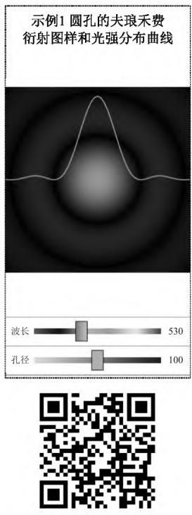
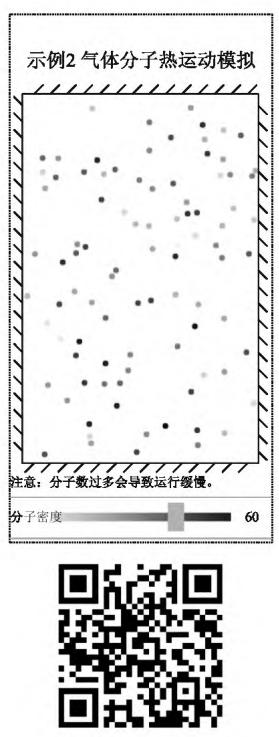
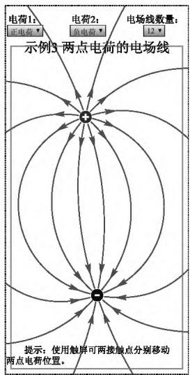
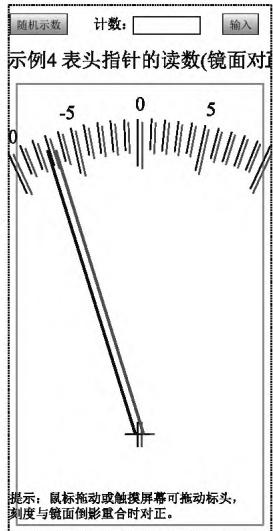

基础物理教学现代化问题

# 基于 HTML5 技术的物理动画开发与应用

宋洪晓1，张琦玮2，刘建强1

( 1． 山东大学 物理学院 国家级实验教学示范中心，山东 济南 250100;2． 高等教育出版社物理分社，北京 100029)

摘要:随着手机等移动设备取代电脑成为主流上网方式，大学物理等学习资源中大量使用的 Flash 动画需要迁移到移动设备上运行．HTML5( 简称 H5) 是目前 Flash 的最佳替代技术，本论文基于物理学新形态教材中 H5 动画的设计 开发实践，总结了物理类 H5 动画的设计思路与开发步骤，并结合实例对选题与物理建模 界面与交互功能设计两个步骤进行了详细介绍

关键词:在线学习; HTML5 动画; 新形态教材; 物理建模

中图分类号: G434; O4－39

文献标识码: A

文章编号: 1000-0712 ( 2021) 07-0051-04

【DOI 】10．16854 /j．cnki．1000-0712．210005

近年来，我国在线教育得到了长足的发展，物理学科也顺应潮流发展，涌现出大量新形态教材 线上课程等．目前在物理学科的线上学习中，还在大量使用 Flash 动画．Flash 动画最突出的优点是支持 Ac-tionScript 编程，能够提供强大的前端交互性，是图像、视频等其他媒体难以做到的．但是 Flash 动画只能在电脑上播放，而不能在手机 平板电脑等移动设备上播放，想开发既能在电脑上运行又能在移动设备上运行的交互动画，目前最佳的方案是使用HTML5( 简称 H5) 技术．

## 1 H5 技术简介

H5 是一系列前端技术的统称，其集成了 JavaS-cript 开发语言，能在浏览器上绘制矢量图形，功能上完全可以取代 Flash．H5 为移动设备进行了优化，被 IOS 和安卓两大移动系统原生支持，同时在电脑端也被各大浏览器广泛支持．

由于移动设备的便捷性，使用移动设备上网已经成为主流．据统计，到2020 年 6 月，国内网民使用台式机和笔记本电脑上网的比例为 37． 3% 和31．8%，而使用手机和平板电脑的比例为 99．2%和27．5%［1］，移动设备占据压倒性的多数．在这种情况下，只能在电脑端运行的 Flash 就成了鸡肋，2012年，Flash 的开发商 Adobe 公司宣布不再发布新版Flash 开发工具［2］，2020 年底之后将停止对 Flash 播放器的更新支持［3］，这意味着 Flash 在商用领域已经被技术淘汰．

在 《加快推进教育现代化实施方案( 2018－2022年) 》中，提出了 “以互联网等信息化手段服务教育教学全过程”的要求，要达到这个要求，就必须解决目前移动设备上缺少交互动画的问题．物理类线上学习中应用 Flash 动画较多，如果这些动画不能迁移到移动设备运行，移动学习的效果将会大打折扣，影响线上学习的广泛性和便利性．很多线上学习环境的建设者都被 Flash 动画不能在移动设备播放的问题所困扰，例如前期的新形态教材，图片 视频等资料可以用手机扫描教材上印刷的二维码直接访问，而 Flash 动画只能用电脑登录课程网站访问［4］．

使用 H5 技术开发交互动画正是解决移动设备缺少交互动画难题的最优技术方案［5］．H5 动画目前在商业领域的应用风生水起，例如微信小游戏跳一跳、淘宝养猫分红包等游戏类动画功能都是使用其开发的，目前 H5 技术在教学中已有较多应用［6］，但动画功能在教学中的应用报道较少．本文作者在 《物理学》( 第五版) 新形态教材建设中，进行了一系列H5 动画的设计和开发，本文主要结合实例对 H5 动画的设计思路与开发流程 选题与物理建模 界面与交互功能设计等物理类 H5 动画的开发设计与应用进行总结．

## 2 H5 动画的设计思路与开发流程

如果只从把 Flash 动画迁移到移动设备运行的角度考虑，可以分两种情况区别处理．Flash 制作的小故事 MTV 之类，交互性较少，使用屏幕捕捉的方式转录成视频更简单［7］． 而应用 ActionScript程序进行计算和逻辑判断的 Flash 动画最重要的是交互性，就必须借助 Javascript 程序才能实现对应功能．

一个 H5 动画从构思到完成开发，大体可以分成三个步骤: 一是选题与物理建模，二是界面与交互功能设计，三是程序的代码编写．整个开发过程最重要的是前两步，需要设计者对教材内容和物理规律有深刻的理解，最好既有物理教学经验，又思维活跃，熟悉计算机和移动设备的使用．

## 2．1 选题与物理建模

设计开发 H5 动画费时费力，因此每一个 H5 动画都要好钢用在刀刃上，在 H5 动画选题时，先梳理课程知识体系中的重点难点，评估哪些知识点增加交互性能促进学生对知识的理解和掌握，对它们进行攻关设计．开发H5 动画需要考虑动画程序编写的可行性，有明确的物理公式描述或者能够数值模拟出近似结果的物理现象才适合用程序进行表现．

从编码容易实现的角度，运动类的物理动画最好能给出运动物体 x、y 两个方向位置分量的时间参数方程，例如斜抛运动 振动和波等．根据公式和参数值绘制曲线类的动画，如 “普朗克公式的曲线”等也比较容易实现; 而一些复杂物理现象的模拟则需要充分利用矢量图形绘制的特点，并结合一定的编程技巧才能实现，例如 “圆孔的夫琅禾费衍射”( 图1a，扫描下方二维码可运行该动画) ，就使用径向的颜色渐变模拟光斑的亮度变化，实现起来有一定难度．而受制于手机处理器的性能和功耗，大计算量的物理现象模拟，例如“气体分子热运动模拟”( 图1b，扫描下方二维码可运行该动画) ，就需要在分子数量 碰撞建模复杂程度等方面做出妥协．

在构思 H5 动画时，可以参考相对成熟的 Flash编程动画．Flash 的 ActionScript 语言和 JavaScript 语言遵循同样的 ECMA 标准，有很多类似之处．Flash编程动画能够实现的效果，H5 基本也能通过编程技巧实现，而 H5 动画交互方面的功能更加强大一些．

  
(a)

  
(b)  
图 1 动画的选题与物理建模

## 2．2 界面与交互功能设计

H5 动画运行环境从电脑改变到手机上，最大的变化是交互方式．电脑输入数据主要使用键盘鼠标，而现在的智能手机大多没有实体键盘．H5 动画依靠虚拟键盘输入效率较低，体验较差，使用滚动条结合加减按钮输入数据操作更便捷，例如图 1 中 “圆孔的夫琅禾费衍射”和“气体的分子热运动模拟”两个动画中都是使用滚动条改变参数值的

手机触屏操作和电脑上鼠标点击类似，手机更强大之处在于支持多点触屏，例如在 “两点电荷的电场线”动画中( 图2a，扫描下方二维码可运行该动画) ，可以用两个手指分别拖动两点电荷的位置，程序实时根据电荷位置，计算出电场线形态并在屏幕上绘制出来，这种多点触屏交互比鼠标每次只能点击、拖动一个点要操作便捷．H5 还可以获取多种手机传感器的数据，例如手机机身的倾斜角度、地磁角度等，能够设计出类似手机模拟方向盘这样更有创意的交互性应用，但是顾及到 H5 动画在电脑端运行时的兼容性，最好提供按键操作等作为补充．

H5 强大的交互性使其不仅能用在理论课程的学习中，也可以用来开发物理实验方面的动画．虽然要做成栩栩如生的仿真实验需要比较大的开发工程量和绘图计算量，但是用简单的小动画模拟基本的仪器使用、简单的实验操作也会有不错的效果．例如很多指针表盘上有一面小镜子，当指针和它在镜中的像重合时，表示人眼正对盘面，才能得到正确的读数． “表头指针的读数( 镜面对正) 动画( 图2b，扫描下方二维码可运行该动画) ，就是模拟了这种表盘的读数过程．手指在屏幕上拖动可以模拟观察视角的改变，在指针、刻度分别和镜中成像重合时进行读数，将读数填入对应的输入框，程序可以对读数是否准确、有效数字位数是否正确等进行判断并弹出对话框提示．

  
(a)

  
(b)  
图 2 动画的交互设计

## 2．3 程序的代码编写

完成前两步设计后，程序的代码编写这一步可以由设计者独立完成，也可以外包给技术公司完成H5 动画使用的 Javascript 语言基本语法规则类似 C语言，入门不算太难．从更好的设计H5 动画的角度，物理教材的作者也有必要学习一些编程的知识．

## 3 H5 动画的应用实践

《中国教育现代化 2035》提出要“充分利用现代信息技术，丰富并创新课程形式”．信息技术的高速发展，伴随着硬件系统的革新，改变了人们的生活方式，也带来了动画开发技术的更迭．学生使用手机、平板电脑等移动设备代替电脑进行学习成为一种趋势，物理类的线上学习资源开发也应该与时俱进，建设适应移动设备的学习环境

笔者在建设高教出版社出版的 《物理学》( 第五版) 新形态教材过程中，尝试使用 H5 开发交互动画，共开发 H5 交互动画 77 个，分布于全书 20 章中的17 章，覆盖力、热、光、电磁、近代物理等内容［8］，本文中前三个示例就选自其中．此后又在 《简明物理学》( 第二版，高教出版社) 和 《大学物理实验》( 第三版，科学出版社) 等新形态教材的建设中使用了H5 交互动画，例如 《大学物理实验》中使用 H5 开发交互实验动画 17 个，本文中的示例 4 “表头指针的读数”选自其中． 实践证明 H5 技术完全可以胜任制作物理类交互动画的要求，能够填补移动设备上Flash 被淘汰造成的交互动画空缺，同学们也反映课本中的 H5 动画兼具趣味性和便捷性．

## 4 小结

H5 动画通过交互的学习方式，增强了学生的参与度，能够有效的提高学习兴趣，加深对物理重点难点知识的理解，在移动设备端的在线学习中具有不可替代的重要作用．在物理学在线学习环境建设中，H5 动画、音视频、图形图像等多种形式的学习资源各有所长，应该根据教学内容需要选择使用，扬长避短，组合成一个有机的整体，提高在线学习的学习效率和学习效果．

H5 作为新一代的前端开发技术，目前在教学网站平台的建设等方面已经有较多应用，但是开发交互动画等教学资源的应用还较少，在这方面有必要进一步拓展和推广，使其在线上学习环境建设、智能化教学、数字教育资源共建共享等方面发挥更大的作用．

## 参考文献:

［1］ 中国互联网信息中心．第 46 次中国互联网络发展状况统计报告［R /OL］． ( 2020－09－29) ［2021－02－17］．ht-tp: / /www． gov． cn /xinwen /2020 － 09 /29 /content \_5548175． htm

［2］ 8 月 15 日起 Adobe 将正式停止安卓市场 Flash 下载［N /OL］． IT 之 家，2012 － 07 － 01［2021 － 02 － 17］．https: / /www．ithome．com /html /android /20248．htm

［3］ Adobe 官网发布 Flash Player 停止支持问答: 建议卸载，到期后不能再使用 Flash［N/OL］． IT 之家． 2020－06－21［2021－02－17］．https: / /www．ithome．com /0 /493 /984． htm

［4］ 马天魁，高建．高校物理新形态教材建设的思考与实践探索［J］． 大学物理，2016，35( 7) : 1-3．

［5］ 钟岑岑，魏蔚．面向数字化教育资源的 Flash 到 HTML5转换研究［J］．中国教育信息化，2015( 18) : 79-83．

［6］ 白亮，马成举．基于微信结合 H5 技术的大学物理实验教学创新研究［J］．大学物理，2019，38( 12) : 40-43．

［7］ 赵智．屏幕捕捉在多媒体课件制作中的应用［J］．南宁师范高等专科学校学报，2002( 04) : 76-77．

［8］ 宋洪晓．移动设备端物理演示程序的算法研究与设计实现［D］．济南: 山东大学，2018．

# Development and application of physical animation based on HTML5 technology

SONG Hong-xiao1，ZHANG Qi-wei2，LIU Jian-qiang1 ( 1． National Demonstration Center for Experimental Physics Education， School of Physics，Shandong University，Jinan，Shandong 250100，China; 2． Higher Education Press，Beijing 100029，China)

Abstract: With mobile devices such as mobile phones replaced computers as the mainstream way of surfing the internet，the Flash animation that is currently used in college physics online learning，is required to be migrated to mobile devices in order to meet the needs of using mobile devices for learning． HTML5( H5 for short) is currently the best substitution of Flash． Based on the design and development practice of H5 animation in the new physics textbooks，in this article，the design ideas and development steps of physics H5 animation is summarized，the two steps of topic selection and physical modeling and interface and interactive function design in detail with examples is described．

Key words: online learning; HTML5 animation; new form teaching materials; physical modeling
