# 基于微信公众平台的物理实验微课程研究与开发———以 “加速度与力、质量之间的关系”为例

汪小明

( 深圳市宝安第一外国语学校 广东 深圳 518128)

摘 要:微信公众号推送的订阅号消息逐渐成为了学生获取知识的重要渠道． 微课程以其短小精悍、知识点集中等特点受到老师和同学们的广泛喜爱，学生可以利用碎片化的时间自主学习，还可以重复观看实验微课视频，很好地满足了学生的个性化学习需求，使得物理实验内容的学习更加高效和便捷． 基于微信公众平台的微课程是对物理实验课堂教学的有益补充．

关键词:微信公众平台; 微课程; 物理实验教学; 移动学习

中图分类号: G633. 7

文献标识码:B

文章编号: 1008 － 4134( 2022) 09 － 0055 － 05

## 1 研究背景

2019 年 2 月中共中央、国务院印发了 《中国教育现代化2035》，在部署的战略任务中，明确提出了加强课程教材体系建设，科学规划大中小学课程，分类制定课程标准，充分利用现代信息技术，丰富并创新课程形式［1］． 《普通高中物理课程标准( 2017 年版 2020年修订) 》在基本理念中指出，高中物理课程通过创设学习情境，培养和发展学生的自主学习能力． 通过多样化的教学方式，利用现代化信息技术，引导学生理解物理学的本质，整体认识自然界，形成科学思维习惯，增强科学探究能力和解决实际问题的能力［2］．

开发微课程既是落实国家 《中国教育现代化2035》战略任务的创新课程形式，亦是实现国家物理课程标准提出的培养和发展学生自主学习能力的新型教学方式，更是对高中物理实验教学的有益补充形式．

## 2 微信公众平台和微课程概述

### 2．1 微信公众平台

微信( WeChat) 是腾讯公司旗下的一款免费即时通信软件，教师和学生使用微信交流互动的现象非常普遍． 微信公众平台是微信中的一个功能模块，可以提供服务号、订阅号、企业号三种账号类型，其中，订阅号可以为用户提供信息，信息会显示在用户 “订阅号”文件夹中，方便订阅用户及时查看． 通过微信公众平台可以实现与特定群体的文字、图片、音视频的全方位沟通、交流互动，利用这个特点，我们可以将物理实验制作成微课程发布在微信公众平台上，方便订阅用户学习．

### 2．2 微课程

微课程( Microlecture) 这一概念最早是 2008 年由美国新墨西哥州圣胡安学院的戴维·彭罗斯( David Penrose) 教授正式提出，并运用于在线课程． 他认为，微课是以建构主义为指导思想，以在线学习、移动学习方式，基于某个简要明确的主题或关键概念为教学内容，通过音频或视频录制的课程［3］． 南京师范大学的张一春教授认为，“微课”是指以先进教育思想和教学理念为指导，以使学习者自主学习达到最佳效果为目标，经过精心的信息化教学设计，以视频、动画等形式记录或展示教师围绕某个知识点开展的简短、完整的教学活动［4］．

本课题组经过研究认为，微课程是以学习者为中心，以知识建构为主要目标的教学资源，微课程是教师为了完成某个教学目标，围绕特定的学习主题，以知识点讲解、典型问题解决、实验过程演示等为主要内容，借助相关视频制作工具( 如 Camtasia，FSCapture，EVCapture，会声会影等) 录制与编辑的教学短视频． 通常微课程视频的时间较短，一般 5 ～8 分钟，最长不超过10 分钟，所占存储空间较小，方便在微信公众平台发布和回看．

物理实验微课程就是以物理实验为主要内容录制的微课，是课堂实验教学的创新形式． 其特点见表 1．

表1 实验微课程的特点
<table><tr><td colspan="2" rowspan="1">特点</td><td colspan="1" rowspan="1">说明</td></tr><tr><td colspan="1" rowspan="1">时间短内容精</td><td colspan="1" rowspan="1">时间约5～8min，一般不超过10min，内容主要是讲解实验操作过程或者实验重难点内容</td></tr><tr><td colspan="1" rowspan="1">教学主题明确</td><td colspan="1" rowspan="1">教学的主题来源于实验操作过程中常遇到的重难点问题，或者实验数据的处理等</td></tr><tr><td colspan="1" rowspan="1">教学资源可视化</td><td colspan="1" rowspan="1">实验微课程以短视频等可视化的资源来呈现实验现象或实验操作过程，能够很好地吸引学生的学习兴趣</td></tr><tr><td colspan="1" rowspan="1">学习方式灵活</td><td colspan="1" rowspan="1">学生可以借助智能手机、平板电脑等移动终端设备，不受场地限制，选择零碎的时间开展自主学习</td></tr><tr><td colspan="1" rowspan="1">评价反馈方便</td><td colspan="1" rowspan="1">借助微信公众平台留言板功能，学生可以留言反馈实验微课中存在的疑惑与问题，教师可以借助留言板答疑解惑，与学生进行良好的互动交流</td></tr></table>

## 3 实验微课程制作流程

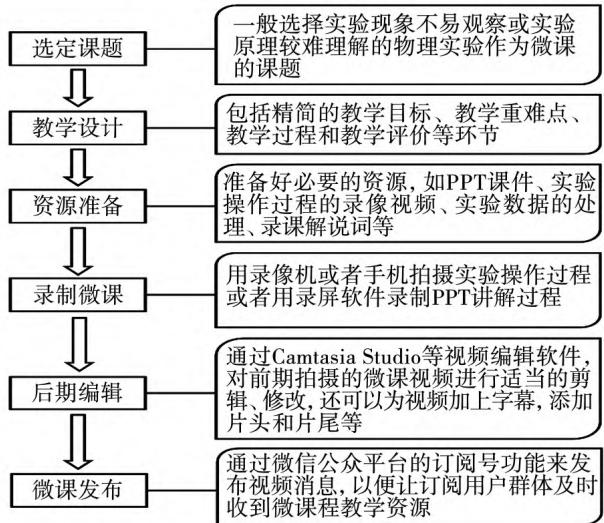  
图1

## 4 实验微课程开发———以“加速度与力、质量之间的关系”为例

### 4．1 前期分析确定课题

粤教版高中物理必修第一册第四章第2 节 “加速度与力、质量之间的关系”是一节实验课，该实验通过气垫导轨、滑块、光电门和数字计时器等组成的实验装置，采用控制变量法，定量地探究加速度与力、质量之间的关系． 该实验方案用到的器材较多，实验需要满足的条件动手操作起来具有一定的困难，且由于该方案中存在系统误差，实验结果往往不是特别理想．

针对以上不足，本课题组研究设计了一种创新的实验方案来定量探究加速度与力、质量之间的关系． 借助弹簧的弹力不会突变，细线的拉力可以突变，以及利用手机物理工坊Phyphox 读取手机的瞬时加速度的特点，研制了如图2 所示的实验装置．

借助创新实验装置，将实验探究过程制作成微课，可以方便学生随时随地观看学习; 同时，在微课的视频剪辑中可以省略掉相同部分的实验操作过程，或者是采用快进的方式处理相同的实验过程，相比现场实验教学，可以节省大量的实验时间． 所以，本实验教学采用微课形式会是一个很好的课题选择．

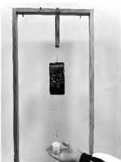  
图2 实验装置图

### 4．2 微教学设计

本微课首先通过简单的演示实验，定性地分析加速度与哪些因素有关; 接着通过自主创新设计的实验装置，利用手机传感器开展实验探究，借助 Excel 表格软件处理数据，引导学生根据图像发现加速度与力、质量之间的定量关系． 微教学设计见表2．

表2 微教学设计
<table>
<tr><td colspan="1" rowspan="1">授课教师</td><td colspan="1" rowspan="1"></td><td colspan="1" rowspan="1">微课程时长</td><td colspan="1" rowspan="1">9min</td></tr>
<tr><td colspan="1" rowspan="1">微课程名称</td><td colspan="3" rowspan="1">4.2 加速度与力、质量之间的关系</td></tr>
<tr><td colspan="1" rowspan="1">内容来源</td><td colspan="3" rowspan="1">粤教版高中物理必修第一册第四章第2节</td></tr>
<tr><td colspan="1" rowspan="1">微教学模式</td><td colspan="3" rowspan="1">实验录像视频 + PPT 讲解</td></tr>
<tr><td colspan="1" rowspan="1">适用对象</td><td colspan="3" rowspan="1">高一年级学生</td></tr>
<tr><td colspan="1" rowspan="1">微教学目标</td><td colspan="3" rowspan="1">物理观念:知道加速度的决定因素，形成正确的运动与相互作用观 科学探究:通过手机受到的合力等于小桶和重物的重力，来定量探究加速度与力、质量之间的关系，经历科学的探究过程 科学思维:采用控制变量法进行实验探究，能够根据减小误差的思想对实验方案提出改进意见和优化方案 科学态度与责任:培养思辨探索、创新进取的科学精神，以及求真务实的科学态度</td></tr>
<tr><td colspan="1" rowspan="1">微教学过程</td><td colspan="3" rowspan="1">一、复习引入:前面学习了力是使物体产生加速度的原因，那么，加速度除了与力有关外，还与什么因素有关呢? 二、演示实验:定性分析加速度与力和质量的关系 三、创新实验:定量探究加速度与力和质量的关系 　实验原理:弹簧的弹力不会突变，细线上的弹力可以突变，Phyphox软件可以读出手机瞬时加速度的数值 四、实验步骤 　1. 保持手机质量 m 不变，探究加速度 a 与力 F 的关系;多次改变拉力 F 的大小，记录多组数据，根据实验数据作出 a－F 图像;观察 a－F 图像得出加速度与力的关系 　2. 保持手机受到的拉力 F 不变，探究加速度 a 与质量 m 的关系;多次改变手机质量 m 的大小，记录多组数据，根据实验数据作出 a－m 图像和 a－1/m 图像;观察 a－m 图像、a－1/m 图像得出加速度与质量的关系 五、实验结论 　在质量一定的情况下，物体的加速度 a 与作用力 F 成正比;在作用力一定的情况下，物体的加速度 a 与质量 m 成反比</td></tr>
<tr><td colspan="4" rowspan="1">续表2</td></tr>
<tr><td colspan="1" rowspan="1">微反思</td><td colspan="3" rowspan="1"></td></tr>
<tr><td colspan="1" rowspan="1">网络评价及反馈</td><td colspan="3" rowspan="1"></td></tr>
</table>

### 4．3 录课前资源准备

在录课前应提前拍摄好实验视频，制作录课 PPT 课件与解说台词，本微课录制前的脚本设计编写见表 3．

表 3 脚本设计
<table><tr><td colspan="1" rowspan="1">序号</td><td colspan="1" rowspan="1">PPT课件</td><td colspan="1" rowspan="1">解说台词</td><td colspan="1" rowspan="1">时间</td></tr><tr><td colspan="1" rowspan="1">1</td><td colspan="1" rowspan="1"></td><td colspan="1" rowspan="1">在两条水平长直导轨上，分别放置两辆相同的小车．分别连接细绳，通过钩码拉动小车运动．请看实验视频</td><td colspan="1" rowspan="1">68'</td></tr><tr><td colspan="1" rowspan="1">2</td><td colspan="1" rowspan="1"><!-- PDF亦模糊：原图为实验现象观察与思考截图，OCR 识别为乱码，以下为依上下文与解说台词整理的可读版本 -->影响加速度的因素：观察与思考 实验现象: (1)质量相同的小车，外力越小，小车运动得越慢，运动时间越长 (2)作用的外力相同，质量越大，小车运动得越慢，运动时间越长 实验结论:物体的加速度 a 既跟所受的外力 F 有关，又跟物体本身的质量 m 有关</td><td colspan="1" rowspan="1">物体的加速度既跟力有关，又跟物体质量有关</td><td colspan="1" rowspan="1">44'</td></tr><tr><td colspan="1" rowspan="1">3</td><td colspan="1" rowspan="1">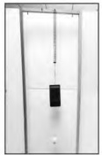</td><td colspan="1" rowspan="1">实验器材有:安装了 Phyphox的智能手机、弹簧、小桶和砝码、配重片、电子秤等 科学方法:采用控制变量法</td><td colspan="1" rowspan="1">60'</td></tr><tr><td colspan="1" rowspan="1">4</td><td colspan="1" rowspan="1"></td><td colspan="1" rowspan="1">手机 Phyphox是一款能够调用手机内置传感器的应用程序，通过 Phyphox可以读出手机的瞬时加速度</td><td colspan="1" rowspan="1">53'</td></tr><tr><td colspan="1" rowspan="1">5</td><td colspan="1" rowspan="1"></td><td colspan="1" rowspan="1">保持手机质量不变，改变拉力 F 的大小，重复多次实验，并记录实验数据．请看实验视频</td><td colspan="1" rowspan="1">159'</td></tr><tr><td colspan="1" rowspan="1">6</td><td colspan="1" rowspan="1">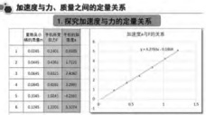</td><td colspan="1" rowspan="1">借助 Excel 表格处理数据、拟合图像，图像为一条近似过原点的直线</td><td colspan="1" rowspan="1">25'</td></tr><tr><td colspan="1" rowspan="1">7</td><td colspan="1" rowspan="1">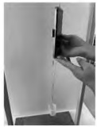</td><td colspan="1" rowspan="1">保持拉力 F 不变，改变手机质量 m 的大小，重复多次实验，并记录实验数据．请看实验视频</td><td colspan="1" rowspan="1">104'</td></tr><tr><td colspan="1" rowspan="1">8</td><td colspan="1" rowspan="1">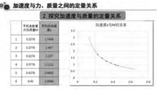</td><td colspan="1" rowspan="1">借助 Excel 表格处理数据、拟合图像，图像近似于一条反比例曲线，大胆猜测:a 与 m 可能成反比</td><td colspan="1" rowspan="1">17'</td></tr><tr><td colspan="1" rowspan="1">9</td><td colspan="1" rowspan="1">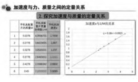</td><td colspan="1" rowspan="1">以 1/m 为横轴，a 为纵轴，借助 Excel 表格处理数据、拟合图像，图像为一条近似过原点的倾斜直线</td><td colspan="1" rowspan="1">22'</td></tr></table>

续表 3
<table><tr><td colspan="1" rowspan="1">序号</td><td colspan="1" rowspan="1">PPT 课件</td><td colspan="1" rowspan="1">解说台词</td><td colspan="1" rowspan="1">时间</td></tr><tr><td colspan="1" rowspan="1">10</td><td colspan="1" rowspan="1"><!-- PDF亦模糊：原图含 a∝F 与 a∝1/m 公式，OCR 误识为乱码 -->实验结论:加速度与力、质量之间的定量关系 在质量一定的情况下，物体的加速度 a 与作用力 F 成正比 在作用力一定的情况下，物体的加速度 a 与其质量 m 成反比</td><td colspan="1" rowspan="1">根据拟合的图像，得到实验结论:物体的加速度与作用力成正比，与其质量成反比</td><td colspan="1" rowspan="1">30'</td></tr></table>

### 4．4 微视频的制作

微教学设计和 PPT 课件制作好后，接下来开始录制微课． 本研究微课录制工具采用的是 Camtasia 9 录屏软件，具体的录制过程如下:

( 1) 打开软件 Camtasia 9，出现图 3 所示的界面．

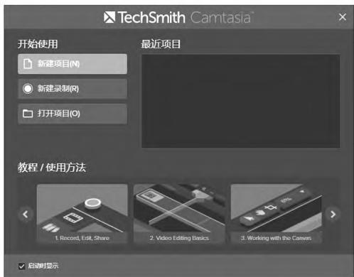  
图3 Camtasia 9软件界面

(2) 点击“新建录制”，在电脑屏幕的右下角会出现录制属性设置，如图4 所示． 可以选择全屏幕录制，也可以选择自定义录制; 选择全屏幕录制，点击红色“rec”按钮便可以开始录制． 接着将制作好的课件 PPT以播放的形式呈现，教师按照正常上课模式进行讲解，讲课过程就会被全部录下来．

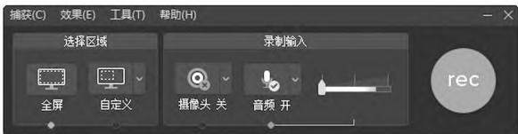  
图4 录制属性设置窗口

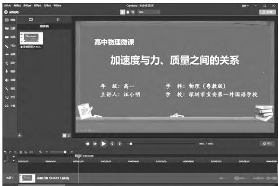  
图5 视频编辑预览窗口

(3) 微课讲解完成后，按下快捷键 F10 便可以结束录制，之后会弹出一个视频编辑预览窗口，如图 5所示，选择保存，可以将刚才录制的视频以 “项目”格式保存，微课程录制完毕．

(4) 可以在该编辑预览窗口中直接对视频进行编辑修改，如添加片头，剪切掉多余的画面，插入实验视频，还可以添加字幕等等． 编辑完成后，可以点击 “播放”按钮对微课视频进行预览，确认无误后，点击右上角“分享”，选择“本地文件”，打开 “生成向导”如图 6所示，选择“自定义生成设置”．

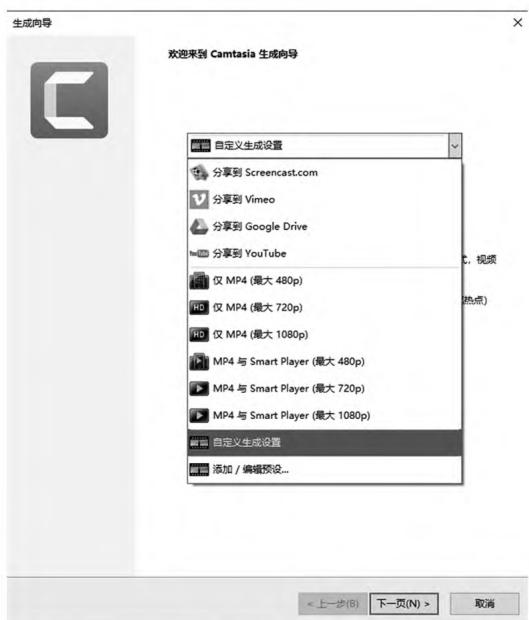  
图6 微课程生成向导

(5) 选择生成视频的文件格式、大小、名称和保存路径等，如图7 所示．

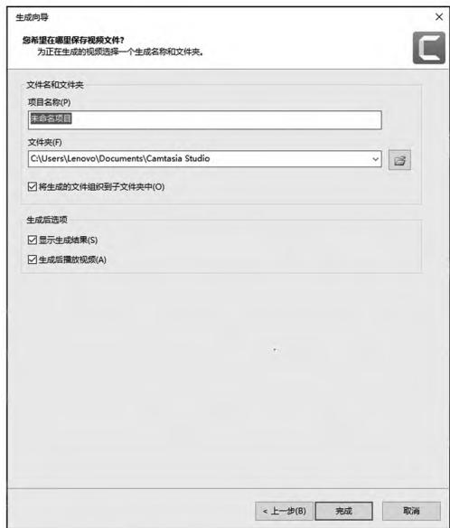  
图7 命名和选择保存路径

(6) 接下来点击 “完成”按钮，系统开始导出视频，如图8 所示．

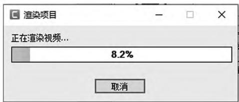  
图8 导出视频

### 4．5 微课程的发布

为了方便微课程的学习，本课题研究组申请了微信公众平台订阅号，在这个微信公众平台上以 “视频消息”的形式上传 “加速度与力、质量之间的关系”微课视频． 具体方法如下:

首先，在“视频消息”的 “素材库”中点击 “本地上传”，将“加速度与力、质量之间的关系”微课视频上传到素材库中，要求视频时长不超过 1 小时，视频上传完成后如图9 所示．

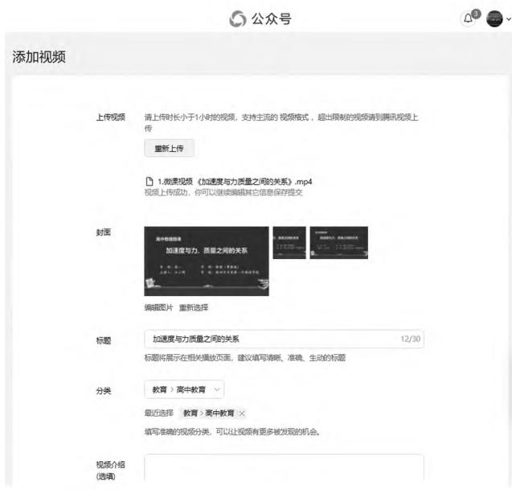  
图9 视频消息编辑

可以在“添加视频”编辑页面上设置封面、标题、分类以及视频介绍等等，设置完成后点击 “保存”按钮． 接下来，上传的视频将会呈现在 “素材库”中，状态显示为“审核中”，如图10 所示．

审核通过后，可以点击操作栏下方的 “前往发表”按钮，之后进入发表页面，如图11 所示．

在此页面可以保存该视频消息为草稿，也可以预览和群发该视频消息，预览满意后点击群发，这个视频消息就成功地群发给所有关注本微信公众号的用户了．

  
图10 视频待审核

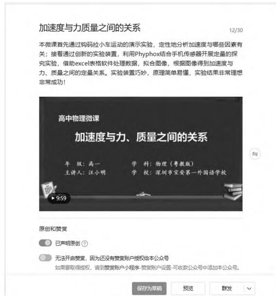  
图11 视频待发表

## 5 基于微信公众平台的物理实验微课程实施应用与评价反馈

### 5．1 微课程的实施应用

本课题组为辅助物理实验教学申请开通了微信公众号，学习者可以扫描该二维码关注公众号或者直接阅读发布在公众号上面的微课程．

微信公众平台可以使用自定义菜单功能管理公众号界面，比如将菜单设置为: 微课视频、微学案、微练习，如图12 所示．

通过后台填写好相应栏目的标题、作品简介，将对应的素材上传至公众号平台． 学生在自主学习的过程中，有任何疑问都可以在公众号平台下方留言，教师可以针对学生的疑问进行回复，实现问题探讨的交流互动．

### 5．2 微课程的评价反馈

实验微课程发布后，可以从教学目标的达成度、实验内容的完整性以及实验过程的有效性等层面对微课进行评价． 学生在微信公众平台上观看物理实验的微课程后，会对物理实验有更深层次的认识，对于实验过程中的重难点知识可以通过反复观看视频来掌握． 针对疑难点和不理解的地方可以在平台上留言，也可以在线下请教老师． 教师可以通过学生的交流反馈了解该实验微课程的优点和不足，为接下来微课程的改进完善积累经验．

  
图12 微信公众号

## 6 结束语

实验微课程创新了课程形式，丰富了教学方式，培养了学生的自主学习能力，是现代信息技术与实验教学深度融合的产物． 基于微信公众平台的微课程有效地弥补了物理实验教学中受场地、器材等条件制约的瓶颈，方便学生利用碎片化的时间自主学习和复习，是对物理实验教学的有益补充．

## 参考文献:

［1］新华社． 中共中央国务院印发 《中国教育现代化2035》［J］． 人民教育，2019( 05) : 4．

［2］中华人民共和国教育部． 普通高中物理课程标准( 2017 年版 2020 年修订) ［M］． 北京: 人民教育出版社，2020．

［3］夏仲文． 利用微课程促进学科教学的应用研究与反思［J］． 中国信息技术教育，2012( 11) : 13 － 14．

［4］张一春． 信息化环境下的教师发展与教学创新［J］． 湖州师范学院学报，2014，36( 06) : 8 － 16 + 21．

( 收稿日期: 2021 － 12 － 03)