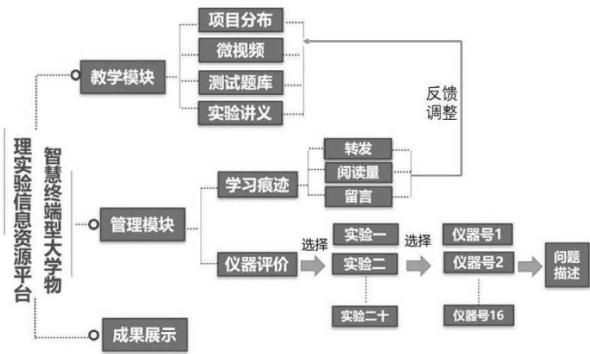
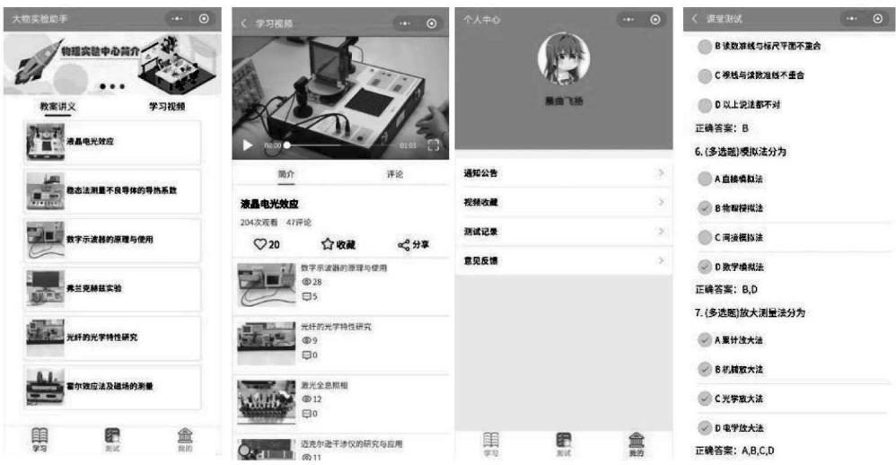
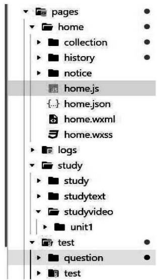

> 来源：MinerU 转换（stem-exact rebuild 2026-08-08）

文章编号：1007-2934(2021)03-0115-04

# 基于微信小程序的大学物理实验移动学习平台的设计

佟林金，陈曲扬，陈雅薇，王晓萌(中国石油大学(华东)理学院，山东 青岛 266580)

摘 要：高等学校物理实验是一门基础课程，对培养学生动手实践能力、基础实验素养、创新能力等具有重要意义。在信息时代下，高校大学物理实验教学应与时俱进，积极利用迅速发展的各类新信息技术，创新实验教学模式和方法。本研究针对大学物理实验课程，开发了基于微信小程序的移动学习平台，并在实际教学过程中进行了初步应用。

关 键 词：信息化教学；小程序；自主学习；智慧终端

中图分类号：G 642.0

文献标志码：A

DOI:10.14139/j.cnki.cn22-1228.2021.03.030

教育信息化2.0是新技术、新方式、新理念支撑下的教育信息化，将多维度、全方面地推动教育改革[1]。另一方面随着人工智能、物联网、移动通信、大数据等信息技术的快速发展，教育信息化的新格局正在形成。教育信息化已成为教育改革与发展的方向[2-4]。在教育信息化的背景下，开发设计适合混合式教学的信息化教学手段是当今课程教学面临的问题之一。目前，信息化的教学手段主要以 PC 端 WEB在线学习和移动智慧终端为主。其中，基于智慧终端的移动式学习以其灵活多变的学习方式和先进高效的学习理念在众多学习方式中脱颖而出，受到越来越多学生的青睐。小程序是一款借助微信平台开发的应用程序，无须安装，即用即走，具有良好的交互性[5,6]。既优化了移动互联网时代的实验课堂教学，又避免了同类移动App软件平台对教、学双方的束缚。研究提出了利用微信小程序开发师生共建型物理实验开放共享平台，符合新一代网络大学生的学习特点和学习需求[7]。

## 1 大学物理实验教学的现状

大学物理实验作为高等学校实验教学中的一门课程，对培养学生动手实践能力、基础实验素养、自主创新研究及团队协作精神具有重要意义，也是大学生跨越物理理论知识与面向科学应用研究之间的重要桥梁[8]。大学物理实验课一般是面向理科或工科专业开设的基础必修课程之一，普遍面临学生多，专业杂，学时少的困境。学生对于大学物理实验的预习停留在对实验目的、实验原理的预习，对实验方案及实验仪器的操作使用缺乏深刻理解从而造成实验课时不够、实验效果不理想、仪器故障率高等问题。另一方面，由于实验课程的特殊性，大学物理实验课的复习比其他理论课的复习困难，往往使得课后复习没有条件。针对目前大学物理实验中遇到的现实问题，有必要在大学物理实验教学中引入信息化的手段，与线下实验教学互为补充、互为支撑，以提高大学物理实验教学的质量和水平。

目前，线上物理实验信息化资源大部分都是基于PC终端的，而以手机、ipad等移动式智慧终端为载体的线上大学物理实验资源匮乏。通过对已学习过大学物理实验的部分同学开展调研，了解了学生的学习需求。结果显示学生对实验操作过程演示及仪器的规范使用和介绍等需求强烈，对建立移动式的学习资源平台接受度非常高。并根据学生们的使用习惯最终选择了以微信小程序为载体的技术手段[9,10]。

## 2 大学物理实验移动学习平台设计和实现

## 2.1 总体框架模式设计

在线移动学习平台包括学生端和教师管理员后台端，功能模块主要包括教学模块、实验管理模块和成果展示模块，其系统整体框架如图1所示。

  
图1 师生共建型大学物理实验在线平台框图

## 2.2 功能模式设计

智慧终端型移动学习平台研究内容包括：教学资源模块，实验教学管理模块以及成果展示模块三个部分。为大学生提供涉及力学、热学、电磁学、光学、近代物理等实验项目的数字化学习资源，覆盖范围广，能满足不同专业不同物理基础的学生的学习需求。通过线上教学资源可以很好地完成课前知识的预习传递、课上知识的内化及课后知识巩固扩展。教学资源模块包括实验项目分布，教学微视频，实验讲义，习题测试等部分。其中，学生可通过实验项目分布功能查询自己上课所在实验室及实验课程相关信息。习题测试主要以单选、多选、判断题的形式呈现，内容涵盖实验原理、具体知识点、仪器操作等部分。学生在课前根据自测题对实验的预习效果进行检验，在课后对实验整体的掌握程度进行测验，查漏补缺及时调整。

教学微视频单元包含几十个实验项目视频讲解，可以扫描二维码进行观看。针对实验中，学生对实验仪器的操作、使用不熟练的学习现状，专门录制10min以内的微视频。区别于传统整堂实验教学视频不同，微视频主要以呈现知识点及实验仪器的规范使用介绍、实验演示操作这些学生反应强烈的需求为主。学生可以在任何时间地点通过搜索小程序或者在课上通过扫描小程序生成的二维码(张贴在实验台)进行微视频的学习，课上实时学习仪器的规范使用及实验演示操作。这在一定程度上缓解了学生预习复习受场地和实验仪器的限制，方便学生随时观看。既有利于预习也有利于复习，同时减少了由于学生实验仪器操作不熟悉或不规范造成的实验失败或者仪器故障率高的问题。平台界面效果如图2所示。

  
图 2 平台界面

实验教学管理模块包括学情统计分析和实验仪器问题反馈模块。根据学生在平台的学习的历史记录(文章阅读量、视频观看量、点赞数)、留言等进行学情统计分析。归纳梳理出学生比较感兴趣或者比较难理解的实验项目或者知识点，从而调整实验教学模块单元的内容，也可以服务课堂实验教学。基于智慧终端的移动式学习平台能实时反馈实验仪器的使用、故障情况。方便教师和实验技术人员了解实验设备情况，由此可以降低由于高频率使用实验设备或者学生错误操作等原因导致的软硬件维护成本保证了实验教学的良好运行。

师生共建型实验移动教学平台不仅要考虑教学内容丰富这一原则还要充分考虑用户体验性好。如果只建立而无法激起学生的兴趣那么平台则无存在及持续运行的动力。用户体验包括；直观性、吸引性、便捷性、课程需要性等。实验室的教学成果及学生成果展示能很好地吸引学生，激发学生的学习动力和兴趣。成果展示包括学生在国内外期刊发表的论文，在各类大赛中的优异成果和作品，创新训练中的优秀作品等。

## 2.3 功能模式实现

## 2.3.1 小程序技术路线

系统在实现逻辑上分为前台和后台。前台包括页面的结构、页面的外观视觉表现以及页面层面的交互实现，主要是在用户手机上实现。后台包括对用户数据的储存、数据的处理、管理数据库等功能。前端采用 iView 组件库，该组件库实现了一些基础的页面组件，可以直接使用，配合 HTML、CSS 样式、JavaScript 语言实现页面的基本外观和功能。后台采用小程序的云开发功能，通过云开发提供的调用接口，实现了数据的储存，及数据处理功能的实现。

## 2.3.2 前台页面的实现

个人页面包括本系统设置的页面结构如图3所示。

  
图3 小程序项目文件结构

通过微信官方提供的小程序开发者工具，点击创建项目时会自动生成小程序的基本配置文件和基础框架代码，每个页面包含四个基本文件，分别以js、json、wxml、wxss作为后缀,js文件实现页面的逻辑功能，json文件对页面进行基本配置，wxml文件实现页面的基本结构，wxss文件控制页面样式。当页面的内容较多且重复的时，使用小程序的列表渲染，使用<view>组件配合wx:for,设置页面的css样式。点击内容框并跳转到相应页面时，使用参数传递和页面跳转API。

## 2.3.3 核心功能的实现代码

视频页面的功能实现了记录播放量、点赞、收藏、转发、评论的功能。先在数据库上创建相关的数据项，当用户点击播放、点赞、评论等图案后，使用数据库的inc接口，将相关记录自增加1，数据修改成功后再修改本地显示的数值。收藏功能的实现是用 setStorageSyn函数，将视频的标题等信息记录在本地，在视频收藏记录页面加载该信息，显示到页面上。

题目测试功能主要实现了加载不同试题，自动判断答题情况，并记录在本地。创建试题的题目数据和题目内容数据，用户点击进入答题界面，根据测试名称加载试题和答案，当用户提交答案，对比用户答案和标准答案，错误的题目显示红色，并将答题记录储存在本地。

## 2.3.4 数据库的设计

数据库是按一定数据结构存储和管理数据的软件系统，是小程序的重要组成部分，数据库的结构决定了软件的使用体验及管理效率。本系统结合各功能模块设计相关的数据结构，主要设计了video\_info、user\_comment、test、question、ppt\_info五张数据表，设置“id”为每条数据的唯一主键值。

用户评论表user\_comment。用户评论表用于存储用户评论信息，当用户点击发表评论时，将用户id、用户评论内容、用户头像等构造成一个json对象，将该数据结构写入到数据库中，在评论页面向数据库请求评论内容，将评论数据显示到评论页面。

测试数据表 test 和问题表 question。测试数据表test主要用来存储测试名称和试题数目，当小程序先获取测试表的试题名称和数量，再到题目内容表中，查询题目的具体内容。当未进入测试页面时，只需获取测试名称，无须获取具体的题目内容，此时应该使用冗余设计。

视频信息表video\_info。视频信息表主要是存储视频的链接、视频标题、评论数、点赞数、封面图片、观看数。当用户在视频播放页面有上述操作时，将会修改相关的记录数值，并将修改后的记录存储回数据库。在云平台上存储好视频资源，通过访问其链接，即可在本地播放视频。

## 3 结语

针对大学物理实验课程，开发了基于微信小程序的移动学习平台，并在实际教学过程中进行了初步应用。通过该平台，实现了线上线下相结合混合式学习。一方面加大了数字化教学资源的建设，为学生自主学习、主动实践提供丰富的线上资源和服务。另一方面，在一定程度上提升学生学习兴趣，提高了教学效果，但还需要在功能上进行完善，如增加题库、学生与老师的私信等功能。

## 参考文献：

[1]任友群，万昆，赵健.推进教育信息化2.0需要处理好十个关系[J].现代远程教育研究,2018(6):3-11.

[2] 李海燕.开放大学:建设学习型社会的载体[J].高教探索,2016,12:90-93.

[3] 贾楠.数字化学习时代对大学生学习方式的重新审视[J].教育导刊,2017,5:93-96.

[4]高志敏，朱敏，傅蕾，等.中国学习型社会与终身教育体系建设：“知”与“型”的重温与再探[J].实验技术与管理,2017,23(4):50-64.

[5] 刘艳.微信小程序视域下移动学习平台的搭建与研究[J].信息与电脑(理论版),2019(14)：78-80.

[6] 张兴飞.基于微信小程序的教学平台设计与开发研究[J].教育现代化,2019(55):268-269.

[7] 王秀云，宿艳，张永策，等.分析化学实验智慧教学模式设计与应用[J].实验技术与管理,2017,23(4) :50-64.

[8]尹玉芳，马红章，张亚萍，等.“探究式”教学在大学物理实验中的应用探索[J].大学物理实验，2018，31(4):127-132.

[9] 宋巍.基于微信小程序的移动学习系统探索与实践[J].电大理工,2020(1):17-21.

[10] 王红岩，冯正南，王永超.物理专业本科生自主学习能力现状分析与对策研究[J].大学物理实验,2020(4):121-124.

# Design and Implementation of Learning Platform for College Physics Experiment Based on WeChat Mini Program

TONG Linjin , Chen Quyang, Chen Yawei , Wang Xiaomeng *

(China University of Petroleum East China, Qingdao 266580, China)

Abstract: Physical experiment in Colleges and is a basic course , which is of great significance to cultivate students' practical ability , basic experimental literacy and innovation ability. In the information age, college physics experiment teaching should keep pace with the times , actively make use of all kinds of new information technology , and innovate experiment teaching mode and method.In this study , a mobile learning platform based on wechat applet is developed for college physics experiment course, and has been applied in the actual teaching process.

Key words: information teaching; mini program ; autonomous learning; smart terminal