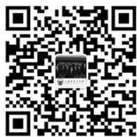
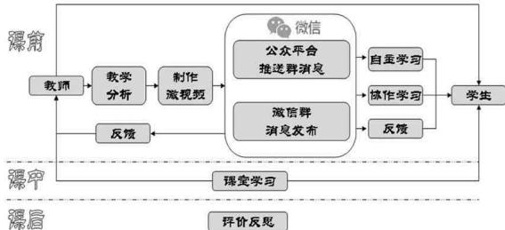

> 来源：MinerU 转换（stem-exact rebuild 2026-08-08）

# 基于微信平台的高中物理“翻转课堂”教学初探

丁 玲

（上海育才高级中学 上海 201801）

摘 要 随着翻转课堂在教育界的大热，越来越多的教育工作者尝试着利用翻转课堂来优化教学活动，促进知识的传授。而笔者则结合全民普及的微信平台对“翻转课堂”进行新的探索，并以高三物理电磁感应部分的知识点为例，构建了微信公共平台支持下的翻转课堂教学模式。

关键词 微信 微课 翻转课堂 物理教学

中图分类号：G424

文献标识码：A

DOI:10.16400/j.cnki.kjdkx.2015.02.066

# High School Physics "Flipped Classroom" Teaching Based on Wechat Platform

DING Ling

(Shanghai Yucai High School, Shanghai 201801)

Abstract With the flipped classroom in the educational circles of hot, more and more educators try to optimize by the flipped classroom teaching activities, to promote the teaching of knowledge.The author combines the universal Wechat platform of new exploration of "flipped classroom", and to the senior high school physics electromagnetism induction knowledge for example, construct the Wechat public platform under the support of the flipped classroom teaching mode.

Key words Wechat; micro class; flipped classroom; physics teaching

WEB2.0的网络热浪已经深刻影响到我们的教学，日常生活中经常出现的微信、微博、微电影等越来越红火的新名词，接二连三的出现在高中教学的实践中。而“电子书包”、“翻转课堂”、“慕课”、“微课”等等新名词在教育行业也正红得发紫。如何将新科技引入课堂教学，优化已有的教学活动，是很多一线教师热衷的话题，笔者就尝试着利用微信平台对“翻转课堂”的进行新的探索。

## 1 微信、微课和翻转课堂的关系

既然需要利用微信平台进行“翻转课堂“教学实践，我们首先需要理顺一下几个相关的词汇。

（1）微信（WeChat）是腾讯公司推出的一款即时通讯服务的应用程序，它具有好友之间进行文字、图片、语音、视频通信的功能，并且支持分组群聊。鉴于该软件是完全免费的，在目前的教育大环境下，这就非常容易得到学校和家长认可，能够顺利在日常教学中使用。因此微信工具的出现给基于网络环境下的开放式教育提供了全新的学习教学平台。

（2）“翻转课堂”（The Flipped Classroom）美国人萨尔曼·可汗（Salman Khan）（原籍巴基斯坦）创立的可汗学院是起源之一。在这里“翻转”的定义是指重新建构了学习流程。在我们已有的传统教学模式中，学生通常需要在学校里听老师讲课，回家后进行课后复习、做作业、然后再回到学校参加考试。而在新的翻转教学模式中，学生可以通过提前观看老师制作的教学视频自学，再到了课堂上做一些相应的练习，同时利用学到的知识解决某些问题。而当学生在学习过程中遇到困难时，老师会进行指导，而不是授课。学生往往进行的是项目活动学习，教师则要针对不同学生进行区别化指导。

（3）“微课”则是源于西方的慕课。但是国外的慕课通常只提供碎片化的知识点，是一组可扩充的、形式多样的内容集合。通过相关领域的专家、教育家、学科教师提供，这些内容集合最后可以汇集成一个中央知识库，就像模块化的网站一样。这些模块化的内容具备的独特之处在于，它可以被“再度组合”。所有的学习资料不是简单地堆砌在一起，而是通过各种慕课彼此关联起来。慕课这个理念在引入中国之后，它被进行了中国化的再次演变，我们的“微课”是以教学视频为主要呈现方式，反映教师在针对某个典型知识点（重难点、疑点、考点等）教学或开展某个教学活动环节中所运用和生成的各种教学资源有机结合体。

在我国的中小学的课程体系中基本是以教学目标或课程标准为基础的，而且我国基础教育的微课在初始阶段就和“翻转课堂”的理念紧密联系起来，形成了独特的以微视频为载体再辅以“翻转课堂”理念的先学后教的模式。同时。微课在结构形态上与西方基础教育的慕课也有一定的区别。由视频为建构核心的微课，在翻转教学中具有先天优势，微课能够为翻转教学的实现提供强大的课程支持，翻转教学为微课走向应用与课堂实践提供市场，使微课由资源提供功能迈向学习支持功能，两者能够完美地结合。

同时随着微信使用的全民普及，由于它所具备的实名制，移动模式，点对点、点对面相互结合的传播方式。使用者可以选择和好友点对点沟通，也可以使用群聊功能与好友们进行点对面的沟通。这样微信、微课、翻转课堂三者不期而遇地走到了一起。探索如何利用微信的点对点与点对面的沟通方式，使之成为教学的一种辅助方式，为教师与学生架设一个有效沟通的桥梁，同时加强师生间的情感沟通，并能促进教学过程的顺利开展，从而提高教学效果，成为很多人的关注点。

## 2 WEB2.0 环境下高中物理教学中的现实需求

上海育才中学从2011年开始在高一、高二年级全面实施学科的模块化教学，学生按照知识模块自主选课，流动组班，人人一张个性化课表。这是我校针对学业水平考试提前做出的调整，重点确保学业水平考试的知识点教学，缩减高考知识点的拓展课教学课时（合议课）。这样导致按照教材应该在高二完成的教学知识点，由于是高考要求，在高一、高二的模块教学中未进行安排。即有些物理知识点只对高考有用，而会考不做要求的，例如《闭合电路》和《电磁感应》章节。这就造成了在同一个模块教学时学生对相同的知识点理解深度存在差异（可能有些知识点有人学过了，而有些还没有学）。到了高三阶段，我校模块化教学又重新回归到传统的高考复习模式。由于教学课时的紧张，教学中不可能像上新课一样将所有知识点重新深入细致地再上一遍，但是学生两年来产生的水平差异不是短期就能弥补的。虽然我们也曾要求学生通过自学的方法掌握，但是自学的效果不佳。

笔者作为班主任在2013年底建立班级微信群，开始只是为了发班级通知。但是随着暑假的到来，微信群不知不觉中开始成为学生作业答疑，教师检查学生作业的平台。高三开学伊始，通过文理分科重新组班，班级学生的层次差异越发明显。为了加快教学进度，并平衡班级同学的学习水平，具备个性化教学优势的“翻转课堂”浮现在了我们的眼前。于是我产生了将微课、翻转课堂引入微信平台的念头。希望利用“翻转课堂”结合网站方式的微课来强化特定知识点内容，为课堂教学提前扫清障碍。

翻转课堂、微课实际上都强调的是先学后教，这已经被证实为一种比较成功的教学范式。我们所说的微视频学习与导学案（讲学稿），都只是先学后教的载体而已，其背后的教育学原理是一样的。而上海育才中学一直以来都有使用导学案的传统，但是微信平台、微课、翻转课堂的引入首先我们的载体发生了变化，其次互联网环境下以微视频为主导的先学后教方式，和以往导学案主导下的先学后教的模式还是存在一些差异的，主要体现在三个方面：（1）反馈迅速。教师无论对于学生的课前学习的作业反馈，还是在课堂学习中的问题反馈，在网络技术支持下，都要比纸质的导学案来得更及时、迅速，同时能够节省了大量的机械批改作业的时间。（2）讲解生动。微视频上，精心准备的、生动形象的讲解，显然比起打印的导学案，更讨学生喜欢。（3）易于检索。在线的电子学习资料比起纸质的导学案来，更加便于资料的保存与检索，同时方便学生的复习。

为了让教学实践开展得更加顺利，我先期在我校教师中做了一个“翻转课堂与微信应用于基础教育现状调查”。参加调查的样本总数为121 个，共有 10 个问题：

第1 题：您使用过微视频学习吗？

第2 题：您是否有制作教学微视频的经历？

第3 题：您对“翻转课堂”了解吗？

第4题：您在教学过程中是否有采用翻转课堂教学模式？

第5 题：您认为这种模式优势存在于什么地方？

第6 题：如果推广翻转课堂何种教学模式，您认为有可能遇到什么样的困难？

第7 题：您平时使用微信最多的功能是什么？

第8题：您关注的微信公共账号的类型属于以下哪一种？

第 9 题：您认为微信公共账号给您的教学是否有提供帮助？请注明是内容？

第10题：您是否有通过微信与家长或者学生沟通交流的经历？

我抽取3 个问题给呈现以下调查数据：

第4题：您在教学过程中是否有采用翻转课堂教学模式？

是：25 人-20.66%否：96 人-79.34%

第 6 题 如果推广翻转课堂这种教学模式，您认为有可能遇到什么样的困难？（多选题）调查结果如图1。

<table><tr><td rowspan=1 colspan=1>选项</td><td rowspan=1 colspan=1>小计</td><td rowspan=1 colspan=1>比例</td></tr><tr><td rowspan=1 colspan=1>教学视频制作复杂</td><td rowspan=1 colspan=1>79</td><td rowspan=1 colspan=1>65.29%</td></tr><tr><td rowspan=1 colspan=1>家长难以接受教学改革</td><td rowspan=1 colspan=1>42</td><td rowspan=1 colspan=1>34.71%</td></tr><tr><td rowspan=1 colspan=1>学生的自制力不够</td><td rowspan=1 colspan=1>93</td><td rowspan=1 colspan=1>76.86%</td></tr><tr><td rowspan=1 colspan=1>硬件设备条件限制</td><td rowspan=1 colspan=1>57</td><td rowspan=1 colspan=1>47.11%</td></tr><tr><td rowspan=1 colspan=1>其它</td><td rowspan=1 colspan=1>8</td><td rowspan=1 colspan=1>E                 6.61%</td></tr></table>

图 1

第10题：您是否有通过微信与家长或者学生沟通交流的经历？

是：50 人-41.32%否：71 人-58.68%

通过分析以上调查数据发现，教师们对于翻转课堂还是有很高的认知度的，并且尝试的也不在少数。但是使用微信平台进行教学活动则不多，大多还停留在信息交流和沟通上。周围同事中真正利用过微信进行“翻转课堂”教学实践的还没有，所有的经验都要自己去摸索，于是我的“翻转课堂“之路开始了。

## 3 微信平台“翻转课堂”的建立

在着手尝试微信结合“翻转课堂”之初，我经过深思熟虑觉得：高中物理教学特别是高三阶段有自己的特色，学生一定要通过大量的习题来提高知识的储备厚度。因此在日常教学中全面铺开是不明智的，也是不可行的。所以最初的尝试只是录制简单的答疑过程，上传视频，学生反映也很令人鼓舞。教师和学生在微信中可以自由提问，微信群里成员都可以发表自己的观点，同时提出解决方案。和几年前的手机短信群发不同，微信群可以把师生之间的弱关系变为半强关系，因为微信的“朋友圈”相当于在原来的通讯功能上又叠加了社交网络和自媒体特征，这样能将有共同经历和相同爱好的学员逐渐转化为朋友，形成相应的交际圈。但是由于答疑内容分散不系统，而且微信反馈的学生一多，就造成刷屏现象，最初上传的微课视频很快就淹没在海量信息中了。同时笔者作为高三物理备课组长，考虑到整个年级的需求，希望按照教学进度，系统地录制一些知识点微课（当然个人力量有点困难，在教研组长和高三老师的支持下开始了尝试）。为了能够支持更多学生和系统化微课程，同时解决刷屏现象，我决定把已有微信群升级成微信公众平台。于是“上海育才中学物理翻转课堂”公众平台上线了（见图 2）。

2014年9月起，在我的高三任课班级正式开始了“翻转课堂”的实践。在开始阶段，因学习载体和手段的变化，学生是喜欢的。但新鲜劲过后，学生发现知识的呈现只不过是由黑板上老师讲变成视频上老师讲的时候，热情就逐渐淡化了。为解决这个问题，我及时微调了时间思路，结合“翻转课堂”的研究实践，我们主要在5个方面进行了调整：（1）调整学习时间，从“学生在课堂上听讲”调整为“课后自己看课本、视频及相关资源”；（2）调整学习方式，由“课堂跟老师学”调整为“课外自学和课上互学”；（3）调整学习内容，将完整的课堂视频调整为“10分钟以内的重点内容视频”；（4）调整学习地点，将“在课堂上学习”调整为“处处皆学习”。（5）调整作业时间，由“课后完成作业”调整为“课上完成作业”。

  
“上海育才中学物理翻转课堂”公众账号微信二维码  
图 2

同时结合以往导学案的教学经验，我设计了微信平台下的“翻转课堂”模式（见表1），它主要由以下几个要件构成：（1）课前预习环节，教师利用微信公众平台提供给学生自主学习的微视频材料或者 PPT 演示文稿。学生则通过观看视频、阅读教材及其他材料或者在线习题。教师可以通过测试结果了解学生学习的情况，适当调整课堂的教学活动，针对性地实施教学。（2）课堂教学环节，教师通过解决学生课前学习所产生的困惑，从而引导学生总结和提升所学内容，进一步深层理解所学内容的。（3）课后巩固环节，学生在课后习题、研讨等帮助下对所学内容进行反思、总结和提升。教师通过微信群或者微信平台为学生提供在线指导。

表 1 微信平台下“翻转课堂”学习方案
<table><tr><td rowspan=1 colspan=1>课前</td><td rowspan=1 colspan=1>学习目标学习方式学习媒体</td><td rowspan=1 colspan=1>掌握指定知识点的基本内容观看视频、教材及相关铺助材料微信平台</td></tr><tr><td rowspan=1 colspan=1>课中</td><td rowspan=1 colspan=1>学习目标学习方式学习媒体</td><td rowspan=1 colspan=1>解决学生课前学生产生的疑问，引导学生消化所学内容答案、讨论、讲授、练习黑板、电脑、投影</td></tr><tr><td rowspan=1 colspan=1>课后</td><td rowspan=1 colspan=1>学习目标学习方式学习媒体</td><td rowspan=1 colspan=1>引导学生反思和总结所学内容课后练习、讨论微信平台、试卷</td></tr></table>

例如在上“感应电流的方向”一课时，提前按照教学要求，录制并上传微课视频，同时配套上传相应的教学辅助资料。然后布置作业同时群发消息提醒学生关注“上海育才中学物理翻转课堂”公众平台，有新课件了，让学生在双休日积极参加相关的学习活动。学生通过浏览微信平台上的课件 PPT 和讲课的音频，可以反复观看，根据自己的理解来调整上课的节奏。由于这节课难点在于：用感应电流的磁场来描述感应电流与磁通量变化的关系。因此学生在看视频自学的过程中，按照我布置的任务，在微信群或平台回复上提出自己的疑难问题，准备在课堂上提问，请老师或同学帮忙解答。

课堂中学生通过观察演示实验效果和教师的讲解，解决初期在微课中产生的一些疑惑。同时通过循序渐进的引导，加深同学们楞次定律的理解。最后配合学生间的讨论和课堂练习的讲解，进一步巩固学生知识点的掌握。

课后则布置了相应的家庭作业，让同学们通过习题熟练知识点的具体应用（在其他知识点的讲解中也尝试过直接通过微信平台布置作业，学生通过照片方式直接上传作业）。

翻转课堂教学是教师、学生、网络平台三大要素的组成，在整个过程教师处于主导地位，学生是主体，而微信网络平台是沟通师生的桥梁，图3 则直观呈现了微信平台作用。

  
图 3 微信平台在“翻转课堂”教学中的位置

## 4 翻转课堂后的效果

经过将近 2 个月的磨合，班级的物理课堂大家反响十分积极热烈。很多学生反映看了上传的课程 PPT 和微视频觉得特别容易理解，而且可以促进自己主动思考，当回到课堂上的时候，精神集中程度比以前好多了，学习效率高了不少。翻转课堂也在悄悄地改变着我上课“唱独角戏”的现状，重复讲解少了，能有更多精力为学生定制个性化辅导方案，同时引导学生进行拓展内容的学习。同时由于关注人群的增多，为了更好地区分受众群，我对关注用户进行了分组，将学生和教师区分开来，这样推送消息时将更有针对性。

与传统课堂相比，“翻转”最大的优势是让交流更趋于有效。课上交流时间多了，学生有备而来，参与讨论更主动。比如，学生问：“如何更好地记忆楞次定律？”“能不能编个故事演绎一下楞次定律？”课前微信群的交流加上课堂上的热烈互动，就诞生了物理课本剧《楞次定律是一场爱情》。

在教学实践中我发现学生喜欢用手机微信看视频学物理。课前、课后，想看就看；看累了，还可以听，想专门看视频上的板书，可以暂停，一遍不懂，可以再看再听，学生可以选择在自己最合适的时间以最方便的方式来上物理课，是真正能召之即来的手机物理课堂。有效的课堂讨论，也让参与其中的学生增强了自信。课下我和学生用手机微信交流，还把相关文字上传到微信上分享，微信即时交流的便利以及参与人数的众多，也是以前的课堂讨论不能比的。

尽管物理课的翻转课堂教学只实施不到 3个月，但我已经发现了不少学有余力的学生。这些同学的理解能力十分强，并且学有余力。还主动希望成为小老师，也来录制一些微课程，将自己的解题思路和同学们分享。如果时机成熟，我还希望能建立一个在线的课题讨论组。能通过建立特定主题的微信群，进行师生互动，随时分享关于学科方面的思考。关于“翻转课堂”的发展，自己需要走的路还很长。

从这几个月的实践看，利用“翻转课堂”理念的课堂效果是明显的。学生们也是喜欢这种学习方式改变的，大家的学习习惯与学习方法有了一些转变，同时减轻了教师的工作负担。备课组的集体备课、经验分享也促进了大家在专业知识和教学能力上的提高。

## 5 对今后教学的设想

通过多次的教学实践，笔者认为“翻转课堂”不是在线视频的代名词，它除了教学视频外，仍然需要师生之间面对面的互动，不是所有的课都适合微课及翻转课堂，它们仅仅只是现有课堂教学的一些补充，具体“翻转”哪些，要根据学情而定。

“翻转课堂”同时需要考虑教师自身的技术能力以及学科的教学实际需求。理想的“翻转”需要特定的网络环境、软件技术与设备的辅助，将现有技术进行适当改进，可以收到较好效果。简易条件下教师在自己录制微视频时，完全可以利用电脑录屏软件加麦克风的方法，把设计好的PPT作为背景，把相关的资料事先放到PPT上，边录音边用鼠标进行指点，最后生成一个包含讲解声音的和PPT 播放的微视频。或者可以利用手机录像功能，将讲解例题过程录像来，直接发送微信平台。

以自身的体会而言，需要改进以下两个方面：（1）培养学生的自控能力。在微信群聊的时候，常出现部分学生自制力较差，发布一些与学习无关的语音信息干扰其他学生，影响群内同学的学习进度和学习效果。（2）强化教师的指导作用。教师在在微信使用的整个教学过程中一定要积极参与其中，学生的学习应该在教师科学合理指导下进行，从而突出教师的主导地位及学生的学习地位。

借助微信平台手段“翻转课堂”能否“翻转”现有的教育状态，还有待于我们去探索。我们需要积极地研究和实验，无论看多少文章、听多少讲座，都不如亲自尝试。希望大家都能取其所长，避其所短，共同为高中物理教学添砖加瓦。

## 参考文献

[1] 刘潇潇.把课堂“翻转”过来.上海中学生报,2013.11.

[2] 黄强.基于微信平台的翻转课堂的实施.教育信息技术,2014(5).

[3] 公海霞.基于即时通信平台的翻转课堂教学模式研究.软件导刊,2013.11

[4] 杜悦“. 翻转课堂”：翻什么转什么坚守什么.中国教育报,2014.4.

[5] 杨九明.基于微视频资源的翻转课堂在实验教学中的应用研究.现代教育技术,2013(10).

[6] 徐晓东.中小学综合学习的课程开发与教学设计.电化教育研究,2000.Vol.93.

[7] [日]恩田彰等著.创造性心理学.河北人民出版社，2008.

[8] 张新华.注重课堂问题设计培养学生的创新思维.中学物理,2009(10).

（2）这种教学方式，对教师提出了更高的要求，学生会提出很多日常教学以外的问题，等待教师帮助解决，因此，教师需要不断充实自己，努力提高自己的教学能力和拓展自己的知识面，才能适应这种新型的教学模式，同时要求老师除了组织和管理教学之外，还要具备项目规划、管理与评价的能力，要随时回答学生提出的问题。

（3）教学评价更为全面，包括了对学生学习的全过程的评价及终结性考核两个方面。促进了学生个体素质的提高，能更好地展示学生的个性特点。更有利于教师有针对性地进行教学。使学生的核心素养和核心技能得到长足发展。

（4）学生的安全问题更为重要，在新的教学模式下，学生完成项目时，使用设备加工零件时的随意性增大，同时还需要学会钻床、铣床等设备的使用，学生发生安全事故的几率增大，这就要求老师们要用高度的责任心，时刻关注每一位学生的安全、让安全意识贯穿整个课堂始终。

通过几年来车工一体化课的讲授，感觉到在一体化的教学模式下，学生们确实有了较大转变，从知识、技能、素质等各方面均有体现。我们会在以后的教学中继续深入领会一体化教学的含义，继续挖掘教学潜力，钻研教学方法，争取为社会输入更多的技能型人才。

## 参考文献

[1] 徐国庆.职业教育项目开发指南[M].华东师范大学出版社,2009.

[2] 余能真.职业技能鉴定教材车工（初级、中级、高级）[M].中国劳动社会保障出版社,1996.

[3] 唐监怀,刘翔.车工工艺与技能训练[M].中国劳动社会保障出版社,2007.
