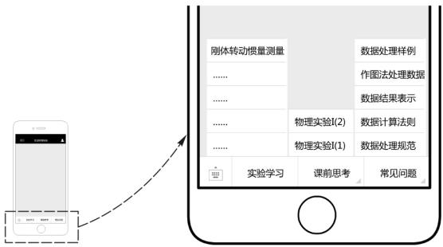
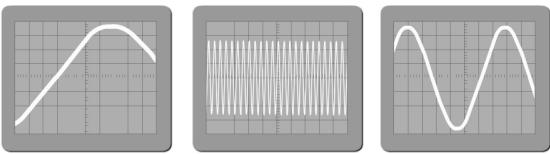
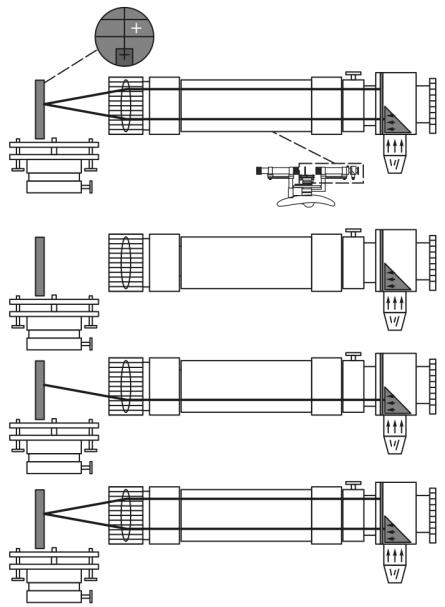
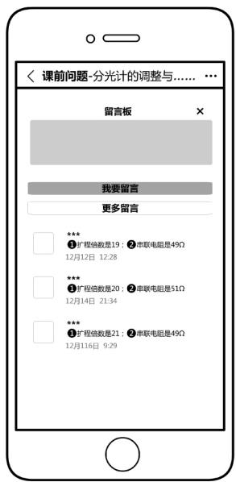
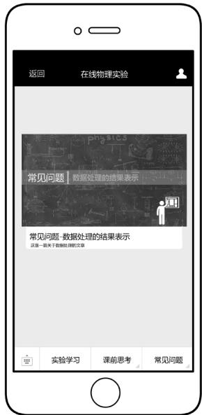
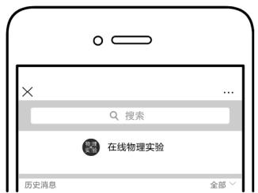
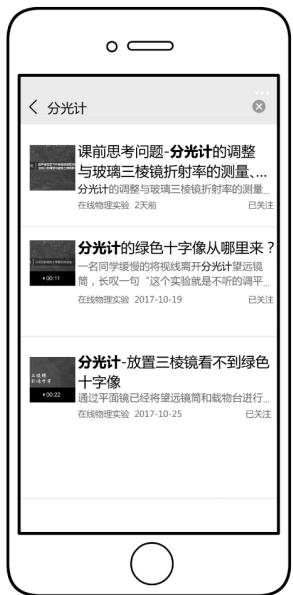

> 来源：MinerU 转换（stem-exact rebuild 2026-08-08）

# 基于微信结合 H5 技术的大学物理实验教学创新研究

白 亮，马成举( 西安石油大学 物理实验中心，陕西 西安 710065)

摘要:本文以微信为平台，结合 H5 技术对大学物理实验教学内容进行了创新设计． 通过实例给出了在线学习过程中教学资源内容设计的思路和使用效果，以及学生自主在线学习中教师参与的内容 方法和技术． 最后根据学生在线学习情况反馈和课堂教学内容之间的相互补充，提出了对于构建高质量的大学物理实验教学内容和提高教学质量新的方法及技术．

关键词:微信公众号; H5 动画; 物理实验; 教学内容

中图分类号: G 642．0

文献标识码:A

【DOI 】10．16854 /j．cnki．1000-0712．180590

文章编号: 1000-0712( 2019) 12-0040-04

自2012 年以来，大规模在线开放课程在世界范围内迅速兴起，学习者可以在线参与完整的教学活动［1］． 慕课是一种具有强大生命力的在线学习方式，博得众多教师、学者的关注［2］． 笔者在我国几个有影响力的在线平台 “中国大学 MOOC” 清华大学“学堂在线” 上海交通大学“好大学在线”中仅看到一门关于大学物理实验的课程，并且其他实践类课程也很少，在这样一种情况下，结合我校实际情况，于2016 年申请了微信公众平台并结合 H5 动画进行小规模在线课程的尝试，此模式教学内容具有突出精华、学生随时随地学习、学生从被动转为主动思考的特点［3］． 累计用户 6．9 万，浏览学习次数 11．7万，以微信平台作为教学内容设计具有平台免费、免安装 实时更新学习资源 不断完善等特点，作为一种尝试，避免了在线开放课程建设投入大量人力 物力 财力．且制作的教学资源后期可以在任何一个平台进行发布． 同时可以获取学习者在使用过程中的大数据，如何挖掘和利用这些学习过程中的数据也是我们面对的一个重要课题［4］，本次研究中 H5 具有数据统计功能，可对学生在线学习过程的数据进行统计与分析，可以了解学生的学习情况，对课堂教学内容设计有指导作用．因此本次实践通过一个免费且功能完善的微信平台，满足大学物理实验的教学内容设计，结合 H5 的数据统计，指导课堂教学内容的设计，对建设大规模在线开放课程奠定了基础．

## 1 大学物理实验现阶段存在的问题

大学物理实验是高等理工科院校学生进行科学实验训练的重要的必修课程，旨在为学生系统地打好科学研究的基础［5］．通过实践，方便学生了解各种物理实验的背景，加深理解原理，以及各种实验装置的使用方法［6］． 对于实验这样一门理论和实践相结合的重要的课程，现阶段存在以下几方面问题:1) 课时安排限制: 目前的课时安排是预习课+操作课分开进行或预习操作一次完成． 分开授课形式由于间隔跨度一周( 节假日耽误时间更长) ，学生容易遗忘，失去了预习课的意义． 若预习操作一次进行，学生以操作结果为目的，轻视理论，甚至操作完成后对原理还不清楚，失去了通过实践加深理论理解的机会． 2) 教学方法单一: 当前的实验教学还是以教师为主体的传统教学模式，讲解示范后学生进行操作，学生缺少了课前思考的过程，操作中依赖教师，而教师对不同程度学生讲解内容一致，缺乏了分层次的教学． 3) 教学资源单一: 目前主要以传统教材为主，对于实验中仪器操作以文字介绍为主，学生很难理解其操作过程，往往会影响学生的学习兴趣．4)缺少师生互动: 当前很多高校设立新校区，教师下课没有更多时间与学生沟通解决学生的问题，不能深入了解学生的学习程度．

要解决大学物理实验课程现阶段的问题，一是要求学生通过移动学习形式进行自主的在线学习，并与教师传统的课堂教学相结合; 二要通过图 文声 视频等多媒体教学手段结合传统教材; 三是教师在学生进行在线学习过程中适当介入进行指导与互动，了解学生的实际学习程度．

## 2 微信平台构建教学内容

教学内容的设计以微信平台的公众号为基础，将在线学习内容分为三个部分，完成课前和课后的在线移动学习，课前思考问题引导学生有侧重点的通过实验学习部分解决问题，完成预习; 课后的在线移动学习部分为常见问题，如数据处理方面内容图1 为在线学习内容菜单和子菜单内容

  
图 1 在线学习内容菜单

课前思考为一学年 16 个实验项目的课前思考问题; 实验学习菜单为全年 16 个实验项目编号，输入代码进入相应的实验内容学习; 常见问题为课堂操作、 记录数据、 数据处理部分重复出现的一些问题．

## 2．1 在线学习的课前思考问题设置

学生在进入实验室做实验之前没有完全掌握要做的实验的基本理论知识． 这样，在做实验的过程中没有清晰的条理，连贯的逻辑思维性［7］，课堂效率低，整个实验课各部分脱节． 在线学习的课前预习思考题不但要求学生进行预习，而且在思考题的引导下完成高效率的预习． 针对不同特点的实验项目进行设置，例如在实验项目 “示波器的使用”中，由于示波器内部结构复杂，面板旋钮多，学生通过教材阅读很难理解仪器构造和各部分的功能及操作，课前思考题设置客观选择题( 如图 2) ，让学生判断波形调节到什么程度适合读数，主观题可以让学生学习思考屏幕波形如何进行读数的问题． 学生有了判断过程，加深了印象，在实际操作中会以正确的图像为标准去调节，这样就达到了高效率的预习效果．在实验项目“牛顿环”中，等厚干涉的物理理论内容相对容易理解，在问题设置中关于测量关系式中的几个物理量的内容能够加深学生的印象，重点问题在于实验操作中的注意事项和影响整个实验测量结果的操作，例如提出保护显微镜镜片的操作要求是什么? 实验中如何避免空程差? 对自身测量数据的规律性如何预判? 这样可以避免大量数据测量完毕后出现不符规律情况，造成重复实验．

  
图 2 示波器波形调节实验的课前思考题

因此在线学习的课前思考问题设置上，要以实验内容特点( 仪器使用、验证物理规律、物理量测量等) 来设置问题; 另外，问题要满足不同认知水平学生的需求［8］，如理论课是否学习过，问题是否从概念的描述等低层次问题到比较、应用、综合的高层次问题，只有符合学生的认知水平，才能够吸引学生积极参与． 因此，要在长期的在线和课堂教学设置中不断发现总结，使课前设置的思考问题能够达到锻炼学生独立思考问题的能力，并能够提高物理实验课堂教学效率．

## 2．2 在线学习中的多媒体教学资源

美国心理学家 Paivio 在很多研究实验中发现，当学习者回想时，对文字加图片的回想能力优于只有文字的回想，图像系统一般比言语系统更能加深印象，更有优势［9］． 因此在线学习教学设计中的多媒体形式主要针对不能用文字或是静止图片描述清楚的实验原理或操作难点等内容( 如图 3) ，不同的媒体表现形式使学生能够加深印象便于理解，更好的完成在线自主学习．

## 2．3 在线学习中的教师引导

虽然在线学习提供了丰富的教学资源以及课前思考问题，仍有部分同学不做课前预习工作和课前思考题，或是做了预习，因出现问题没有及时解决而失去兴趣． 因此在线学习过程中教师应适当介入，引导和吸引学生参与问题互动，在留言中观察学生提出的问题和不同学生对问题的反应( 如图 4) ，通过和学生的讨论互动过程进而引导学生分析 解决问题或是拓展出新的问题讨论［8］． 对于引导过程中出现的普遍问题，可以通过微信公众号群发推送教学资源的功能( 如图 5) ，让所有学生接受和获取问题信息．

  
图 3 多媒体资源望远镜内部光路动画静帧

  
图 4 教师引导留言互动

## 2．4 在线学习－教学资源搜索

实验课有别于其他理论课程，既有理论讲解又有实践操作，学生在自主学习过程中遇到的问题相对多一些，如果问题不能得到及时解决，会影响学习的积极性和兴趣． 因此利用微信公众号搜索功能( 如图6) ，可以对学习中遇到的问题进行搜索，教师将制作好的各种形式的教学资源上传微信公众号后台，图7 为输入 “分光计”后给出的相关教学资源，学生可以在任何时间地点完成学习并解决学习中遇到的问题，提高学生学习效率和积极性．

  
图 5 教学资源推送

  
图 6 公众号中的教学资源搜索

  
图 7 公众号中教学资源搜索结果

## 3 微信平台促进传统课堂教学

在线学习过程中，提供了丰富的教学资源，提出了课前思考问题，师生间的互动为课堂教学节省了大量时间． 教师根据在线学习反馈情况以及在线交流互动中的有代表性或重复提出的问题有重点的讲解实验内容; 将大部分时间用于讨论和解决操作过程中学生的问题和实验仪器的故障，并针对实验数据中容易出现的问题进行强调． 实践过程中，在课前预习思考和在线交流互动基础上，学生在预习课前已经掌握了一定预备知识，预习课已经可以将大部分时间留给学生自己进行实验仪器熟悉与操作，解决课前提出的问题，为操作课打下良好的基础．学生的学习效率和课堂的教学效果都有了明显提高．

## 4 结论和建议

传统教学对学生的差异性问题无法解决，不能达到个性化的教育，因此近几年利用互联网，出现了慕课 微课 在线开放课程等形式来解决这一问题．而基于 H5 技术的在线学习内容作为一种小规模的在线开放课程，具有投入小 免安装 可实时更新的特点． 通过对一门课程，一段时间的尝试，不断更新内容，优化资源，获取学习过程中的相关数据，提高了教学效率和质量． 同时也可以为更好地实施慕课、微课、大规模在线课程建设做准备．实际运用中，我们发现无论哪种互联网+教育的教学形式，要以好的教学安排设置作为前提，作为教师在传统课堂教学模式基础上重构教学流程，布置合理的课前任务，围绕任务，学生之间、学生和教师间的交流在课前已经进入了教学环节，课堂教学主要以教师指导实验内容和解决实验操作问题为核心．这样，课前学生可以利用碎片化时间随时随地进行学习，提高学习效率，课堂上教师可以有针对性的教学，提高教学质量．

对于理论+实践操作的物理实验课，具有任务明确，需要储备知识量相对较少的特点，因此以微信公众号为平台通过 H5 技术提供的移动学习内容能够帮助学生提高学习效率，同样对有实践环节的其他课程也可以借鉴，配以专业教师团队对教学安排合理设置，采集学习过程数据并分析评价，优化课堂教学内容和在线教学内容，最终提高课程教学质量．

## 参考文献:

［1］ 倪牟翠，张汉壮．物理类在线开放课程群的建设展望与建设理念的思考［J］． 大学物理，2017，36( 7) : 51-55．

［2］ 高健，赵馨蕊，周雨青，等．MOOC 平台学习者学习评价体系研究［J］． 大学物理，2017，36( 12) : 50-53+61．

［3］ 曹显莹，曲阳．基于慕课模式的大学物理实验教学改革与创新［J］． 物理实验，2016，36( 5) : 25-28．

［4］ 马宁生，吕军，方恺．基于大数据背景下的大学物理实验教学改革［J］． 物理实验，2016，36( 12) : 26-34

［5］ 姬晓旭，王爱华．微课在大学物理实验教学中的研究与实践［J］． 物理实验，2018，38( 1) : 49-52．

［6］ 李松，刘秀琴．“互联网+”大学物理实验教学体系构建［J］．实验技术与管理，2017，34( 1) : 172-174．

［7］ 肖立娟．大学物理实验教学的现状与教学改革的探究［J］． 大学物理实验，2015，28( 6) : 114-116．

［8］ 罗莹，刘兆龙．交互教学在理工科基础物理课中应用的教学策略研究［J］． 大学物理，2018，37( 1) : 71-76．

［9］ Clark J M，Paivio A． Dual Coding Theory and Education ［J］． Educational Psychology Review，1991，3 ( 3 ) : 149-170．

# Innovative research on college physics experiment teaching based on wechat combined with H5 technology

BAI Liang，MA Cheng-ju ( Physical Experiment Center，Xi ’ an Oil University，Xi ’ an，Shaanxi 710065，China)

Abstract: By using wechat public account as a platform and combing H5 technology，an innovative design for the teaching content of college physics experiment is carried out． This paper introduces a learning process including both online and classroom and also gives the idea and effect of online learning and the importance of teachers participation and guidance in autonomous online learning． Finally，according to the feedback of the students ’ online learning and the mutual complementation of the classroom teaching content，a new method and technology for improving the teaching content of physics experiment and teaching quality is proposed．

Key words: wechat public accounts; Html5 animation; physical experiment; teaching content
