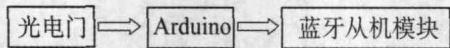
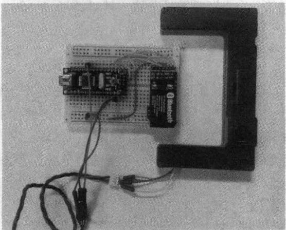
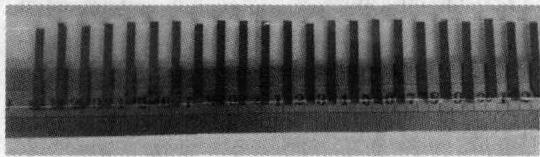
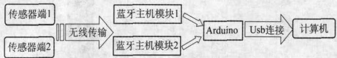
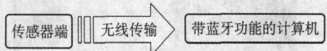
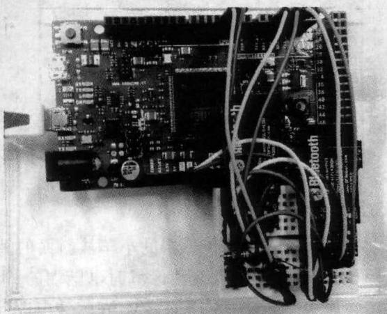
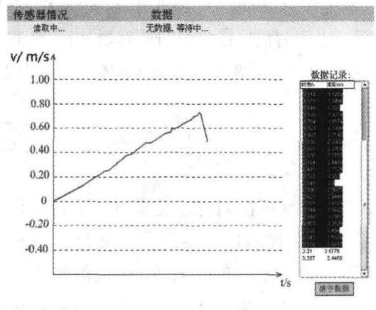
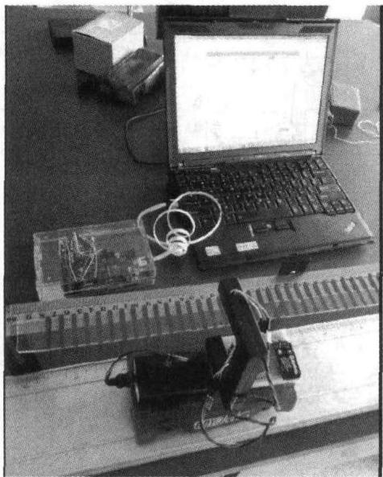
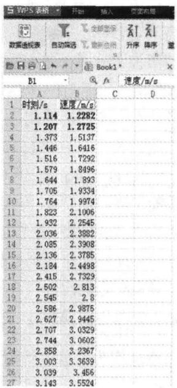
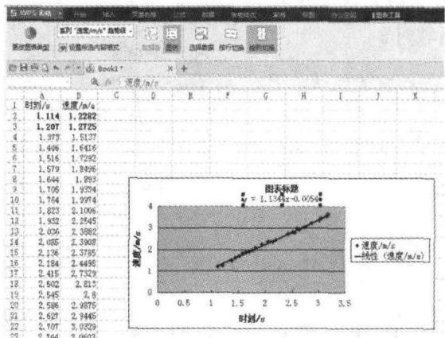

> 来源：MinerU 3.4.4 二次 OCR 转换并依据本地 PDF 逐页精校（2026-08-12）。

# 无线速度传感器

## ——基于 Arduino 和 Flash 的无线 DIS 实验

翁浩峰（浙江省宁波市宁波中学，浙江 315100）

摘要：对高中物理实验中的速度测量方法进行改进，利用安装在小车上的无线光电门来测量小车运动过程中的速度，既满足了对精度的要求，又可以研究物体的运动过程。无线光电门和数据接收器间采用蓝牙无线传输的方式，电脑端的软件使用 Flash 来制作。用 Flash 动画作为 DIS 实验的软件界面，开创了虚拟实验和真实实验相结合的 DIS 实验。

关键词：速度传感器；无线 DIS 实验；打点计时器

文章编号：1002-0748（2014）7-0026

中图分类号：G633.7

文献标识码：B

运动学是高中物理中的重要部分，对运动物体的研究也是高中物理实验中的重要部分。在传统的教学工具下，使用打点计时器或者光电门来研究物体的运动；在 DISLab 出现后，可以使用超声波测距仪来研究物体的运动。但是，上述方法中的任何一种，都存在着缺点。

## 一、原有运动测量工具的缺点

### 1. 打点计时器测速的缺点

打点计时器测速的优点是可以测量多个时刻的速度，在物体做匀变速运动时，可以使用平均速度来代替中点时刻的速度。但是缺点也是很明显的，那就是纸带会干扰物体的运动。虽然可以通过平衡摩擦力平衡掉一部分，但是由于纸带长度随着物体的运动而改变，从而导致纸带与打点计时器间的摩擦力也会改变。因此，用打点计时器来研究物体的运动误差比较大，但它可以测多个时刻的速度，可以研究物体的运动过程，高中物理实验中还是较多地采用了这种方法。

### 2. 光电门测速的缺点

光电门测速是利用测量一已知宽度的挡光片经过光电门的时间来计算得到速度。相比于打点计时器，光电门测速做到了无接触测速，不会干扰物体的运动。光电门测时一般可以精确到 1 ms，有些也可以精确到 1 μs，因此精度要远远高于打点计时器。但是由于光电门数量有限，导致这种方法只能对某些位置进行速度测量，而无法测量多个速度并绘制速度—时间图象，因此无法研究物体的运动过程。

### 3. 超声波测距仪测速的缺点

高中物理 DISLab 中的超声波测速是基于超声波测距原理的。一般的超声波测距分为两种：反射式和对射式。

反射式超声波测距的原理是通过测量超声波脉冲从发出到反射回来的时间来计算前方物体的距离。对射式超声波测距还需要借助红外线，在发射端同时发射超声波和红外线脉冲，然后在接收端测量接收到红外线脉冲和超声波脉冲的时间差，从而计算出发射端和接收端的距离。

由于物体对超声波反射时会受到物体表面的影响，所以对射式超声波测距要优于反射式。超声波测距的测量精度会受到超声波频率以及当时环境温度和湿度的影响。如果不考虑环境变化，以 100 kHz 超声波为例，可以通过计算得到超声波的波长大约为 3.4 mm，而超声波传感器对接收到超声波脉冲时刻的判断依靠超声波波峰，这就导致超声波测距的误差大约会在 3 mm 左右（不同频率的超声波测距仪误差不同，频率越高误差越小，但一般都会达到毫米级别）。

虽然超声波测距的精度可能可以满足测距要求，但是如果利用超声波测距仪的数据来计算物体的速度，误差将会更大。以每秒采样 50 次为例，每次测距间隔为 20 ms，每次距离误差有 3 mm，由此计算得到的速度误差大约为 0.15 m/s。在高中物理实验中物体的速度一般在 3 m/s 以内，这样超声波测距仪测速的误差将会达到 5% 左右；如果物体速度更慢，其误差更大。

## 二、新的测速方法

从对原有测速方法的分析中可以看到，光电门测速是精度最高的，但却无法测量多个时刻的速度；打点计时器和超声波测速虽然能够测量多个时刻的速度，但是精度不高。如能对一个运动过程用光电门进行多次测速，便可解决这个问题。但如果仍旧将挡光片安装在轨道车上，将光电门放置在轨道上，会导致需要的光电门过多，显然是不现实的。但是如果将光电门放置在轨道车上，而将多个相同宽度的挡光片放置在轨道上，就可以利用光电门完成多次测速了。现有光电门必须有线连接到数据采集器，无法使用。所以必须对现有光电门进行改进，让其与数据采集器间采用无线数据传输，就可以使用了。

## 三、无线速度传感器设计与制作

由上可见，新的测速方法必须依赖于无线光电门。具体的无线速度传感器设计共包含 4 个部分：无线光电门端、挡光片、数据接收端和电脑端软件。

### 1. 无线光电门端

这里使用 Arduino（一种单片机）作为无线光电门端的处理器，由它采集来自光电门的信号，并将数据通过蓝牙从机模块发射出去。具体的结构原理如图所示：

具体的实物连接图如图所示（开发阶段，还未进行电路板制作，只要连接电源即可独立工作）：

对 Arduino 进行编程，让它完成对来自光电门信号的处理（可以得到精确到微秒的挡光时间），同时将挡光时间和挡光中点时刻的时间经过蓝牙模块发射出去，具体的程序这里不再提供。

### 2. 挡光片部分

由于需要在轨道上放置多个相同宽度的挡光片，这里使用了盒式磁带条来制作。由于磁带条的宽度几乎相等，所以可以将磁带条等间距（其实不等间距也没关系）地贴在透明有机玻璃上来制作，最后的实物如图所示：

### 3. 数据接收端

这里使用 Arduino DUE（Arduino 的一种，有较快的处理器）作为数据接收端的处理器，由它处理来自蓝牙模块的数据并传输到电脑端，具体的原理图如下：

由于考虑到可能同时接收来自两个速度传感器的数据，所以在数据接收端有两个蓝牙主机模块用来接收不同传感器的数据。不同组的模块间通过设置不同的连接密码进行区别，连接密码初始化在蓝牙模块中。也就是说，蓝牙主机模块 1 会自动连接传感器端 1 中的蓝牙从机模块，蓝牙主机模块 2 会自动连接传感器端 2 中的蓝牙从机模块，并且数据采集器端的 Arduino 能自动识别来自哪个传感器端的数据。如果只使用一个无线传感器进行实验，因为大多数计算机已经集成了蓝牙模块，所以这个结构可以简化为下图所示结构：

具体的实物图（两路蓝牙接收）如下：

### 4. 电脑端软件

由于 Arduino 通过 USB 连接电脑或直接利用蓝牙连接电脑时，都采用串口数据传输，所以可以使用名为 Serproxy 的串口代理程序，将来自串口的数据转化成 Flash 动画可以读取的数据。最后的数据呈现和绘图都由 Flash 动画来实现，也可以让数据控制 Flash 动画界面上的某些元素，实现实时模拟的 DIS 实验；实验结束后，还可以让已经记录下来的数据驱动动画上的元素，实现模拟实验的回放或慢放，增加演示实验的可视性。最终完成的软件界面如下图所示（开发界面还未添加动画元素，只实现了图象绘制和数据记录功能）：

## 四、利用无线速度传感器进行实验

下面利用这个无线速度传感器进行一个简单的实验——研究小车在斜面上的运动情况。具体的实验装置如下图所示：

将带有无线光电门传感器的小车从斜面的某处开始释放。当小车经过挡光片区域时，电脑端的 Flash 动画中会显示并记录所测得的速度（在软件中进行了计算，所以直接显示了速度值）和对应的时刻，并描绘速度—时间图象。由于挡光片前端和末端有边缘，所以数据的前面和后面几个不可用。将数据记录表中的数据复制到 WPS 电子表格中进行处理。

然后对这些数据进行处理，可再现速度—时间图象。

对图象中的点进行线性拟合后可得物体运动的加速度。

## 五、无线 DIS 实验展望

随着科学技术的不断进步，实验方法和实验器材也会相应地进步。无线传感器无论从使用方便性还是从使用范围上，都要远高于现有的有线传感器。除了无线速度传感器外，笔者还开发了无线力传感器、无线电压电流传感器等。同时也期待有更多的商家改进现有的有线 DIS 实验器材，推出无线 DIS 实验器材。

## 参考文献

[1] 冯容士，李鼎. DIS 无线向心力实验器[J]. 物理教学，2012(3):23.
