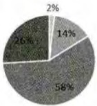
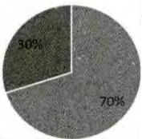
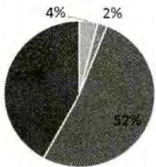
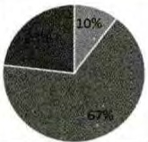
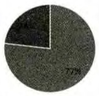
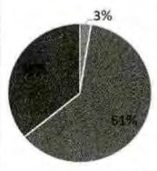

> 来源：MinerU 转换（stem-exact rebuild 2026-08-08）

# 面向数字化教育资源的 Flash 到 HTML5 转换研究

钟岑岑 1 魏 蔚 2

（1.人民教育出版社 北京 100081 ； 2.华东师范大学 上海 200062 ）

摘 要：作为数字化教育资源的主流实现技术 Flash 在移动互联时代中的制约性日益凸显 而 HTML5则以兼容 实用 互通等特点走上了舞台 在这种情况下 目前众多的 Flash 教育资源将何去何从？文章从减少重新开发代价的角度出发 设想是否可实现从 Flash 到 HTML5 的直接转换 并围绕 5 个工具进行 6组转换实验 结果表明 基于现有工具 50 个样例的转换效果并不理想 因此 从可持续和可扩展角度考虑 尽早摒弃 Flash 而直接采用 HTML5 开发教育资源才是长久之道

关键词 ：Flash；HTML5；数字化教育资源

中图分类号 ： G40-057

文献标志码：B

21 世纪初 动画视频素材 多媒体演示型课件等数字化教育资源在计算机技术的支撑下得到了迅速普及其中 Flash 因其效果炫丽 操作简单等特点成为了当时乃至现今教育资源的主流开发技术 由此创作生成的Flash 教育资源在课堂教学 教育游戏 资源网站建设等领域均得到了广泛的应用

近些年来 随着信息技术和移动互联的快速发展

文章编号 ： 1673-8454 （2015 ）18-0079-05

电子课本 数字教材等教育资源新形态相继出现 人们对此提出了富媒体式的内容呈现 友好的人机交互 便捷的终端移植等新要求 而这也使得 Flash 技术及 Flash教育资源的制约性日益明显 一方面 乔布斯曾公开表示“Flash 是为了使用 PC 而设计的 不适合用于用手指操作的触屏设备”[1] 另一方面 Adobe 公司于 2012 年宣布不再为 Android 提供 Adobe Flash Player 插件的更新

(编辑：李晓萍)

更是将 Flash 关在了约 83.6%的移动市场之外 而这些因素也就限制了 Flash 教育资源在具有 iOS Android4.1及其更高版本系统的移动终端中的使用

近年来 HTML5[2]迅速崛起 多媒体和交互 图形和特效 本地存储等新特性以及跨平台的特点使其较Flash 在移动互联网中体现了更强的可用性 目前众多网站 APP 乃至电子书 电子课本 数字教材等已转而支持或直接使用这项技术 由此看来 采用 HTML5 作为数字化教育资源的开发工具应是连接移动终端与资源 增强用户体验的最直接方式 并已显现为当前的主流趋势 在这种形势下 目前已经存在的基于 Flash 的众多教育资源将何去何从？ 正在进行的资源开发是否还可以继续采用 Flash？ 围绕这些疑问 本文从减少重新开发代价的角度出发 设想是否可以实现从 Flash 到 HTML5 的直接转换 从而得到与原始动画效果相一致的基于HTML5 的教育资源

基于上述考虑 本文设计了从 Flash 到 HTML5 的转换实验 并对转换效果以及上述问题进行了讨论 从而为未来数字化教育资源的建设和扩展提供了参考依据 。

本文结构安排如下 ： 第一部分对 Flash HTML5 在数字化教育资源开发中的应用现状进行分析 第二部分介绍Flash 到 HTML5 转换实验的设计思路； 第三部分描述实验结果并展开讨论 第四部分给出研究结论与启示

## 一 Flash HTML5 在数字化教育资源开发中的应用现状

Flash 动画包含丰富的声音 图片 视频 并允许用户使用键盘或鼠标进行交互 在场景呈现 实验演示等教学活动中发挥着重要的作用 Flash 教育资源（即应用Flash 及 Flash 相关软件开发创作而形成的 在教育教学领域有直接应用价值或潜在应用价值的信息资源 [3]）概念的引出引发了一系列研究课题 从最为直接的多媒体课件制作[3] [4] 到基于内容的 Flash 动画检索和管理[5][6]再到 Flash 资源文档的转换以及反编译[7] 均为 Flash 教育资源开发 利用与管理的进一步推进提供了条件 然而 随着移动互联时代的到来 Flash 技术本身的跨平台 交互性等限制愈发明显 因此也就制约了上述资源在移动终端中的使用

HTML5 的跨平台 音视频技术 交互性等优势令人们产生了取代 Flash 的想法 随着其在网站 APP 等大众领域的迅速普及 开发者也逐渐倾向于直接采用这种技术进行移动学习平台[8] 教育游戏[9]等教育资源的开发尤其对于电子课本 数字教材等近些年来出现的资源新形态更是如此 例如 在 2013 年的“HTML5 守望者暨开发者日全国巡回”活动中 英特尔给出了基于 HTML5 技术的电子课本解决方案 有效地增强了电子课本的内容表现力和互动性 相关研究也表明[10] 在诸多电子课本基础技术标准的调查中 HTML5 的应答率最高

而作为当前电子教材的一大主流格式[11] 电子书标准 EPUB3.0 更是进一步推进了 HTML5 的应用 例如 作为较早研发数字化教科书的韩国 已采用 HTML5 作为标准来实现教科书的内容显示 基于 EPUB3.0 实现了包含多媒体资料 用语词典 评价项 补充资料等在内的多样课文 数字化学习资源中心在制作基于 iOS 的全媒体数字教材时采用了 iBooks Author 和 EPUB3.0 制作电子书 同时根据教学需要辅以 HTML5 CSS3 jQuery 等技术开发特定功能 从而使数字教材具备更好的交互效果 此外 北京师范大学出版社 天闻数媒科技有限公司等单位所研发的数字教材也纷纷采用了 HTML5 这项技术 。

由此可见 将 HTML5 作为数字化教育资源开发工具的这一形势越发明朗 但是 目前市面上仍然存在大量的 Flash 教育资源 如 在国家基础教育资源网[12] 优课网[13] 人教网[14]等教育资源网站中这种资源就占有较大比重 甚至一部分正在进行的开发也仍在使用 Flash这不禁令人思考 在 Flash 不易于跨平台使用而 HTML5已是大势所趋的情况下 这些已经存在或正在开发的Flash 教育资源是否可以或将如何继续使用？

现有研究并未给出明确答案 本文则基于减少重新开发的成本和代价的考虑 从将 Flash 资源转换为HTML5 资源的角度进行分析讨论 从而为 Flash 教育资源的处理以及未来数字化教育资源的开发建设提供参考。

## 二 Flash 到 HTML5 的转换实验设计

对于已经存在或正在开发的 Flash 教育资源 首先考虑的就是从 Flash 到 HTML5 的转换问题 即通过类型转换直接得到与原始 Flash 动画效果相一致的基于HTML5 的教育资源 从而减少重新开发的成本和代价

从这一角度出发 本实验的目的在于对 Flash 转换为 HTML5 进行基于工具的测试 并重点关注实验样例转换成功的程度 对于不成功的部分是否需要人工干预来促成转换等问题 主要内容涉及转换工具的收集 实验样例的设计 转换测试的设置以及转换结果的评价标准等方面 具体如下

## 1.转换工具的收集

本实验以 “Flash 转换 HTML5” “Flash HTML5 con-vert” 等为关键词在百度 Google 等网站搜索转换工具排除 “将 Flash 转换为视频的伪 HTML5 转换工具 （如Recool SWF to HTML5 Converter ） ” 以及 “ 仅实现还原显示的浏览器插件（如：Smokescreen）”等干扰项 本实验选定 “将 Flash 文件 （ 以 SWF FLA 格式存储 ） 转换为HTML5 文件”的 5 个工具 如表 1 所示。

表 1 转换工具列表
<table><tr><td rowspan=1 colspan=1>序号</td><td rowspan=1 colspan=1>名称</td><td rowspan=1 colspan=1>使用方式</td><td rowspan=1 colspan=1>基本功能</td><td rowspan=1 colspan=1>限制条件</td><td rowspan=1 colspan=1>截至 2014 年9月24日的最新版本</td></tr><tr><td rowspan=1 colspan=1>1</td><td rowspan=1 colspan=1>Free Flash to HTML5Online Converter[15]</td><td rowspan=1 colspan=1>在线免费</td><td rowspan=1 colspan=1>将 SWF 转化为HTML5</td><td rowspan=1 colspan=1>文件大小&lt;=3M</td><td rowspan=1 colspan=1>N/A</td></tr><tr><td rowspan=1 colspan=1>2</td><td rowspan=1 colspan=1>硕思闪客精灵[16]</td><td rowspan=1 colspan=1>付费软件</td><td rowspan=1 colspan=1>将 SWF 转化为FLA、HTML5</td><td rowspan=1 colspan=1>无</td><td rowspan=1 colspan=1>2014-02-14</td></tr><tr><td rowspan=1 colspan=1>3</td><td rowspan=1 colspan=1>Google Swiffy[17]</td><td rowspan=1 colspan=1>在线免费</td><td rowspan=1 colspan=1>将 SWF转化为HTML5</td><td rowspan=1 colspan=1>文件大小&lt;=1M</td><td rowspan=1 colspan=1>2014-08-14</td></tr><tr><td rowspan=1 colspan=1>4</td><td rowspan=1 colspan=1>Adobe Wallaby[18]</td><td rowspan=1 colspan=1>免费软件</td><td rowspan=1 colspan=1>将FLA转化为HTML5</td><td rowspan=1 colspan=1>无</td><td rowspan=1 colspan=1>2011-03-08</td></tr><tr><td rowspan=2 colspan=1>5</td><td rowspan=2 colspan=1>Toolkit for CreateJS[19]</td><td rowspan=1 colspan=1>AdobeFlashProCS6 的插件</td><td rowspan=1 colspan=1>将FLA转化为HTML5</td><td rowspan=1 colspan=1>无</td><td rowspan=1 colspan=1>V1.1.0908</td></tr><tr><td rowspan=1 colspan=1>AdobeFlashProCC的插件</td><td rowspan=1 colspan=1>将FLA转化为HTML5</td><td rowspan=1 colspan=1>64位系统</td><td rowspan=1 colspan=1>v1.1.0311</td></tr></table>

## 3.转换测试的设置

本实验的实现思路是基于每一种工具对所有样例进行转换测试 即根据表 1 中 5 个工具可处理的文件类型 一方面将 50 个以 SWF 类型存储的样例进行“Free Flash to HTML5 Online Converter ” “ 硕 思 闪 客 精灵”和 “Google Swiffy”三个工具的转换测试 ； 另一方面

将其中 39 个 FLA 类型样例进行 “Adobe Wallaby ” 和 “Toolkitfor CreateJS ” 两 个工 具 的 测 试另 外 由 于 “Toolkit for Create-JS”可同时作为 Flash 制作软件“Adobe Flash Pro CS6 ” 和“Adobe Flash Pro CC ” 的 插 件因此该工具对应两组实验 综上所述 本实验涉及 5 个工具共 6 组转换实验

## 4.转换结果的评价标准

对于每一组实验的转换结果 本实验拟从两个角度来进行统计描述 一方面 从样例整体的转化效果角度考虑 本实验将转换结果归为如下四个状态 并统计样例转换比率（即不同转换状

## 2.实验样例的设计

Flash 教育资源大体包括单帧式 顺序播放式 交互式 嵌入媒体式等呈现形式 另外 考虑到 Flash 的矢量特性是移动互联时代下保证不同屏幕大小或缩放条件下基本阅读体验的重要支撑 因此 本实验主要关注以下动画效果的转换成功与否

①矢量性质：图形 静态文本 输入文本 动态文本；

②基本类型动画 逐帧动画 传统补间动画 补间动画 形状补间动画 引导动画 遮罩动画；

③交互 按钮点击 鼠标滑过 其它鼠标交互 键盘交互 其它组件交互

④嵌入媒体 流式音频 音频事件同步 视频 动画剪辑。

值得注意的是 有些动画文件不只局限于这些单一类型 而是其中两种 甚至三种的复合形式 基于此 本实验从第二代“人教数字教材”包含的Flash 动画文件 文献[20]提供的样例以及互联网[21]中选用50个实验样例 基本保证每种单一类型至少有两个样例有所包含 注 由于Flash文件来源的不同 50个样例均是以 SWF类型存储 只有其中的39个存在FLA存储形式

态的样例数所占整体样例数的比率）

①不符合工具要求：如文件大小的限制；

②转换过程出错：无法生成HTML文件；

③转换结果有误 HTML 效果与原始样例的 Flash效果有出入；

④转换成功 ：HTML 效果与原始样例的 Flash 效果完全一致。

另一方面 从上述提到的动画效果类型的角度考虑本实验统计不同效果类型的转换成功率 （即在所有生成的 HTML 文件中 对于某种类型成功转换的HTML 文件数与理应成功转换的 HTML 文件数的比率）

## 三、实验结果与讨论

基于上述设计思路 表 2 列出了包含 5 个工具在内的 6 组实验的转换结果 从中可知

（1）从整个样例的转换比率来看 转换结果并不理想 。 其中 转换成功比率最高的“Google Swiffy”仅为 42%（即 50 个样例中仅有 21 个的转换效果与原始 Flash 效果 完 全 一 致 ） 而 最 低 的 是 “Adobe Wallaby ” 和 作 为“Adobe Flash Pro CS6 ” 插 件 的 “Toolkit for CreateJS ” ， 仅达到 23%

表 2 6 组实验的转换结果统计列表
<table><tr><td rowspan=2 colspan=1>实验序号</td><td rowspan=2 colspan=1>工具</td><td rowspan=1 colspan=1>样例转换比率</td><td rowspan=1 colspan=1>动画类型转换成功率</td><td rowspan=2 colspan=1>生成文件描述</td></tr><tr><td rowspan=1 colspan=1>图例不标合工具要求=转换过程出错转换结果有误封换液功</td><td rowspan=1 colspan=1>图例矢量性质基本类型动画交互 嵌入媒体</td></tr><tr><td rowspan=1 colspan=1>1</td><td rowspan=1 colspan=1>Free Flashto HTML5OnlineConverter</td><td rowspan=1 colspan=1></td><td rowspan=1 colspan=1></td><td rowspan=1 colspan=1>HTML文件：主要用JavaScript 实现，利用JSON 与外部 JS 文件进行数据交换。其中，使用base64 编码表示图像，而矢量图形和文字用 SVG标签实现。</td></tr><tr><td rowspan=1 colspan=1>2</td><td rowspan=1 colspan=1>硕思闪客精灵</td><td rowspan=1 colspan=1></td><td rowspan=1 colspan=1>60%3%0%nu</td><td rowspan=1 colspan=1>HTML文件：主要用JavaScript 实现,利用JSON与外部JS文件进行数据交换。其中，使用base64编码表示图像，而矢量图形和文字用 SVG标签实现。</td></tr><tr><td rowspan=1 colspan=1>3</td><td rowspan=1 colspan=1>GoogleSwiffy</td><td rowspan=1 colspan=1></td><td rowspan=1 colspan=1>100%00%1             mmwmmthes20%&lt;     学国副          1</td><td rowspan=1 colspan=1>HTML文件：主要用canvas 和 JavaScript 实现，利用 JSON 与外部JS 文件进行数据交换。其中，使用 base64 编码表示图像（包括原始的图像资源，以及将矢量图形和文字转化成的位图等)。</td></tr><tr><td rowspan=1 colspan=1>4</td><td rowspan=1 colspan=1>AdobeWallaby</td><td rowspan=1 colspan=1></td><td rowspan=1 colspan=1>toΦ058wN9&lt;6298公洋经二EES  2504281其国50加就 A SGRE</td><td rowspan=1 colspan=1>① HTML 文件：用 CSS和 JavaScript 实现；②assets文件夹：包含图像、图形(SVG格式)、音频等多媒体资源。</td></tr><tr><td rowspan=1 colspan=1>5</td><td rowspan=2 colspan=1>ToolkitforCreateJS</td><td rowspan=1 colspan=1></td><td rowspan=1 colspan=1>100%sON*6y减150%4N20%               mimn0%i1B&lt;M测225m公国总瓶土新论加经     x其ms电滤0t</td><td rowspan=1 colspan=1>①HTML 文件：用 can-vas 和 JavaScript 实现；②资源文件夹：存储图像、音频资源。</td></tr><tr><td rowspan=1 colspan=1>6</td><td rowspan=1 colspan=1></td><td rowspan=1 colspan=1>t00%mn4%0%20%             nun表海经北出公车公量与增三重审加石箱交含织 世型港422号1位的边</td><td rowspan=1 colspan=1>① HTML 文件：用 can-vas 和 JavaScript 实现；②资源文件夹：存储图像、音频资源。</td></tr></table>

（2）从 HTML 文件所实现的动画效果类型来看 只有部分类型能够实现成功转换 并且分布相对集中 即不同工具之间无法形成互补以保证所有效果的转换成功

具体如下 ①对于矢量性质的支持 图形和静态文本的矢量性质可以在部分工具中得到保持 如 “FreeFlash to HTML5 Online Converter” 和 “ 硕思闪客精灵 ” 是用SVG 标签描述来实现 而 “Adobe Wallaby” 则是直接

题 。

从 FLA 中导出图形的 SVG 文件然后在 HTML 文件中引用这一资源 对于动态和输入类型的文本其矢量形式所有的工具均不支持 ； 另 外 由 于 “ Google Swiffy ” 和“ Toolkit for CreateJS ” 是 将 矢 量 对象用位图来表示 因此 在这两个工具的转换生成文件中矢量性质均丢失。

②对于交互效果的支持 从整体来看 现有工具对于交互效果的转换不够理想 尤其是下拉框 单选框等组件以及键盘的交互则大多无法实现；但是 相对于其它工具的无力 “Google Swiffy”对于基于鼠标的以及 ActionScript 的 部 分 交 互 可 以提供一定程度的支持

③对于嵌入媒体的支持 现有工具仍处于初级阶段 对于视频 所有工具生成的 HTML 都无法实现视频的载入和播放 而音频也仅在作为“事件”嵌入时 才有可能实现并且在动画较为复杂时 极易受到其它因素的影响 因此并不稳定

（3）从转换生成的文件来看 素材的可更新性和代码的易修改性与转换工具所支持的转换方式密切相关

其中 ：①输入为 SWF 时 涉及“Free Flash to HTML5 Online Con-verter” “硕思闪客精灵 ” 和 “GoogleSwiffy”三个工具 它们是将图像用base64 进行编解码 不易后续的图像素材变更； 代码方面采用的是基于 JSON 的 JavaScript 编写方式 存在代码可读性差和不易修改的问

②输入为 FLA 时 ： 涉及 “Adobe Wallaby” 和 “Toolkitfor CreateJS”两个工具 它们是将多媒体素材导出 并采用 HTML 标签进行嵌入 易更新 代码方面 采用 HTML标签编写方式 相对来说更易修改

（4）在基于工具转换的思路下 可从文件类型和大小以及是否保持矢量性质的角度来选择具体的转换工具 但是无论选择哪种工具 都必须加入人工干预

## 具体体现在：

①对于非交互和无媒体嵌入的简单动画 上述 5 个工具大多可以成功转换 但转换结果的正确与否仍需要人工确认；

②对于嵌入媒体的动画 音频事件同步可由作为“Adobe Flash Pro C C ” 插 件 的 “Toolkit for CreateJS ” 来 实现 其它情况需要借助 HTML5 的多媒体新特性进行人工加入；

③对于交互的实现 按钮点击交互可由“GoogleSwiffy”实现 但其它形式的交互应重新编写

综上可知 现有工具大多仅支持部分动画效果的转换 而对于由交互 媒体嵌入等复杂单一效果或多种效果复合形成的 Flash 文件 则不易得到与原始动画效果相一致的转换结果 当采用单一工具进行转换时 对于大量可能转换失败的数据 应延续该工具采用的 HTML5 框架来人工编写相应的 HTML5 文件 以保证代码的一致性和易维护 相比之下 虽然将多种工具相结合以求达到最大的转换成功率的处理方式更为省时 但是会留下代码不兼容 可扩展性差等多种隐患

## 四、结论与启示

用 HTML5 取代 Flash 作为数字化教育资源的开发工具 符合当前移动技术和互联网发展的要求 对于目前已经存在或正在开发的以 Flash 为主要实现技术的众多教育资源 根据上述转换实验可知 由于现有转换工具的效率普遍较低 因此成功地将其直接转换为HTML5 资源并不是一个简单的过程 转换之路仍有待工具功能的进一步提升 此时 即使选择工具进行转换也应在权衡现有资源呈现的主要动画效果与工具支持的效果之后 选用单一工具以保持代码的一致性 并且需要加入大量的人工干预

因此 从可持续性和可扩展性角度考虑 本文认为尽早摒弃 Flash 而直接采用 HTML5 作为数字化教育资源的开发工具才是长久之道 并且应尽早建立相关的开发和测试标准 进而对未来教育资源的构建 扩展和传播起到积极的推进作用

## 参考文献：

[1]Thoughts on Flash [EB/OL]. http://www.apple.

com/ hotnews/thoughts-on-flash.

[2]HTML5[EB/OL].http://www.w3.org/TR/html5.

[3]郑小军.Flash 教育资源的理论研究与实践探讨[J].电化教育研究,2002(2):49-53.

[4]刘斌,衣勉.基于 Flash 的课件制作与应用[J].科技广场,2012(7):102-105.

[5]孟祥增.基于内容的 Flash 网络教学资源检索研究[J].电化教育研究,2009(9):77-79.

[6]刘菲,孟祥增.基于场景的 Flash 动画摘要研究及其教育应用[J].现代教育技术,2009,19(5):111-114.

[7]黄立冬.Flash 教育资源文档的处理技术综述[J].中国教育信息化,2009(4):63-65.

[8]陈楠楠.基于 HTML5 的移动学习资源设计及应用研究[D].西安:西安电子科技大学,2013.

[9]马少雄.基于 HTML5 的教育游戏设计与开发——以“Impact”打字游戏为例[D].上海:上海师范大学,2013.

[10]许哲,顾小清.电子课本国际标准的发展与追踪调研[J].现代远程教育研究,2014(1):62-71.

[11]王然,郭鸿.电子教材的研究与设计[J].中国远程教育,2014(5):82-87.

[12]国家基础教育资源网[EB/OL]. http://www.cbern.gov.cn/derscn/portal/index.html.

[13]优课网[EB/OL].http://www.uken.cn.

[14]人教网[EB/OL].http://www.pep.com.cn.

[15]Free Flash to HTML5 Online Converter [EB/ OL].http://www.flash-to-html5.net.

[16]硕 思 闪 客 精 灵[EB/OL]. http://www.shankejingling.com.

[17]Google Swiffy [EB/OL]. https://www.google.com/ doubleclick/studio/swiffy.

[18]Adobe Wallaby [EB/OL].http://en.wikipedia.org/ wiki/Adobe\_Wallaby.

[19]Toolkit for CreateJS [EB/OL].http://www.adobe. com/devnet/createjs.html.

[20]贾勇,孟权国.完全掌握 Flash CS6 白金手册[M].北京:清华大学出版社,2013:28-398.

[21] 站 长 素 材 网 [EB/OL]. http://sc.chinaz.com/donghua/.

(编辑：李晓萍)
