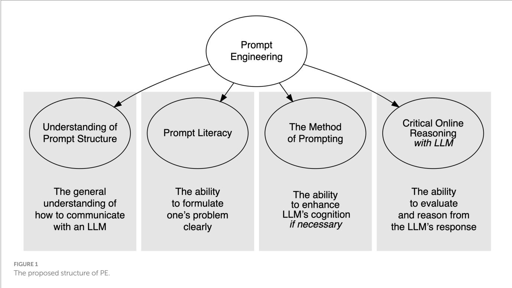

> 来源：MinerU 二次 OCR 精校（2026-08-12）；保留开放获取论文的题录、正文、图注与参考文献

## OPEN ACCESS

EDITED BY   
Knut Neumann,   
IPN–Leibniz Institute for Science and   
Mathematics Education, Germany   
REVIEWED BY   
Hongzhi (Veronica) Yang,   
The University of Sydney, Australia   
Barry Lee Reynolds,   
University of Macau, China   
\*CORRESPONDENCE   
Denis Federiakin   
denis.federiakin@uni-mainz.de

RECEIVED 06 January 2024   
ACCEPTED 08 October 2024   
PUBLISHED 29 November 2024

CITATION   
Federiakin D, Molerov D,   
Zlatkin-Troitschanskaia O and Maur A (2024) Prompt engineering as a new 21st century skill.

Front. Educ. 9:1366434. doi: 10.3389/feduc.2024.1366434

## COPYRIGHT

© 2024 Federiakin, Molerov,   
Zlatkin-Troitschanskaia and Maur. This is an open-access article distributed under the terms of the Creative Commons Attribution License (CC BY). The use, distribution or   
reproduction in other forums is permitted, provided the original author(s) and the   
copyright owner(s) are credited and that the original publication in this journal is cited, in accordance with accepted academic   
practice. No use, distribution or reproduction is permitted which does not comply with these terms.

# Prompt engineering as a new 21st century skill

Denis Federiakin\*, Dimitri Molerov, Olga Zlatkin-Troitschanskaia and Andreas Maur

Department of Business and Economics Education, Johannes Gutenberg University Mainz, Mainz, Germany

Artificial Intelligence (AI) promises to revolutionize nearly every aspect of human learning. However, users have observed that the efficacy of AI assistants hinges crucially on the quality of the prompts supplied to them. A slight alteration in wording can make the difference between an assistant misinterpreting an instruction and exceeding expectations. The skill of precisely communicating the essence of a problem to an AI assistant is as crucial as the assistant itself. This paper aims to introduce Prompt Engineering (PE) as an emerging skill essential for personal and professional learning and development in the 21st century. We define PE as the skill of articulating a problem, its context, and the constraints of the desired solution to an AI assistant, ensuring a swift and accurate response. We show that no existing related frameworks on 21st skills and others cover PE to the extent that allows for its valid assessment and targeted promotion in school and university education. Thus, we propose a conceptual framework for this skill set including (1) comprehension of the basic prompt structure, (2) prompt literacy, (3) the method of prompting, and (4) critical online reasoning. We also discuss the implications and challenges for the assessment framework of this skill set and highlight current PE-related recommendations for researchers and educators.

## KEYWORDS

prompt engineering, artificial intelligence, 21st century skills, ChatGPT, digital skills, critical online reasoning, LLM

## 1 Introduction

The development of assisting Artificial Intelligence (AI) tools promises to revolutionize almost all fields of human learning. The widespread adoption of emerging digital technologies has accelerated the development and the speed of information exchange. It has become obvious that learners require a specific competence to be able to process various forms of information to successfully undertake tasks in disciplinary and cross-disciplinary contexts. As part of this transformative trend, the cultivation of 21st century skills has been deemed essential to preparing a global workforce to succeed in an increasingly data-centric and information-driven society.

While a universal definition of 21st century skills is hardly possible due to numerous different frameworks, their common features can be determined. These skills are generic, not specifically tied to any particular professional domain, and essential for personal development in the ever-changing 21st century (Foster and Piacentini, 2023). These skills include online information problem-solving (Goldman and Brand-Gruwel, 2018) and other abilities required to evaluate and process new information and competently use it in various settings (Foster, 2023a; Pellegrino, 2023).

Not only has ChatGPT become a pervasive presence within the computer-reliant programming and technology sector (Chen et al., 2023a; Ridnik et al., 2024) and the research community (Kasneci et al., 2023; Giray, 2023), it has also established itself in various service industries (Opara et al., 2023). Consequently, this new tool has infiltrated the learning and workflow of students, transcending the boundaries of technological focus. The impact of such AI tools on society has already been so immense that some researchers have claimed that some fields, such as education, are significantly disrupted by them (Cain, 2024).

Hosseini et al. (2023) surveyed students beginning university who reported using ChatGPT (very) often while learning at school and/or in professional training. Proficient utilization can surmount inhibition thresholds associated with familiarizing oneself with a particular topic, expedite information processing through summarization, visually and systematically process information, validate writing, and serve various other functions (Mohr et al., 2023). Some have claimed that AI tools like ChatGPT can promote “unlearning,” resulting in students acquiring less knowledge and underperforming due to less intensive cognitive learning processes (Abbas et al., 2024). Another aspect of this negative impact is the blind trust in ChatGPT’s responses, causing users to accept the outputs of Large Language Models (LLMs) without critical evaluation (Krupp et al., 2023).

The malleability and adaptability inherent in LLMs render tools like ChatGPT capable of fundamentally altering virtually all processes to which they are applied. Nonetheless, LLMs are not the only type of AI assistance on the agenda. Text-to-Image models, Speech-to-Text, polymodal AI tools, and other tools have already been in the practice for quite a while, sufficiently expanding the societal and learning impact of AI.

While LLMs have been in development for years, the release of ChatGPT to the general public by OpenAI in autumn 2022 has marked a shift in use affordances of digital and Internet-based tools even compared to the seemingly ubiquitous search engines. In contrast to such engines, LLMs provide full-text responses to longer inputs by users, are more friendly to further inquiry and chatbot communication, but typically include fewer references or direct hyperlinks that would guide users to leave their interface. Still, the usefulness of open-access ChatGPT for learning (not least in higher education) has been quickly noted.

Although ChatGPT erupted onto the scene very quickly, users have just as quickly noticed that the performance of many types of AI-assisting tools highly depends on the quality of prompts supplied to them (Ekin, 2023). Changing just a couple of words in the prompt can split the difference between the AI tool failing to understand the instruction and outperforming the request. From a technical standpoint, the importance of prompt accuracy is not particularly surprising, since LLMs (the engine of tools such as ChatGPT) are focused on predicting the next language token. Tokens are essentially building blocks of written language–punctuation, specific forms of words, word endings (such as-s or-ed), and so on. They combine in a sequence to produce the written text. Correspondingly, the fundamental task of such LLMs is just to use probability to predict the next token conditional on the previous tokens. Given this, it is expected that the model performance will depend on the quality of the prompt. Typically, the more detailed and explicit the prompt is, the more precise the model is in its response.

Moreover, users might experience difficulties evaluating the quality of LLM output. Recent research has already registered that LLMs (including ChatGPT) can hallucinate (Alkaissi and McFarlane, 2023). LLMs can invent facts and references that are non-existent or factually incorrect. This degrades the quality of model output even to a degree of rendering it unusable. Users might overlook this, which poses an additional challenge in the use of LLMs. This challenge is compounded by the users’ concurrent adoption of conflicting roles, serving both as the processor and the supervisor of the task because ChatGPT does not indicate how certain it is about the given answer or whether the prompt needs to provide more information. The amalgamation of these dual responsibilities contributes to the heightened complexity and intricacy of the communication process within the context of utilizing LLMs, and ipso facto requires meta-awareness and ambiguity tolerance on the users’ part.

Additionally, some research has suggested that the correct prompting of an LLM can enhance its performance to the point that special fine-tuning of a foundational model (trained on a generic corpus of texts without any particular specialization) might be unnecessary. For example, Nori et al. (2023) and Maharajan et al. (2024) have shown that the correct prompting technique can improve LLM performance to the extent that that foundational models outperform specially fine-tuned LLMs in medical knowledge. This demonstrates that prompting is an immensely powerful phenomenon that holds a dramatic influence on LLM performance.

Recently, Microsoft has released BingGPT and Google introduced Gemini as the preliminary merged search engines with LLM capabilities. LLMs with increased capabilities have been continuously released over the past months. This wild universality of LLMs and their capacity to quickly work with unstructured information renders their application increasingly and continuously important and popular across many fields. Hence, the necessity of exact prompting skills may vary by application and are expected to change, however, the general insights on LLMs apply, as long as the types of interfaces, training, and output quality prevail.

While some AI tools themselves can help to reformulate and improve the prompts (Zhou et al., 2022) via dialoguing with a user, it takes time and still does not guarantee the desired result. Moreover, some tools (i.e., Text-to-Image models) might experience difficulties in improving the prompt in the situations where users apply too many constraints on the desired solution. These constraints might mislead the model, forcing it to focus on the insufficient details. In the end, the only way left to communicate with the tool is through trial-and-error until the user is satisfied with the solution. The iterative nature of trial-and-error can be  time-consuming, inefficient, economically burdensome, fallible, and may introduce security risks into critical decision-making processes, potentially leaving errors unobserved and further impacting corporate success and the well-being of users.

Thus, being able to concisely communicate the nature of the problem to the AI tool is as valuable as the tool itself. Without this skill, users may fail to receive an acceptable and correct solution. In this respect, we disagree with those researchers in the data science community who argue that PE is merely a facet of general communication skills (Morton, 2024). Merely speaking a language does not assume good communication skills, and similarly, a good communicator may not inherently possess the skills necessary to effectively interact with AI. Therefore, we aim to define PE as a distinct skill which warrants investigation within the educational and psychological sciences.

## 2 Research objectives

Numerous higher-order (meta)cognitive skill concepts have been developed through research, which theoretically define the proficient utilization of digital information, communication, and learning tools. These include skills related to Information and Communication Technology (ICT; Kaarakainen et al., 2018), digital skills as measured in the PISA assessment (OECD, 2023), and Critical Online Reasoning (COR) skills (Molerov et al., 2020; Nagel et al., 2020, 2022; Schmidt et al., 2020). The previous concepts at least do not explicitly address and conceptualize the skills for the competent use of AI-supported tools, but only elaborate on the necessity of creativity and higher-order, metacognitive skills without a specific relation to AI (PISA 2025 framework; Hu et  al., 2023). As transversal skills like information problem-solving gain prominence in education as essential 21st century skills (Foster, 2023a; Pellegrino, 2023), the cultivation of PE skills becomes particularly crucial. Competent ChatGPT use heavily relies on well-formulated and elaborated prompts. The proficiency in crafting prompts is essential to anticipate and minimize the risk of inaccurate answers, necessitating a thoughtful process of reflection and rehearsal.

This paper aims to address this desideratum and to conceptualize PE as a specific skill in the 21st century. We claim that defining it in a manner akin to generic competencies (which are universal across many professions; Shavelson et al., 2019) is benefficial, as the variety of tasks that LLMs can solve or assist in solving are virtually infinite. Based on a systematic, structured analysis and synthesis of previous relevant concepts as well as the elaboration of specific requirements for dealing with AI tools competently, we  aim to develop a new conceptual framework and discuss implications for a corresponding PE assessment framework, which holds particular research and practical significance. Studies have already assessed PE as a skill without explicitly defining its components and indicators (Knoth et al., 2024b) and related it to collateral literacies such as AI literacy (Knoth et al., 2024a). Such preliminary work indicates that educational researchers recognize the importance of investigating PE as a distinct skill. A comprehensive PE definition and conceptual framework have not yet been developed.

Following the conceptual analyses, we conclude that this skill is necessary for learning and working with such AI-supported tools like ChatGPT, and as such requires separate and specific investigation from the educational science perspective as a new 21st century skill.

## 3 Research focus

In this paper, we commence by elucidating the concept and theory surrounding PE and online reasoning skills. This strategic, analytic approach aligns with the notion that assessment, fundamentally perceived as a process of reasoning from evidence, necessitates a thoughtful design (Mislevy and Haertel, 2007). We  utilize the assessment-targeted approach because it is exactly the field of educational assessment that links together theoretical ideas about the construct nature and the rigorous orientation to the data (Pellegrino et al., 2001). Therefore, this paper seeks to establish a foundation that integrates both theoretical frameworks on online reasoning skills and practical insights from PE. This dual approach aims to inform the design of assessments, ensuring they are not only rooted in sound theoretical principles but are also practically applicable to the specific context in which they are employed.

Hence, to provide a necessary foundation for developing a PE assessment framework, this paper takes one of the first steps, aiming to spark a discussion on the conceptual framework of PE skills in educational research. Taking the inspiration from the Evidence-Centered Design (ECD; Mislevy and Haertel, 2007), we  start by defining claims on how students are supposed to understand and use AI tools in the context of online reasoning. The insights from this paper will serve to inform the development of the ECD-based model of PE in future research.

Regarding PE, we make a distinction by the type of model it is applied to. In this paper, we focus on the LLMs, and not Text-to-Image Models, since they have their own specific manner of engineering prompts (Liu and Chilton, 2022; Oppenlaender, 2022). LLMs (or polymodal models) might be applied to a significantly wider variety of tasks, making them more flexible.

Moreover, we focus on the application of ChatGPT as the main and one of the most general AI-assisted tools. We also focus on the user side of PE, and not on the technical side of improving the model performance by specifically training it for the task. This machine learning subfield is also called PE, but it focuses on technicalities, like text embedding optimizations (Gu et al., 2023), or training on specific outputs indicating the nature of reasoning of a larger model (Mukherjee et al., 2023). Hence, for the sake of this paper, we exclude any procedure that implies re-estimation or optimization of the LLM parameters from the scope of PE and focus it exclusively on the user-side of LLM applications.

In addition, we make a distinction between PE as a (composite) skill and PE as a practice. PE as a practice has been described to some extent by other researchers (Cain, 2024; Wang et al., 2023b), and some showcase examples aimed at learning PE (Google, 2024). The description of PE practice is focused on unsystematized hints, tricks, and examples intended to help users achieve the desired result from an LLM. In the description of PE as a practice, many researchers emphasize that PE is often a continuous process that unfolds over several iterations of interactions between a human user and an LLM, much like many other information processing-related practices. This makes the description of the PE skill, like descriptions of many other information processing-related skills (Goldman and Brand-Gruwel, 2018) challenging because this structure needs to be  able to incorporate the sequential aspect of the process. In such processes, many distinct cognitive components might activate in different orders or simultaneously, complicating their untangling for research investigations. However, the structure of the skills utilized in PE practice has been scarcely addressed, which serves as the motivation for this paper.

The (online) information literacy concept, regardless of the exact framework or definition, typically splits into passive (user) and active (developer) use (Koltay, 2011). In this paper, we discuss PE in the context of only passive use by (higher education) students for learning and knowledge acquisition, which corresponds to engineering prompts and evaluating LLM output. PE itself, however, can be  considered under the frameworks of computer-assisted text production or creative writing, but these frameworks also lie beyond the focus of this paper as these aspects are more closely related to linguistics, media and communication science, rather than educational science.

While skill descriptions in Internet use and information acquisition might also apply to LLMs in general, our conceptual analysis illustrates that skills for competent use of LLMs (including PE) for learning differ from most skills in frameworks. Given the enormous interactivity of LLMs, their dependency on user input, their virtually unlimited knowledge, and their tendency to hallucinate while remaining very convincing, we conclude that PE requires distinct skills not covered by traditional (online) information literacy frameworks. To conceptualize a specific PE skillset, we review related prior skills frameworks, illustrating what we can learn from them, but also how they fall short in modeling specific PE (sub)skills, revealing a gap in the research.

## 4 Review of online skills frameworks and their distinctions from prompt engineering

When designing conceptual (and assessment) frameworks for 21st century skills related to AI, one first needs to identify the knowledge and skills students need while engaging with tasks. We, therefore, relate PE to a selection of prominent skill frameworks and show that they are too global, referring primarily to search-engine-based Internet inquiry, and do not cover LLMs, even lacking entire PE components (see also Zlatkin-Troitschanskaia et al., 2021). This section aims to illustrate that, although these skill frameworks are relevant for contextualizing PE in a pre-2023 Internet, they are currently insufficient for describing PE itself or in the context of the Internet in 2024.

## 4.1 Prompt engineering as part of (exploratory) technology use and targeted inquiry for information acquisition

Prompt Engineering (PE) for learning in (higher) education can be considered under at least two broader kinds of activities that relate to research on ‘literacies’: digital technology use and manipulation (as part of digital literacy) and information acquisition (as covered in information literacy) (for a differentiation, Koltay, 2011; for a synthesis for assessment of digital information literacy in higher education, Sparks et al., 2016).

In using digital technology, (higher) education students’ understanding and use of LLMs (and corresponding tools like ChatGPT) can be examined as the ability to use a specific class of platforms for adequate purposes in ways to achieve desired results, e.g., to obtain textual output with specific qualities from an LLM. This paradigm highlights that the user

1. decides to consult an LLM (vs. other information resources) to acquire specific types of information,

2. interacts with the selected LLM,

3. ends the interaction when a compelling mental or emotional state is reached (e.g., satisfaction, frustration, tiredness, boredom), having either completed their inquiry or not.

Here, the motivation for selecting a specific LLM is important, and LLM(s) might or might not be the only source of information for the user. Regardless, PE in this context refers to the sub-phase of inputting and refining prompts and marks the user’s main active input to the LLM to obtain desired information. This perspective helps frame students’ general tool exploration and experimentation (among platform novices), their versatility in interacting through inputs, troubleshooting, ludic use, and unintended or original technology uses.

In the context of exploratory technology use, such as the inquiry of a new topic to assess a resource’s usefulness, users may not necessarily aim for efficient prompting. Instead, they may seek to test the capabilities of an LLM within their domain of interest, evaluating factors such as breadth and depth of answers, as well as information quality. This testing may involve pushing the LLM to its limits to understand its full potential. By contrast, for specific inquiry, more skillful goal-directed users can be expected to seek to obtain only the types of information the present LLM can indeed produce (above their desired quality threshold). Thus, part of the PE skill set includes knowledge and understanding of what the LLM system can and cannot do to judge its suitability to a given task and use it only for as long as it is helpful (section 5.1). Advanced users can benefit from understanding the capabilities and limitations, ethics and privacy trade-offs of different LLMs (including their multimodal data capabilities), the coverage of their training databases, reasoning capabilities, speed, energy use, cost, and other metadata. This knowledge enables them to select the most suitable set of tools for their inquiries.

## 4.2 Prompt engineering and online information problem-solving skills

In the tradition of research on information literacy, conceptualizations have combined general tool use for active production and (passive) interpretations of information, but have still been defficient in conceptualizing Internet-based skills (Foster and Piacentini, 2023). More applied conceptual approaches have sought to narrow this gap, from Multiple Document Literacy and Multiple Source Use/Comprehension/Understanding to Information Problem Solving on the Internet (IPS-I) (for an overview, Goldman and Brand-Gruwel, 2018; List and Alexander, 2019).

IPS-I (Brand-Gruwel et al., 2009) was derived as a descriptive model of (five) phases that users go through when solving tasks that require the acquisition of information expanded for the Internet. These phases cover analysis (problem analysis and prior knowledge activation, searching the Internet for information, preliminary and deeper processing of information along with evaluations and reflection) and synthesis (text response drafting, and process and product evaluation), accompanied by regulation (on task, time, test content). Despite the good description of the online inquiry phases in the IPS-I model, its explanation of sufficient reasons to conclude an online inquiry can be improved (Goldman and Brand-Gruwel, 2018). Moreover, IPS-I employs task covering typical online platforms but does not model their affordances explicitly, and does not yet include a differentiation of single-or multi-platform inquiry, or search engine vs. LLM querying.

In general, the IPS-I framework, although promising, needs to be adapted to LLMs. For instance, the search component is entirely geared toward search engines, and evaluation does not account for specific LLM cues or the pages-long machine-generated text (although it does highlight checking page ownership). Moreover, reasoning in IPS-I does not cover how the typical responses of LLMs can veil a lack of specificity or contain factually incorrect information.

The weighting of facets should differ for PE, as well. In evaluation, there are fewer website cues to be considered, while specific LLM language cues can become more important. Knowledge of LLM production becomes more crucial for discernment of output quality; for instance, domain knowledge which serves as a critical reference is typically still underdeveloped among learners. Regarding syntheses and reasoning, LLMs can effectively carry out part of the thinking for users. The key question becomes how satisfied, if at all, are users with the respective LLM output (when to cross-check with further sources or not), and what are possible pitfalls of LLMs to be hedged against. As LLMs can now forward queries to other LLMs and deliver results for several of the IPS-I inquiry subphases for the user, while augmenting the requirements for others such as prompt formulation, it remains to be seen in future descriptive studies if the IPS-I phase structure will hold for this new platform type.

## 4.3 Prompt engineering and PISA’s framework ‘learning in the digital world’

One of the flagships of the educational assessment practices is OECD’s Programme for International Student Assessment (PISA). While it focuses on school students, PISA showcases assessment innovations and key 21st century skills targeted in each wave. With the advent of assessing broader skills, such as critical thinking and problem-solving in PISA (Pellegrino, 2023), the necessity of competent use of technology and fostering PE skills becomes increasingly evident. Assessing and unveiling educational needs to prepare students in leveraging technology effectively in an increasingly information-driven society, including the adept formulation of prompts for AI tools like ChatGPT, becomes a pivotal aspect in ensuring comprehensive educational outcomes.

The PISA 2025 model responds in part to recent technological trends with the Learning in the Digital World (LDW) framework. The authors break the skills of learning with and from software down into

(1) computational and scientific inquiry practices (analyzing problems and recognizing patterns, working with software outputs, conducting experiments and analyzing data),

(2) metacognitive monitoring and cognitive regulation (progress monitoring and adaptation, performance and knowledge evaluation), and.

(3) noncognitive regulation processes (maintaining task engagement and afective states).

While PISA’s LDW framework is limited to ofline administration to school students (thereby limiting its use for open search), a chatbot has been implemented, and exploratory tool use is designed intuitively so as to tap into (secondary school level) technology-based data manipulation and examination principles. On-task learning is included as part of the assessment and is measured through logged indicators constructed from situational inference rules. Inputs are limited to presented stimuli. However, the LDW framework (2025) also presupposes a closed information environment, which in this instance does not seem to include LLM-like tools (i.e., a highly versatile chatbot).

## 4.4 Prompt engineering and open (web) search assessments

The development of AI tools goes toe to toe with the assessment innovations, making the current educational assessment practices more authentic and complex (Sabatini et  al., 2023). Assessment innovations have rapidly evolved in the recent past, also paving the way for more complex conceptualizations of skills (with the prospects of feasible operationalization). Particularly, there is a shift from closed information pools (including in multiple source use) to open (web) search assessment environments (Wineburg et al., 2022). This places much more emphasis on subskills such as targeted search, rigorous selection, and cross-referencing to obtain useful information, under the uncertainty connected to never seeing the entire information pool. This contrasts with the careful evaluation of every source and deduction of information from a limited information pool, as in assessments with a document library (Shavelson et al., 2019). Thus, open web search assessments, compared to closed ones, differentially tap and weight-assessed subskills in a more ecologically valid setup. They place importance on design features such as abundance vs. scarcity of acceptable quality alternatives, noise vs. no noise, access, familiarity, and affordances for information search and organization. However, they also raise the need to account for cheating opportunities and changes in the information pool.

LLMs can further increase these differences, while also synthesizing and filtering out some of the interim complexity of open web search assessments. LLMs are generative models, meaning that they can generate new texts that never existed before. Hence, many of the open web search characteristics also apply to their use. An LLM’s capability to recombine, structure, preselect, and synthesize information (while leaving the undisplayed bits and even sources opaque) differentiates it from search engines and results in a corresponding weighting of required skills. Users need to put less thinking efort into drawing inferences and compiling an (initial) draft that summarizes their inquiry, as the system can do this step for them. Corrections are also facilitated. Compared to search engines, LLMs are more dialogical, e.g., in explicitly restating, reafirming, specifying, correcting user’s prompts (seemingly in their own terms), and are able to autonomously apply suggested changes to entire text blocks of results. Therefore, studying and assessing PE as a new educationrelevant skill requires the application of sufficiently complex forms of assessment practices.

## 4.5 Prompt engineering and critical online reasoning skills

Critical Online Reasoning (COR) is a recent conceptualization of the skillset necessary to acquire, evaluate, and reason with and about sources and information from the Internet, developed for the setting of learning in higher education (Molerov et al, 2020; Nagel et al., 2020, 2022). COR provides a convenient conceptual adaptation and development of IPS-I phases to the process of solving complex, openended information problems in a mixed information quality environment (Molerov et al., 2020). In particular, COR includes three interconnecting facets: “Online Information Acquisition” (OIA), “Critical Information Evaluation” (CIE), and “Reasoning Using Evidence, Argumentation, and Synthesis” (REAS), as well as a metacognitive facet (MCA) for the situation-specific activation and regulation of the COR skills.

COR was developed to implement advances in assessment, specifically to include ecologically valid open web search in assessment (with associated web behavior tracking). COR has aspired to capture competent behaviors regarding differences in the credibility of online sources and information, focusing on students’ discernment of Internet sources and content in the face of realistic challenges online, such as a multitude of information, low-quality information, and/or misinformation (Molerov et al., 2020).

COR, too, was conceptualized before the popularization of LLMs. Today, students may find satisfying answers on ChatGPT and avoid further search or synthesis. LLMs can ofer recommendations on general evaluation criteria. By loading or copying texts and sources into the LLM as part of a prompt, students may also obtain full machine evaluations.

## 4.6 Prompt engineering and artificial intelligence literacy

One of the more recent concepts, Artificial Intelligence (AI) literacy, is also relevant to the discussion of PE. In response to the rapidly developing AI field, the educational science community has already begun attempting to define the skills needed for competent AI use. AI literacy concerns AI in general, which is far broader than the topic of using LLMs. The concept of AI literacy distinguishes between generic and domain-specific use of AI (Knoth et al., 2024a), which includes numerous AI tools and machine learning models developed for narrow use in specific professional fields. Moreover, the explicit inclusion of attitudes in AI literacy (Wang et al., 2023a) binds at least part of the operational indicators of the construct to the self-report format, which becomes troublesome in the case of developing educational assessments.

Attempts to include more objective measures of AI literacy, however, tend to focus on the general knowledge of respondents about the structure, nature, and functioning of AI (Hornberger et al., 2023; Weber et al., 2023), which is not the same as defining what allows a person to use AI successfully, albeit complementary to this ability. Moreover, the employed items have been of multiple-choice format, which increases standardization but can threaten the authenticity of the assessment and ecological validity of claims about the respondents.

Given that our definition of PE aims to isolate the cognitive nature of the skill specifically tailored for the use of LLMs, we conclude that this is a distinct skill, which might be considered a part of AI literacy but is not defined by it. Within AI literacy (i.e., among all available types of AIs), LLMs and their use comprise a portion of a specific type of AI. Within LLM use, PE comprises a significant portion of the skills needed. Moreover, AI literacy frameworks are still in the early stages and evolving, requiring more specificity in various subareas. While general considerations about the functioning of AIs apply to PE as well, most parts are still underspecified.

In summary, the abovementioned skill frameworks focus on the perspective of students as agentic learners who actively regulate their own learning processes. Therefore, PE and LLM use are compatible with the above frameworks, as they essentially relate to the consistently emerging cognitive, metacognitive, and self-regulatory skills (Foster, 2023a; Roll and Barhak-Rabinowitz, 2023). They can be attributed to the respective search phases as well as partly to the evaluation and reasoning phases, if the assessment’s operationalization grants students access to LLMs. However, the frameworks are not specific enough in addressing how users can skillfully interact with the AI-supported tools like ChatGPT to obtain desired information, leaving a number of conceptual questions open. As with any new technology, novel affordances call for new (sub)skills, too.

## 5 Conceptualization of prompt engineering skills

For the sake of this paper, we  define PE as the skill of communicating the problem, its context, and the constraints imposed on the desirable solution to an LLM to solve it correctly as fast as possible (Lo, 2023a). Thus, this skill conveys the user’s needs to an LLM in a manner that the model can understand. However, since the tasks to which the LLMs can be applied vary, the prompts for their application vary as well (White et al., 2023), so there is no general “best” prompt structure. Instead, it makes sense to describe the PE as a composite skill consisting of a combination of several subskills involved in the communication with the LLM. We describe PE as a composite multidimensional skill consisting of four skills, intertwining in the practice of using an LLM (Figure 1).

Since the purpose of this paper is to develop an operationalization of PE that can be  flexibly used in the development of various assessments, either in parts or entirely, we do not provide a taxonomy of behavioral indicators (e.g., Bloom’s taxonomy; Anderson and Krathwohl, 2000). Such taxonomies are closely linked to the exact type of claims about respondents that the assessment aims to make and are therefore defined by the purpose of the assessment (Mislevy and Haertel, 2007). Describing any taxonomy of behavioral indicators in the context of PE would reduce the possible scope of such applications and purposes. Instead, we aim to broadly describe the structure of the PE construct, which can be  developed and used further. The application of an incorrect taxonomy can result in the misspecification of the assessment framework, a decrease in the authenticity of the assessment, and a degradation of the validity of the final claims. To further enrich the understanding of PE, we juxtapose online skills frameworks to integrate and adapt their essence to PE skills.

## 5.1 Understanding the basic prompt structure

Giray (2023, p. 2630), following the DAIR.AI (2023) frameworks, lists four elements of a prompt. These elements, combined together, substitute a prompt, which formulates the problem, gives the model the necessary information to solve it, and contains output in the desired form:

• Instruction – a specific task that guides the model’s behavior (e.g., “Proofread the text”);

• Context – external information or additional context that provides background knowledge to the model, helping it generate relevant responses (e.g., “The text is an email that needs to follow an oficial corporate style”);

• Input data – the content of the prompt that the model needs to solve, might vary given the instruction (e.g., contents of different emails);

• Output indicator – specifies the type or format of the desired output (e.g., “Do not rewrite the text, only correct grammar, spelling, and punctuation”).

Incorporating “output indicators” in the prompt structure implies that a user needs to have a projected image of the result. This means that PE inherently requires a user to know what they want. This will allow an AI tool to shape the output according to the user’s expectations. This allows the user to have representational benchmarks, against which the output of an AI tool is judged.

In sum, understanding the necessity to provide all these elements, as well as the ability to optimize them when needed, can be considered the necessary part of PE. The quality of these components is particularly important, since imprecise formulations or irrelevant information can derail the LLM’s response to the prompt.

## 5.2 Prompt literacy

Prompt literacy addresses the user’s ability to be precise in their formulations. None of the research to date has to come up with any exhaustive lists of requirements for being precise in prompts. Still, Hwang et al. (2023) define prompt literacy as the ability to generate precise prompts as input for AI tools, interpret the outputs, and iteratively refine prompts to achieve desired results. Others vaguely address this literacy in terms of avoidance of pitfalls and common mistakes that learners make while engineering prompts (Busch et al., 2023; Lo, 2023b). Nonetheless, in practice, avoidance of the aforementioned pitfalls might not be necessary, as the improvement after an initial input or the general awareness of the limitations of one’s suboptimal prompts allows for the avoidance of incorrect conclusions. Mostly, researchers highlight such aspects of prompt literacy as (Giray, 2023):

• Ambiguity or lack of specificity – without a concrete focused input, an LLM might wander away from a desired solution.

• Bias reinforcement – an ill-formulated prompt might provoke an LLM to give an answer which can be interpreted as biased.

• Overfitting and unrealistic dependency on model limitations – an LLM might not know all the specific details of a certain field or area, and as a result might be not the best consultant on an overly specific topic.

• The correct context – LLM needs necessary and sufficient context to work with (e.g., “write an email” is not a specific enough prompt to solve a problem correctly).

• Overly complex prompts – supplying too much information might trigger the LLM to focus on an irrelevant part of the prompt.

• Ethical considerations – ethical and ecological use of an AI that does not inherently have values or an ethical system remains the responsibility of the user.

The aspect of ethical considerations has received significant attention in PE literature. It relates to the fact that many LLMs have pre-built system prompts (hidden from the user) that explicitly prohibit them from discussing unethical topics (e.g., crimes or violence). Because of this, so-called “jailbreaking” has gained special attention in PE literature as a way to relax this limitation (Zhou et al., 2024; Yu et al., 2024). This topic is closely related to the general ethics of AI usage and is a specific field of AI research in general (Jobin et al., 2019) and AI research in education specifically (Borenstein and Howard, 2021; Burstein (2024) for the Duolingo Standards on Responsible AI). While a rigorous discussion of this topic is beyond the scope of this paper, the ethics of PE, as well as the ethics of a major part of general AI use, boils down to keeping a human in the loop of the process involving an AI tool and holding the person accountable for the decisions made (Shah, 2024).

Interestingly, in some cases, the context of the problem needs to be reduced rather than explicated. For instance, in the study by

Krupp et  al. (2023), a physics problem was phrased along the following lines: “Tarzan swings hanging on a liana of a given length with a given speed from a given height. He picks up Jane (who has a given mass) standing still on the ground. Calculate Tarzan’s speed right after he  has picked Jane up.” This phrasing can derail ChatGPT into discussing the Tarzan story, rendering the output useless. However, rephrasing the problem in terms of pendulums and loads will result in ChatGPT giving a correct response (or, in analogous cases, at least providing the user with the correct formulas for further calculations). This example illustrates that LLMs, like humans, can struggle to discern details from the core of the problem if the context is too unexpected. This behavior makes LLMs similar to humans who might experience the same difficulties (Carnoy et al., 2015). Therefore, a proficient level of PE requires the user to carefully measure the necessary and sufficient context for solving the given problem, not only expanding it (as is typically highlighted in the literature) but also reducing it in some cases.

In general, there is a striking similarity to item writing principles from test development and prompt literacy. For example, Haladyna and Rodriguez (2013) highlight 23 features that test items should have, among which, for example, are:

• Test important content, avoid overly specific and overly general content;

• Avoid opinions unless qualified;

• Avoid trick items;

• Edit and proof items;

• Keep linguistic complexity appropriate to the desired output;

• State the central idea clearly and concisely.

These similarities make sense conceptually, since, in both cases, the prompt/item writer is trying to be as precise, unambiguous, and economical as possible to achieve the purpose of prompt or assessment. This is attributed to the fact that, in both situations, a higher number of brief items can yield more reliable data, as the information can be amassed across a greater number of instances (Piacentini et al., 2023).

## 5.3 The method of prompting

The method of prompting is an aspect of PE that up until now has almost exclusively been studied from the technical perspective, or just anecdotally described by the users. The method of prompting is an inherent component of PE that includes using special verbal ways of organizing the prompt information to help an AI tool solve the posed problem. Although not all methods of prompting are suitable for every problem, it is crucial for users to understand these methods and identify when they are applicable. This knowledge can significantly improve the performance of LLMs.

In the following, we provide a relatively detailed discussion of the methods of prompting, as it ofers practice-related insights into the functioning of LLMs. We suggest that understanding these aspects might be more important than the technically oriented knowledge of internal AI machinery, which tends to attract researchers’ attention when they attempt to measure AI literacy. Hence, these methods of prompting might serve as a basis for the assessment of PE.

In general, there are many different methods of prompting. For example, Sahoo et al. (2024) describe 29 distinct techniques, most of which can be considered separate methods of prompting. However, some of them can be seen as variants of each other, and others are prompting strategies individually tailored to specific tasks. Moreover, new methods of prompting that require increasingly more skills than information processing (e.g., collective prompting that includes communication between human users and thus requires social communication skills; Wang et  al., 2024) are continuously being created, making it impossible to exhaustively describe and systematize all recent prompting methods. Therefore, we limit ourselves to a brief description of some of the most prominent and important “families” of prompting methods.

## 5.3.1 Few-shots prompting

Few-Shots (FS) prompting1 (Brown et al., 2020) may be important when an LLM is required to reason by analogy. FS prompting refers to the idea of providing the model with several examples of similar tasks and their solutions before the actual task. This idea bears a heavy similarity to Bandura and Jefrey’s (1973) observational learning concept, suggesting that people might learn something from observing other people doing it. The mechanics of LLMs’ reasoning in this approach to prompting (the input-label mapping, the distribution of the input, the label space, and the output format; Min et al., 2022) details the “motor reproduction” process – one of four processes that account for learning according to Bandura and Jefrey (1973), except, it unfolds in the verbal space.

Another process, retention, also has a reflection in the prompting literature since if the total length of the prompt exceeds the context memory of an LLM (the number of input tokens that the model uses to condition its responses), LLM’s performance decreases (Mosbach et  al., 2023; Kuratov et  al., 2024). This exact phenomenon is fundamental to some of the “jailbreaking” techniques, which aim to overwhelm the context memory of an LLM to make it “forget” the ethical constraints contained in the latent system prompt (Jiang et al., 2024). However, with the recent chase after an exponential increase in the number of context tokens that an LLM can remember (up to millions of tokens; Reid et  al., 2024; Zhang et  al., 2024), these “jailbreaking” techniques become obsolete, and the problem of insufficient LLM context memory decreases. This chase unlocks other features of LLM use, such as the so-called mega-prompts (a couple of pages long) and the use of dozens of examples for few-shot (FS) learning.

Other processes from Bandura and Jefrey (1973), attention and motivation, are barely covered in the prompting literature. However, while motivation is non-existent in AI literature in general on account of LLMs lacking it, the attention mechanism is almost solely responsible for LLMs’ existence (Vaswani et al., 2017). This mechanism allows LLMs to find the dependencies between language tokens from different parts of a token sequence in a computationally efficient manner. Still, this mechanism is an architectural feature and has no impact on prompting strategy.

FS prompting also reflects a somewhat traditional insight from psychological research in intelligence (Gentner et  al., 2001) and higher-order reasoning (Alexander et  al., 2016) which states that analogy is the fundamental concept of these processes. In the context of AI, an LLM having few examples of what is required from it can focus on the key aspects of the task better, generalize from them, and repeat the required information processing on the actual task.

FS prompting has had such an immense impact on the model performance that it has become a general practice in evaluating the model performance to reflect in the reporting documents what method of prompting exactly (e.g., 5-shots or zero-shots) has been used when several competing LLMs are measured against benchmark tasks (Bragg et al., 2021).

## 5.3.2 Chain-of-thought prompting

When an AI tool, for example, is required to perform some complex informational tasks (e.g., to formulate the implications of a text, or to reason from it in regards to a specific context), it needs to be allowed to spell out its reasoning steps (Kojima et al., 2022). Since LLMs do not have implicit higher-order reasoning skills (as they only predict the next language token), their reasoning can only occur in the form of “thinking aloud.” This method of prompting in particular resembles concurrent thinking aloud (Fuchs et al., 2019). If the core of a request to an LLM includes several complex operations on the textual information, requiring the model to explicitly describe the steps that lead to its conclusion invokes the higher-order reasoning skills in the model and sufficiently improves the quality of the output (Wei et  al., 2022). Such method of prompting is called Chain-of-Thought (CoT) prompting.

However, not all tasks require CoT prompting as, for example, some requests may just require creating a simple overview of a topic or rewriting a text. Hence, knowing about this method of prompting and recognizing when and how to have a model “think aloud” is also required from a user. This prompting method also has implications for the machine learning community, since training the model on the datasets that explicitly describe those reasoning steps can sufficiently boost its intelligence, even if the size of the model is relatively small. In such cases, the model trains to mimic the reasoning steps described in the training corpus, which is sufficient to exhibit impressive reasoning skills in the model evaluation (Mukherjee et al., 2023; Mitra et al., 2023).

Currently, CoT prompting has sparked a separate area of research in PE (Sahoo et al., 2024). For example, CoT promoting has been generalized to Graph-of-Thought (Yao Y. et  al., 2023) and X-of-Thought (Ding et al., 2023) reasoning strategies that force LLMs to learn to reason internally, without spelling the solution process out. A significant portion of such research is dedicated to “interiorizing” this higher-order reasoning in LLM. The purpose of this “interiorizing” is essentially to make LLMs automatically (in a hidden manner, “internally”) apply the reasoning steps without spelling the reasoning steps out (“externally”). This appears to be the key to unlocking the extremely complex cognitive performance of AI (Chu et al., 2023). This research direction bears similarities to Vygotsky’s concept of interiorization, which states that higher psychological functions initially develop with external support in the real world and then become executed internally within the human mind without requiring this support (Bertau and Karsten, 2018). Importantly, these similarities are only superficial, since Vygotsky described the development of human psychological phenomena.

## 5.3.3 Tree-of-thought prompting

While this is a generalization of CoT (Yao S. et  al., 2023; Yao Y. et al., 2023; Long, 2023), it has gained particular prominence. While some technical implementations of ToT require coding applications, a non-technical prompting variant has been suggested. It requires a prompt that emulates a collaborative brainstorming session among experts (Al-Samarraie and Hurmuzan, 2018). Hulbert (2023) uses the following prompt: “Imagine three different experts are answering this question. All experts will write down 1 step in their thinking, then share it with the group. Then all experts will move to the next step, etc. If any expert realizes at any point that they are wrong, then they leave. The question is...” This method enables the model to fulfill multiple roles and potentially enhances its performance.

Self-Consistency (Wang et al., 2022) is another technique used to enhance model performance. Essentially, this method poses the same query to the model multiple times and determines the most frequently occurring response. While there are various sophisticated methods to refine this procedure (Wang et al., 2022), it is also possible to apply it in a straightforward, manual fashion, ensuring that the model does not retain memory of previous responses (e.g., by initiating new chat sessions). This concept is akin to the wisdom of crowds (Surowiecki, 2005), which posits that a collective group of individuals often makes more accurate judgments than individual members of the group. In the context of LLMs, the model is treated as if it were a crowd of people, with each new attempt at answering the question acting as an independent opinion from the group. It is crucial, however, for the user to ensure that each response remains separate from the previous one – repeating the question in a continuous chat thread may lead to biased reasoning due to influence from the previous attempts.

Self-fact-checking is another strategy (Semnani et al., 2023), which helps to mitigate LLM hallucinations. While originally designed as a chat-bot function, users can manually adopt this technique. Here, the response is divided into individual claims, verifying their accuracy separately, and constructing a final response only from those which are correct. Although the self-fact-checking chat-bot has shown superior performance compared to other LLMs, it operates more slowly due to the additional steps involved. Nevertheless, users can incorporate elements of this method by inquiring about the veracity of sources or specific facts. This practice draws strong parallels with retrospective thinking aloud (Prokop et al., 2020), focusing on the evaluation of information rather than its generation.

## 5.3.4 Role-model

Another strategy relating to the method of prompting are special role-model hints that a user can have an LLM consider when answering the request. Such approaches have been described only anecdotally to date (Ivanovs, 2023). For example, some users have noticed that ChatGPT can perform better if it has been ofered money for the successful solution.2 Although this is an obviously nonsensical statement, adding this suggestion to the prompt evidently increases the meticulousness of ChatGPT’s response. It has been suggested that this is an artifact of the dataset that was used for the ChatGPT training. Since it included some Internet forums where users ask for help, some of such requests included the promise of monetary prizes for those that would help to overcome the problem. Correspondingly, the solutions provided to such requests were more verbally rich, rigorous and meticulous, and better overall. Hence, once tokens meaning the promise of money for the solution (or similar ones—for example, saying that the user’s work or life depends on the success of the solution) are used in the prompt, ChatGPT imitates the responses that were given to similar requests on the Internet. This is consistent with the intuition of neural networks learning the data features, which can be overlooked by the creators of the training datasets but are still present (Buolamwini, 2017). In terms of superficial psychological analogies, this calls for observational learning (Greer et al., 2007) to be externally motivated (Hendijani et al., 2016).

The list of similar role-model hints is constantly increasing, as users discover new saddle features of ChatGPT’s behavior. Some recommendations to date include:

• Asking LLM to “take a deep breath” (because, apparently, this combination of tokens is used when people describe the successful solutions of the problem after a long and frustrating chain of attempts; Yang et al., 2023),

• Asking ChatGPT to imagine, that it is now May (that is related to the fact that ChatGPT also receives a latent timestamp of the prompt as well as the training dataset also having timestamps; apparently, close to holidays (especially in December), the length of human responses which were contained in the training dataset decreased, resulting in ChatGPT giving more concise responses leading up to and after wide-spread holidays3),

• Stating that a user “unfortunately has no fingers,” so “they cannot type” (apparently, it is especially successful in the request of writing programming code; it makes ChatGPT provide a final solution to the problem, incorporating all small changes to the final code at the same time; Ivanovs, 2023).

• Additionally, several other tricks, such as making the LLM repeat the question before answering or stressing human-relevant motivation factors (Bsharat et al., 2023), appear to have a positive impact on LLM performance.

## 5.4 Toward specifying prompt engineering in relation to critical online reasoning

Walter (2024) has suggested that the ability to critically evaluate the output of an LLM is a crucial part of successfully integrating AI into educational processes, alongside prompting skills. Additionally, Krupp et al. (2023) found that one of the major problems in students’ use of LLMs is the lack of critical evaluation of LLM outputs. Given that the prompting structure (section 5.1) includes output indicators, PE implicitly requires the user to conceptualize the desired LLM output and evaluate the actual output against it. We suggest that this set of skills is necessary at the stage of evaluating LLM output and deciding on further actions.

With regard to the COR facets (section 4.5), particularly the evaluation (CIE) and reasoning (REAS) facets are necessary for concluding whether or not the LLM output satisfies the necessary criteria of the desired solution. The information acquisition facet (OIA) is relevant at the stages of selecting a platform such as an LLM for a (sub) inquiry, choosing between several available LLMs, and formulating prompts. When formulating a relevant prompt, the user is responsible for correctly phrasing and articulating the prompt in relation to the actual problem they are trying to solve.

The meta-cognitive facet (MCA) is related to the motivation of the user to critically evaluate the LLM output. This facet is the most elusive in the COR structure since it is hard to operationally disentangle low motivation to use COR abilities from low COR abilities. This problem is one of the most important in the field of assessment of higher-order cognitive skills in general and 21st century skills in particular, as they by definition include this meta-cognitive component. Current assessments presume motivation and awareness as given within the test-taking window, thanks to extrinsic motivators (i.e., test-taking incentives) and explicit task instructions.

The features making COR an important component of PE include its interactivity, high emphasis on ecological validity, focus on information quality and web behavior tracking capabilities. Given that LLMs are by definition interactive, if a user finds the output of an LLM unsatisfactory, they might change the prompt on the spot or correct it in natural language immediately after evaluating the output. This significantly alters traditional understandings and conceptualizations of critical reasoning because they are often defined and measured in much less interactive environments.4

Moreover, high authenticity and ecological validity have been crucial parts of the COR skills from the very beginning of their development, demanding innovative assessment formats that do not restrict the natural unfolding of these processes by utilizing traditional standardized and well-studied response formats (such as multiple choice). Additional features of COR skills, such as their connection to the online environment and their utility for filtering out fake information (Molerov et al., 2020), strengthen the tie of this skillset to PE. Given LLMs’ propensity to hallucinate and invent non-existent information (such as imaginary sources), the focus in COR skills on source quality evaluation is highly relevant.

## 6 Implications and challenges for developing a prompt engineering assessment framework

The purpose of this paper is not to develop an assessment framework of PE but to provide an initial conceptualization of the PE construct as a skill set that enables a person to use LLMs successfully. This has implications for the corresponding assessment framework to be developed in the future. Section 5 might serve as a PE construct model within the terminology of ECD (Mislevy and Haertel, 2007), as it lists the proposed conceptual components of PE and broadly describes their content. However, not all components might be used in an assessment if one is willing to accept the limitations of the claims about the respondents that a selective construct model may entail. Moreover, some components of the constructed model can be added to the proposed structure if this is justified for a given assessment. For example, it is expected that different LLMs perform better when solving different kinds of problems. Hence, the general awareness of specific proficiencies of different LLMs or ethical considerations in LLM use can be designated as separate components of PE if necessary.

We intentionally refrain, however, from providing an ECD evidence model in this paper. Given that PE is a 21st century skill, its assessments can be  developed for an enormously wide range of situations. From formative assessments in high schools to high-stakes assessments in recruiting, different aspects of PE might be more or less relevant for different contexts. Given the inherent connection of the evidence model with the assessment context, we do not provide any limitations on the types of evidence that can be used to assess PE as a skill.

However, when it comes to the ECD task model, one issue becomes abundantly clear: it is nearly impossible to assess PE with the traditional multiple-choice response format. The inherent property of PE—interactivity—demands innovative response formats for any PE assessment. The necessity for a highly authentic task model, in turn, impacts the scoring procedure. While psychometricians are understandably comfortable with traditional response formats, utilizing them for the assessment of such highly complex skills appears to be a misspecification of the assessment framework.

The use of restricted virtual chats similar to PISA’s collaborative problem-solving assessment (OECD, 2017) is a possible approach here. In such assessments, the multiple-choice items are masked by students selecting pre-formulated replies suggested by a test developer, along with a coherent storyline and rescue points mimicking learning progression toward the relevant outcomes (Piacentini et al., 2023). However, while the limited variability and flexibility of suggested responses in such virtual chats can be advantageous for assessment standardization, the assessment’s authenticity is still decreased in this option. Creating choice-rich environments is a very complex task on its own (Piacentini et al., 2023).

Instead, the use of open-ended response formats is appealing for PE assessment. They appear to be highly effective in capturing the shifting assessment purpose from summatively evaluating the presence of static knowledge to evaluating students’ ability to acquire and scrutinize knowledge in different contexts (Roll and Barhak-Rabinowitz, 2023). In the face of this paradigm shift, it has been asserted that generating, assessing, and processing such complex data streams from these interactive tasks is feasible on a large scale only through the utilization of advanced digital technologies (Hu et al., 2023). Additionally, more robust claims can be made on students’ (differential) skills if they work on invention activities in an unconstrained (or less constrained) environment (Piacentini et al., 2023).

The scoring of open-ended items, however, is usually done with human raters, prohibiting interactivity and making such assessments very expensive. Here, the utilization of other language models – for automated scoring of open-ended responses (LaFlair et al., 2023), as well as other innovations from the field of automated LLM evaluation with specific evaluator language models (Kim et  al., 2024) – can improve the economic feasibility of such assessments. Still, such scoring procedures will be based on uninterpretable statistical models scoring the responses, which can be considered a threat to validity (Lottridge et al., 2023).

Importantly, this also impacts procedural aspects of the assessment structure, such as the ECD delivery model. Until Small Language Models (Zhu et al., 2024) can be utilized as efficiently as LLMs, such technologically enhanced assessments will predictably require not only a computer but also a stable online connection. In general, as with any assessment, designing a PE assessment appears to involve a complex network of trade-offs between multiple aspects, with no solution fitting all situations.

Given all these implications, one of the most significant potential advantages of PE assessment is its possible orientation for learning, which goes much deeper than traditional formative assessment (Hu and Wang, 2024). The provision of learning resources through ChatGPT in assessment tasks can synergistically serve multiple purposes: enabling non-linear learning trajectories, facilitating interactivity for meaning-making, capturing digital traces to unveil intermittent cognitive processes, etc. Only tasks that trigger deeper learning can unveil misconceptions and faulty strategies, identifying further needs for support in follow-up training (Piacentini et al., 2023). This approach provides limitless opportunities for assessing self-regulated learning (Roll and Barhak-Rabinowitz, 2023). The interactivity and adaptability of LLMs can tailor challenges to different abilities, improving measurement quality and the authenticity of assessments (Piacentini et al., 2023) while maintaining student engagement in the assessment (Foster, 2023b). Overall, the thoughtful implementation of a PE assessment has the potential to grow into an unprecedented assessment-for-learning tool with capabilities previously unseen.

## 7 Conclusion

With the development of AI assisting tools, multiple areas of human learning are experiencing rapid changes. AI promises to revolutionize nearly all fields of information processing – from highstakes decision making to education. This is especially evident in the discussions around AI-based chatbots like ChatGPT, which are based upon the use of LLMs – machine learning engines which create a sequence of language tokens (words, letters, and punctuation) as an output in response to an initial prompt from the user. Still, multiple reports have emerged stating that incorrect phrasing or an inappropriate context of the problem is capable of degrading the output of an LLM beyond any use. These reports highlight that the skill of communicating with an LLM—PE—might be as important as the AI-assisted tool itself. Moreover, since LLMs can be  applied universally across nearly all areas of learning and professional activity, this skill should be conceptualized as a universal skill, similarly to the widely-recognized 21st century skills. Given that the rise of AI and its applications is expected to be increasingly wide-spread, the necessity for studying this skill in the field of educational science becomes evident (Gattupalli et al., 2023). This paper constitutes one of the first approaches to this topic, attempting to justify such investigation of this skill in the tradition of educational assessment.

We demonstrate that this emerging skillset is not covered by the existing frameworks for the 21st century skills, although, it fits within them nicely. Therefore, we suggest understanding PE as a composite skill reflecting people’s ability to communicate with an LLM to solve informational problems and/or more complex disciplinary and crossdisciplinary tasks. This skill includes components reflecting the understanding of the basic prompt structure that is required for an LLM to understand the request, as well as the ability to navigate through the pitfalls of inappropriate formulation of the request. We show that the latter component, prompt literacy, bears a striking similarity to the item writing guidelines from the test development field, meaning that test developers already have a head start in understanding the art of PE. Moreover, PE requires an alternation between formulating the request and evaluating the output of the model to improve, reformulate, or stop and use the current solution provided by an LLM. This component is covered via critical online reasoning skills. Additionally, in prompting methods, we  discuss different tricks in information organization and phrasing that can significantly increase LLMs’ performance.

While we  discuss some implications and challenges for AI assessment framework based on the initial conceptual framework of PE, concrete recommendations on the practices of the PE assessment or attempts to assess this construct lie far beyond the scope of this conceptual paper. Such a task, as well as the specific suggestion for the assessment framework of PT, would require numerous further theoretical and methodological investigations. This paper aims to contribute to the initial milestone of such a challenging endeavor and to justify the approach to the analysis of PE as a new 21st century skill, to outline its possible conceptual structure, and to call for further research.

We must critically recognize, however, that the current LLM development boom is outpacing many peer-reviewed academic research processes, assessment development cycles, and likely our abilities to maintain a sufficiently up-to-date overview. By the time a paper is completed, results and recommendations may become outdated and will certainly be incomplete. This paper does not attempt to be exhaustive; instead, it aims to initiate the discussion on PE as a skill relevant to professionals in the 21st century.

Moreover, the size of challenges in obtaining useful and credible content from LLMs keeps shifting as single facets of the inquiry process are augmented by new features. Thus, PE advice and skill components are bound to a specific time and system version (Chen et al., 2023b). They can become socially differentiated as experienced users may perform information quality or utility-enhancing services,

## References

Abbas, M., Jam, F. A., and Khan, T. I. (2024). Is it harmful or helpful? Examining the causes and consequences of generative AI usage among university students. Int. J. Educ. Technol. High. Educ. 21:10. doi: 10.1186/s41239-024-00444-7

Alexander, P. A., Singer, L. M., Jablansky, S., and Hattan, C. (2016). Relational reasoning in word and in figure. J. Educ. Psychol. 108, 1140–1152. doi: 10.1037/edu0000110

Alkaissi, H., and McFarlane, S. I. (2023). Artificial hallucinations in ChatGPT: implications in scientific writing. Cureus 15:e35179. doi: 10.7759/cureus.35179

Al-Samarraie, H., and Hurmuzan, S. (2018). A review of brainstorming techniques in higher education. Think. Skills Creat. 27, 78–91. doi: 10.1016/j.tsc.2017.12.002

Anderson, L. W., and Krathwohl, D. R. (2000). A taxonomy for learning, teaching, and assessing: A revision of Bloom's taxonomy of educational objectives. Upper Saddle River: Pearson Education (US).

such as ofering ready prompts, prompt generation recommendations, or tools.

## Data availability statement

The original contributions presented in the study are included in the article/supplementary material, further inquiries can be directed to the corresponding author.

## Author contributions

DF: Conceptualization, Writing – original draft, Writing – review & editing. DM: Investigation, Writing – original draft, Writing – review & editing. OZ-T: Conceptualization, Funding acquisition, Investigation, Project administration, Supervision, Writing – original draft, Writing – review & editing. AM: Investigation, Writing – original draft, Writing – review & editing.

## Funding

The author(s) declare that financial support was received for the research, authorship, and/or publication of this article. This research work was conducted in the context of the research Unit CORE (Critical Online Reasoning in Higher Education) funded, by the German Research Foundation (Funding number: 5404).

## Conflict of interest

The authors declare that the research was conducted in the absence of any commercial or financial relationships that could be construed as a potential conflict of interest.

## Publisher’s note

All claims expressed in this article are solely those of the authors and do not necessarily represent those of their afiliated organizations, or those of the publisher, the editors and the reviewers. Any product that may be evaluated in this article, or claim that may be made by its manufacturer, is not guaranteed or endorsed by the publisher.

Bandura, A., and Jefrey, R. W. (1973). Role of symbolic coding and rehearsal processes in observational learning. J. Pers. Soc. Psychol. 26, 122–130. doi: 10.1037/h0034205

Bertau, M. C., and Karsten, A. (2018). Reconsidering interiorization: self moving across language spacetimes. New Ideas Psychol. 49, 7–17. doi: 10.1016/j. newideapsych.2017.12.001

Borenstein, J., and Howard, A. (2021). Emerging challenges in AI and the need for AI ethics education. AI Ethics 1, 61–65. doi: 10.1007/s43681-020-00002-7

Bragg, J., Cohan, A., Lo, K., and Beltagy, I. (2021). Flex: unifying evaluation for fewshot nlp. arXiv, 1–20. doi: 10.48550/arXiv.2107.07170

Brand-Gruwel, S., Wopereis, I., and Walraven, A. (2009). A descriptive model of information problem solving while using internet. Comput. Educ. 53, 1207–1217. doi: 10.1016/j.compedu.2009.06.004

Brown, T., Mann, B., Ryder, N., Subbiah, M., Kaplan, J. D., Dhariwal, P., et al. (2020). Language models are few-shot learners. Adv. Neural Inf. Proces. Syst. 33, 1877–1901. doi: 10.48550/arXiv.2005.14165

Bsharat, S. M., Myrzakhan, A., and Shen, Z. (2023). Principled instructions are all you  need for questioning LLaMA-1/2, GPT-3.5/4. arXiv, 1–26. doi: 10.48550/ arXiv.2312.16171

Buolamwini, J.A. (2017). Gender shades: Intersectional phenotypic and demographic evaluation of face datasets and gender classifiers. Master dissertation. Cambridge (MA), Massachusetts Institute of Technology

Burstein, J. (2024). Responsible AI standards. Duolingo. Available at: https://duolingopapers.s3.amazonaws.com/other/DET+Responsible+AI+Standards+-+040824.pdf

Busch, K., Rochlitzer, A., Sola, D., and Leopold, H. (2023). “Just tell me: prompt engineering in business process management,” in Enterprise, business-process and information systems modeling, eds. AaH. van der, D. Bork, H. A. Proper and R. Schmidt Cham: Springer Nature Switzerland, 3–11

Cain, W. (2024). Prompting change: exploring prompt engineering in large language model AI and its potential to transform education. TechTrends 68, 47–57. doi: 10.1007/ s11528-023-00896-0

Carnoy, M., Khavenson, T., and Ivanova, A. (2015). Using TIMSS and PISA results to inform educational policy: a study of Russia and its neighbours. J. Compar. Int. Educ. 45, 248–271. doi: 10.1080/03057925.2013.855002

Chen, E., Huang, R., Chen, H. S., Tseng, Y. H., and Li, L. Y. (2023a). GPTutor: a ChatGPT-powered programming tool for code explanation. arXiv, 1–26. doi: 10.48550/ arXiv.2305.01863

Chen, L., Zaharia, M., and Zou, J. (2023b). How is ChatGPT's behavior changing over time? Harvard Data Science Rev. 6, 1–47. doi: 10.1162/99608f92.5317da47

Chu, Z., Chen, J., Chen, Q., Yu, W., He, T., Wang, H., et al. (2023). A survey of chain of thought reasoning: advances, frontiers and future. arXiv, 1–31. doi: 10.48550/ arXiv.2309.15402

DAIR.AI. (2023). Elements of a prompt. Available at: https://www.promptingguide. ai/introduction/elements (Accessed December 22, 2023)

Ding, R., Zhang, C., Wang, L., Xu, Y., Ma, M., Zhang, W., et al. (2023). Everything of thoughts: defying the law of penrose triangle for thought generation. arXiv, 1–34. doi: 10.48550/arXiv.2311.04254

Dong, Q., Li, L., Dai, D., Zheng, C., Wu, Z., Chang, B., et al. (2022). A survey for in context learning. arXiv, 1–22. doi: 10.48550/arXiv.2301.00234

Ekin, S. (2023). Prompt engineering for ChatGPT: a quick guide to techniques, tips, and best practices. TechRxiv, 1–11. doi: 10.36227/techrxiv.22683919.v2

Foster, N. (2023a). “21st century competencies: challenges in education and assessment” in Innovating assessments to measure and support complex skills. eds. N. Foster and M. Piacentini (Paris: OECD Publishing), 30–44.

Foster, N. (2023b). “Exploiting technology to innovate assessment” in Innovating assessments to measure and support complex skills. eds. N. Foster and M. Piacentini (Paris: OECD Publishing), 98–109.

Foster, N., and Piacentini, M. (2023). Innovating assessments to measure and support complex skills. OECD Publishing. doi: 10.1787/e5f3e341-en

Fuchs, L. S., Äikäs, A., Björn, P. M., Kyttälä, M., and Hakkarainen, A. (2019). Accelerating mathematics word problem solving performance and efficacy with think-aloud strategies. South Afr. J. Childhood Educ. 9, 1–10. doi: 10.4102/sajce. v9i1.716

Gattupalli, S., Maloy, R.W., and Edwards, S.A. (2023). Prompt Literacy: A Pivotal Educational Skill in the Age of AI. College of Education Working Papers and Reports Series 6. University of Massachusetts Amherst. doi: 10.7275/3498-wx48

Gentner, D., Holyoak, K. J., and Kokinov, B. N. (2001). The analogical mind. Cambridge: The MIT Press.

Giray, L. (2023). Prompt engineering with ChatGPT: a guide for academic writers. Ann. Biomed. Eng. 51, 2629–2633. doi: 10.1007/s10439-023-03272-4

Goldman, S. R., and Brand-Gruwel, S. (2018). “Learning from multiple sources in a digital society” in International handbook of the learning sciences. eds. F. Fischer, C. E. Hmelo-Silver, S. R. Goldman and P. Reimann (New York: Routledge), 86–95.

Google. (2024). Prompting guide 101: A quick-start handbook for effective prompts. Available at: https://services.google.com/fh/files/misc/gemini-for-google-workspaceprompting-guide-101.pdf (Accessed December 22, 2023).

Greer, R. D., Dudek-Singer, J., and Gautreaux, G. (2007). “Observational learning” in Behavior analysis around the world: A special issue of the international journal of psychology. ed. C. Dalbert (London: Psychology Press), 486–499.

Gu, J., Han, Z., Chen, S., Beirami, A., He, B., Zhang, G., et al. (2023). A systematic survey of prompt engineering on vision-language foundation models. arXiv, 1–21. doi: 10.48550/arXiv.2307.12980

Haladyna, T. M., and Rodriguez, M. C. (2013). Developing and validating test items. New York: Routledge.

Hendijani, R., Bischak, D. P., Arvai, J., and Dugar, S. (2016). Intrinsic motivation, external reward, and their effect on overall motivation and performance. Hum. Perform. 29, 251–274. doi: 10.1080/08959285.2016.1157595

Hornberger, M., Bewersdorf, A., and Nerdel, C. (2023). What do university students know about artificial intelligence? Development and validation of an AI literacy test. Comput. Educ. 5:100165. doi: 10.1016/j.caeai.2023.100165

Hosseini, M., Gao, C. A., Liebovitz, D. M., Carvalho, A. M., Ahmad, F. S., Luo, Y., et al. (2023). An exploratory survey about using ChatGPT in education, healthcare, and research. medRxiv, 1–21. doi: 10.1101/2023.03.31.23287979

Hu, X., Shubeck, K., and Sabatini, J. (2023). “Artificial intelligence-enabled adaptive assessments with intelligent tutors” in Innovating assessments to measure and support complex skills. eds. N. Foster and M. Piacentini (Paris: OECD Publishing), 173–187.

Hu, S., and Wang, X. (2024). FOKE: a personalized and explainable education framework integrating foundation models, knowledge graphs, and prompt engineering. arXiv, 1–17. doi: 10.48550/arXiv.2405.03734

Hulbert, D. (2023). Using tree-of-thought prompting to boost ChatGPT's reasoning. Available at: https://medium.com/@dave1010/using-tree-of-thoughtprompting-to-boost-chatgpts-reasoning-318914eb0e76 (Accessed January 4, 2024).

Hwang, Y., Lee, J. H., and Shin, D. (2023). What is prompt literacy? An exploratory study of language learners' development of new literacy skill using generative AI. arXiv. doi: 10.48550/arXiv.2311.05373

Ivanovs, A. (2023). Users are turning to reinforcement prompts to fix ChatGPT laziness. Available at: https://stackdiary.com/users-are-turning-to-reinforcementprompts-to-fix-chatgpt-laziness/ (Accessed January 4, 2024)

Jahn, D., and Kenner, A. (2018). “Critical thinking in higher education: how to foster it using digital media” in The digital turn in higher education. eds. D. Kergel, B. Heidkamp, P. K. Telléus, T. Rachwal and S. Nowakowski (Wiesbaden: Springer Fachmedien Wiesbaden), 81–109.

Jiang, F., Xu, Z., Niu, L., Xiang, Z., Ramasubramanian, B., Li, B., et al. (2024). ArtPrompt: ASCII art-based jailbreak attacks against aligned LLMs. arXiv, 1–17. doi: 10.48550/arXiv.2402.11753

Jobin, A., Ienca, M., and Vayena, E. (2019). The global landscape of AI ethics guidelines. Nat Machine Intelligence 1, 389–399. doi: 10.1038/s42256-019-0088-2

Kaarakainen, M. T., Kivinen, O., and Vainio, T. (2018). Performance-based testing for ICT skills assessing: a case study of students and teachers’ ICT skills in Finnish schools. Univ. Access Inf. Soc. 17, 349–360. doi: 10.1007/s10209-017-0553-9

Kasneci, E., Seßler, K., Küchemann, S., Bannert, M., Dementieva, D., Fischer, F., et al. (2023). ChatGPT for good? On opportunities and challenges of large language models for education. Learn. Individ. Difer. 103:102274. doi: 10.1016/j.lindif.2023.102274

Kim, S., Suk, J., Longpre, S., Lin, B. Y., Shin, J., Welleck, S., et al. (2024). Prometheus 2: an open source language model specialized in evaluating other language models. arXiv, 1–16. doi: 10.48550/arXiv.2405.01535

Knoth, N., Decker, M., Laupichler, M. C., Pinski, M., Buchholtz, N., Bata, K., et al. (2024a). Developing a holistic AI literacy assessment matrix–bridging generic, domainspecific, and ethical competencies. Comput. Educ. Open 6:100177. doi: 10.1016/j. caeo.2024.100177

Knoth, N., Tolzin, A., Janson, A., and Leimeister, J. M. (2024b). AI literacy and its implications for prompt engineering strategies. Comput. Educ. 6:100225. doi: 10.1016/j. caeai.2024.100225

Kojima, T., Gu, S. S., Reid, M., Matsuo, Y., and Iwasawa, Y. (2022). Large language models are zero-shot reasoners. arXiv, 1–42. doi: 10.48550/arXiv.2205.11916

Koltay, T. (2011). The media and the literacies: media literacy, information literacy, digital literacy. Media Cult. Soc. 33, 211–221. doi: 10.1177/0163443710393382

Krupp, L., Steinert, S., Kiefer-Emmanouilidis, M., Avila, K. E., Lukowicz, P., Kuhn, J., et al. (2023). Unreflected acceptance--investigating the negative consequences of ChatGPTassisted problem solving in physics education. arXiv, 1–9. doi: 10.48550/arXiv.2309.03087

Kuratov, Y., Bulatov, A., Anokhin, P., Sorokin, D., Sorokin, A., and Burtsev, M. (2024). In Search of needles in a 10M haystack: Recurrent memory finds what LLMs Miss. arXiv. doi: 10.48550/arXiv.2402.10790

LaFlair, G., Yancey, K., Settles, B., and von Davier, A. A. (2023). “Computational psychometrics for digital-first assessments: a blend of ML and psychometrics for item generation and scoring”, eds. V. Yaneva and M. von Davier Advancing natural language processing in educational assessment. (Routledge), 107–123.

List, A., and Alexander, P. A. (2019). Toward an integrated framework of multiple text use. Educ. Psychol. 54, 20–39. doi: 10.1080/00461520.2018.1505514

Liu, V., and Chilton, L. B. (2022). Design guidelines for prompt engineering text-toimage generative models. arXiv, 1–26. doi: 10.48550/arXiv.2109.06977

Lo, L. S. (2023a). The art and science of prompt engineering: a new literacy in the information age. Internet Ref. Serv. Q. 27, 203–210. doi: 10.1080/10875301.2023. 2227621

Lo, L. S. (2023b). The CLEAR path: a framework for enhancing information literacy through prompt engineering. J. Acad. Librariansh. 49:102720. doi: 10.1016/j. acalib.2023.102720

Long, J. (2023). Large language model guided tree-of-thought. arXiv, 1–11. doi: 10.48550/arXiv.2305.08291

Lottridge, S., Ormerod, C., and Jafari, A. (2023). “Psychometric considerations when using deep learning for automated scoring”, eds. V. Yaneva and M. von Davier Advancing natural language processing in educational assessment. (Routledge), 15–30.

Maharajan, J., Garikipati, A., Singh, N. P., Cyrus, L., Sharma, M., Ciobanu, M., et al. (2024). OpenMedLM: Prompt engineering can out-perform fine-tuning in medical question-answering with open-source large language models. Scientific Reports. 14:14156. doi: 10.1038/s41598-024-64827-6

Min, S., Lyu, X., Holtzman, A., Artetxe, M., Lewis, M., Hajishirzi, H., et al. (2022). Rethinking the role of demonstrations: what makes in-context learning work? arXiv, 1–9. doi: 10.48550/arXiv.2202.12837

Mislevy, R., and Haertel, G. (2007). Implications of evidence-centered design for educational testing. Educ. Meas. Issues Pract. 25, 6–20. doi: 10.1111/j.1745-3992. 2006.00075.x

Mitra, A., Del Corro, L., Mahajan, S., Codas, A., Simoes, C., Agarwal, S., et al. (2023). Orca 2: teaching small language models how to reason. arXiv, 1–53. doi: 10.48550/ arXiv.2311.11045

Mohr, G., Reinmann, G., Blüthmann, N., Lübcke, E., and Kreinsen, M. (2023). Übersicht zu Chat-GPT im Kontext Hochschullehre. Hamburg: Hamburger Zentrum für Universitäres Lehren und Lernen. Hamburg University.

Molerov, D., Zlatkin-Troitschanskaia, O., Nagel, M.-T., Brückner, S., Schmidt, S., and Shavelson, R. J. (2020). Assessing University Students’ Critical Online Reasoning Ability: A Conceptual and Assessment Framework With Preliminary Evidence. 5:1102. doi: 10.3389/feduc.2020.577843

Morton, J. (2024). Using prompt engineering to better communicate with people. Available at: https://hbr.org/2024/01/using-prompt-engineering-to-bettercommunicate-with-people (Accessed February 15, 2024)

Mosbach, M., Pimentel, T., Ravfogel, S., Klakow, D., and Elazar, Y. (2023). Few-shot fine-tuning vs. in-context learning: a fair comparison and evaluation. arXiv, 1–29. doi: 10.48550/arXiv.2305.16938

Mukherjee, S., Mitra, A., Jawahar, G., Agarwal, S., Palangi, H., and Awadallah, A. (2023). Orca: progressive learning from complex explanation traces of gpt-4. arXiv, 1–51. doi: 10.48550/arXiv.2306.02707

Nagel, M.-T., Schäfer, S., Zlatkin-Troitschanskaia, O., Schemer, C., Maurer, M., Molerov, D., et al. (2020). How Do University Students’ Web Search Behavior, Website Characteristics, and the Interaction of Both Influence Students’ Critical Online Reasoning? Frontiers in Education, 5:565062. doi: 10.3389/feduc.2020.565062

Nagel, M.-T., Zlatkin-Troitschanskaia, O., and Molerov, D. (2022). Validation of newly developed tasks for the assessment of generic Critical Online Reasoning (COR) of university students and graduates. Frontiers in Education, 7:914857. doi: 10.3389/ feduc.2022.914857

Nori, H., Lee, Y. T., Zhang, S., Carignan, D., Edgar, R., Fusi, N., et al. (2023). Can generalist foundation models outcompete special-purpose tuning? Case study in medicine. arXiv, 1–21. doi: 10.48550/arXiv.2311.16452

OECD (2017). PISA 2015 results (volume V): collaborative problem solving. Paris: OECD Publishing.

OECD (2023). PISA 2025 learning in the digital world framework (second draft). OECD. Available at: https://www.oecd.org/media/oecdorg/satellitesites/pisa/PISA%20 2025%20Learning%20in%20the%20Digital%20World%20Assessment%20 Framework%20-%20Second%20Draft.pdf (Accessed January 4, 2024).

Opara, E., Mfon-Ette Theresa, A., and Aduke, T. C. (2023). ChatGPT for teaching, learning and research: prospects and challenges. Global Acad. J. Human. Soc. Sci. 5, 33–40. doi: 10.36348/gajhss.2023.v05i02.001

Oppenlaender, J. (2022). A taxonomy of prompt modifiers for text-to-image generation. Behav. Inform. Technol., 1–14. doi: 10.1080/0144929X.2023.2286532

Pellegrino, J. W. (2023). “Introduction: arguments in support of innovating assessments” in Innovating assessments to measure and support complex skills. eds. N. Foster and M. Piacentini (Paris: OECD Publishing), 15–28.

Pellegrino, J. W., Chudowsky, N., and Glaser, R. (2001). Knowing what students know: The science and Design of Educational Assessment. Washington, DC: National Academy Press.

Piacentini, M., Foster, N., and Nunes, C. A. A. (2023). “Next-generation assessments of 21st century competencies: insights from the learning sciences” in Innovating assessments to measure and support complex skills. eds. N. Foster and M. Piacentini (Paris: OECD Publishing), 45–60

Prokop, M., Pilař, L., and Tichá, I. (2020). Impact of think-aloud on eye-tracking: a comparison of concurrent and retrospective think-aloud for research on decision making in the game environment. Sensors 20:2750. doi: 10.3390/s20102750

Reid, M. Gemini Team Google (2024). Gemini 1.5: unlocking multimodal understanding across millions of tokens of context. arXiv, 1–154. doi: 10.48550 arXiv.2403.05530

Ridnik, T., Kredo, D., and Friedman, I. (2024). Code generation with AlphaCodium: from prompt engineering to flow engineering. arXiv, 1–10. doi: 10.48550/ arXiv.2401.08500

Roll, I., and Barhak-Rabinowitz, M. (2023). “Measuring self-regulated learning using feedback and resources” in Innovating assessments to measure and support complex skills. eds. N. Foster and M. Piacentini (Paris: OECD Publishing), 159–171.

Sabatini, J., Hu, X., Piacentini, M., and Foster, N. (2023). “Designing innovative tasks and test environments” in Innovating assessments to measure and support complex skills. eds. N. Foster and M. Piacentini (Paris: OECD Publishing), 131–146.

Sahoo, P., Singh, A. K., Saha, S., Jain, V., Mondal, S., and Chadha, A. (2024). A systematic survey of prompt engineering in large language models: techniques and applications. arXiv, 1–9. doi: 10.48550/arXiv.2402.07927

Schmidt, S., Zlatkin-Troitschanskaia, O., Roeper, J., Klose, C., Weber, M., Bültmann, A.-K., et al. (2020). Undergraduate Students’ Critical Online Reasoning— Process Mining Analysis. Frontiers in Psychology, 11:576273. doi: 10.3389/ fpsyg.2020.576273

Semnani, S., Yao, V., Zhang, H., and Lam, M. (2023). WikiChat: stopping the hallucination of large language model chatbots by few-shot grounding on Wikipedia. arXiv, 1–27. doi: 10.48550/arXiv.2305.14292

Shah, C. (2024). From prompt engineering to prompt science with human in the loop. arXiv, 1–7. doi: 10.48550/arXiv.2401.04122

Shavelson, R. J., Zlatkin-Troitschanskaia, O., Beck, K., Schmidt, S., and Marino, J. (2019). Assessment of university students’ critical thinking: next generation performance assessment. Intern. J. Testing. doi: 10.1080/15305058.2018.1543309

Sparks, J. R., Katz, I. R., and Beile, P. M. (2016). Assessing digital information literacy in higher education: a review of existing frameworks and assessments with recommendations for next-generation assessment. ETS Res. Rep Series 2016, 1–33. doi: 10.1002/ets2.12118

Surowiecki, J. (2005). The wisdom of crowds. Anchor. doi: 10.5555/1095645

Vaswani, A., Shazeer, N., Parmar, N., Uszkoreit, J., Jones, L., Gomez, A. N., et al. (2017). Attention is all you need. arXiv. doi: 10.48550/arXiv.1706.03762

Walter, Y. (2024). Embracing the future of artificial intelligence in the classroom: the relevance of AI literacy, prompt engineering, and critical thinking in modern education. Int. J. Educ. Technol. High. Educ. 21:15. doi: 10.1186/s41239-024-00448-3

Wang, Z. J., Chakravarthy, A., Munechika, D., and Chau, D. H. (2024). Wordflow: social prompt engineering for large language models. arXiv, 1–8. doi: 10.48550/ arXiv.2401.14447

Wang, B., Rau, P. L. P., and Yuan, T. (2023a). Measuring user competence in using artificial intelligence: validity and reliability of artificial intelligence literacy scale. Behav. Inform. Technol. 42, 1324–1337. doi: 10.1080/0144929X.2022.2072768

Wang, J., Shi, E., Yu, S., Wu, Z., Ma, C., Dai, H., et al. (2023b). Prompt engineering for healthcare: methodologies and applications. arXiv, 1–33. doi: 10.48550/arXiv.2304.14670

Wang, X., Wei, J., Schuurmans, D., Le, Q., Chi, E., Narang, S., et al. (2022). Selfconsistency improves chain of thought reasoning in language models. arXiv, 1–24. doi: 10.48550/arXiv.2203.11171

Weber, P., Pinski, M., and Baum, L. (2023). Toward an objective measurement of AI literacy. PACIS 2023 Proceedings, 60. Available at: https://aisel.aisnet.org/pacis2023/60 (Accessed December 22, 2023).

Wei, J., Wang, X., Schuurmans, D., Bosma, M., Xia, F., and Chi, E. (2022). Chainofthought prompting elicits reasoning in large language models. arXiv, 1–43. doi: 10.48550/arXiv.2201.11903V

White, J., Fu, Q., Hays, S., Sandborn, M., Olea, C., Gilbert, H., et al. (2023). A prompt pattern catalog to enhance prompt engineering with ChatGPT. arXiv, 1–19. doi: 10.48550/arXiv.2302.11382

Wineburg, S., Breakstone, J., McGrew, S., Smith, M. D., and Ortega, T. (2022). Lateral reading on the open internet: a district-wide field study in high school government classes. J. Educ. Psychol. 114, 893–909. doi: 10.1037/edu0000740

Yang, C., Wang, X., Lu, Y., Liu, H., Le, Q. V., Zhou, D., et al. (2023). Large language models as optimizers. arXiv, 1–42. doi: 10.48550/arXiv.2309.03409

Yao, Y., Li, Z., and Zhao, H. (2023). Beyond chain-of-thought, effective graph-ofthought reasoning in large language models. arXiv, 1–21. doi: 10.48550/arXiv.2305.16582

Yao, S., Yu, D., Zhao, J., Shafran, I., Grifiths, T. L., Cao, Y., et al. (2023). Tree of thoughts: deliberate problem solving with large language models. arXiv, 1–14. doi: 10.48550/arXiv.2305.10601

Yu, Z., Liu, X., Liang, S., Cameron, Z., Xiao, C., and Zhang, N. (2024). Don't listen to me: understanding and exploring jailbreak prompts of large language models. arXiv, 1–18. doi: 10.48550/arXiv.2403.17336

Zlatkin-Troitschanskaia, O., Hartig, J., Goldhammer, F., and Krstev, J. (2021). Students’ online information use and learning progress in higher education–A critical literature review. 46, 1996–2021.

Zhang, P., Shao, N., Liu, Z., Xiao, S., Qian, H., Ye, Q., et al. (2024). Extending Llama-3's context ten-fold overnight. arXiv, 1–5. doi: 10.48550/arXiv.2404.19553

Zhou, A., Li, B., and Wang, H. (2024). Robust prompt optimization for defending language models against jailbreaking attacks. arXiv, 1–28. doi: 10.48550/ arXiv.2401.17263

Zhou, Y., Muresanu, A. I., Han, Z., Paster, K., Pitis, S., Chan, H., et al. (2022). Large language models are human-level prompt engineers. arXiv, 1–40. doi: 10.48550/ arXiv.2211.01910

Zhu, Y., Zhu, M., Liu, N., Ou, Z., Mou, X., and Tang, J. (2024). LLaVA-phi: efficient multi-modal assistant with small language model. arXiv, 1–6. doi: 10.48550/ arXiv.2401.02330

