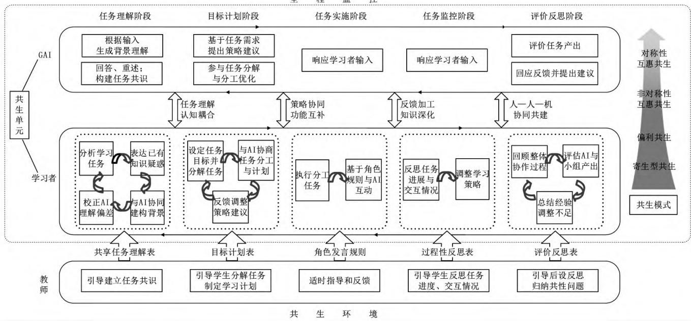
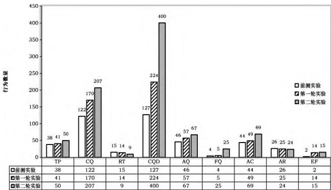
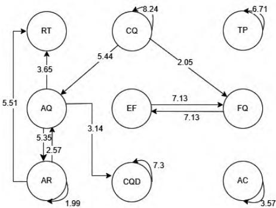
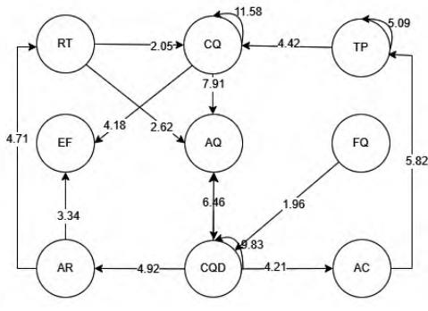
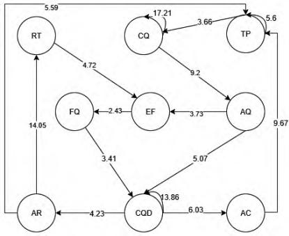
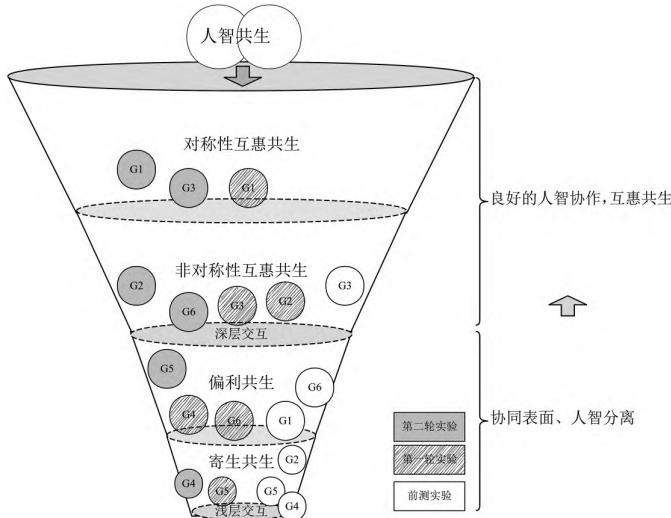

DOI:10.13811/j.cnki.eer.2026.07.009

# 共生理论下的共享调节学习：人智交互的提升路径探索

李 蕊 刘红霞 徐晓青

（东北师范大学 信息科学与技术学院 吉林 长春 130117）

[摘 要] 生成式人工智能在教育领域的深度融合正推动人机协同学习成为未来教育的重要形态 然而 当前人机协作中仍普遍存在人智分离与浅层交互等问题 为突破这一瓶颈 本研究引入共生理论 构建了面向人智交互的共享调节学习活动模型 将 GAI 视为协作伙伴 通过任务理解 目标计划 任务实施 监控与反思五个阶段 结合支架工具引导学习者与 GAI 进行双向调节与认知共建 实证研究表明 ：共享调节机制显著提升了交互频率 提问策略与反馈质量 推动交互行为从“工具性调用”向“协同共建”转变 ；学习者逐步形成“提问—回应—分析—反馈—再建构”的闭环调节路径人智关系呈现出由寄生 偏利共生向互惠共生发展的演化趋势。 本研究从认知锚定 策略协同 反馈加工与三元共生四个方面揭示了共享调节对人智交互的促进机理 为破解人机协同学习中的浅层交互困境 构建高质量人智共生关系提供了理论模型与实践路径

[关键词]人智交互 ； 共享调节学习 ； 共生理论 ； 生成式人工智能

[中图分类号] G434

[文献标志码] A

[作者简介] 李蕊 （2001—） 女 河北衡水人。 硕士研究生 主要从事人机协同学习 共享调节研究。 E-mail：lir010831@163.com 。

## 一、引 言

近 年 来 随 着 生 成 式 人 工 智 能 （Generative Artificial Intelligence，GAI ） 的 迅 速 发 展 人 机 协 同 学习逐渐从实验性探索走向广泛应用 成为未来学习的重要形态[1] 人机协同学习是指学习者与 GAI 建立协作关系 实现知识共享与共同发展的过程[2] 它不仅是智能教育实践的重要途径 也是国际教育人工智能发展的重要方向[3] 随着教育数字化战略的持续推进 学习者与 GAI 的实时沟通 互动交流与协同决策日益普遍 人机协同学习已被视为引领教育创新的重要途径

人智交互是指人类学习者与 GAI 通过语言、符号 行为等媒介进行双向信息交流[4] 意义建构与反馈调整的动态过程 与传统协作学习中以“人—人”为主体的互动模式不同 人智交互将协作关系拓展为“人—人—机”的三元结构 借助生成式人工智能 学习者不仅能够在较短时间内获取多样化的信息反馈还能在 GAI 的引导和启发下突破既有思维局限 拓展认知边界 提升知识建构的深度 因此 人智交互是学习者有效利用 GAI 开展协作学习的关键环节 直接影响学习者的人机协同学习绩效 然而 在实际的人机协作中 学习者与 GAI 的互动往往停留在浅层[5] 许多学习者倾向于将其视作信息库 过度依赖甚至直接复制其生成的内容 GAI 的反馈被局限于表层知识传递 未能有效参与认知建构[6] 这种人智交互本质上是一种人智分离 难以达到协同的效果

共享调节学习为解决这一问题提供了有益思路共享调节强调小组围绕共同目标 在任务理解 目标计划 过程监控与反思评价等环节进行集体调控 从而实现深度知识建构与高水平协作能力的生成[7] 已有研究表明 共享调节不仅能够优化群体的互动质量 还能提升学习绩效与协作效率[8-9] 但相关成果多集中于传统协作学习情境 在人机协同学习中的应用仍缺乏深入探讨 基于此 本研究引入共生理论作为分析视角 构建了面向人智交互的共享调节学习活动模型 旨在探索如何通过共享调节机制提升人机协同学习的交互水平 推动学习者与 GAI 之间形成互惠共生关系 从而为智能教育环境下的人机协同学习提供理论支撑与实践借鉴

## 二、人机协同学习的交互困境

为揭示生成式人工智能介入下学习者与 GAI 交互中暴露的具体问题与调节困境 本研究采取在自然情景中对大学生进行深度访谈的形式 收集受访者与GAI 协作的真实经历与感受 并基于扎根理论方法挖掘人机协作中的典型交互困境 访谈以小组形式开展 共设 6 组 每组 2~3 人 对访谈数据进行三级编码 最终得到 28 个开放式编码 7 个主轴范畴与 4 类核心主题 部分编码见表 1

研究发现 人智交互中存在四类关键问题 一是认知理解层面 学习者难以准确表达任务目标 缺乏与 GAI 共享背景知识的意识 二是信任情感层面 学习者对 GAI 存在依赖倾向或信任失衡 三是交互策略层面 提问方式随意 反馈调控意识薄弱 四是技术层面 存在 GAI 内容虚假 功能受限等问题 这主要源于系统自身的局限 具有较强的不可控性 因此 本研究将分析重点聚焦于前三类问题 为提升人智交互水平提供可行的干预方向与支持策略

## 三、共生理论下共享调节学习活动设计

共生理论最早由德国生物学家德贝里于 1879 年提出 指的是不同生命体之间的共同生存关系[10] 随着社会科学的不断发展 共生的概念逐渐被扩展到社会 经济 教育等多个领域 袁纯清认为 共生是一种常见的社会现象 主要由共生单元 共生模式和共生环境三个要素构成 共生单元之间通过资源的交换与互动共同进化 共生模式指单元之间的互动方式包括寄生 偏利共生 非对称性互惠共生和对称性互惠共生四种类型 其中对称性互惠共生被认为是理想的状态 共生环境则是指影响共生关系发展的外部条件[11] 在人机协作背景下 共生理论也得到进一步的拓展 人智共生强调人类学习者和 GAI 作为两个不同种类的共生单元 通过合作与竞争的方式 共同实现学习与进步。

由此 在共生理论视角下 人智交互不再是工具层面的支持关系 而是异质智能之间通过动态协作实现认知增值的过程 GAI 不仅是信息提供者 更是调节参与者与共建合作者 因此 在共享调节学习活动中 需要将 GAI 纳入调节过程 推动形成“人—机共调”的学习机制[12-13] 根据已有研究对共享调节学习阶段的划分[7-9] 本文将共享调节活动划分为任务理解目标计划 任务实施 任务监控与评价反思五个阶段在各个阶段划分了共生单元（学习者 GAI）的角色功能[14] 并设计了相应支架 以支撑高质量人智交互的发生 活动开展依托一定的共生环境 学习资源 任务情境 教师支持与反馈等为人机协作提供了外部支持 本研究所设计的共享调节学习活动 旨在通过过程支架与资源支持 推动人智交互由低层次的单向依赖逐步走向互惠共生 从而实现认知与调节的共同增值 共生理论视角下面向人智交互的共享调节学习活动模型如图 1 所示

表 1  
人智交互问题部分编码
<table><tr><td rowspan=1 colspan=3>部分开放式编码</td><td rowspan=2 colspan=1>主轴编码</td><td rowspan=2 colspan=1>选择性编码</td></tr><tr><td rowspan=1 colspan=1>节点</td><td rowspan=1 colspan=1>资料来源数</td><td rowspan=1 colspan=1>节点参考数</td></tr><tr><td rowspan=1 colspan=1>无法清晰地向GAI表达自己的需求</td><td rowspan=1 colspan=1>4</td><td rowspan=1 colspan=1>5</td><td rowspan=2 colspan=1>学习者未能清晰表达任务目标,导致理解偏差</td><td rowspan=4 colspan=1>认知理解层面</td></tr><tr><td rowspan=1 colspan=1>直接将作业要求复制粘贴给GAI</td><td rowspan=1 colspan=1>5</td><td rowspan=1 colspan=1>15</td></tr><tr><td rowspan=1 colspan=1>没有告诉GAI背景信息和先验知识</td><td rowspan=1 colspan=1>6</td><td rowspan=1 colspan=1>9</td><td rowspan=2 colspan=1>学习者未能有效共享自身学习背景、知识结构和具体需求</td></tr><tr><td rowspan=1 colspan=1>没有告诉GAI想要什么风格类型的回答</td><td rowspan=1 colspan=1>5</td><td rowspan=1 colspan=1>9</td></tr><tr><td rowspan=1 colspan=1>GAI使用引发思维惰性、离不开GAI</td><td rowspan=1 colspan=1>5</td><td rowspan=1 colspan=1>7</td><td rowspan=2 colspan=1>学习者在使用中表现出依赖与思维惰性</td><td rowspan=4 colspan=1>信任情感层面</td></tr><tr><td rowspan=1 colspan=1>对AI产生主动依赖倾向</td><td rowspan=1 colspan=1>6</td><td rowspan=1 colspan=1>14</td></tr><tr><td rowspan=1 colspan=1>不相信GAI 生成的内容</td><td rowspan=1 colspan=1>5</td><td rowspan=1 colspan=1>6</td><td rowspan=2 colspan=1>学习者对GAI信任失衡,存在盲目信任与过度怀疑</td></tr><tr><td rowspan=1 colspan=1>高度信任GAI内容</td><td rowspan=1 colspan=1>2</td><td rowspan=1 colspan=1>4</td></tr><tr><td rowspan=1 colspan=1>“偏感觉”式提问,想到什么问什么</td><td rowspan=1 colspan=1>5</td><td rowspan=1 colspan=1>8</td><td rowspan=2 colspan=1>学习者缺乏清晰、针对性的提问与反馈策略</td><td rowspan=2 colspan=1>交互策略层面</td></tr><tr><td rowspan=1 colspan=1>反复尝试但难以获得理想输出</td><td rowspan=1 colspan=1>4</td><td rowspan=1 colspan=1>7</td></tr><tr><td rowspan=1 colspan=1>GAI生成虚假信息或文献</td><td rowspan=1 colspan=1>5</td><td rowspan=1 colspan=1>7</td><td rowspan=2 colspan=1>GAI存在系统性技术限制</td><td rowspan=2 colspan=1>技术层面</td></tr><tr><td rowspan=1 colspan=1>GAI无法准确识别上下文内容</td><td rowspan=1 colspan=1>4</td><td rowspan=1 colspan=1>4</td></tr></table>

## 1. 任务理解阶段

该阶段强调人机对任务情境的协同建构 学习者借助共享任务理解表与 GAI 开展多轮互动 主动表达小组的已有知识经验和对任务的疑惑 识别 GAI 理解的偏差并给予反馈 从而引导 GAI 对学习者的知识状态形成更精准的把握 GAI 则通过回答 重述等方式参与认知协商过程 与学习者构建初步的认知耦合关系 为后续的人智协作奠定共情与共识基础

## 2. 目标计划阶段

达成任务共识后 小组需与 GAI 共同完成目标设定与任务规划 教师提供目标计划表引导学习者协商目标 明确个人与 GAI 的角色分工 GAI 则基于任务属性与成员能力提出分工建议 时序安排与策略调整建议 此阶段体现出典型的“策略共生”关系 人类主体在计划中保持主导 GAI 则通过高效的信息加工能力提供辅助性调节建议

## 3. 任务实施阶段

该阶段以任务为核心 依托教师提供的角色发言规则 学习者与 GAI 按照协商好的角色定位展开深度协作 GAI 不再仅是知识工具 而是围绕分工主动推进任务 响应学习者需求 提出多样思路 并参与方案打磨 学习者可基于交互实时调整自己的策略 引导 GAI 进行输出迭代 形成任务执行过程中的“动态互构” 。

## 4. 任务监控阶段

在任务进行过程中 学习者需基于过程性反思表进行定期进展回顾 反思当前策略的合理性 并评估GAI 反馈的有效性 学习者在此过程中承担主要的判断与修正责任 通过反馈引导 GAI 不断优化内容与表达 GAI 则根据学习者的反馈进行调整 提供替代性方案或优化建议 以支持小组的进一步改进

## 5. 评价反思阶段

任务结束后 教师引导学习者使用评价反思表对作品完成质量 人机交互过程与小组协作成效进行评价 GAI 则需要基于过程记录以及最终作品评价任务产出 辅助学习者识别优势与短板 提出提升建议与此同时 学习者可对 GAI 的表现进行元评价 反馈其有效性与信任度 形成反向调节链条 此阶段不仅帮助学习者提炼经验 更通过“共评—共调”机制促进GAI 系统地持续学习并提高其适配性 实现人—机能力的双向增长

## 四、研究设计

## （一）研究对象

研究对象为 D 大学教育技术学专业 2022 级本科生 共 24 人 均具备多次人机协作经验 并掌握教学设计 微课开发及教育实验等相关基础知识 所有参与者被分为 6 个小组 每组 4 人

<!-- 存疑：PDF 原文无“全程监控”字样，疑为图 1 模型图内文字被 OCR 误识飘入正文 -->
全程监控

  
图 1 共生理论视角下面向人智交互的共享调节学习活动模型

## （二）研究过程

本研究的实验周期为 8 周 分为准备和实验两个阶段 准备阶段对学习者开展 GAI 使用培训 帮助学习者熟悉 Kimi 在课程中的使用方式[15] 实验阶段共计开展三轮实验 包括前测和两轮正式实验 分别对应课程中的三个协作任务 为全面记录协作情况与人智交互行为 研究者要求各小组全程录制讨论过程并同步共享与 GAI 的交互界面 每轮实验结束后 研究者进行过程性数据的整理 分析 同时开展迭代调整 确保共享调节学习活动与支架设计不断优化

## （三）研究工具

为全面评估人机协作中学习者与 GAI 之间的交互水平 本研究参考汪靖提出的人智协同写作对话行为编码框架[5] 汪凡淙提出的交互行为编码框架[16] 以及吴磊提出的在线协作学习互动模式[17] 方海光提出的人机协同合作博弈模型[18] 构建了涵盖交互行为交互质量与交互模式三个维度的综合评价体系

## 1. 人智交互行为评价工具

结合已有研究中针对人机交互与群体调节特征的行为分类体系 形成了人智交互行为编码框架（见表 2 ） 。

表 2 人智交互行为编码框架
<table><tr><td rowspan=1 colspan=1>编码</td><td rowspan=1 colspan=1>名称</td><td rowspan=1 colspan=1>描述</td></tr><tr><td rowspan=1 colspan=1>TP</td><td rowspan=1 colspan=1>任务规划</td><td rowspan=1 colspan=1>讨论任务目标、流程、整体思路</td></tr><tr><td rowspan=1 colspan=1>CQ</td><td rowspan=1 colspan=1>提问策略协商</td><td rowspan=1 colspan=1>讨论向 GAI提问的方式/内容</td></tr><tr><td rowspan=1 colspan=1>RT</td><td rowspan=1 colspan=1>策略调整</td><td rowspan=1 colspan=1>对已有策略/提问方式进行调整</td></tr><tr><td rowspan=1 colspan=1>AQ</td><td rowspan=1 colspan=1>向 GAI提问</td><td rowspan=1 colspan=1>向GAI提出正式问题请求，寻求分析、建议、解释等</td></tr><tr><td rowspan=1 colspan=1>FQ</td><td rowspan=1 colspan=1>基于 GAI 追问</td><td rowspan=1 colspan=1>在GAI已有回答基础上继续深入提问或补充问题</td></tr><tr><td rowspan=1 colspan=1>EF</td><td rowspan=1 colspan=1>对 GAI 反馈</td><td rowspan=1 colspan=1>对GAI的回答进行评价、修正或怀疑</td></tr><tr><td rowspan=1 colspan=1>CQD</td><td rowspan=1 colspan=1>GAI内容讨论</td><td rowspan=1 colspan=1>小组成员对GAI生成内容进行间接讨论、评论、质疑、判断等行为，未直接反馈给 GAI</td></tr><tr><td rowspan=1 colspan=1>AC</td><td rowspan=1 colspan=1>观点采纳</td><td rowspan=1 colspan=1>采纳 GAI 输出内容</td></tr><tr><td rowspan=1 colspan=1>AR</td><td rowspan=1 colspan=1>拒绝 GAI 建议</td><td rowspan=1 colspan=1>明确表示GAI的回答意义不大、无法使用</td></tr></table>

① ACR（观点采纳度）= AC / AQ；RFP（反馈调节频率）=（FQ + EF）/ AQ；ARP（拒绝率）= AR /（AC + AR）；HQ%（高质量行为占比）=（FQ + EF + RT）/ 所有交互行为总数（不含 TP）× log［总交互行为数（不含 TP）］。

## 2. 人智交互质量评价工具

人智交互质量的评价包括五个核心维度 信息提取与请求能力 概念理解与构建深度 调节互动能力人—机对话调控能力[19]以及人—人—机协同水平 每个维度总分为 9 分 内部各项指标根据其重要性进行加权赋分 合计总分 45 分

## 3. 人智交互模式评价工具

结合行为频次指标①与交互质量评分结果 本研究基于共生理论建立了人智交互模式的判定框架

## （1）对称性互惠共生

学习者与 GAI 之间形成高频 双向 调节性强的互动关系 交互过程中 双方输出内容具有显著的建构价值 GAI 生成的建议不仅被采纳 还引发持续的反馈 追问与再加工行为 人与 GAI 共同参与知识建构 展现出高度协同与互信 构成“双主体调节”的合作模式 是人智交互的理想状态 判定标准为总交互质量 ≥ 35 且 RFP ≥ 0.3、ACR ≥ 0.5 、HQ% ≥ 0.3 。

## （2）非对称性互惠共生

学习者主导任务进程 GAI 主要提供认知支持与内容建议 虽整体调节行为较少 但 GAI 输出被有效采纳 辅助学习者完成建构任务 该模式体现学习者“单向获益” 特征 判定标准为总交互质量 ≥27 且RFP ≥ 0.2 ACR ≥ 0.5 HQ% ≥ 0.15

## （3）偏利共生（人主导）

学习者对 GAI 保持高判断性与高拒绝率 GAI 被工具化使用 交互中缺乏反馈调节 协同性低 该模式反映出“GAI 边缘化”的人主导合作形态 判定标准为总交互质量较低且 RFP≈0 ARP≥0.3 且 “人—人—机”协同水平≥7 调节互动能力≤3

## （4）寄生型/表层共生 （GAI 主导 ）

学习者在交互中缺乏反馈 调节与判断性讨论行为 几乎无拒绝或追问行为 表现为“无判断的盲目吸收” 该模式中 学习者高度依赖 GAI 完成任务 认知加工深度较浅 是人智交互中应规避的表层依赖状态 判定标准为总交互质量较低且 ARP≈0 基本无FQ/EF 行为 。

## 五、研究结果

## （一）交互行为

## 1. 交互行为频次差异

根据人智交互行为编码框架 对三轮实验的讨论文本进行整理与编码 共获得有效交互片段前测 424条 第一轮 599 条 第二轮 866 条 对比三轮实验的交互行为频次（如图 2 所示） 可以发现 在共享调节学习活动与支架的引导下 人智交互在频率和行为类型的丰富性上均呈现出显著增长 具体体现在： （1）调节意识进一步增强 提问更具策略性与协同性。 CQ 由前测的 122 条增长至 207 条 说明小组成员在提问前展开了充分的集体协商 在与 GAI 互动过程中展现出更强的目标导向性与主动调节意识 （2）内容加工行为持续激增 深层互动显著加强 CQD 在第二轮实验中激增至 400 条 成为最显著的行为增长点 这表明学习者对 GAI 生成内容的处理已从 “接受—判断”走向“协商—建构”的深入阶段 体现出强烈的批判性思维与知识重构意图 （3）反馈与追问行为大幅提升 交互逐步走向双向共建 FQ EF 较前两轮稳步上升 表明学习者不再满足于单向获取信息 而是主动反馈追问 GAI 回应内容 体现出更高水平的交互调节能力 （4）信息提取能力提升 协同采纳意识增强 AQAC 行为持续增长 同时 AR 保持相对稳定 说明小组对 GAI 信息的筛选与采纳更加理性 能够在理解的基础上更积极地将 GAI 内容整合到集体建构中

  
图 2 三轮实验交互行为总频次对比

## 2. 行为序列分析

为进一步揭示交互行为的动态转移过程 研究对三轮实验的交互行为进行了滞后序列分析（如图 3 所示） 对比三轮实验可见 前测交互行为整体较为零散 第一轮实验在共享调节支架的支持下 出现了跨行为的联结与初步的多轮互动 到第二轮实验 行为序列的复杂性和网络紧密度显著增强 逐步形成较为成熟的“人—机—人”调节闭环 具体表现为：

## （1）多向交互路径更加清晰，交互结构由线性走向网状

前测中显著行为序列相对分散 关键行为（如 TPAC）未能有效融入交互结构中；第一轮实验开始出现跨行为的联结（如 CQ→EF） 初步构建出“提问—分析—建构”的线性交互链条 但此阶段 FQ 仍未与主路径形成闭环 到第二轮实验 显著行为序列进一步增多 形成了从“提问—回应—分析—判断—反馈”再到“追问—再建构” 的多层次交互结构 典型路径如 ：CQ→AQ→CQD→AR / AC→RT→EF、EF→FQ→CQD→AR / AC 。

## （2）对 GAI 回应处理逻辑更清晰，调节路径更合理

前测中学习者面对 GAI 回应缺乏深入分析 （如AQ→AR ） 。 第一轮实验出现了 AQ→CQD→AR→EF路径 说明学习者开始尝试与同伴分析 GAI 回应内容并给予 GAI 简单反馈 表现出一定的调节意识 在第二 轮 实 验 中  出 现 了 AQ→CQD→AR→RT→EF→FQ→CQD 路径 表明学习者在面对 GAI 回应时能够先分析再判断 判断后还可以进一步通过策略调整（RT）修正原有方向 并再次反馈追问（EF FQ）推动新一轮的内容协商（CQD） 反馈不再是交互的终点 而是成为引发新一轮深入讨论与再建构的起点 调节流程实现了从“接收—判断”到“反思—修正”的闭环过渡 体现出更成熟的人智协同调节能力

## （二）交互质量

配对样本 t 检验结果（见表 3）表明 三轮实验中学习者的人智交互质量呈现出显著提升的趋势 其中 信息提取与请求能力 调节互动能力 人—机对话调控能力及总质量得分均在前测与第二轮实验之间达到极显著差异（p&lt;0.01 ） 且在第一轮与第二轮之间也存在显著提升（p&lt;0.05） 表明共享调节活动与支架的优化有效促进了学习者提问策略 反馈调节及对话调控能力的提升 验证了共享调节学习活动在提升交互质量方面的积极成效

## （三） 交互模式

为深入探究共享调节学习活动对人智交互模式的影响 绘制了三轮实验中各小组交互模式的演化轨迹（如图 4 所示） 整体来看 各小组呈现出“由浅入深 由人智分离向协同共生”的优化趋势 但也有个别小组存在波动 具体分析发现 （1）G1 与 G3 小组经过两轮实验均达到了“对称性互惠共生”的理想状态 表现出较强的调节意识 反馈能力与协同建构能力 说明这两个小组已逐步内化并有效运用了共享调节支架引导的交互策略 （2）G2 与 G6 小组均达到 “非对称性互惠共生” 反映出这两个小组逐步增强了对 GAI 输出的辨别和利用能力 能够有针对性地采纳并给予适当的反馈这是迈向人机协同的一大步 （3）G5 小组从“寄生型共生”提升至“偏利共生” 尽管调节能力仍较弱 但已经展现出积极向上的变化和一定的策略应用能力 G4 小组呈现“U 型变化” 第一轮由寄生提升至偏利共生 但在第二轮又退回至寄生 显示出其未能稳定内化调节策略 存在策略运用表层化 调节执行力不足等问题

  
（a）前测实验

  
（b）第一轮实验

  
（c）第二轮实验

图 3 三轮实验交互行为转换

表 3 三轮实验人智交互质量各维度及总分配对样本 t 检验结果
<table><tr><td rowspan=2 colspan=1>维度</td><td rowspan=1 colspan=3>配对(平均值)</td><td rowspan=2 colspan=1>配对</td><td rowspan=2 colspan=1>t</td><td rowspan=2 colspan=1>p</td></tr><tr><td rowspan=1 colspan=1>前测</td><td rowspan=1 colspan=1>第一轮</td><td rowspan=1 colspan=1>第二轮</td></tr><tr><td rowspan=2 colspan=1>信息提取与请求能力</td><td rowspan=2 colspan=1>4.00</td><td rowspan=2 colspan=1>6.83</td><td rowspan=2 colspan=1>8.00</td><td rowspan=1 colspan=1>前测 VS 二轮</td><td rowspan=1 colspan=1>-6.928</td><td rowspan=1 colspan=1>0.001**</td></tr><tr><td rowspan=1 colspan=1>一轮 VS 二轮</td><td rowspan=1 colspan=1>-2.907</td><td rowspan=1 colspan=1>0.034*</td></tr><tr><td rowspan=2 colspan=1>概念理解与构建深度</td><td rowspan=2 colspan=1>5.50</td><td rowspan=2 colspan=1>4.67</td><td rowspan=2 colspan=1>5.67</td><td rowspan=1 colspan=1>前测 VS 二轮</td><td rowspan=1 colspan=1>-0.277</td><td rowspan=1 colspan=1>0.793</td></tr><tr><td rowspan=1 colspan=1>一轮 VS 二轮</td><td rowspan=1 colspan=1>-2.236</td><td rowspan=1 colspan=1>0.076</td></tr><tr><td rowspan=2 colspan=1>调节互动能力</td><td rowspan=2 colspan=1>1.67</td><td rowspan=2 colspan=1>4.33</td><td rowspan=2 colspan=1>5.67</td><td rowspan=1 colspan=1>前测 VS 二轮</td><td rowspan=1 colspan=1>-6.325</td><td rowspan=1 colspan=1>0.001**</td></tr><tr><td rowspan=1 colspan=1>一轮 VS 二轮</td><td rowspan=1 colspan=1>-3.162</td><td rowspan=1 colspan=1>0.025*</td></tr><tr><td rowspan=2 colspan=1>人—机对话调控能力</td><td rowspan=2 colspan=1>0.33</td><td rowspan=2 colspan=1>1.50</td><td rowspan=2 colspan=1>4.33</td><td rowspan=1 colspan=1>前测 VS 二轮</td><td rowspan=1 colspan=1>-5.855</td><td rowspan=1 colspan=1>0.002**</td></tr><tr><td rowspan=1 colspan=1>一轮 VS 二轮</td><td rowspan=1 colspan=1>-9.22</td><td rowspan=1 colspan=1>0.000**</td></tr><tr><td rowspan=2 colspan=1>人—人—机协同水平</td><td rowspan=2 colspan=1>7.17</td><td rowspan=2 colspan=1>7.67</td><td rowspan=2 colspan=1>8.00</td><td rowspan=1 colspan=1>前测 VS 二轮</td><td rowspan=1 colspan=1>-2.076</td><td rowspan=1 colspan=1>0.093</td></tr><tr><td rowspan=1 colspan=1>一轮 VS 二轮</td><td rowspan=1 colspan=1>-1.581</td><td rowspan=1 colspan=1>0.175</td></tr><tr><td rowspan=2 colspan=1>总质量</td><td rowspan=2 colspan=1>18.67</td><td rowspan=2 colspan=1>25</td><td rowspan=2 colspan=1>31.67</td><td rowspan=1 colspan=1>前测 VS 二轮</td><td rowspan=1 colspan=1>-6.982</td><td rowspan=1 colspan=1>0.001**</td></tr><tr><td rowspan=1 colspan=1>一轮 VS 二轮</td><td rowspan=1 colspan=1>-5.199</td><td rowspan=1 colspan=1>0.003**</td></tr></table>

注 ： \*p&lt;0.05，\*\*p&lt;0.01。

  
图 4 三轮实验中各小组交互模式的演化轨迹

## 六、讨 论

在共生理论视角下 人智交互是一种异质体之间的动态协作关系 其本质在于实现认知 策略与情感层面的共建与互利[20] 然而 人智协作在天然的不对称性与技术限制下 常呈现出“人智分离”的浅层倾向 难以实现真正意义上的协同增效 结合前文实证分析可见 低水平的人智交互往往表现为 GAI 响应质量难以掌控 学习者输入策略单一 互动流程杂乱 在此背景下 本研究所设计的共享调节学习活动通过多层次的调节支架介入 引导学习者主动调控人机交互过程 优化提问策略与反馈加工 进而提升人智交互的整体水平 其促进机理主要体现在以下四个方面：

## 1. 构建任务共识：以认知锚定缓解人智任务理解的偏差

任务理解差异是导致交互低效的关键障碍之一GAI 作为外部智能体 往往无法准确识别任务情境与用户意图 尤其是在复杂或开放性的学习任务中 学习者与 GAI 之间在目标识别 语义指向和任务要求上的理解偏差 极易造成信息传递失真与交互焦点的游离 进而影响后续的知识建构

基于共生理论 共建性的认知协同是实现有效共生的前提条件 而共享调节正是实现认知锚定的关键机制 本研究在任务起始阶段引入任务理解表与目标计划表等支架工具 通过明确任务情境与交互意图引导小组成员在与 GAI 交互前先行达成小组内的任务共识 并结合 GAI 生成内容进行必要的对比 提问与澄清 从而在人—人—机三方之间建立初步一致的认知框架 从实证数据来看 较之前测 后两轮实验中学习者的信息提取与请求能力显著提升 访谈结果也显示 学习者普遍认为任务起点的“讨论—梳理—确认—再输入给 GAI”流程 有助于规避 GAI 对任务要求的误解 也帮助他们更明确自身所需的信息类型与提问问题的焦点

## 2. 促进策略协同：以输入结构优化缓解人智提问低效

提问策略的随意性与低结构性是制约交互深度的重要因素 GAI 虽具备强大的响应能力 但其内容生成高度依赖于人类输入的明确性与逻辑性 前期扎根分析表明 学习者在提问中常表现为想到什么问什么 缺乏围绕任务目标的策略组织 导致 GAI 生成内容与任务焦点偏离 降低了交互效率

本研究所设计的共享调节学习活动 通过嵌入提问提示 提供角色发言规则 引导学习者在组内先行对信息需求与提问内容进行协商整合[19] 并在与GAI 交互中采用更具逻辑的输入方式 进而提升提问的针对性 实证数据显示 较之前测 后两轮实验中 协 商 行 为 （CQ ） 与 提 问 行 为 （AQ+FQ ） 显 著 增 长人—机对话调控能力显著提高 多数学习者认为“协商—组织—输入”的流程能够帮助他们厘清提问的逻辑 减少了重复提问与偏题的现象 GAI 的反馈质量也有所提升

## 3. 引导反馈加工： 以反馈调控促进知识深加工再建构

基于共生理论 真正的互惠共生不仅依赖信息交换的频次 更依赖于交互双方围绕核心任务实现的认知协同与意义共创 共享调节活动通过提供过程性反思表与提醒机制 引导学习者在接受 GAI 内容后主动进行判断性回应 促使其对 GAI 内容进行深层理解与再建构 实证结果显示 后两轮实验中反馈加工类行为频次与高质量行为占比显著增长 调节互动能力不断增强 从讨论视频中也观察到 学习者逐渐形成了先评估 GAI 内容的逻辑与契合度 再决定是否采纳并对疑点进行追问或修正的主动加工习惯

## 4. 激活三元共生：以协同机制推动人—人—机共建融合

在人智协作中 个体与 GAI 的有效互动不能脱离团队协作的整体逻辑 基于共生理论 理想的协作应呈现出对称性互惠的三元共生结构 即组内成员与GAI 围绕任务形成动态的 连续的信息流与决策链条 本研究通过引入角色发言规则 过程性反思表 评价反思表等支架 明确交互节奏 责任分工与协同路径 引导学习者在人—人交流的基础上共同设计提问 分析反馈并推进任务 实证表明 后两轮实验中各小组的交互频次和人—人—机协同水平不断提升 交互模式不断优化 尤其在第二轮实验中 人—人—机三方已初步形成了 “共识协商—提问生成—反馈判断—再共建”的闭环路径

## 七、结 束 语

在人工智能快速发展的背景下 如何提升人智协作水平成为教育技术领域的重要议题 本研究基于共生理论 聚焦共享调节学习活动对人智交互的促进作用 通过扎根分析发现 学习者在人机协作中存在任务理解偏差 提问策略不足与反馈缺失等问题 为此研究设计了面向人智交互的共享调节学习活动模型并构建了结合行为频次与质量指标的交互评价体系在三轮教学实验中 共享调节机制显著提升了学习者的交互活跃度与高质量行为比例 交互流程逐步趋于有序 不同小组的交互模式呈现出向互惠共生型演化的趋势 研究结果验证了共享调节学习活动及其支架对人智交互水平具有积极的促进作用 能够有效缓解当前人智交互中存在的“人智分离”与“协同表面”问题 推动交互过程从“单向提问—信息判断”转向“多向协商—知识共建” 促使人智关系由工具使用走向真正的协同共生。

## [参考文献]

[1] 王一岩 ， 刘淇 ， 郑永和． 人机协同学习 ： 实践逻辑与典型模式[J]． 开放教育研究 ， 2024 ， 30 （1 ） ： 65-72．

[2] 郝祥军 ， 顾小清 ， 张天琦 ， 等． 人机协同学习 ： 实践模式与发展路向[J]． 开放教育研究 ， 2022 ， 28 （4 ） ： 31-41．

[3] 汪维富 毛美娟 余慧 等 人工智能驱动的教育科研新范式：发轫逻辑 变革路径与实践进路[J] 电化教育研究 2025 46（6） ：21-28

[4] 王国勇. 教育社会学[M]. 北京 ： 社会科学文献出版社 ： 2020 ： 309.

[5] 汪靖 陈恬妮 杨玉芹 思维与调节的融合共创 ：生成式人工智能支持的人智交互过程与模式研究[J] 中国电化教育 2024（8） ：45-55．

[6] 张敬威． ChatGPT 的教育审思 ： 他异关系技术的教育挑战及应用伦理限度[J]． 电化教育研究 2023 44 （9 ） ： 5-11 25．

[7] 陈向东 ，罗淳 ，张江翔． 共享调节 ：一种新的协作学习研究与实践框架[J]． 远程教育杂志 ，2019，37（1） ：62-71．

[8] Cortazar C ， Goni J ， Nussbaum M ， et al． The impacts of scaffolding socially shared regulation on teamwork in an online project-based course[J] The Internet and Higher Education 2022 55 ： 100877

[9] 郑兰琴，李欣． 调节性学习的发展 ：模型、支持工具及培养策略[J]． 现代远程教育研究 ，2017，29（2） ：60-66

[10] 林恩·马古利斯. 生物共生的行星——进化的新景观[M]. 易凡 译. 上海 ：上海科学技术出版社 1999：11.

[11] 袁纯清 共生理论及其对小型经济的应用研究 （ 上 ）[J] 改革 1998 （2 ） ： 101-105

[12] Kong X M Fang H G Chen W L et al． Examining human-AI collaboration in hybrid intelligence learning environments ： insight from the synergy degree model[J]． Humanities and Social Sciences Communications 2025 12 ： 821．

[13] 韩悦 ， 赵晓伟 ， 沈书生． 人机协同调节 ： 复合脑视角下自我调节学习的新路径[J]． 电化教育研究 ，2024 ，45（5） ：20-26 ，34．

[14] 汪靖 米尔外提·卡马勒江 杨玉芹 人机共生的复合脑 ：基于生成式人工智能辅助写作教学的应用发展及模式创新[J] 远程教育杂志 2023 41 （4 ） ： 37-44

[15] Li Y Sadiq G Qambar G et al. The impact of students'use of ChatGPT on their research skills: the mediating effects of autonomous motivation engagement and self-directed learning[J]. Education and Information Technologies 2024 30 （ 4 ） ： 1-32.

[16] 汪凡淙 汤筱玙 余胜泉． 基于生成式人工智能的认知外包：交互行为模式与认知结构特征分析[J]． 心理学报 2025 57（6） ：967-986．

[17] 吴磊 ，白青贺 ，范丽鹏． 共生理论视域下在线协作学习机制与互动模式分析[J]． 现代远距离教育 ，2024（4） ：60-70．

[18] 方海光 孔新梅 刘慧薇 等 基于共生理论的人机协同教育主体合作博弈及其优化策略研究[J] 电化教育研究 2024 45（1） 21-27

[19] 岳彦龙 罗江华 人智协同问题解决能力 ：概念框架 核心维度与指标体系[J] 电化教育研究 2025 46（12） ：34-42

[20] 李芒 贺鹏洋． 人类与人工智能的关系 ： 互补 、 互动 、 互生[J]． 电化教育研究 2025 46 （8 ） ： 15-20 80．

[21] Lin Z C． How to write effective prompts for large language models[J]． Nature Human Behaviour ， 2024 ， 8 （ 4 ） ： 611-615．

# Shared Regulation of Learning under Symbiotic Theory: Exploring Pathways to Enhance Human-AI Interaction

Li Rui, Liu Hongxia, Xu Xiaoqing

(School of Information Science and Technology, Northeast Normal University, Changchun Jilin 130117)

[Abstract] The deep integration of generative artificial intelligence (AI) in education is driving human-machine collaborative learning to become a key form of future education. However, current human-machine collaboration still faces common problems such as human-AI separation and shallow interaction. To address this, the study introduces symbiosis theory to construct a shared regulation learning activity model for human-AI interaction. The model treats AI as a collaborative partner and guides learners through five stages, task understanding, goal planning, task execution, monitoring, and reflection. Then, scaffolding tools are used to facilitate bidirectional regulation and cognitive co-construction between learners and AI. Empirical results demonstrate that the shared regulation mechanism significantly improves interaction frequency, questioning strategies, and feedback quality, shifting interactive behavior from instrumental invocation toward collaborative co-construction; learners gradually formed a closed-loop regulatory pathway of questioning, responding, analyzing, feeding back, and reconstructing, and the human-AI relationship exhibits an evolutionary trend from parasitism and commensalism toward mutualistic symbiosis. The study reveals the mechanisms through which shared regulation promotes human-AI interaction from four aspects: cognitive anchoring, strategic coordination, feedback processing, and triadic symbiosis, thereby providing a theoretical model and a practical pathway to overcome the challenge of shallow interaction and to foster high-quality symbiotic relationships in human-AI collaborative learning.

[Keywords] Human -AI Interaction; Shared Regulation of Learning; Symbiotic Theory; Generative Artificial Intelligence