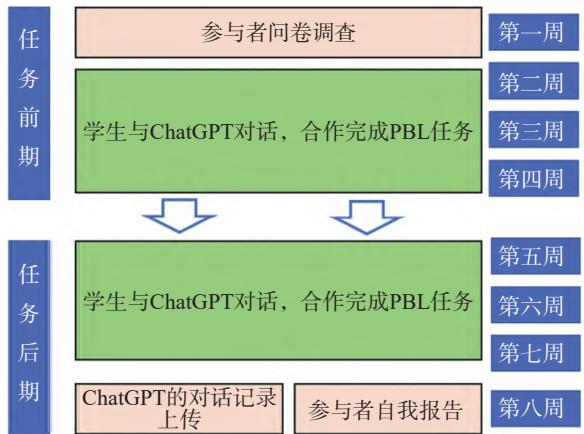
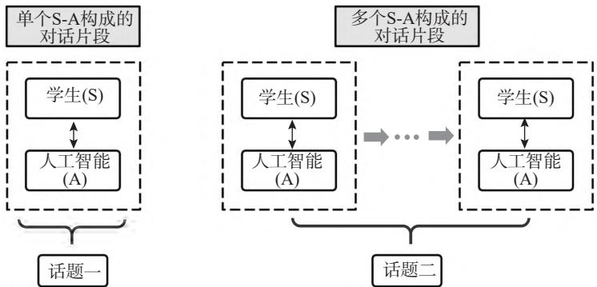
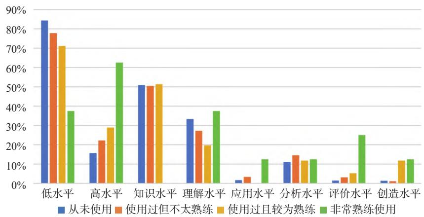
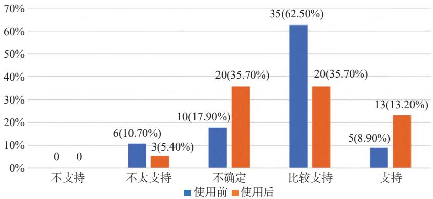

# 学会提问：大学生与生成式人工智能协同学习模式的研究

何珊云　沈 演

（浙江大学教育学院，杭州 310058）

摘　要：以 ChatGPT 为代表的生成式人工智能的问世，给传统的学习模式带来了巨大的机遇与挑战。学生如何运用生成式人工智能促进学习成为教育教学改革亟待探索的问题。本研究在大学生课程学习过程中引入 GAI，对学生与 GAI 的话语类型、提问水平、提问策略以及自我报告进行编码分析，探究了大学课堂中学生如何与 GAI 进行协同学习。研究发现，在学生与 GAI 的对话中，学生是对话的发起主体，单个对话构成的对话单元居多，持续性的讨论较少。学生话语主要以初始提问、拓展提问和改述提问为主，评价和继续指令话语较少。同时学生提问的认知水平较低，以知识水平、理解水平提问为主，提问策略单一，较少使用角色提问、材料提问、方案提问等策略。在不同任务阶段、不同使用经验的学生与 GAI 的对话存在差异性，在任务后期人智之间展开更高频、更持续的互动对话，且提问认知水平更高、提问策略使用更熟练。使用 GAI 经验越丰富的学生产生更多的高认知水平对话。在呈现出不同话语特征的对话过程中，学生对在大学课堂教学中引入 GAI 整体上持积极态度但有所分化。学生普遍认为，GAI 能够积极地辅助学习，具有回应优势、能够为学生提供信息价值、处理多类任务和促进学生能力发展，但同时也存在技术局限，引发对学生主体、学习评价和教育生态的挑战。在此基础上，本研究从提供提问训练、丰富提问场景、加强回答反思三个方面为进一步在课堂教学过程中引入生成性人工智能提供了有效的建议。

关键词：生成式人工智能；对话；提问；项目化学习

## 一、研究背景与问题

自 OpenAI 发布 ChatGPT 以来，生成式人工智能（Generative Artificial Intelligence，GAI）应用于教育教学引发了广泛的讨论与关注（朱永新，杨帆，2023; 徐国庆等，2023）。ChatGPT 基于大型语言模型，具备自动学习、语言理解、类人对话、快速响应、知识保留等强大功能（Rudolph, Tan &Tan, 2023），被认为能够在教育教学领域发挥积极作用。具体而言，可以为教师组织和联想知识点、快速检索和生成教学资源、辅助课堂互动，为学生提供一对一个性化的学习支持服务、通过启发式对话辅助学生对知识点的理解、构建沉浸式学习场景（陈静远等, 2023）。另一方面，GAI 正在不断冲击传统教育主体性，重塑了学习场景、学习关系和学习角色（宋萑, 林敏, 2023），推动教育工作者教学方法与学习者获取知识途径的转变。在这一背景下，教师如何运用 GAI 教、学生如何通过 GAI 学都是人工智能时代教育教学亟待探索的问题（钟秉林, 2022; 顾小清等, 2023）。

已有大量的研究开始关注 GAI 在课堂教学中实际运用的效果。这些研究在医学（Gilson, 2023）、法律（Hargreaves, 2023）、经济（Geerling et al., 2023）、数学（Frieder et al., 2023）、编程（Stutz et al., 2023）等领域通过测试、访谈等方式将 ChatGPT 表现与学生表现、教学标准等进行比较，根据 ChatGPT 的回应质量判断其是否可以作为合格的学习工具或教学助手。还有一些研究关注师生对课堂教学中使用 ChatGPT 的感受、态度、看法等（Singh, Tayarani-Najaran, & Yaqoob, 2023; Sánchez-Ruiz, et al., 2023; Shoufan, 2023），并探究影响学习者在课堂中使用 ChatGPT 的态度、意图与实际行为的因素，如自我调节、预期努力、预期绩效、感知易用性、感知有用性、信息系统质量及其相互关系（Duong, et al., 2023; Cai, Lin, & Yu, 2024）。还有不少研究通过案例研究、描述性研究等方式揭示 ChatGPT 在实际教学应用过程中扮演虚拟教师、学习伙伴、虚拟助教等角色（Singh, Tayarani-Najaran, & Yaqoob, 2023），如何影响教师教学和学生学习（Rahman & Watanobe, 2023; Alshater, 2022）。这种对 ChatGPT 的“工具视角”向“类人视角”的转向也开始引发研究者关注“如何在学习中与 GAI 建立有效协同”这一问题（荀渊，2023），但目前还鲜少有实证研究呈现学生进行人智协同的主要方式。

基于 GAI 的技术特征，对话是人智互动的主要形式。建构主义认为学习的本质就是社会的、对话的过程，对话是意义构建最主要的方式；巴赫金对话理论同样强调了语言和思维具有对话性（Koschmann, 1999）。在学生与 GAI 交互过程中，对话是推动人智协同学习发生、构建的重要载体。作为人智互动的主体，学生在主动提问并获得个性化的反馈，再进一步追问的递进式问答对话中构建新知、促进学习。ChatGPT 等生成式人工智能正在赋能对话式学习个性化、精准化和自适应发展，形成以人为中心、人机共融的群智协同的对话式学习新样态（戴岭等, 2023）。因此，本研究以当下高等教育现场中的人智对话为研究对象，进行话语类型、提问水平、提问策略等编码分析，并关注学生主体通过自我报告呈现的使用感受，以探究在高等教育数字化转型背景下学生提问所引发的人智协同学习的模式及其特征，以及学生视角下 GAI 作为对话伙伴如何促进学习，并对当前高校课堂教学中引入 GAI 所面临的现实问题与挑战提出具体的建议。

## 二、研究设计

### （一）研究方法与过程

本研究的研究对象为 Z 大学修读 2023 年春夏学期教育学二年级专业课程的 56 位本科学生（基本情况见表 1）。该课程共计 16 周，每周授课 2 次，每次 2 个课时。其中的 8 周时间学生将进行“世界义务教育课程方案展评会”的项目化学习 (Project-Based Learning，PBL），通过小组合作完成某一国家义务教育课程方案的案例分析报告并做展示。

表 1 研究对象基本情况
<table><tr><td>统计项目</td><td>分类</td><td>人数</td></tr><tr><td rowspan="2">性别</td><td>男</td><td>13(23.21%)</td></tr><tr><td>女</td><td>43(76.79%)</td></tr><tr><td rowspan="4">GAI使用经验</td><td>从未使用</td><td>23(41.07%)</td></tr><tr><td>使用过但不太熟练</td><td>22(39.29%)</td></tr><tr><td>使用过且较为熟练</td><td>9(16.07%)</td></tr><tr><td>非常熟练地使用</td><td>2(3.57%)</td></tr><tr><td>参与总人数</td><td>/</td><td>56</td></tr></table>

研究过程持续了 8 周（图 1）。课程第 1 周，研究者对参与者的基本个人信息、GAI 使用经验及其引入课堂教学的态度等进行问卷调查，同时提供学生 GAI 工具的操作手册（内含访问路径和使用伦理规范），鼓励学生使用 GAI 工具完成 PBL，并不对使用次数、时间等作限制。GAI 工具为国内开放的大模型接口，其性能与 ChatGPT3.5 版本基本一致。第 8 周 PBL 项目完成后，学生会提交使用 GAI 的自我报告（self-report），并上传学习过程中与 GAI 的对话记录。其中，自我报告包含学生对引入 GAI 的态度、GAI 对学习任务完成的帮助、使用 GAI 的经验与启发等问题。

  
图 1 研究流程图

### （二）数据处理与研究工具

本研究首先对 56 位学生上传的人智对话记录进行整理清洗，并进行了敏感信息的筛查，剔除因网络卡顿原因、输入有误等原因的无效对话，共获得人智对话 2250 条。由于 PBL 过程具有进阶性，随着任务的推进和解决问题的深入，人智对话具有不同特征，因此本研究根据对话的时间将所有对话分为PBL 任务前期（第 1 周至第 4 周）和后期（第 5 周至第 8 周）两个时间段，并进行编码分析。

研究首先对发言主体进行编码，S 表示学生，A 表示生成式人工智能。基于 GAI“有问必答”的特性，学生的每一次提问都能得到人工智能的回应，因此本研究将一个“人问智答”的对话作为基本的对话单元（S-A）进行分析。参考 Lemke（1990）的话语分析，将围绕一个话题所产生的一个或多个相关联的对话单元视为一个对话片段（episode），人智对话可以分为由单个对话单元构成的对话片段和由多个对话单元构成的对话片段（图 2）。

  
图 2 不同对话单元组成的对话判断

学生在与人智交互过程中往往掌握着发起对话的主动权，其对话水平决定着人智互动的结构与深度，因此本研究主要从话语类型、提问水平和提问策略三个维度对学生话语进行编码分析，从而呈现人智如何协同学习。

#### 1. 学生话语的功能类型编码

话语类型是传统课堂对话研究中较为关注的问题（Chin, 2006; 柴少明, 李克东, 2010）。本研究对人智对话中学生话语类型进行自下而上的编码，通过对整个数据集的内容分析，生成初始提问、改述提问、拓展提问、指出问题、情感表达、中断继续、补充继续 7 个维度，并进一步整合、归类成提问、追问、评价和继续指令 4 种功能（表 2）。

表 2 人智对话中学生话语的功能类型编码
<table><tr><td>功能</td><td>维度</td><td>编码</td><td>定义</td></tr><tr><td>提问I</td><td>初始提问</td><td>I</td><td>开启一个新的话题</td></tr><tr><td rowspan="2">追问F</td><td>改述提问</td><td>F1</td><td>转换表达方式或调整限定条件，以获得更精准的回答</td></tr><tr><td>拓展提问</td><td>F2</td><td>围绕与GAI对话的先前内容进一步提问</td></tr><tr><td rowspan="2">评价E</td><td>指出问题</td><td>E1</td><td>对GAI回应的正确性质疑或指出错误</td></tr><tr><td>情感表达</td><td>E2</td><td>表达如肯定、赞扬、感激等积极情绪或拒绝、责备等消极情绪</td></tr><tr><td rowspan="2">继续指令C</td><td>中断继续</td><td>C1</td><td>让GAI把没说完的话补充完整</td></tr><tr><td>补充继续</td><td>C2</td><td>让GAI在原回应的基础上增添新的内容</td></tr></table>

其中，生成维度时参考传统课堂教学中话语类型和理答行为类型。初始提问参考课堂话语中“问题”（Hmelo-Silver & Barrows, 2008）、“提问”（Chin, 2006）的类型；改述提问参考自秦乐琦（2023）教师归纳式回音中“改述”的类型，邵怀领（2009）等理答类型研究中也存在类似的“重复”“重述”“澄清”等类型；拓展提问参考“拓展”的理答类型（刘畅, 2012）；指出问题参考“更正”“简单否定”等理答类型（Good& Brophy, 1978；王春燕, 林静峰, 2011）；情感表达是较为普遍的理答方式，较多研究中都提及肯定、表扬、否定、批评、鼓励等理答类型（Good & Brophy, 1978; 王春燕, 林静峰, 2011）；而中断继续和补充继续的指令类型则是由 GAI 功能特征所决定。

#### 2. 学生提问水平和提问策略编码

提问是教学中重要的话语形式，也同样是人智对话的重要话语形式。其中，对提问的分析主要从提问水平和提问策略两个维度进行（沈小碚, 1996; 邵怀领, 2009）。

在提问水平方面，参照 Anderson（2001）提出的布鲁姆（Bloom）认知领域六层次目标分类修订版，将提问水平由低到高分为知识水平、理解水平、应用水平、分析水平、评价水平和创造水平（表 3），其中知识水平和理解水平为低水平，应用水平、分析水平、评价水平、创造水平为高水平。

表 3 人智对话中学生的提问水平编码
<table><tr><td>水平</td><td>定义</td><td>举例</td></tr><tr><td>Ⅰ知识水平</td><td>要求识别、回忆基本事实、过程、方法、理论等</td><td>全球教育监测报告最新版是哪一年发布的？</td></tr><tr><td>Ⅱ理解水平</td><td>要求通过解释、举例、分类等对信息进行有意义的整合</td><td>PSLE特别优秀的人才能进入综合中学吗？</td></tr><tr><td>Ⅲ应用水平</td><td>要求在给定的情境中执行练习或运用程序完成任务</td><td>请帮我修改上述语段中存在的语病。</td></tr><tr><td>Ⅳ分析水平</td><td>要求分解材料，对材料的组成部分及相互关系等进行区别、组织、归因</td><td>比较一下南非和卢旺达两个国家教育目标的相同和不同之处。</td></tr><tr><td>Ⅴ评价水平</td><td>要求基于准则和标准做出判断、评论</td><td>评价一下法国保罗朗之万小学的课程。</td></tr><tr><td>Ⅵ创造水平</td><td>要求将要素重新组织产生成新的整体</td><td>你现在是一位国际顶尖的比较教育学者，请结合以上材料形成一份3000字的有关挪威基础教育核心课程的报告。</td></tr></table>

在提问策略方面，Groisser（1964）和 Wilen（1991）都将表述明确、目的清晰作为有效提问的策略，这一观点也被国内外诸多学者所认同。因此除了简单的基础提问之外，本研究将提供具体细节的问题列为“具体提问”。在此基础上，基于 GAI 模拟角色回复、生成式分析、不仅能解决“What”的问题也能回应“How”的问题等功能，本研究归纳出角色提问、材料提问和方案提问三种提问策略（表 4），并将除基础提问外的其余四类划分为“附加要求提问”。

#### 3. 自我报告的主题分析

对学生的 56 份自我报告依序标记为 S1-S56，针对“GAI 对学习的作用”进行主题分析。在初步编码过程中，研究者对学生的自我报告逐句精读，明晰词语、句子及段落的意义，尤其尊重学生的原意表达，明确意义后标记关键词，初步得到 37 个编码。随后，研究者进一步对这些编码进行反复地比较、分析、整合和归纳，形成 8 个子主题。最终，研究者将 8 个子主题进一步归类，构建为两大主题，即GAI 对学习的积极影响、GAI 引入教学面临的挑战。

表 4 人智对话中学生的提问策略编码
<table><tr><td>策略</td><td>维度</td><td>定义</td><td>举例</td></tr><tr><td>基础提问</td><td>/</td><td>简单的提问以了解事物的基本情况或获取基础信息</td><td>介绍俄罗斯的教育体制</td></tr><tr><td rowspan="4">附加要求提问</td><td>具体提问</td><td>在基础提问的基础上，通过增添具体的要求和条件，对问题进行解释说明等让提问目的清晰明确，以更准确地获得需要的信息</td><td>结合几个典型案例，从办学理念、课程设置、学时要求等方面介绍俄罗斯的公立初中</td></tr><tr><td>角色提问</td><td>要求GAI扮演角色、模拟真实情境，从更专业的角度回应问题</td><td>如果你是莫斯科1535学校的校长，请您向前来参观的教学研究者们全面且深入地介绍一下你们学校的教学情况</td></tr><tr><td>材料提问</td><td>依赖数据、事实和背景知识等外部资料辅助问题询问，以提高问题的准确性和权威性</td><td>请根据以上参考资料，分析莫斯科1535学校课程设置的显著特征</td></tr><tr><td>方案提问</td><td>提供具体的应用场景，让GAI从专业背景领域或超出专业领域提供解决方案或做法建议</td><td>莫斯科1535学校的教育经验有哪些值得借鉴</td></tr></table>

## 三、研究结果与分析

### （一）人智协同中的学生话语特征

#### 1. 学生与 GAI 的对话频次

本研究对课堂上人智协同的对话单元和片段进行初步编码统计（表 5），共收集到 1125 个对话单元（S-A），即人智发生 1125 次对话，形成 634 个对话片段，即学生围绕学习任务与 GAI 开展 634 个话题讨论。对话片段中，以单个 S-A 构成的对话片段为主，占比为 68.45%，多个 S-A 构成的对话片段占比较少，平均长度为 3.5 个 S-A。而每位学生与 GAI 互动产生约 20 个 S-A，围绕约 11 个话题进行互动交流。由此可见，人智对话大部分以一个回合即从“学生提出新问题”到“得到 GAI 回应”结束，较少就一个话题展开持续性的交互探讨，即使有进一步的深入交流，也通常在经历 3-4 个 S-A 后结束。

表 5 学习的不同阶段学生与GAI互动的对话单元和片段统计
<table><tr><td>统计项目</td><td>细分项目</td><td>总数</td><td>前期</td><td>后期</td></tr><tr><td>使用人数</td><td></td><td>56</td><td>54</td><td>36</td></tr><tr><td>对话单元数量</td><td></td><td>1125</td><td>563</td><td>562</td></tr><tr><td></td><td>参与者人均对话单元数量(SD)</td><td>20.1(19.36)</td><td>10.4(9.8)</td><td>15.6(13.64)</td></tr><tr><td>对话片段数量</td><td></td><td>634</td><td>340</td><td>294</td></tr><tr><td></td><td>单个S-A对话片段数量</td><td>434(68.45%)</td><td>237(69.71%)</td><td>197(67.01%)</td></tr><tr><td></td><td>多个S-A对话片段数量</td><td>200(31.55%)</td><td>103(30.29%)</td><td>97(32.99%)</td></tr><tr><td></td><td>多个S-A对话片段的平均长度</td><td>3.5</td><td>3.2</td><td>3.8</td></tr><tr><td></td><td>参与者人均对话片段数量(SD)</td><td>11.3(9.69)</td><td>6.3(4.63)</td><td>8.2(7.44)</td></tr></table>

伴随学习任务的推进，学生与 GAI 的互动情况有所差异。其中，有 20 位同学在学习后期放弃继续使用 GAI，有 2 位前期并未使用的学生在后期选择使用 GAI，有 34 位学生则全程使用 GAI。在学习后期，人均对话单元和对话片段数量均较前期有所增加，说明使用 GAI 的学生在后期与人智对话频次更高，且后期多个 S-A 对话片段比例及其平均长度也相较前期有所上升，可见学生在后期与 GAI 就一个主题展开更持续的对话交流。

#### 2. 学生与 GAI 互动的话语类型

由于部分话语具有不止一种功能，因此最终编码产生 1133 条不同功能的学生话语，包括 E1+E2、E1+F2、E2+F2、E2+I 四种复合功能话语（表 6）。

表 6 学生话语的功能类型统计
<table><tr><td>功能及其数量</td><td>维度</td><td>数量</td><td>前期</td><td>后期</td></tr><tr><td>提问I 634(55.96%)</td><td>初始提问I</td><td>634(55.96%)</td><td>340(60.18%)</td><td>294(51.76%)</td></tr><tr><td rowspan="2">追问F 417(36.81%)</td><td>改述提问F1</td><td>127(11.21%)</td><td>57(10.09%)</td><td>70(12.32%)</td></tr><tr><td>拓展提问F2</td><td>290(25.60%)</td><td>143(25.31%)</td><td>147(25.88%)</td></tr><tr><td rowspan="2">评价E 69(6.09%)</td><td>指出问题E1</td><td>60(5.30%)</td><td>16(2.83%)</td><td>44(7.75%)</td></tr><tr><td>情感表达E2</td><td>9(0.79%)</td><td>3(0.53%)</td><td>6(1.06%)</td></tr><tr><td rowspan="2">继续指令C 13(1.14%)</td><td>中断继续C1</td><td>3(0.26%)</td><td>3(0.53%)</td><td>0</td></tr><tr><td>补充继续C2</td><td>10(0.88%)</td><td>3(0.53%)</td><td>7(1.23%)</td></tr></table>

从表6中可见，提问占比最高（55.96%），超过半数，说明学生倾向于向 GAI 发起新话题的提问。第二占比的为追问功能的话语（36.81%），说明部分学生在没有得到理想答案或产生新想法时会进一步提问。评价功能的学生话语比例仅为 6.09%，可见学生鲜少对 GAI 的回答质疑或指出错误，同时也较少表达肯定或否定的情绪。而继续指令的学生话语仅出现在 4 位同学的对话中，仅有 13 条，说明大部分学生对 GAI 的使用经验并不丰富，较少通过简单的指令让 GAI 进一步完善已有回答。

进一步从 7 个二级指标进行编码发现，除了初始提问之外，拓展提问占比最多，可见人智对话很多时候能让学生对话题产生新想法和新思考，不断推动对话深化展开。紧随拓展提问的是改述提问话语（11.21%），说明当 GAI 的回应与学生的预期不符时，学生会反思并调整自己的提问表达，通过完善提问继续从 GAI 那里获得回应，这也在一定程度上说明学生对 GAI 有一定信任。指出问题的话语（5.30%）真实地反映出部分学生对 GAI 的回答展开批判性思考，对其真实性和可靠性质疑，甚至直接指出“这不对”“你说错了”等，而并非一味地盲目接受。此外，情感表达的话语很少出现，且情感表达功能的话语鲜少作为单独的功能话语出现，往往和其他功能的话语共同出现，这也说明学生较少在人智对话中流露出自己的情绪状态或对 GAI 的情感态度。

对比 PBL 前期、后期的人智话语的功能编码类型可以发现，学生在后期初始提问比例下降明显，这同样说明学生随着 PBL 学习任务的不断推进，其关注的问题更加聚焦和具体，与 GAI 展开更多持续性的讨论。其中，改述提问和指出问题的话语比例增幅较为显著，这意味着随着学习任务阶段的推进、难度的上升、专业性的增强，GAI 的回答似乎越来越难以满足学生的需求。

#### 3. 学生与 GAI 互动的提问水平与提问策略

本研究对获得的学生话语进行分析后发现，提问是人智互动过程中学生的主要话语类型（1 051，92.77%）。随后，研究对学生话语的提问水平根据表3进行编码，其结果如表7所示。可以看到，学生向 GAI 的提问以知识水平的提问为主（50.33%），主要为询问某一对象的事实信息，包括向 GAI 询问网址链接、政策文件、信息来源等材料性提问。其次为理解水平的提问（29.88%），再次为分析水平的提问（12.65%），而较高认知层次的评价水平提问和创造水平提问均较少。这在很大程度上说明，当下学生的提问主要集中在知识检索和信息获取，运用 GAI 进行分析、评价、创造等高水平认知活动的较少，人智对话的认知水平较低。在 PBL 任务后期，分析水平、创造水平的学生提问比例有所增加，低水平提问的比例有所下降，这表明伴随学习任务的深入，学生在任务后期与 GAI 的对话产生更深层次的认知过程，学生更期待、更需要运用 GAI 解决更高认知水平的复杂问题。

同时，不同使用经验的学生在与人智对话的提问水平上也呈现出差异性（图 3）。图中可以看到，学生的使用经验越丰富，其人智对话的高水平提问占比越高。尤其是评价、创造水平的提问，使用经验较为丰富的学生提出这两类问题的比例远远高于没有使用经验和有使用经验但不太熟练的学生。由此可见，学生对 GAI 的使用经验越丰富，对 GAI 的功能越了解并熟练掌握运用技巧，学生在解决学习任务的过程中越倾向于让 GAI 帮助自己解决更高认知水平的问题。值得一提的是，拥有非常熟练使用经验的学生甚至没有知识水平的提问。

表 7 学生话语的提问水平统计
<table><tr><td rowspan=1 colspan=1>水平</td><td rowspan=1 colspan=1>总数</td><td rowspan=1 colspan=1>前期</td><td rowspan=1 colspan=1>后期</td></tr><tr><td rowspan=1 colspan=1>知识水平</td><td rowspan=1 colspan=1>529(50.33%)</td><td rowspan=1 colspan=1>276(51.11%)</td><td rowspan=1 colspan=1>253(49.51%)</td></tr><tr><td rowspan=1 colspan=1>理解水平</td><td rowspan=1 colspan=1>314(29.88%)</td><td rowspan=1 colspan=1>166(30.74%)</td><td rowspan=1 colspan=1>148(28.96%)</td></tr><tr><td rowspan=1 colspan=1>应用水平</td><td rowspan=1 colspan=1>25(2.38%)</td><td rowspan=1 colspan=1>13(2.41%)</td><td rowspan=1 colspan=1>12(2.35%)</td></tr><tr><td rowspan=1 colspan=1>分析水平</td><td rowspan=1 colspan=1>133(12.65%)</td><td rowspan=1 colspan=1>58(10.74%)</td><td rowspan=1 colspan=1>75(14.68%)</td></tr><tr><td rowspan=1 colspan=1>评价水平</td><td rowspan=1 colspan=1>28(2.66%)</td><td rowspan=1 colspan=1>18(3.33%)</td><td rowspan=1 colspan=1>10(1.96%)</td></tr><tr><td rowspan=1 colspan=1>创造水平</td><td rowspan=1 colspan=1>22(2.09%)</td><td rowspan=1 colspan=1>9(1.67%)</td><td rowspan=1 colspan=1>13(2.54%)</td></tr></table>

  
图 3 不同使用经验学生话语的提问水平分布统计

研究对学生的提问策略根据表4进行编码的统计结果如表8所示。整体来说，学生的提问形式以具体提问为主，基础提问其次，而与 GAI 功能相关的角色提问、材料提问和方案提问的策略使用较少，说明学生对 GAI 的提问缺乏经验和方法策略，大部分学生只会使用相对简单的基础提问和具体提问策略，而在任务后期，具体提问的比例较前期显著增加，材料提问和方案提问的比例也有所增加，整体来说学生在任务后期对附加要求提问的策略使用相对更多提问更具体，明确且更充分地发挥了GAI 的功能优势。使用经验越丰富的学生使用角色提问的策略越多，从使用过但不太熟练到非常熟练使用，学生的角色提问策略使用比例从 0.82% 上升至 7.02%、25.00%。

表 8 学生话语的提问策略统计
<table><tr><td>策略</td><td>总数</td><td>前期</td><td>后期</td></tr><tr><td>基础提问</td><td>327(31.11%)</td><td>225(41.67%)</td><td>102(19.96%)</td></tr><tr><td>具体提问</td><td>694(66.03%)</td><td>300(55.56%)</td><td>394(77.10%)</td></tr><tr><td>角色提问</td><td>8(0.76%)</td><td>7(1.30%)</td><td>1(0.20%)</td></tr><tr><td>材料提问</td><td>13(1.24%)</td><td>5(0.93%)</td><td>8(1.57%)</td></tr><tr><td>方案提问</td><td>9(0.86%)</td><td>3(0.56%)</td><td>6(1.17%)</td></tr></table>

### （二）人智协同中的学生感受

#### 1. 人智协同是否促进学习？

本研究对学生的自我报告进行主题分析发现，学生认为，在情境任务的解决过程中，GAI 既能够在一定程度上辅助学习，但也可能对学习产生消极影响。GAI 对学习的积极作用集中体现在 GAI 的回答所具有的优势、GAI 为学生提供的信息价值、GAI 能够处理多类任务以及能够促进学生能力发展四大范畴，具体包含表 9 中的 18 类积极作用。

表 9 学生自我报告的主题分析
<table><tr><td>主题</td><td>子主题</td><td>编码</td></tr><tr><td rowspan="4">GAI对学习的积极影响</td><td>回应优势</td><td>内容质量较高、回应及时、更加便利、个性化回应、交流舒适轻松</td></tr><tr><td>提供信息价值</td><td>提供新的问题分析视角、提供框架与启发思路、迅速了解一个领域、验证其他信息</td></tr><tr><td>处理多类任务</td><td>高效搜索信息、概述与总结、撰写文本、语言翻译工具、提供修改意见</td></tr><tr><td>锻炼能力发展</td><td>培养正确使用工具的能力、提升学生的学习主导性、在纠正GAI的过程中学习、利于学生创造</td></tr><tr><td rowspan="4">GAI引入教学面临的挑战</td><td>技术发展的挑战</td><td>存在虚假错误答案、缺乏时效性、回应偏题、表达不清、数据不全、专业性和深度不够、中文使用限制、信息来源不够透明、缺乏主观思想、语言表达生硬</td></tr><tr><td>学习评价的挑战</td><td>学习结果同质化、引发学术风险和师生信任危机</td></tr><tr><td>教育生态的挑战</td><td>教学不太稳定可控、加大教育差距</td></tr><tr><td>学生主体的挑战</td><td>产生依赖性、加剧学习惰性、增加学生负担、不利于学生独立思考和能力发展、学生难以驾驭GAI</td></tr></table>

对于 GAI 的回答质量，学生认为其能够提供一些有效（S3）、具体（S48）、逻辑性强（S48）的高质量信息，尤其是在经过多次询问和训练后，GAI 能够提供相对精准的回答以满足学生的需求，且具有回应及时（S52）、获取便利（S21）、个性化（S21）的特点。还有个别同学认为和 GAI 互动交流是轻松舒适的（S38），但提及 GAI 提供情绪价值的较为稀少，而对于 GAI 的问题回答所带来的信息价值，学生认为根据 GAI 的回应所提供信息整合、搜索途径、丰富内容等，能够迅速、粗略地了解一个陌生的知识领域（S39），尤其为课前预习、领域的宏观学习、概念界定等提供有效的借鉴参考；也能从中借鉴解决问题的思路和框架（S12），补充新的分析视角（S16），并能够与其他途径获得的信息相互印证（S15），保障所获信息的可靠性。同时，学生还提到 GAI 具有处理多类任务的丰富功能，包括 GAI 能够高效地搜索信息并加以整合，为学生节省了大量检索信息的时间，提高了学习效率（S3），也启发了学生“GAI 每次在回答的最后都会进行总结，也提醒了使用者在自身的作业中进行分析总结”（S49）。不仅如此，学生提到 GAI 具备撰写演讲稿件等文本（S5）、概述和总结材料（S4）、翻译外语（S40）、为文本或作品等提供修改意见（S15）等功能。此外，学生认为人智协同学习的经验能够培养自己正确使用工具的能力（S12），促使学生进一步明确学习目标，思考自己的不可替代性，提升学生在学习中的主导性（S12），得以在 GAI 回应的基础上发挥创造力（S26）。还有学生认为，在甄别信息、查找对比等纠正 GAI 答案（S14）的过程中能够提升批判性思维和信息筛选能力（S28）。

学生在此过程中充分感受到了 GAI 引入课堂教学可能面临的挑战和风险，共包含 19 类（表 9），分别来自其自身技术不足面临的风险、对学习评价带来的挑战、对教育生态稳定带来的挑战和对学生主体带来的挑战。

较多同学提及 GAI 会提供杜撰的（S28）、虚假的信息（S38）或错误信息（S50），导致其答案“有的时候具体内容不太可信”“回答质量参差不齐”（S41）；同时其给出的答案通常较为笼统和简略（S12），泛泛而谈、缺乏深度，且在专业性问题的回应如专业名词的解释、处理复杂问题上可能较难给出权威的、精准的、切合要点的回应，“论及更深层次的研究与思考，GAI 相形见绌，联想、比较和价值性评估等高要求认知活动是其短板”（S30）、“因为在前面几次的使用过程中发现它对于一些比较难懂的题目好像不是很能理解”（S33）。学生还提及缺乏时效性（S23）、回应偏题（S6）、表达不清（S21）、数据不全（S40）、翻译语言局限（S11）、屏蔽敏感词（S47）、信息来源不够透明（S40）等问题。此外，其生成创作文本的功能也受到了学生的质疑，并认为它虽然尝试模拟人类进行对话，但是其表达的观点缺乏主观思想，话语表达较为生硬，“具有遣词造句的固定思路”（S45），不仅机械化、模式化的痕迹较为显著，且使用中文进行提问的问答质量不是很高（S20），同时本土化程度不够，英文翻译成中文的回应有时会不符合中文表达和写作的习惯（S27）。

除了工具因素的挑战，学生也表达了对 GAI 可能威胁教学评价、教育生态和学习主体的担忧。在学习评价方面，GAI 可能会导致学习结果同质化，引发造假、抄袭等学术风险（S51），且对学生的学术不诚信行为较难判定，从而引发师生信任危机（S34），这对评价的公平公正与标准把控提出了更高要求（S21）。在教育生态方面，GAI 还在不断完善发展，其提供的教学辅导过于“个性化”，例如“问同一个问题，出现的答案不一样”（S35），于教师而言不太可控，在贺樑等（2023）的研究中也表明，以 ChatGPT 为代表的 GAI 目前尚不具备独立辅导学生的能力。同时学生担忧 GAI 的“局部”引入是否可能会拉大教育差距（S16），在条件、能力、经验的影响下使得强者愈强、弱者愈弱，冲击整个教育生态系统的人才选拔与考核问题。在学生主体方面，学生担忧会对便捷的技术产生依赖（S5），加剧学习惰性，不利于构建学习的发生过程和在此过程中培养学生独立思考、创新力、批判力、表达力、判断力等能力（S31），“在一定程度上会限制学生的发挥”（S11）。此外，学生也担忧是否能够驾驭 GAI 这一工具，准确辨别其回答的真伪（S32），还有部分学生认为其回答的不可信使得他们需要花费更多的精力验证信息的真实性，反而会加剧学业负担（S38）。

#### 2. 学生对人智协同的态度

研究者在前测问卷和自我报告中对学生关于课堂教学中引入 GAI 的态度这一维度进行考查，按李克特5级划分为不支持、不太支持、不确定、比较支持和非常支持，分别记为1-5分。经过配对样本t 检验发现，学生在本次课堂教学运用 GAI 的学习经历前后对课堂教学引入 GAI 的态度产生显著差异（p<0.05），且学生在研究后的态度整体上（M=3.77）较研究前（M=3.70）更加积极。研究前后学生对GAI 引入课堂教学的态度具体如图 4 所示，从中可见研究后倾向于“不太支持”态度的学生减少 5.3%，说明学生群体在充分地感受和体验 GAI 辅助学习之后对 GAI 引入教学的抗拒有所降低。但值得一提的是，有不少学生（14.8%）进入“不确定”的阵营，对 GAI 是否要引入课堂学习持观望和中立态度。结合学生的自我报告，持有中立态度的学生认为 GAI 的教育应用是一种必然趋势，无法阻止人工智能进入学生的学习中（S48）；部分认为应当限制引入条件，例如把握引入的教学年段“不建议引入低年级课堂”（S23）或课程性质“在某些特定课程中引入”（S20）或任务性质“对于一些比较开放的小组合作性质的任务，可以适当引入 GAI”（S44）、明确 GAI 引入的角色“稍微作为辅助工具引入不推荐做主要工具”（S53）“启发学生更深入地思考人工智能时代人的存在，那么可以在教学中简单引入……只是把GAI 作为一个作业辅助工具使用的话，我还是认为要谨慎考虑”（S17）、把握 GAI 引入的程度“课堂中不要过多使用”（S11）等；部分认为应该待 GAI 的技术更成熟后再引入。

## 四、研究讨论

### （一）学生提问决定了人智对话的呈现特征

通过对高校学生解决复杂问题过程中人智对话的分析，本研究发现，在人智协同学习过程中，学生向生成式人工智能的提问是高频的、随意的、发散的。这是由于与 GAI 的互动仅需简单提问就可以迅速获得生成式信息，且无需考虑人人对话的社交顾虑等因素，学生往往随意、轻易、不假思索地进行提问，这种提问的“便捷性”“易操作性”使得人智对话缺乏严密的逻辑和系统的结构，较难持续、深入地展开，正如本研究中大部分人智对话都表现为“提出问题→得到回答→对话结束”的对话结构，往往一个人智对话互动就结束了，这也引发我们对人智对话过程中“学习是否真正发生”的担忧。这种短时间内的密集提问，虽然能够高效地获得大量信息，但缺乏深入理解、批判审视和思考建构的深度学习过程；提问的低成本性也让学生在处理 GAI 反馈信息时采取“囫囵吞枣”式地浏览，忽略对其整理、提炼、反思等。此外，研究还发现，学生“想到什么问什么”的随意性提问，让人智对话的逻辑是跳跃的，而非线性、连贯地发展。在多个 S-A 构成的对话片段中，也可以看到学生的提问具有发散性，会根据当前对话交流的信息追问先前的问题，或是提出新的问题，从而让人智对话时常短暂偏离当前话题，或来回穿插不同的主题或生成新的主题。这离不开 GAI 持续学习、长短期记忆和多轮对话管理等技术的支持，从而在长对话中保持内部的一致性和上下文的连贯，进而对学生发散性的提问给予回应。

  
图 4 研究前后学生对GAI引入课堂教学的态度

在本研究中，学生提问呈现出认知水平较低，多以知识水平和理解水平为主；提问策略较为薄弱，主要集中在基础提问和具体提问，这一提问特征难以构建起真实性、情境性、深层次、有效性的人智对话。结合学生人智对话记录和自我报告，学生大多运用 GAI 完成“搜索信息”和“外语翻译”等简单任务，获取低认知水平的知识与信息，而较少发挥出 GAI 在生成高认知水平的知识、模拟专业角色对话交流、促进个性化和场景化学习等功能，这可能是由于学生对 GAI 的功能、运作逻辑、工作优势等缺乏全面的认识，并不了解 GAI 究竟可以做什么。

此外，学生的提问鲜少涉及情感交互。一方面，学生并未将 GAI 视为协作学习的真实同伴，本研究中只有偶尔出现的“非常感谢你的补充”对话语句，鲜少有其他的情感表达，这与 Kukulska-Hulme &Lee(2020)研究发现大学生鲜少与人工智能展开情感交互的结果相一致。学生在自我报告中也没有提及 GAI 带来的情感价值，这说明不同于学习过程中的人人对话，学生在人智对话中并未抱有情感交流的期待和需求。另一方面，GAI 回应的机械化也进一步阻碍了学生与 GAI 之间产生自然的情感交互。部分学生认为 GAI 的语言表达生硬，尽管 GAI 的自然语言处理技术是对人类语言规则的学习运用，进而生成类人回应，并且能够通过训练调试，不断持续学习、虚心改正，具有类比真实的对话感和互动性，但 GAI 很多的回应仍然呈现出学生能够感知且区分的套路化、模式化痕迹，“机”味十足。同时GAI 依赖于语料库的学习，这意味着它的观点来自已有观点的整合与提炼，缺乏独立思考的主观思想，缺乏从 0 到 1 的创造创新，使得人智对话容易出现“中规中矩”的“套话”和“正确的废话”。学生在这样一种可以预测的程序性对话（刘伟, 谭维智, 2022）中，无法规避发生在人人对话中的思维碰撞和观念冲击的风险，进而也无法产生教育的创造和美丽（比斯塔, 2018），这种“机械味”让学生难以在对话中找寻归属感（Tang, et.al., 2023），更难将其视为真正意义上的同伴。

### （二）学生提问影响人智协同学习质量

如上文所述，学生提问决定了人智对话的呈现特征，可见学生提问主导着人智对话的推进与发展，对人智协同促进深度学习至关重要。Korzynski, et.al.（2023）、Spasic & Jankovic（2023）等提示语工程（prompt engineering）领域的研究同样认为，尽管以 GAI 为代表的 GAI 具有生成回应的强大功能，对非技术用户同样具有可访问性和易用性（Cain, 2024），但其有效性在很大程度上取决于提示语（prompt）的质量。一个精确且结构良好的提问能够弥合用户意图和模型理解之间的差距（Ekin, 2023），有助于引发 GAI 准确的响应（White, et.al., 2023），而提问质量将直接影响学生对 GAI 功能的感知，进而影响学生后续与 GAI 协同学习的意愿和实际协同行为。正如本研究中学生提问和人智协同体验的差异，引发了学生对 GAI 引入教学的态度分化，如在学习后期有近三分之一的学生（20 位）认为其“不好用”“没有太大的用处”“不如直接去官网查找资料”等而选择弃用 GAI，相似情况也出现在其他研究中（Duong,et.al., 2023）。这说明，学生最初在新奇效应（喻葵, 2021）的驱动下，愿意积极尝试 GAI 这一新技术、新事物与新体验，但随着新奇效应的逐渐消失，学生对 GAI 的长期使用意愿仍然取决于 GAI 的回应质量以及是否能形成有效的人智协同解决问题。故而本研究认为，在人工智能时代，伴随着 GAI 赋能学生学习的程度不断加深，学会提问将是人得以与 GAI 共存、协同、合作的重要能力（杜华等，2024），是人智协同学习中的关键素养。

尽管在本研究中，学生的提问的素养整体上有待进一步提升，但也可以看到部分学生在人智对话过程中不断学习如何向 GAI 提问。学生在人智对话过程中，逐渐意识到不同的提问表达方式会引发GAI 产生不同回应，“同一种问题我曾尝试用几种不同的问法对 GAI 提问，发现答案截然不同”；开始意识到学会提问的重要性，不少学生在自我报告中均提及“向 GAI 提出合适的问题非常重要”“提问技巧很重要”。学生因此在人智对话过程中也开始积极尝试如何撰写更清晰、更有效的提问。研究中，学生改述话语的比例仅次于初始提问、拓展提问，且在 PBL 后期改述话语与指出问题话语的比例均有所上升，这表明学生有意识且越来越重视对问题表述与提问方式的完善，以期获得更精准的回答，而在改述、迭代提问的实践过程中，学生也反思积累了如何提问的相关技巧，例如“明确问题指向”“完善问题描述”“补充附加要求”“解释专业名词”“转换术语表达”等，这也能够解释学生在 PBL 后期具体提问的策略比例有所上升，以及人智对话在 PBL 后期频次更高、持续程度更深、认知水平更高。

### （三）影响人智对话中学生提问的因素

本研究发现，使用经验越丰富的学生与 GAI 协同学习时进行分析、总结、评价、创造等高认知水平提问更多，使用的角色提问策略更丰富，即使用经验越丰富的学生能提出更高质量的问题，更高效且充分地运用 GAI 解决学习问题，而相对缺乏使用经验的学生，其使用经验大多源于与搜索引擎的互动模式，故而习惯于通过简短的陈述词等常规提问方式来获得低认知水平的碎片式信息。还有部分学生则因为对其有着新技术“光晕”，对其抱有过高的期待，提出的问题超出了其现有的功能范围，引发其无法回应或提供低质量回应的情况，使得学生在人智协同学习后对其感到失望，产生消极的态度倾向，“我们想象中的人工智能和它实际的能力或许还是有所出入”“比想象中的差劲一点”。可见学生对GAI 的认知是否全面、客观，将影响学生对 GAI 的使用感受与使用态度，从而影响学生后续的提问意愿和交互行为，而相关垂直领域的知识水平也将直接影响学生提问的深度（韩琴，2019），领域知识水平较高的学生往往能够基于自身的领域认知和学科思维，提出更高认知水平的专业问题，对 GAI 的回应作出更有效的诊断、批判、评价和再次追问。

与以往研究一致（Sánchez-Ruiz, et.al., 2023; Rahman & Watanobe, 2023），本研究中的学生对学习中运用 GAI 的态度整体上倾向于开放、期待和积极。学习初始，超过三分之二的学生对在课堂中使用GAI 持有比较支持和支持的积极态度。尽管有接近三分之一的学生弃用，但如上文所述，学生对GAI 引入课堂教学这一问题仍然持有积极的倾向。这在一定程度上说明，体验与经历并不是影响学生对 GAI 态度的唯一因素，学生对 GAI 这一新型工具具有复杂感受（Michalon & Camacho-Z, 2023）。学生在自我报告中虽然提出 GAI 存在诸多功能性的不足有待发展，认为其可能对学习评价、教育生态和学生主体造成挑战，但学生也表达了对“技术更成熟后可以引入”的信心与期待，且意识到对学习评价、教育生态和学生主体的挑战实则取决于如何、何处应用 GAI。故而即使在本次研究中人智对话的体验并不理想，学习者仍然对未来技术发展更完善的 GAI 在课堂教学中规范地、条件地应用持有乐观态度，仍然较为积极地评判该技术工具在长远上对未来课堂教学的影响，正如部分学生认为“AI 教学是未来教育趋势”“高校学生借助网络工具自主学习尤为重要”。

除了“人”的因素，“智”的技术限制也会影响学生的提问。较多学生在自我报告中指出，GAI技术发展的不足如无法追溯信息来源、数据缺乏时效性等是其引入教学面临的重大挑战之一。GAI 的技术原理是提问的底层逻辑，高质量的提问需要适应 GAI 的运行规则，才能实现有效的人智合作。GAI 的技术限制从根本上决定了 GAI 能做什么及做的水平，从而要求学生根据其技术能力选择提问方式与使用场景。例如，本研究中部分学生基于 GAI 语料库的英文特征而选择使用英语进行提问，以期获得更为有效的 GAI 回应；又例如，本研究发现，GAI 在回应复杂的专业问题上质量欠佳，这可能是因为专业问题的公开数据和信息流通相对较少，GAI 在专业问题方面缺乏高质量、有深度的语料库素材支撑，且人文社科类的专业问题通常需要切入的角度、独到的见解、综合的判断和复杂的推理，而非宽泛、笼统的整合，而这恰是 GAI 的技术难点所在，由此使得学生逐渐丧失对 GAI 解决专业问题的信心，认为“下次还是不要问专业问题了”，从而影响学生对 GAI 使用场景的判断和选择。

## 五、研究启示与建议

生成式人工智能的发展日新月异，ChatGPT4o、Sora 等模型的相继问世大幅提升了 GAI 的回应质量，不断拓宽 GAI 的功能上限与应用场景，而具有更高文化适切性、更稳定的中文大语言模型如Kimi、智谱清言、文心一言等的面世，也极大地推动 GAI 对教师教学和学生学习的赋能与改革，生成式人工智能与教育教学的融合势不可挡，人智协同学习成为人工智能时代的新型学习方式和重要教育实践。本研究探索性地将 GAI 作为学生解决问题的“学伴”引入高校课堂教学，对人智协同过程中的人智对话与学生感受进行具体的话语分析，发现学生整体上对 GAI 赋能教学保持积极开放的态度，但在实际交互过程中缺乏丰富的使用经验与提问素养，在对话频次、话语类型、提问水平和提问策略上的表现有待进一步提升。这也影响了人智协同的实际效果以及学生的后续态度与使用体验。因此，在GAI 深度赋能教育教学的过程中，需要关注学生层面作为交互主体如何更好地与 GAI 协作，培养学生的生成式人工智能素养，促进人智协同中学习的有效发生，具体建议如下：

首先，需要提供有效的提问训练。开设 GAI 通识类课程，加强学生对 GAI 底层技术逻辑、运行机制与功能局限的理解和运用，帮助学生正确理解新技术为学习带来的便利与挑战，从而明确 GAI 能够在哪些方面做什么，如何与 GAI 建立合作共同解决问题，并对其形成开放、积极、客观、包容的态度。同时，我们也需要增强学生对“提问”重要性的认识，对学生如何有效提问、精准表述问题开展提问训练，增强提问的结构，完善提问的要素（包括背景信息、生成要求等），选择适切性的提问策略，如分解复杂问题、提供参考示例、明晰问题导向、转换专业表达、设置角色口吻、自动生成提问等。此外，学生的领域知识、专业能力与逻辑思维等将会决定 GAI 实际的反馈质量，提升学生对某个垂直领域的专业能力，形成专家思维成为促进深度人智协同的重要基础。

其次，需要创设丰富的提问场景。高校和教师需要进一步推动 GAI 赋能课堂教学，加强垂直领域的开发与训练，同时提供学生在不同学科、不同课程、不同类型任务与 GAI 协同学习的机会和指导，让学生不断积累丰富场景的人机协同经验与提问能力，同时面对当下 GAI 发展所引发的学生学习惰性、学习诚信等讨论，在创新教学、评价等形式的同时，也需要提供指导和规范，注意提问伦理问题。GAI 的发展正在重新定义“什么知识最有价值”，人智对话中的提问场景设置应当以 GAI 时代中创造力、元认知能力、批判性思维、解决问题能力等高阶思维的发展为目标，推进人智协同解决问题，更好地完成学习任务。

其三，需要引导学生加强对 GAI 回答的反思。人智对话是双向互动的过程，在重视问题提出的同时，需要进一步引导学生加强从 GAI 回答中的学习与反思，学生需要在批判性地诊断、判断、甄别 GAI 回答的基础上，筛选、修正、整合有价值的信息并加以处理、加工和创造，以发挥学生在人智协同学习中的主体地位，促进学习者对知识的构建，加强人智协同学习的深度。同时，引导学生有意识地根据 GAI 的回答作出评价与反馈、调整改进提问方式，进而在尝试、反思、迭代的提问实践中提出更有效的问题。

本研究也存在一定的局限。基于 GAI 技术的飞速发展和日渐完善，学生对其的接受度与熟悉度亦在不断地动态变化，本文所研究的人智协同特征与学生使用感受是基于 2023 年春夏学期人智协同现状的切片呈现。此外，在本研究中，参与者的学科背景与性别较为同质，在未来的研究中可以进一步丰富研究对象的代表性。研究者也需进一步丰富 GAI 在课堂教学中的应用情境与方式，持续关注不同特征的学习者面对不同类型的任务如何与日益发展成熟的 GAI 达成协作，并探索人智协同中有效提问的支架与支持。

（何珊云工作邮箱：heshanyun@126.com）

## 参考文献

比斯塔. (2018). 教育的美丽风险(赵康, 译). 北京: 北京师范大学出版社.

柴少明, 李克东.（2010）.CSCL中基于对话的协作意义建构研究. 远程教育杂志,（04）,19—26.

陈静远, 胡丽雅, 吴飞. （2023）. ChatGPT/生成式人工智能促进以知识点为核心的教学模式变革研究. 华东师范大学学报(教育科学版),（07）, 177—186.

戴岭, 赵晓伟, 祝智庭. （2023）. 智慧问学: 基于 ChatGPT 的对话式学习新模式. 开放教育研究，29（6）, 42—51+111.

杜华, 孙艳超.（2024）.生成式人工智能浪潮下知识观的再审视——兼论两个经典知识之问的当代回应. 现代教育技术,（01）,96—106.

顾小清, 胡艺龄, 郝祥军. （2023）. AGI 临近了吗: ChatGPT 热潮之下再看人工智能与未来教育发展. 华东师范大学学报(教育科学版),（07）, 117—130.

韩琴. (2019). 课堂提问能力实训. 北京: 高等教育出版社.

贺樑, 应振宇, 王英英, 孙文琪. （2023）. 教育中的 ChatGPT: 教学能力诊断研究. 华东师范大学学报(教育科学版), （07）, 162—176.

刘畅. (2012). 两种教育情境下的师幼互动研究. 上海: 华东师范大学硕士论文

刘伟, 谭维智.（2022）.人工智能时代的师生交互: 困顿与突破. 开放教育研究,（02）,54—63.

秦乐琦.（2023）.归纳式回音的话语策略及其意义建构. 全球教育展望,（05）,25—38.

邵怀领. （2009）. 课堂提问有效性: 标准、策略及观察. 教育科学, （01）, 38—41.

沈小碚.（1996）.课堂教学提问类型的概括研究. 江西教育科研,（01）,46—48.

宋萑, 林敏.（2023）.ChatGPT/生成式人工智能时代下教师的工作变革: 机遇、挑战与应对. 华东师范大学学报(教育科学版),（07）,78—90.

王春燕, 林静峰.（2011）.幼儿园集体教学中教师提问的现状及其改进. 学前教育研究,（02）,12—18.

徐国庆, 蔡金芳, 姜蓓佳, 李政, 杨惠, 郑杰. （2023）. ChatGPT/生成式人工智能与未来职业教育. 华东师范大学学报(教育科学版), （07）,64—77.

荀渊.（2023）.ChatGPT/生成式人工智能与高等教育的价值和使命. 华东师范大学学报(教育科学版),（07）,56—63.

喻葵.（2021）.职业教育中聊天机器人激发学生学习兴趣的技术干预实验. 当代职业教育,（01）,44—51.

钟秉林.（2022）.高等学校要主动应对数字化转型新挑战. 中国高等教育,（Z2）,1.

朱永新, 杨帆.（2023）.ChatGPT/生成式人工智能与教育创新: 机遇、挑战以及未来. 华东师范大学学报(教育科学版),（07）,1—14.

Alshater, Muneer. (2022). Exploring the Role of Artificial Intelligence in Enhancing Academic Performance: A Case Study of ChatGPT. Retrieved from https://ssrn.com/abstract=4312358.

Anderson, L.W. (Ed.), Krathwohl, D.R. (Ed.), Airasian, P.W., et al. (2001). A Taxonomy for Learning, Teaching, and Assessing: A Revision of Bloom’s Taxonomy of Educational Objectives (Complete Edition). New York: Longman.

Cai, Q., Lin, Y., & Yu, Z. (2024). Factors Influencing Learner Attitudes Towards ChatGPT-Assisted Language Learning in Higher Education. International Journal of Human–Computer Interaction,40(22), 7112—7126.

Cain, W. （2024）. Prompting change: Exploring prompt engineering in large language model AI and its potential to transform education. Techtrends, 68（1）, 47—57.

Chin, C. （2006）. Classroom interaction in science: Teacher questioning and feedback to students' responses. International Journal of Science Education, 28（11）, 1315—1346.

Duong, C. D., Bui, D. T., Pham, H. T., Vu, A. T., & Nguyen, V. H. (2023). How effort expectancy and performance expectancy interact to trigger higher education students’ uses of ChatGPT for learning. Interactive Technology and Smart Education, 21(3), 356—380.

Ekin, S. (2023). Prompt engineering for ChatGPT. Retrieved from https://doi.org/10.36227/techrxiv.22683919.v2.

Frieder, S., Pinchetti, L., Chevalier, A., Griffiths, R., Salvatori, T., Lukasiewicz, T., Petersen, P. C., & Berner, J. (2023). Mathematical capabilities of ChatGPT. Advances in Neural Information Processing Systems 36:Annual Conference on Neural Information Processing Systems.

Geerling, W., Mateer, G. D., Wooten, J., Damodaran, N. (2023). ChatGPT has Mastered the Principles of Economics: Now What?. Retrieved from https://ssrn.com/abstract=4356034.

Gilson, A., Safranek, C. W., Huang, T., Socrates, V., Chi, L., Taylor, R. A., & Chartash, D. (2023). How does ChatGPT perform on the united states medical licensing examination? the implications of large language models for medical education and knowledge assessment. JMIR Medical Education, 9

Good, T. L., & Brophy, J. E. (1978). Looking in classrooms (2nd ed. ).New York: Harper & Row.

Groisser, Philip L. （1964）. How to Use the Fine Art of Questioning. New York: Teachers Practical Press.

Hargreaves, S. (2023). “Words are flowing out like endless rain into a paper cup”: ChatGPT & law school assessments. Legal Education Review, 33(1).

Hmelo-Silver, C. E., & Barrows, H. S. （2008）. Facilitating collaborative knowledge building. Cognition and Instruction, 26（1）, 48—94.

Korzynski, P., Mazurek, G., Krzypkowska, P., & Kurasinski, A. （2023）. Artificial intelligence prompt engineering as a new digital competence: Analysis of generative AI technologies such as ChatGPT. Entrepreneurial Business and Economics Review, 11（3）, 25—37.

Koschmann, T. (1999). Toward a Dialogic Theory of Learning: Bakhtin’s Contribution to Understanding Learning in Settings of Collaboration. International conference on computer supported collaborative learning.

Kukulska-Hulme, A., & Lee, H. (2020). Intelligent assistants in language learning: An analysis of features and limitations. In K. -M. Frederiksen, S. Larsen, L. Bradley, & S. Thouësny (Eds. ), CALL for widening participation: Short papers from EUROCALL 2020 (1st ed.).

Lemke, J. L. (1990). Talking science: Language, learning, and values. New York: Ablex Pub. Corp.

Michalon, B., & Camacho-Zuñiga, C. （2023）. ChatGPT, a brand-new tool to strengthen timeless competencies. Frontiers in Education, 8.

Rahman, M. M., & Watanobe, Y. （2023）. ChatGPT for education and research: Opportunities, threats, and strategies. Applied Sciences, 13（9）.

Rudolph, J.; Tan, S.; Tan, S. (2023). ChatGPT: Bullshit spewer or the end of traditional assessments in higher education?. Journal of Applied Learning & Teaching, (06), 342-363

Sánchez-Ruiz, L. M., Moll-López, S., Nuñez-Pérez, A., Moraño-Fernández, J. A., & Vega-Fleitas, E. （2023）. ChatGPT challenges blended learning methodologies in engineering education: A case study in mathematics. Applied Sciences, 13（10）.

Shoufan, A. （2023）. Exploring students’ perceptions of ChatGPT: Thematic analysis and follow-up survey. IEEE Access, 11, 38805—38818.

Singh, H., Tayarani-Najaran, M., & Yaqoob, M. （2023）. Exploring computer science students’ perception of ChatGPT in higher education: A descriptive and correlation study. Education Sciences, 13（9）.

Spasic, A. J., & Jankovic, D. S. (2023). Using ChatGPT standard prompt engineering techniques in lesson preparation: Role, instructions and seed-word prompts.2023 58th International Scientific Conference on Information, Communication and Energy Systems and Technologies (ICEST), 47-50.

Stutz, P., Elixhauser, M., Grubinger-Preiner, J., Linner, V., Reibersdorfer-Adelsberger, E., Traun, C., Wallentin, G., Wöhs, K., & Zuberbühler, T. （2023）. Ch(e)atGPT? an anecdotal approach addressing the impact of ChatGPT on teaching and learning GIScience. GI Forum, 11(1), 140—147.

Tang, P. M., Koopman, J., Yam, K. C., De Cremer, D., Zhang, J. H., & Reynders, P. （2023）. The self-regulatory consequences of dependence on intelligent machines at work: Evidence from field and experimental studies. Human Resource Management, 62（5）, 721—744.

White, J., Fu, Q., Hays, S., Sandborn, M., Olea, C., Gilbert, H., Elnashar, A., Spencer-Smith, J., & Schmidt, D. C. (2023). A prompt pattern catalog to enhance prompt engineering with ChatGPT. Retrieved from https://doi.org/10.48550/arXiv.2302.11382.

Wilen, William W. (1991). Questioning Skills, for Teachers: What Research Says to The Teacher(3rd).Washington, D. C. : National Education Association of the United States.

（责任编辑 王　森）

# Learn to Question: Study on the Pattern of Undergraduates-GAI Collaborative Learning

He Shanyun Shen Yan (College of Education, Zhejiang University, Hangzhou 310058, China)

Abstract：The advent of Generative Artificial Intelligence(GAI) represented by ChatGPT has challenged the traditional learning. How students learn through GAI tends to be an urgent problem to be explored in the current education and teaching reform. This research analyses the dialogues in class between undergraduate and GAI by coding discourse types, questioning levels, questioning strategies and students’ self report to explore the learning model of human-artificial intelligence collaboration. It is found that in student-GAI dialogues dominated by students, there are more single round conversations and less continuous discussions around a topic. The main types of students’ discourse are initial questioning, extended questioning and rephrasing questioning, while the evaluation and continuing instruction discourses are less. What’s more, students’cognitive level of questioning is low, focusing on knowledge level questioning and comprehension level questioning. The using of questioning strategies is unfamiliar and students seldom use role questioning, material questioning and scheme questioning. In addition, it is discovered that different task stages and different experience both lead to different conversation situation between students and GAI. With the development of task solving, there are more frequent and sustained dialogues, along with the deeper cognitive level and more proficient using of questioning strategies. Meanwhile, students with more experience in using GAI generate more dialogues with high cognitive level. In student-GAI dialogues representing different characteristics, though there are different opinions towards using GAI in class teaching, most of the students hold a positive attitude. In students’ perception, GAI has the advantage in generating responses, furnishing valuable information, handling various types of tasks and fostering the development of student abilities, thereby assisting students in learning. But at the same time, GAI faces challenges related to technical limitations, raising concerns about student development, learning assessment, and overall educational ecosystem. According to the findings of the research, our study provides effective suggestions for further introducing GAI into classroom teaching from three aspects: providing question guidance, enriching question scenes and strengthening reflection of GAI response.

Keywords：Generative Artificial Intelligence；dialogue；raise a question；Project-Based Learning