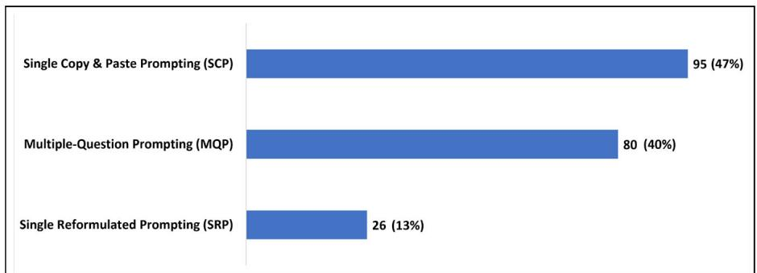
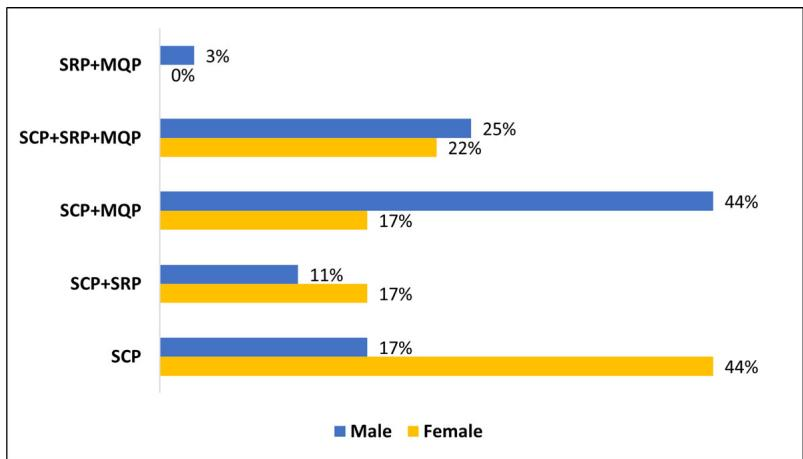
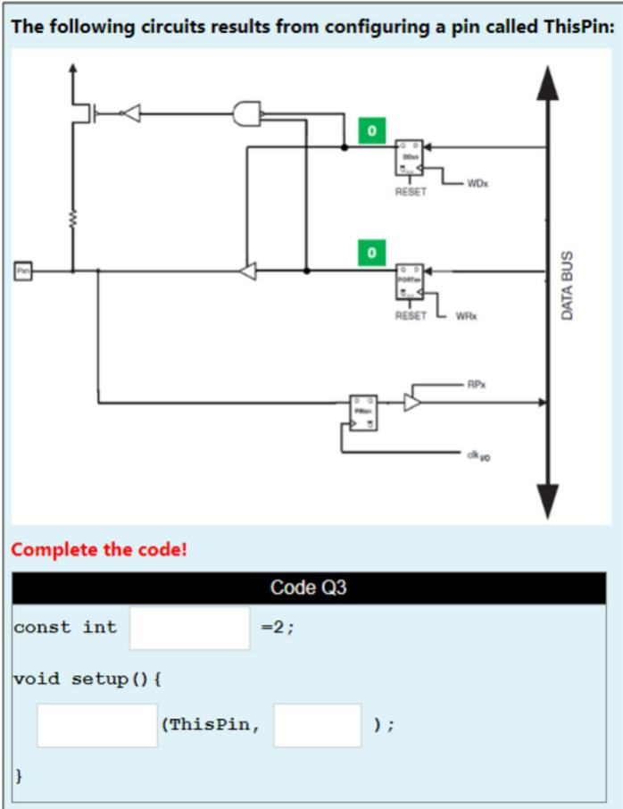
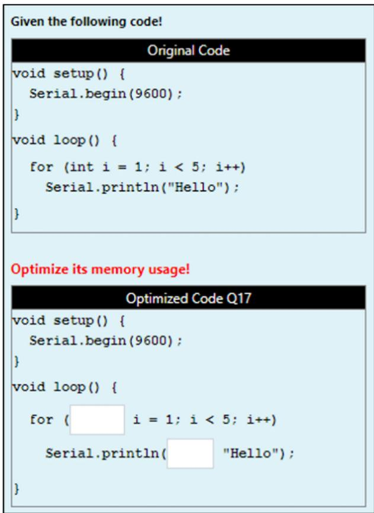
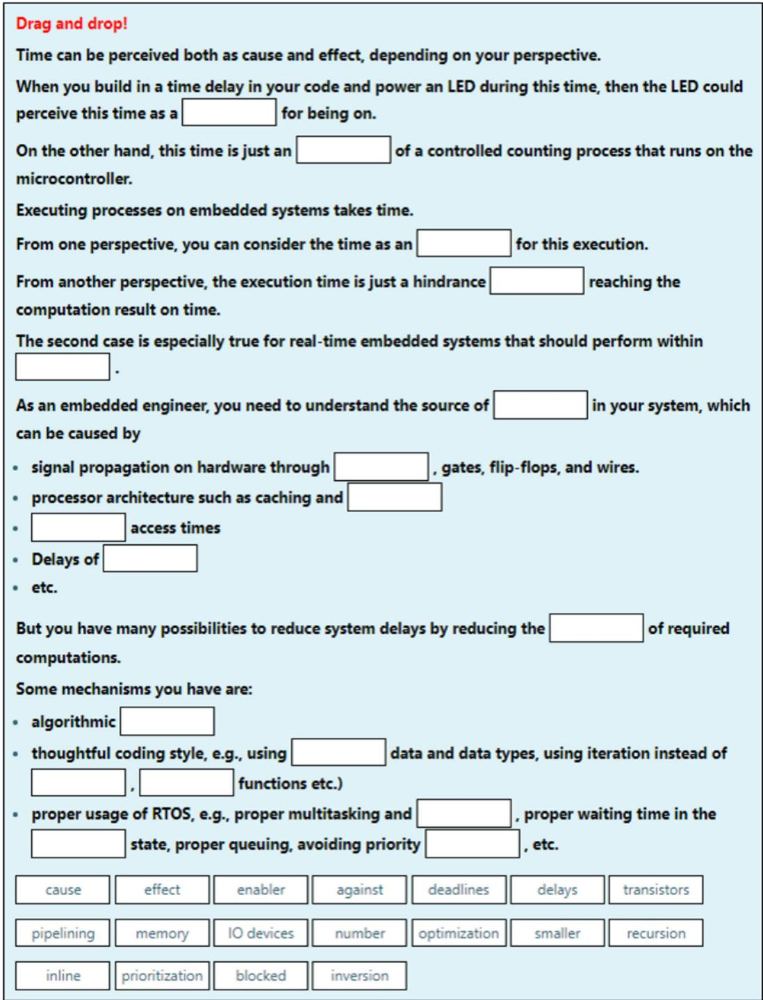
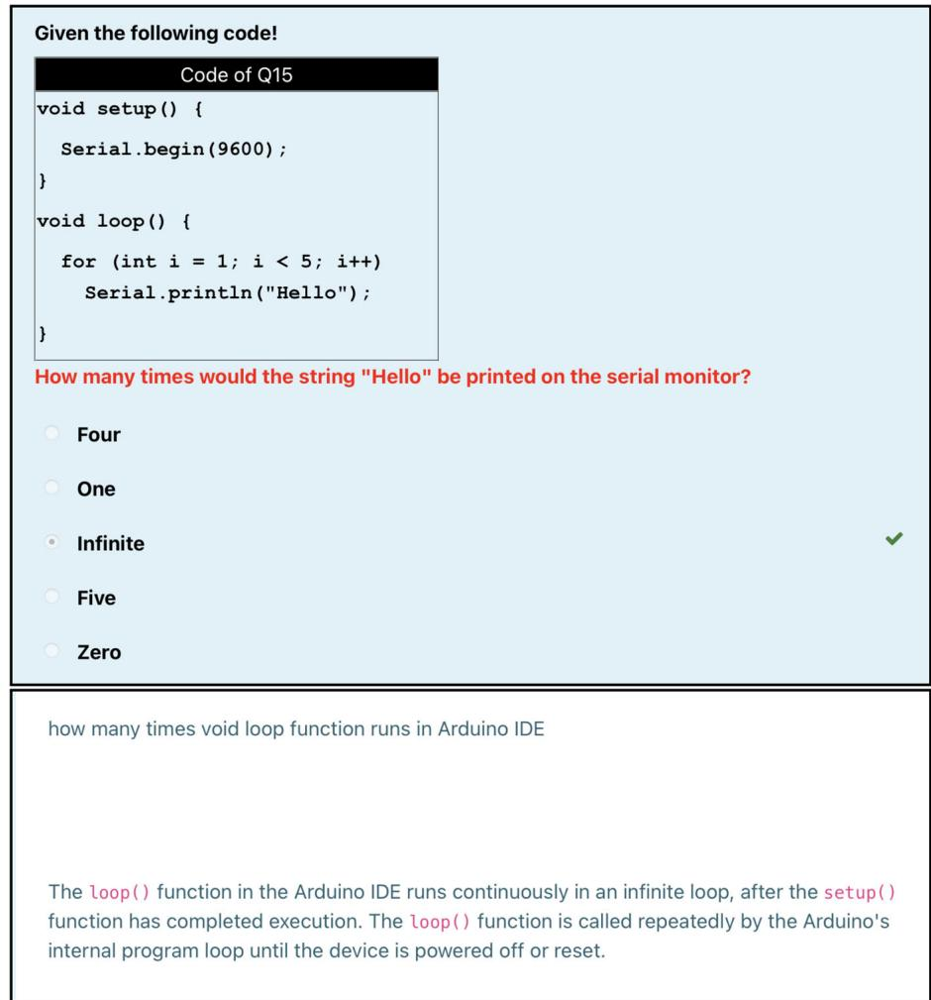
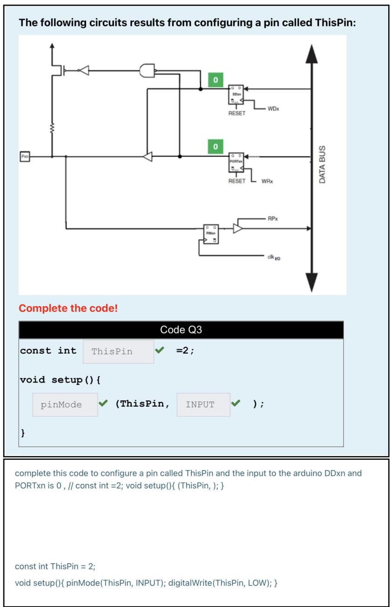

# Analyzing student prompts and their effect on ChatGPT’s performance

Ghadeer Sawalha, Imran Taj & Abdulhadi Shoufan

To cite this article: Ghadeer Sawalha, Imran Taj & Abdulhadi Shoufan (2024) Analyzing student prompts and their effect on ChatGPT’s performance, Cogent Education, 11:1, 2397200, DOI: 10.1080/2331186X.2024.2397200

To link to this article: https://doi.org/10.1080/2331186X.2024.2397200

© 2024 The Author(s). Published by Informa UK Limited, trading as Taylor & Francis Group

View supplementary material

Published online: 09 Sep 2024.

Submit your article to this journal

Article views: 10476

View related articles

View Crossmark data

Citing articles: 54 View citing articles

HIGHER EDUCATION | RESEARCH ARTICLE

OPEN ACCESS

Check for updates

# Analyzing student prompts and their effect on ChatGPT’s performance

Ghadeer Sawalhaa, Imran Tajb and Abdulhadi Shoufana

aDepartment of Computer and Communication Engineering, Center for Cyber Physical Systems, Khalifa University, Abu Dhabi, United Arab Emirates; bCollege of Interdisciplinary Studies, Zayed University, Abu Dhabi, United Arab Emirates

## ABSTRACT

Large language models present new opportunities for teaching and learning. The response accuracy of these models, however, is believed to depend on the prompt quality which can be a challenge for students. In this study, we aimed to explore how undergraduate students use ChatGPT for problem-solving, what prompting strategies they develop, the link between these strategies and the model’s response accuracy, the existence of individual prompting tendencies, and the impact of gender in this context. Our students used ChatGPT to solve five problems related to embedded systems and provided the solutions and the conversations with this model. We analyzed the conversations thematically to identify prompting strategies and applied different quantitative analyses to establish relationships between these strategies and the response accuracy and other factors. The findings indicate that students predominantly employ three types of prompting strategies: single copy-and-paste prompting (SCP), single reformulated prompting (SRP), and multiple-question prompting (MQP). ChatGPT’s response accuracy using SRP and MQP was significantly higher than using SCP, with effect sizes of -0.94 and -0.69, respectively. The student-by-student analysis revealed some tendencies. For example, 26 percent of the students consistently copied and pasted the questions into ChatGPT without any modification. Students who used MQP showed better performance in the final exam than those who did not use this prompting strategy. As for gender, female students tended to make extensive use of SCP, whereas male students tended to mix SCP and MQP. We conclude that students develop different prompting strategies that lead to different response qualities and learning. More research is needed to deepen our understanding and inform effective educational practices in the AI era.

ARTICLE HISTORY

Received 2 July 2024

Revised 19 August 2024

Accepted 20 August 2024

KEYWORDS ChatGPT; prompt engineering; response accuracy; gender factor

SUBJECTS

Statistics & Probability; Artificial Intelligence; Computer Engineering; Information & Communication Technology (ICT)

## 1. Introduction

Education 5.0 - an important element of the fifth industrial revolution (Taj & Jhanjhi, 2022) - holds the promise to elevate the overall learning experience by leveraging modern technology tools. It builds on the digital processes realized during Education 4.0. Large Language Models (LLMs) are seen as major milestones in achieving Education 5.0 (Ahmad et al., 2023), by providing personalized learning experiences that adapt to the needs of individual students. This level of customized education is un-paralleled by any previous technology or system. However, the lack of AI literacy is a major gap in fully realizing Education 5.0. The skill of acquiring AI literacy is gaining significant attention among students and instructors, as it is positively associated with LLMs output quality (Knoth et al., 2024). Prompt Engineering - an important AI literacy aspect - entails developing and improving inputs for LLMs, and quantitative analysis of multiple prompt strategies remains an under-studied area. According to Oppenlaender et al. (Oppenlaenderand et al., 2023) such quantitative analysis is needed as it would enhance students’ AI literacy, helping them use LLMs like ChatGPT more efficiently. Students use LLMs, such as ChatGPT, to seek help in their respective learning areas; essay composition (Bernabei et al., 2023), scenario writing (Bai et al., 2024), code generation (Chen et al., 2021), effective translations (Bernabei et al., 2023; Stojanov et al., 2024), summarizations of complex text (Bernabei et al., 2023; Kasneci et al., 2023), and obtaining comprehensive feedback on their work (Kasneci et al., 2023; Qadir, 2023; Stojanov et al., 2024; Tossell et al., 2024). Engineering and computing education (Denny et al., 2023a; Neumann et al., 2023; Qadir, 2023) has attracted immense interest as well. However, the acceptance of LLMs in education - particularly in Engineering and computation - will depend on their accuracy and response correctness (Meyer et al., 2023), which in turn relies on the quality of the prompt (Knoth et al., 2024; Stojanov et al., 2024; Wang et al., 2024; White et al., 2023), which is not mere a question and comprises of several elements (Giray, 2023; White et al., 2023). Giray et al. (Giray, 2023) defined prompt as a specific query, comprising of Instruction, Context, Input data, and Outout indicator. In higher education context, Eager et al. (Eager & Brunton, 2023) recommended six prompt components - Verb, Focus, Context, Focus and Condition, Alignment Constraints, and Limitations - that would guide the LLM to the intended output. Also, previous interactions with the LLM in the same conversation provide a context that affects the LLM response (Dong et al., 2023). This has led to extensive research on what is referred to as prompt engineering (Wang et al., 2024). Prompt engineering aims to identify prompting patterns and best practices that help the LLM generate accurate responses (Wang et al., 2024). Knoth et al. (Knoth et al., 2024) stressed the importance of mastering this skill, especially to counteract ChatGPT’s tendency to produce inaccurate or nonsensical outputs also known as hallucinations. They have highlighted that prompt engineering essentially is based on bi-directional human and AI interaction and to improve on the quality of the prompts, the students have to refine them iteratively.

In certain studies (Giray, 2023; White et al., 2023), prompt engineering is viewed as a form of programming and coding patterns capable of helping users in interacting more effectively with the LLM. For example, White et al. (White et al., 2023), assert that prompt patterns are imperative to prompt engineering. They developed a prompt catalog that elicits the most efficient responses from the LLM and demonstrates this by examples like:

‘Prompt: From now on, I would like you to ask me questions to deploy a Python application to AWS. When you have enough information to deploy the application, create a Python script to automate the deployment’ (White et al., 2023).

Schmidt et al. (Schmidt et al., 2023) classify prompting patterns into different categories. For example, the question refinement pattern aims to ensure that the LLM constantly suggests improvements or refinements to the user’s original question. This involves the LLM in prompt engineering, helping users craft more precise queries that lead directly to the desired information. The reflection pattern prompts the LLM to automatically articulate the rationale behind the response so that the user can understand the rationale behind it and debug the prompt, if needed. The CRISPE framework (OpenAI, 2023) for writing prompts - when followed - is shown to lead to detailed and relevant answers in-depth. However, students should not be expected to learn and master the framework to generate the framework-compliant prompts to seek help in answering the questions

Despite the growing body of research on this topic, most related studies relied on LLM prompts by the researchers rather than by students. A few authors looked into how students used language models. Recently, Wang et al. (Wang et al., 2024) showed the relevance of guiding students on prompt engineering for improving the quality of information retrieval towards task completion in a flipped class on computer networks. Denny et al. (Denny et al., 2023b) provided 36 graduate students with a graphical representation of input and output matrices and asked them to prompt ChatGPT to generate Python codes that perform the required matrix conversions. The authors analyzed the conversations returned by 15 students and found out that many students, even those who have been studying programming for a long time, were not necessarily familiar with writing effective prompts. Sheese et al. (Sheese et al., 2024) examined how first-year students used a programming assistance tool that the authors built based on a LLM. They collected and analyzed 2500 queries submitted by students. They found that students mostly used the tool to obtain immediate help with the programming assignments, rather than for conceptual learning. Also, they found that the students often provided minimal information in their prompts. Kazemitabaar et al. (Kazemitabaar et al., 2023) analyzed how 33 novice programmers, aged 10-17, used OpenAI Codex to learn Python independently. They identified four usage methods of this tool: single prompt coding, step-by-step coding, hybrid coding, and manual coding. The authors found a positive trend between using hybrid coding, where learners wrote some of the code themselves and used Codex to generate other parts, and students’ performance in a post-test.

Strategically designed input prompts have the potential to make or break the quality of information that students receive from ChatGPT. Few recent studies, e.g (Wang et al., 2024). investigate the student prompt engineering strategies. Within this context, this research aims to investigate students’ interactions with ChatGPT and how these interactions affect the response quality, by answering the following research questions:

1. RQ1: What strategies do students use while prompting ChatGPT?

2. RQ2: How do students’ prompting strategies affect ChatGPT’s response quality?

3. RQ3: Do students show a tendency towards specific prompting strategies? Is such a tendency related to student’s performance in the course?

4. RQ4: Does gender matter when it comes to prompting ChatGPT?

The rest of the paper is organized as follows: Section 2 describes our methodology to investigate the research questions, Section 3 details and analyzes our results to compare the student prompting strategies. We summarize our findings in Section 4, together with the limitations, and implications of the study.

## 2. Methodology

## 2.1. Context

This study was conducted in the context of an embedded systems course in the computer engineering program at our university. In this course, we adopted an active learning approach where students learn by completing learning quizzes on Moodle, rather than listening to lectures. The questions that the students solved in this study were designed as Moodle quizzes, too. In addition to the solutions to the problems, the students were asked to insert their conversations with ChatGPT in extra essay questions. The current study builds on our previous study, in which we analyzed the impact of the question type on ChatGPT performance.

## 2.2. Participants

56 senior students (33% females), who were enrolled in the course, participated in this study. However, two students did not provide any conversations with ChatGPT. The authors obtained an ethical exemption to conduct the study from the university’s Research Ethics Committee.

## 2.3. Questions

In our prior study, our students responded to a total of 20 questions over four sessions. Through analysis, we identified three categories of questions regarding the accuracy of ChatGPT’s responses: those consistently answered correctly, those consistently answered incorrectly, and those with varying correctness rates. For the current study, which seeks to comprehend the prompt’s influence on ChatGPT’s performance, we focused solely on the questions falling into the latter category. Table 1 summarizes the five questions belonging to this category.

Table 1. Summary of questions used in the study.
<table><tr><td>No</td><td>Question Type</td><td>Question Content</td></tr><tr><td>1</td><td>Code completion</td><td>Understand a configured I/O circuitry and complete a code accordingly!</td></tr><tr><td>2</td><td>Code analysis</td><td>Understand the concept of the super loop!</td></tr><tr><td>3</td><td>Code completion</td><td>Read a user entry x and calculate the factorials of all numbers from 1 to x!</td></tr><tr><td>4</td><td>Code completion</td><td>Optimize memory usage!</td></tr><tr><td>5</td><td>Drag and drop to text</td><td>Understand the concepts of time, real-time, execution time, scheduling, deadlines, etc.</td></tr></table>

## 2.4. Data analyses

The 54 students contributed partial or complete copies of their interactions with ChatGPT. This yielded 201 conversations containing 201,907 words. To address our first research question (RQ1), thematic analysis, employing multiple-round coding and theme-building techniques, was conducted to extract prompting patterns or strategies. The frequency of these identified strategies was then examined. For RQ2, we evaluated the impact of various prompting strategies on ChatGPT’s response quality using basic summary statistics. Furthermore, we compared the prompting strategies using three t-tests and Cohen’s d effect size. To answer RQ3, we clustered students based on their utilization of different prompting strategies and reported the average final exam grades for each cluster. Additionally, a t-test was conducted to explore whether high-achieving students favored specific prompting methods. Finally, RQ4 was addressed through frequency analysis.

## 3. Results

## 3.1. RQ1: what strategies do students use while prompting ChatGPT?

The qualitative analysis of students’ prompts yielded three types of prompting strategies:

1. Single Copy & Paste Prompting (SCP): This occurs when a student copies a question from the problem statement and pastes it into the ChatGPT prompting field without any change. The student adopts the answer generated by ChatGPT and enters it into the Moodle quiz without any further action.

2. Single Reformulated Prompting (SRP): This occurs when a student asks ChatGPT a single question, either fully or partially in their own words. The student adopts the answer generated by ChatGPT and enters it into the Moodle quiz without any further action. Five strategies were identified in this category, as summarized in Table 2.

3. Multiple-Question Prompting (MQP): This occurs when a student asks ChatGPT at least two questions before adopting an answer. Ten strategies were identified in this category, as summarized in Table 3.

Figure 1 shows the frequency of using these strategies by the students. Accordingly, in almost 47% of all cases, the students just copied the question from the problem statement and pasted it into the ChatGPT prompt field. In 13% of the cases, the students reformulated a single prompt. In the remaining 40% of the cases, the students used multiple-question prompting strategies.

## 3.2. RQ2: how do students’ prompting strategies affect ChatGPT’s response quality?

Table 4 summarizes the mean and standard deviation of the marks obtained using the three prompting strategies for all questions and students. Accordingly, ChatGPT provided the best answers when students reformulated the original question in a single prompt. In contrast, copying and pasting the question led to the worst performance.

Table 2. Single reformulated prompting strategies.
<table><tr><td>Strategy</td><td>Description</td><td>Frequency</td></tr><tr><td>1. &#x27;Replace keyword!&#x27; instead of &#x27;Complete code!&#x27;</td><td>When the students copied a code with blanks to the chat field, the blanks were replaced with the word &#x27;Answer&#x27;. Many students asked ChatGPT to replace the keyword &#x27;Answer&#x27; with a correct response.</td><td>12</td></tr><tr><td>2. &#x27;Generate code!&#x27; instead of &#x27;Complete code!&#x27;</td><td>Instead of asking ChatGPT to complete a code, some students prompted the model to generate the code from scratch for the given inputs and outputs.</td><td>5</td></tr><tr><td>3. Removing the question</td><td>Some students provided the code snippet without further instructions.</td><td>4</td></tr><tr><td>4. Narrowing the question to the core idea</td><td>Some students identify the core idea or concept in the question, i.e. the super loop, and reformulate the question highlighting this concept.</td><td>3</td></tr><tr><td>5. Expanding the question with more context</td><td>The student provides a comprehensive description detailing relevant contextual elements, such as supplying input values to registers DDxn and PORTxn as depicted in a circuit diagram image.</td><td>2</td></tr></table>

Table 3. Multiple-question prompting strategies.
<table><tr><td>Strategy</td><td>Description</td><td>Frequency</td></tr><tr><td>1. Role-playing</td><td>The student creates a scenario that echoes a human conversation. They first inform ChatGPT that they will present a series of questions. They then break down the problem statement into multiple components and sequentially provide them to ChatGPT, setting the pace and order of the interaction.</td><td>23</td></tr><tr><td>2. Question segmentation</td><td>The student breaks down the question into parts without altering the original content. The student then asks ChatGPT one question part at a time.</td><td>18</td></tr><tr><td>3. Divide and conquer</td><td>The student disassembles the question or the code into smaller clearer units. Each unit is then presented to ChatGPT separately.</td><td>14</td></tr><tr><td>4. Corrective feedback</td><td>The student methodically guides the model toward the intended or correct answer by offering constructive feedback.</td><td>8</td></tr><tr><td>5. Top-down exploration</td><td>Initially, the student engages ChatGPT with a broad topic or concept to establish a fundamental grasp of the topic at hand. As the dialog advances, the student refines the focus and examines more detailed aspects related to the original question.</td><td>5</td></tr><tr><td>6. Guided code generation</td><td>Instead of asking ChatGPT to complete the code, the student prompts ChatGPT to generate code from scratch. Following the initial code generation, the student asks ChatGPT to refine the code by introducing specific requirements or modifications, such as the inclusion of a pointer variable.</td><td>4</td></tr><tr><td>7. Requesting verification</td><td>The student repeatedly and explicitly requests ChatGPT to affirm the provided responses. For example, the student asks questions like &#x27;Are you certain?&#x27; or converts the previous response into a follow-up question.</td><td>3</td></tr><tr><td>8. Key point identification and highlighting</td><td>The student identifies the key point in the problem statement and reformulates the question to make ChatGPT focus on this key point omitting unnecessary details. The student then asks related follow-up questions.</td><td>2</td></tr><tr><td>9. Solution-oriented follow-up queries</td><td>After obtaining the answer, the student asks follow-up questions to get more insights into related aspects, concepts, and alternative methods. For example, the student prompts ChatGPT to explain generated code.</td><td>2</td></tr><tr><td>10. Progressive provision of constraints</td><td>The student starts with an open-ended query, withholding certain constraints such as the word list in a fill-in-the-blanks question. Later, the student adds the previously skipped constraints or provides additional context.</td><td>1</td></tr></table>

Table 5 presents the results of three t-tests comparing the performance for the three prompting strategies. Accordingly, using single reformulated prompts and multi-question prompts significantly outperforms the use of copy & paste prompts, with large and medium effect sizes, respectively. On the other hand, the difference between SRP and MQP is statistically insignificant due to the large p-value.

## 3.3. RQ3: do students show a tendency towards specific prompting strategies? Is such a tendency related to student’s performance in the course?

The participating students showed different behaviors in prompting ChatGPT as summarized in Table 6 that groups students into five clusters. Accordingly, 14 students (26%) consistently copied and pasted the questions into ChatGPT prompting field without any modification. 13 students (24%) tried the three prompting strategies while solving the problems. The largest cluster C3 includes 19 students (35%) who used SCP and MQP. Interestingly, this group showed the highest average grade in the final exam.

Table 7 presents the results of two t-tests that we conducted to compare the performance of two groups of students. Group 1 comprises 33 students who used an MQP strategy at least once, while Group 2 consists of 21 students who did not use any MQP strategy. Since six students dropped the course, leaving ChatGPT data but no final exam grades, we conducted two t-tests: one with and one without data augmentation. Data augmentation involved replacing missing grades with the average grade of the respective group. The results of both tests indicate that the MQP group performed better in the final exam with a medium effect size. However, this difference is statistically significant only in the case of data augmentation (p < 0.05).

  
Figure 1. The relative frequencies of using the different prompting strategies.

Table 4. Mean and standard deviation of marks for all questions and students.
<table><tr><td>Strategy</td><td>Mean Mark</td><td>Mark STD</td></tr><tr><td>SCP</td><td>43.5</td><td>38.8</td></tr><tr><td>SRP</td><td>77.9</td><td>25.4</td></tr><tr><td>MQP</td><td>67.8</td><td>31.6</td></tr></table>

Table 5. Independent t-tests to compare the performance using the three prompting strategies.
<table><tr><td></td><td>t value</td><td>p-value</td><td>Cohen&#x27;s d</td></tr><tr><td>SCP vs. SRP</td><td>5.3</td><td> $1.7 \times 10^{-6}$ </td><td>-0.94</td></tr><tr><td>SCP vs. MQP</td><td>4.3</td><td> $1.1 \times 10^{-5}$ </td><td>-0.68</td></tr><tr><td>SRP vs. MQP</td><td>-1.6</td><td>0.11</td><td>0.33</td></tr></table>

Table 6. Student clusters according to ChatGPT prompting behaviors and the average final exam’s grade per cluster.
<table><tr><td>Cluster</td><td>Prompting behavior</td><td>Number of students</td><td>Average final exam grade</td></tr><tr><td>C1</td><td>SCP</td><td>14</td><td>80</td></tr><tr><td>C2</td><td>SCP + SRP</td><td>7</td><td>74</td></tr><tr><td>C3</td><td>SCP + MQP</td><td>19</td><td>87</td></tr><tr><td>C4</td><td>SCP + SRP + MQP</td><td>13</td><td>84</td></tr><tr><td>C5</td><td>SRP + MQP</td><td>1</td><td>70</td></tr></table>

## 3.4. RQ4: does gender matter when it comes to prompting ChatGPT?

Figure 2 compares the prompting behavior of the female (18) and male (36) students. Accordingly, the majority of females (44%) prompted ChatGPT simply by copying and pasting the questions from the problem statements. In contrast, the majority of the males (44%, too) mixed SCP and MQP prompting strategies.

## 4. Discussion

## 4.1. RQ1: what strategies do students use when prompting ChatGPT?

The qualitative analysis of students’ conversations with ChatGPT revealed their ability to develop various prompting techniques without guidance. This indicates the ease of use of this technology on the one hand and students’ interest in using it on the other. Both aspects were confirmed in numerous studies (Abdaljaleel et al., 2024; Tiwari et al., 2023). The analysis showed a prevalent trend to engage with ChatGPT in a way that mimics human interactions. The findings by Knoth et al. (Knoth et al., 2024) noted similar patterns with students engaging with the model as a human conversational partner. They noted the incorporation of polite and socially established elements such as greetings and instances of warmth and gratitude making the interactions feel more like natural conversations with a human rather than rigid interactions with the model. Remember that role-playing was a dominant strategy when it comes to multiple-question prompting. This indicates that students prefer a conversational style for problemsolving as reported by some authors (Kong et al., 2023; Shao et al., 2023). For example, Denny et al. (Denny et al., 2023a) observed that students frequently greet the LLM and keep trying to explain what they mean step by step, which helps them understand difficult concepts because it feels like they are talking to a person rather than a machine. Other popular strategies by our students were question segmentation and divide-and-conquer that resemble chain-of-thought prompting (Wei et al., 2022). Corrective feedback underscores students’ active role in steering the conversation and points to a high level of engagement and critical analysis (Denny et al., 2023b). Top-down exploration, starting from general concepts and moving to specific details, demonstrates a layered approach to knowledge acquisition, beneficial for grasping complicated topics in a structured manner.

Table 7. Comparing final exam grades of students who used MQP and students who did not.
<table><tr><td></td><td>t value</td><td>p-value</td><td>Cohen&#x27;s d</td></tr><tr><td>Without data augmentation</td><td>1.98</td><td>0.06</td><td>-0.66</td></tr><tr><td>With data augmentation</td><td>2.47</td><td>0.02</td><td>-0.77</td></tr></table>

  
Figure 2. Female and male students distribution in the different prompting clusters.

As for single-reformulated prompting, the most used strategy was more or less intuitive: Since the operating system replaced the blanks in the copied and pasted code with the word Answer, many students asked the model to replace this word with something useful. The other SRP strategies reflect deep engagement with the problem and the model. For instance, asking ChatGPT to generate rather than complete a code shows that the students were ready to compare the generated code with the given code to find the missing parts. It would be interesting to know why students opted for this strategy. Unfortunately, however, we do not have data to answer this question. One potential explanation might be that students believed creating code from the beginning is simpler for ChatGPT compared to completing a code with blanks. Another explanation could be convenience, as students may want to avoid copying and pasting a given code. More research is needed to understand this aspect. Another interesting SRP strategy was copying the code to the chat field without asking any questions. The removal of the question essentially presents as an explicit constraint, a technique for effective prompt engineering according to the recommendations by Ekin (Ekin, 2023).

## 4.2. RQ2: how do student prompting strategies affect ChatGPT response quality?

The findings indicated that ChatGPT responses were more accurate when prompted using SRP strategies compared to SCP or MQP. One possible explanation for this trend is that students who utilized SRP likely invested additional effort in understanding and refining the problem, as demonstrated in Table 2. In contrast to MQP, SRP offers a concise and focused prompt, which may enhance the model’s performance. This observation aligns with existing research, such as (Chen et al., 2023; Lo, 2023), which underscores the efficacy of concise prompts for optimizing the performance of large language models.

## 4.3. RQ3: do students show a tendency toward specific prompting strategies? Is such a tendency related to the student’s performance in the course?

The individual analysis of student behavior revealed that approximately 26% of students consistently relied on simple copy-and-paste prompts to solve problems, suggesting a lower level of engagement with the model. One possible explanation for this behavior could be a lack of motivation to seek correct solutions, particularly since these students received no feedback from us or Moodle regarding their entered answers. Alternatively, students’ low interest in the subject of embedded systems, which is a compulsory course for all computer engineering students, may have contributed to their minimal engagement. This hypothesis gains support from the t-test that compares students’ final exam performance: those who utilized more advanced prompting methods tended to perform better. However, we would avoid assuming that the students, who used SCP only, had low interest in ChatGPT, considering the numerous studies that show students’ interest in this language model (Adeshola & Adepoju, 2023; Shoufan, 2023). The remaining students predominantly employed advanced prompting techniques such as SRP and MQP, indicating a higher level of engagement with the model. Their interaction with ChatGPT can likely be attributed to perceived ease of use and usefulness, as supported by several studies on technology acceptance models (Ma & Huo, 2023; Saif et al., 2024).

## 4.4. RQ4: does gender matter when it comes to prompting ChatGPT?

The results highlight differences in prompting strategies between female and male students. While female students often relied on single copy & paste prompts, males more frequently utilized multiplequestion prompts. This discrepancy suggests a higher level of engagement with ChatGPT among males. This finding aligns with Draxler et al.’s observation of a ‘gender gap’, where females are less inclined to use LLMs (Draxler et al., 2023). Similarly, Strzelecki’s research (Strzelecki, 2023) indicates that individual differences, including gender, moderate the acceptance of ChatGPT according to the Unified Theory of Acceptance and Use of Technology (UTAUT). Conversely, Alneyadi and Wardat (Alneyadi & Wardat, 2023) found that females tend to use ChatGPT more frequently and for longer durations, while males reported sporadic usage for shorter periods. However, both genders expressed similar perceptions regarding the usefulness, impact on performance, and comfort while using LLMs (Alneyadi & Wardat, 2023). These partially contradictory findings underscore the need for further research to comprehensively understand the role of gender in the acceptance and usage of large language models.

## 5. Implications, limitations, and conclusion

This study has several implications. First, it suggests that students naturally develop effective prompting strategies when interacting with large language models, even without explicit instruction. This implies that educators should provide guidance on effective prompting techniques, while also recognizing and learning from students’ creative approaches. The study also highlights that large language models like ChatGPT are not meant to replace human intelligence but rather to complement and extend it. This is supported by the observation that simple copy-and-paste prompting was the least effective strategy while concisely formulated prompts led to the best results. The study also highlights that there is a need for further research to explore how individual differences and demographic factors influence students’ interactions with large language models. This implies a deeper understanding of the diverse ways in which students engage with and benefit from such technology.

The study has several limitations that can be addressed in future and replicated studies. First, the data are limited to a specific version of ChatGPT. Given the rapid evolution of this technology, some findings may be affected by new versions of this model or while using other language models. Another limitation is that the results can be specific to the domain of computer engineering and embedded systems. Caution should be exercised in generalizing these findings to other fields or disciplines. Additionally, although the participant pool was sufficiently large to draw certain statistically significant conclusions, the clustering of only 54 students based on their prompting behaviors necessitates cautious interpretation.

In conclusion, gaining insights into how students engage with AI-powered tools is crucial for shaping the future of education. This study has provided initial insights into students’ prompting strategies and their impact on the responses of large language models. Further research is needed to deepen our understanding and inform effective educational practices.

## Disclosure statement

No potential conflict of interest was reported by the author(s).

## Funding

This work was supported by the Zayed University Research Grant # R23082.

## About the authors

Ghadeer Sawalha received her Bachelors degree in Computer Engineering from Khalifa University in 2024. Her research interests include computational pathology and exploring the application of large-language models (LLMs) in engineering education. She is committed to advancing the intersection of technology and education, aiming to optimize the capabilities of AI and machine learning to enhance learning experiences and outcomes in the field of engineering.

Imran Taj is currently an Assistant Professor at Zayed University. Prior to that he was a Senior Team Lead, Information Systems Branch with BC Public Service, Canada, where he led the digital transformation and automation of an enterprise software application using Artificial Intelligence techniques and Robotic Process Automation tools. He received his Ph.D. degree in computer engineering from University of Paris-Est, France. He has several years of professional experience of applying machine learning operations to craft real world data solutions and has been involved in all phases of Software Development Life Cycle - from inception to implementation - for several systems engineering projects in the fields of Artificial Intelligence, Machine Learning and Data Sciences.

Abdulhadi Shoufan (Member, IEEE) received the Dr.-Ing. degree from Technische University Darmstadt, Germany, in 2007. He is currently an Associate Professor of electrical engineering and computer science with Khalifa University, Abu Dhabi. His research interests include drone security, safe operation, embedded security, cryptography hardware, learning analytics, and engineering education.

## References

Abdaljaleel, M., Barakat, M., Alsanafi, M., Salim, N. A., Abazid, H., Malaeb, D., Mohammed, A. H., Hassan, B. A. R., Wayyes, A. M., Farhan, S. S., Khatib, S. E., Rahal, M., Sahban, A., Abdelaziz, D. H., Mansour, N. O., AlZayer, R., Khalil, R., Fekih-Romdhane, F., Hallit, R., Hallit, S., & Sallam, M. (2024). A multinational study on the factors influencing university students’ attitudes and usage of ChatGPT. Scientific Reports, 14(1), 1983. https://doi.org/10.1038/s41598-024-52549-8

Adeshola, I., & Adepoju, A. P. (2023). The opportunities and challenges of ChatGPT in education. Interactive Learning Environments, 1(1–14). https://doi.org/10.1080/10494820.2023.2253858

Ahmad, S., Umirzakova, S., Mujtaba, G., Amin, M., & Whangbo, T. (2023). Education 5.0: Requirements, enabling technologies, and future directions, arXix preprint arXix: 2307.15846.

Alneyadi, S., & Wardat, Y. (2023). ChatGPT: Revolutionizing student achievement in the electronic magnetism unit for eleventh-grade students in emirates schools. Contemporary Educational Technology, 15(4), ep448. https://doi.org/10.30935/cedtech/13417

Bai, S., Gonda, D. E., & Hew, K. F. (2024). Write-curate-verify: A case study of leveraging generative ai for scenario writing in scenario-based learning. IEEE Transactions on Learning Technologies, 17, 1313–1324. https://doi.org/10.1109/TLT.2024.3378306

Bernabei, M., Colabianchi, S., Falegnami, A., & Costantino, F. (2023). Students’ use of large language models in engineering education: A case study on technology acceptance, perceptions, efficacy, and detection chances. Computers and Education: Artificial Intelligence, 5, 100172. https://doi.org/10.1016/j.caeai.2023.100172

Chen, L., Ding, X., Emani, M., Vanderbruggen, T., Lin, P.-H., & Liao, C. (2023) Data race detection using large language models [Paper presentation]. Proceedings of the SC ’23 Workshops of The International Conference on High Performance Computing, Network, Storage, and Analysis, SC-W 2023, ACM. https://doi.org/10.1145/3624062.3624088

Chen, M., Tworek, J., & Jun, H. (2021). Evaluating large language models trained on code arXiv: 2107.03374.

Denny, P., Leinonen, J., & Prather, J. (2023a). Promptly: Using prompt problems to teach learners how to effectively utilize ai code generators, arXiv preprint arXiv:2307.16364

Denny, P., Leinonen, J., Prather, J., Luxton-Reilly, A., Amarouche, T., Becker, B., & Reeves, B. (2023b). Promptly: Using prompt problems to teach learners how to effectively utilize ai code generators (07). https://doi.org/10.48550/arXiv.2307.16364

Dong, Q., Li, L., Dai, D., Zheng, C., Wu, Z., Chang, B., Sun, X., Xu, J., Li, L., & Sui, Z. (2023). A survey on in-context learning arXiv:2301.00234.

Draxler, F., Buschek, D., Tavast, M., Hämäläinen, P., Schmidt, A., Kulshrestha, J., & Welsch, R. (2023). Gender, age, and technology education influence the adoption and appropriation of llms, arXiv preprint arXiv:2310.06556.

Eager, B., & Brunton, R. (2023). Prompting higher education towards ai-augmented teaching and learning practice. Journal of University Teaching & Learning Practice, 20(5), 02.

Ekin, S. (2023). Prompt engineering for ChatGPT: A quick guide to techniques, tips, and best practices. https://doi.org/10.36227/techrxiv.22683919.v2

Giray, L. (2023). Prompt engineering with ChatGPT: A guide for academic writers. Annals of Biomedical Engineering, 51(12), 2629–2633. https://doi.org/10.1007/s10439-023-03272-4

Kasneci, E., Sessler, K., Küchemann, S., Bannert, M., Dementieva, D., Fischer, F., Gasser, U., Groh, G., Günnemann, S., Hüllermeier, E., Krusche, S., Kutyniok, G., Michaeli, T., Nerdel, C., Pfeffer, J., Poquet, O., Sailer, M., Schmidt, A., Seidel, T., … Kasneci, G. (2023). ChatGPT for good? on opportunities and challenges of large language models for education. Learning and Individual Differences, 103, 102274. https://doi.org/10.1016/j.lindif.2023.102274

Kazemitabaar, M., Hou, X., Henley, A., Ericson, B. J., Weintrop, D., & Grossman, T. (2023). How novices use llm-based code generators to solve cs1 coding tasks in a self-paced learning environment [Paper presentation]. Proceedings of the 23rd Koli Calling International Conference on Computing Education Research, in:, pp. 1–12. https://doi.org/10.1145/3631802.3631806

Knoth, N., Tolzin, A., Janson, A., & Leimeister, J. M. (2024). Ai literacy and its implications for prompt engineering strategies. Computers and Education: Artificial Intelligence, 6, 100225. https://doi.org/10.1016/j.caeai.2024.100225

Kong, A., Zhao, S., Chen, H., Li, Q., Qin, Y., Sun, R., & Zhou, X. (2023). Better zero-shot reasoning with role-play prompting arXiv:2308.07702.

Lo, L. S. (2023). The clear path: A framework for enhancing information literacy through prompt engineering. The Journal of Academic Librarianship, 49(4), 102720. https://doi.org/10.1016/j.acalib.2023.102720

Ma, X., & Huo, Y. (2023). Are users willing to embrace ChatGPT? Exploring the factors on the acceptance of chatbots from the perspective of aidua framework. Technology in Society, 75, 102362. https://doi.org/10.1016/j.techsoc.2023.102362

Meyer, J. G., Urbanowicz, R. J., Martin, P. C. N., O’Connor, K., Li, R., Peng, P.-C., Bright, T. J., Tatonetti, N., Won, K. J., Gonzalez-Hernandez, G., & Moore, J. H. (2023). ChatGPT and large language models in academia: opportunities and challenges. BioData Mining, 16(1), 20. https://doi.org/10.1186/s13040-023-00339-9

Neumann, M., Rauschenberger, M., & Schön, E.-M. (2023). We need to talk about ChatGPT: The future of ai and higher education [Paper presentation]. 2023 IEEE/ACM 5th International Workshop on Software Engineering Education for the Next Generation (SEENG), pp. 29–32. https://doi.org/10.1109/SEENG59157.2023.00010

OpenAI. (2023). Best practices for prompt engineering with the openai api. https://help.openai.com/en/articles/6654000-best-practices-for-prompt-engineering-with-the-openai-api

Oppenlaenderand, J., Linder, R., & Silvennoinen, J. (2023). Prompting ai art: An investigation into the creative skill of prompt engineering, arXiv preprint arXiv: 2303.13534.

Qadir, J. (2023). Engineering education in the era of ChatGPT: Promise and pitfalls of generative ai for education [Paper presentation]. 2023 IEEE Global Engineering Education Conference (EDUCON), pp. 1–9. https://doi.org/10.1109/EDUCON54358.2023.10125121

Saif, N., Khan, S. U., Shaheen, I., ALotaibi, A., Alnfiai, M. M., & Arif, M. (2024). Chat-gpt; validating technology acceptance model (tam) in education sector via ubiquitous learning mechanism. Computers in Human Behavior, 154, 108097. https://doi.org/10.1016/j.chb.2023.108097

Schmidt, D. C., Spencer-Smith, J., Fu, Q., & White, J. (2023). Cataloging prompt patterns to enhance the discipline of prompt engineering, https://www.dre.vanderbilt.edu/\~schmidt/PDF/ADA\_Europe\_Position\_Paper.pdf

Shao, Y., Li, L., Dai, J., & Qiu, X. (2023). Character-llm: A trainable agent for role-playing arXiv:2310.10158.

Sheese, B., Liffiton, M., Savelka, J., & Denny, P. (2024). Patterns of student help-seeking when using a large language model-powered programming assistant [Paper presentation]. Proceedings of the 26th Australasian Computing Education Conference, pp. 49–57. https://doi.org/10.1145/3636243.3636249

Shoufan, A. (2023). Exploring students’ perceptions of ChatGPT: Thematic analysis and follow-up survey. IEEE Access, 11, 38805–38818. https://doi.org/10.1109/ACCESS.2023.3268224

Stojanov, A., Liu, Q., & Koh, J. H. L. (2024). University students’ self-reported reliance on ChatGPT for learning: A latent profile analysis. Computers and Education: Artificial Intelligence, 6, 100243. https://doi.org/10.1016/j.caeai.2024.100243

Strzelecki, A. (2023). Students’ acceptance of ChatGPT in higher education: An extended unified theory of acceptance and use of technology. Innovative Higher Education, 49, 1–23.

Taj, I., & Jhanjhi, N. (2022). Towards industrial revolution 5.0 and explainable artificial intelligence: Challenges and opportunities. International Journal of Computing and Digital Systems, 12(1), 295–320. https://doi.org/10.12785/ijcds/120128

Tiwari, C. K., Bhat, M. A., Khan, S. T., Subramaniam, R., & Khan, M. A. I. (2023). What drives students toward ChatGPT? An investigation of the factors influencing adoption and usage of ChatGPT. Interactive Technology and Smart Education, 21(3), 333–355. https://doi.org/10.1108/ITSE-04-2023-0061

Tossell, C. C., Tenhundfeld, N. L., Momen, A., Cooley, K., & de Visser, E. J. (2024). Student perceptions of ChatGPT use in a college essay assignment: Implications for learning, grading, and trust in artificial intelligence. IEEE Transactions on Learning Technologies, 17, 1069–1081. https://doi.org/10.1109/TLT.2024.3355015

Wang, M., Wang, M., Xu, X., Yang, L., Cai, D., & Yin, M. (2024). Unleashing ChatGPT’s power: A case study on optimizing information retrieval in flipped classrooms via prompt engineering. IEEE Transactions on Learning Technologies, 17, 629–641. https://doi.org/10.1109/TLT.2023.3324714

Wei, J., Wang, X., & Schuurmans, D. (2022). Chain-of-thought prompting elicits reasoning in large language models. In S. Koyejo, S. Mohamed, A. Agarwal, D. Belgrave, K. Cho, & A. Oh (Eds.), Advances in neural information processing systems (vol. 35). Curran Associates, Inc.

White, J., Fu, Q., Hays, S., Sandborn, M., Olea, C., Gilbert, H., Elnashar, A., Spencer-Smith, J., & Schmidt, D. C. (2023). A prompt pattern catalog to enhance prompt engineering with ChatGPT, arXiv preprint arXiv:2302.11382.

## Appendix A. Problems students solved using ChatGPT

  
Figure A3. Q1 as it appears in the Moodle quiz. Students need to analyze an I/O port configuration and identify how the pin should be configured in the software. The expected answers are ThisPin, pinMode, and INPUT respectively.

Given the following code!   
Code of Q15   
void setup() {   
Serial.begin(9600);   
  
void loop() {   
for (int i = 1; i < 5; i++)   
Serial.println("Hello");   
  
How many times would the string "Hello"   
be printed on the serial monitor?   
Infinite   
Zero   
Four   
One   
Five

Figure A4. Q2 as it appears in the Moodle quiz. The for loop is within the super loop that runs as long as the system is powered. So, the for loop within the super loop will be executed again and again causing ‘Hello’ to be printed infinitely.

Code Q16   
int\* ptr;   
void setup() {   
Serial.begin(9600) ;   
1   
void ]0 {   
if (Serial.available() > 0) {   
x = Serial.parseInt();   
ptr = (int\*) \* sizeof(int));   
for (i = 0; i <= x; ++i) {   
int fact = 1;   
if (i != 0) {   
for (int j = 1; j <= i; j++)   
fact = [   
}   
ptr[i] = fact;   
for (i = 1; i <= x; ++i) {   
Serial.print(i);   
Serial.print("! = ");   
Serial.println(ptr[i]);   
for (i = 1; i <= x; ++i) {   
Serial.print(i + (": ") + ptr[i]);   
(ptr) ;   
一  
Figure A5. Q3 as it appears in the Moodle quiz. The missing words are loop, malloc, fact, j, and free in order.

  
Figure A6. Q4 as it appears in the Moodle quiz. The missing words are byte and F in order.

  
Figure A7. Q5 as it appears in the Moodle quiz. The question is about several concepts related to real-time embedded systems. Note that the drag & drop items are listed without shuffling to help the reader. The students saw these items shuffled.

## Appendix B. Some examples on the noted single reformulated prompting strategies

### Appendix B1. Removing the question strategy example.

  
Figure B8. In this interaction, the student only provided the code to the LLM omitting the question and/or any other context. From the response we can see that not only was the model able to deduce the functionality of the code but also complete the missing blanks.

### Appendix B2. Narrowing the question to the core idea strategy example.

  
Figure B9. In this interaction, the student refrained from asking the original question. They instead noted the dependency on the superloop and how the number of times that this loop executes determines the amount of times the message prints.

### Appendix B3. Expanding the question with more context strategy example.

  
Figure B10. In this interaction, the student worked around ChatGPT’s inability to understand the complex circuitry by offering a really important piece of context, which is the input to registers DDxn and PORTxn. This enabled the model to deduce the functionality of the code and hereby complete the missing parts of the code correctly.

## Appendix C. Some examples on the noted multiple-question prompting strategies

### Appendix C1. Top down exploration strategy example.

## data types and sizes in arduino IDE

The Arduino IDE supports several data types, including:

• int: a 16-bit signed integer, with a range of -32,768 to 32,767.

• unsigned int: a 16-bit unsigned integer, with a range of 0 to 65,535.

• long: a 32-bit signed integer, with a range of -2,147,483,648 to 2,147,483,647

• unsigned long: a 32-bit unsigned integer, with a range of 0 to 4,294,967,295.

• byte: an 8-bit unsigned integer, with a range of 0 to 255.

• char: an 8-bit signed integer, with a range of -128 to 127

• boolean: a true or false value

• float: a 32-bit floating point number.

• double: a 64-bit floating point number.

## The size of these data types in bytes is:

• int: 2 bytes

• boolean: 1 byte

• double: 8 bytes

It's worth noting that the actual size of these data types may vary depending on the specific microcontroller and architecture of the board being used.

## how to reduce the memory usage for a string in arduino IDE

There are several ways to reduce the memory usage for a string in the Arduino IDE:

1. Use the String class instead of the char array. The String class allows you to concatenate strings without creating a new copy each time, which can save memory.

2. Use the reserve() function to pre-allocate memory for the string. This can help prevent memory fragmentation and reduce the amount of memory used by the string

3. Use the trim() function to remove any unnecessary whitespace from the string. This can help reduce the size of the string and save memory.

4. Use the substring() function to extract only the portion of the string that you need. This can help reduce the size of the string and save memory.

5. Use the toInt() or toFloat() function to convert a string to a number. This can save memory compared to using atof() or other string-to-number conversion functions.

6. Avoid using multiple concatenations, instead use the "+=" operator, which can save memory.

7. Use the compact() function of the String class to reduce memory usage.

8. Use the c\_str() function to convert String object to a char\* array, this is useful when you need to pass the string as an argument to a C function which accept char\* as input

It's important to note that these methods might not always lead to a memory reduction, as it depends on the specific case and use of the string

Figure C11. In an attempt to answer Q4 which mainly addresses the topic of code memory optimization. The student did not ask about the code or memory optimization techniques. Instead they asked a broad question about the data types used in arduino IDE as well as their respective sizes. The student then asked about optimizing the memory usage for strings. What is interesting about this approach is the student’s inclination to start with generic questions that are highly relevant to the essence of the query being posed.

### Appendix C2. Corrective feedback strategy example.

void setup() { Serial.begin(9600); } void loop() { for (int i = 1; i < 5; i++) Serial.printIn("Hello"); }   
Can you take this code and optimize it for better memory usage?   
One way to optimize this code for better memory usage would be to remove the for loop and   
only print "Hello" once in the loop() function. Also you can use Serial.print instead of   
Serial.println which will save memory as no new line character is added after sending the data   
over serial.   
Copy code   
void setup() { Serial.begin(9600); } void loop() { Serial.print("Hello"); }   
Another way to optimize memory usage would be to use a variable to hold the string "Hello'   
and print the variable instead of the string itself.   
Copy code   
void setup() { Serial.begin(9600); } void loop() { char hello[] = "Hello"; for (int i = 1; i < 5; i++) <!-- PDF亦模糊 -->
Serial.printIn(hello); }
It's depend on what you're trying to achieve in the code.
void setup() {
Serial.begin(9600);
}
void loop() {
for (int i = 1; i < 5; i++) <!-- PDF亦模糊 -->
Serial.printIn("Hello");
}
Can you take this code and optimize it for better memory usage? by modifying the for loop   
One way to optimize this code for better memory usage is to use a while loop instead of a for   
loop, and have a counter variable that is incremented each time through the loop. This   
eliminates the need to use the "i" variable in the for loop, which saves memory.   
Copy code   
void setup() { Serial.begin(9600); } void loop() { int counter = 0; while(counter < 5) {   
Serial.printIn("Hello"); counter++; }}   
Another way to optimize memory usage would be to use a single variable to keep track of how   
many times "Hello" has been printed, and then use an if statement to check if the desired   
number of prints has been reached before exiting the loop.   
Copy code   
void setup() { Serial.begin(9600); } void loop() { int counter = 0; while(counter < 5) {   
Serial.printIn("Hello"); counter++; if(counter == 5) break; }}   
It's depend on what you're trying to achieve in the code  
Figure C12. In this interaction, the student clearly provides guidance to ChatGPT by asking it to optimize the memory usage of the code by modifying the for loop as opposed to completely removing it. By offering corrective feedback, the student ensures that they guide the model to an answer that fulfills their requirements.

### Appendix C3. Key point identification and highlighting strategy example

Q2: Would changing the data type of i in the original code help?   
A2: Yes, changing the data type of "i" in the original code from "int" to a smaller data   
type such as "byte" can help to optimize memory usage.   
An "int" data type typically uses 2 bytes of memory, while a "byte" data type uses only 1   
byte of memory. Since "i" is only used to iterate through a small range of values (1 to 4)   
in the for loop, using a "byte" data type would be sufficient and would save 1 byte of   
memory.   
Here is the updated code with the "byte" data type:   
void setup() {   
Serial.begin(9600);   
}   
void loop() {   
for (byte i = 1; i < 5; i+ +)  
Figure C13. In an attempt to answer Q4, the student clearly notes that what the question wants is an alternate datatype that would use less memory. Their ability to understand exactly what the question seeks enabled them to pose a highly efficient query leading them directly to the correct answer.