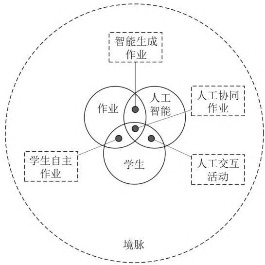
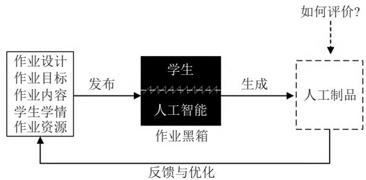

> 来源：MinerU 二次 OCR 精校（2026-08-12）；保留中文正文、英文摘要和参考文献

# 生成式人工智能时代的学生作业设计与评价

李海峰 王　炜

（新疆师范大学 教育科学学院，乌鲁木齐 830017）

[摘要]　以 ChatGPT 为代表的生成式人工智能被学生直接用于生成作业，导致作业的价值和目的化为乌有。如何设计和评价生成式人工智能时代的学生作业，是当前亟需解决的问题。针对这一问题，本文通过分析生成式人工智能的内涵和特征及学生作业的新特点，提出新时代学生作业在类型、时空、监控、目标和方式方面的转变。据此，文章构建了生成式人工智能时代的作业设计模型，阐明了学生、人工智能和作业三者间的关系，呈现了智能生成作业、学生自主作业、人机交互活动以及人机协同作业四个作业设计的关键维度，提出作业评价应充分利用活动驱动型、群体研讨型等表现性作业评价方式，并开展作业真实性算法评估。

[关键词]　生成式人工智能；学习评价；智能聊天机器人；学生作业；人机协同

[中图分类号] G434

[文献标识码] A

[文章编号] 1007−2179（2023）03−0031−09

## 一、生成式人工智能时代学生作业评价困境

ChatGPT（Chat  Generative  Pre-trained  Transfor-mer）是目前最具代表性的生成式人工智能技术，2022 年 11 月 30 日由人工智能实验室 OpenAI 开发完成。ChatGPT不仅能够根据用户需求快速生成故事、诗歌、文章和程序等内容（Mollick，2022），而且能够根据上下文语境与用户进行持续的、“类人”的会话交流。微软联合创始人比尔•盖茨认为，ChatGPT的出现不亚于个人电脑和互联网的诞生（Mollick，2023）。ChatGPT 引入“基于人类反馈的强化学习”技术，解决了内容生成模型的一项核心挑战，即如何让人工智能模型的生成内容与人类的需求、认知、常识和价值观保持一致。ChatGPT为师生会话提供了卓越的类人体验，带来了个性化学习发展的新机遇（Mogali，2023），诸如流畅的互动聊天、持续的逻辑推理、严谨的程序代码编写和高质量的作业生成。

然而，许多学生直接利用 ChatGPT代写作业，最具代表性的案例来自美国北密歇根大学。一名学生利用 ChatGPT生成课程论文，其语言表达、逻辑结构和论证过程获得教师的高度评价，但该生与教师的互动交流暴露了其对论文内容一无所知。ChatGPT代写作业事件迅速引发教师、教育机构和相关部门的担忧。纽约市公立学校开始禁止学生在校内使用ChatGPT生成文本，旨在防止误导学校的教育目的（Querolo，2023）。ChatGPT 还被许多学生用来完成测验、考试和作品创作等作业任务，如课前学习测验、编写程序、绘制图像等。ChatGPT对学生的这种“帮助”同样引发了相关部门和群体的关注、警惕甚至禁止。例如，美国纽约市公立学校师生被禁用 ChatGPT，法国巴黎政治学院禁止学生使用 ChatGPT，国际机器学习会议禁用大规模语言模型生成论文内容，计算机公司禁用 ChatGPT生成或者修改程序代码。

生成式人工智能不会消失，也不可能被禁止，人们需讨论如何使用它赋能学生学习（O'Brien etal.，2023）。利用生成式人工智能直接生成学生作业的潜在风险，引发教育领域研究者的深度思考和激烈争论，焦点之一是生成式人工智能时代如何设计与评价学生作业？本研究围绕学生作业设计与评价这一主题，基于ChatGPT内容生成的群体体验与争论，探索生成式人工智能时代学生作业的设计模式和评价方式。

## 二、生成式人工智能的内涵、特征及作业新特点

## （一）内涵与特征

## 1. 内涵

2022年 9月，《生成式人工智能：一个创造性的新世界》一文的发表，成为内容生成式人工智能（AI-Generated Content， AIGC）的 开 端 （Huang et al.，2022）。内容生成式人工智能是利用机器学习算法，创造新的和原始内容的人工智能类型，是利用人工智能技术自动化创造信息的过程，能够实现令用户满 意 的 个 性 化 需 要（Du et al.， 2023）。 ChatGPT 是当今最具代表性的生成式人工智能，集写作、编写程序和情境聊天等多项内容生成技能。

## 2. 特点

生成式人工智能有五个主要特征：1）生成内容的创造性。ChatGPT开始替代人类的创造性工作，如编写儿童读物、完成学术论文和创作诗歌等；2）生成逻辑的流畅性。ChatGPT使人机对话贴近人类，上下文语境的会话能力可实现人机围绕主题持续探讨；3）生成技能的多样性。生成式人工智能能生成多模态内容，如论文、诗歌、图片和视频等；4）生成思想的道德性。ChatGPT能回答连续性追问、承认自己的错误、质疑不正确的前提、拒绝不适当的请求（OpenAI，2022）；5）生成模型的巨大性。当模型参数超过特定临界值时，生成式人工智能会涌现独特的创造能力（Wei et al.，2022），ChatGPT 大模型的参数达到15亿个。

## （二）作业新特点

## 1. 生成式人工智能是学生作业的代理工厂

鉴于上述特征，大量学生可以利用生成式人工智能直接替代他们完成作业。美国超过 89%的学生曾使用 ChatGPT帮助完成家庭作业，48%的学生承认利用 ChatGPT在家完成测验或问答比赛（Study.com，2023）。ChatGPT 也被用来完成课程论文作业，论文的研究质量、语言表达和论证过程等都得到教师的表扬。

## 2. 生成式人工智能是学生作业的作弊禁区

学生用 ChatGPT完成作业的现象引发了人们的担忧。法国巴黎政治学院禁止使用 ChatGPT，对偷偷使用该技术生成作业的学生给予警告。智能公司的调查结果显示，46%的教师或者学校已禁止使用 ChatGPT（Newswire，2023）。一些中小学教师和学校针对传统作业的内容和形式禁用ChatGPT。英国艾伦（Alleyn）小学要求将“翻转学习”的课前作业类型，从知识型作业转向深度研究型作业，防止学生利用 ChatGPT 生成作业（Nicola，2023）。

## 3. 生成式人工智能是学生作业的智慧伙伴

学生将生成式人工智能看作助手，利用ChatGPT能够快速进入研究状态，开始批判性阅读、思考，生成灵感。譬如，ChatGPT可为低阅读水平学生降低困难，使有学习障碍或者第一语言非英语的学生更容易阅读。哥伦比亚大学瓦苏德万（Vasudevan）希望将聊天机器人看作新的学习机会，就如同利用图形计算器解决计算问题一样，使学生有更多的时间和机会进行探索、创新和发展（Johnson，2023）。

## 4. 生成式人工智能是学生作业偏见的推手

庞杂的、没有甄别和筛选的大数据可能使大模型训练自带“偏见”。微软聊天机器人Tay、Meta公司的 BlenderBot 3 以及 OpenAI 公司的 ChatGPT等，都曾因传播种族主义、反犹主义和欺诈性信息遭到批评。OpenAI公司虽然开发了审核系统，但依然没有充分解决这些问题（Johnson，2022）。此外，学生更易被 ChatGPT类人、流畅和友好的表达所迷惑，降低对偏见信息的批判性分析，导致作业内容可能存在偏见。

## 三、生成式人工智能时代学生作业新转向

与以往作业相比，以 ChatGPT为代表的生成式人工智能时代学生作业出现了新转向，具体体现在作业类型、时空、监控、目标和作业方式上。

## （一）类型转变

生成式人工智能对学生作业的消极影响使许多教师重新设计作业类型。英国伦敦的一位小学英语教师认为，ChatGPT的论文生成功能使论文型作业变得毫无意义，继而提出“家庭作业避风港”（homework haven）模式（Wolfin，2023），即论文和长时间的书面作业转移到课中由教师监督完成，家庭作业转向拓展性、研究性和阅读性类型。英国艾伦（Alleyn）小学发现，学生利用 ChatGPT 能够高质量完成“翻转学习”的课前作业，导致学生难以从深度思考或失败中学到关键的经验教训（Nicola，2023）。因此，课前作业需从传统的知识型作业转向深度研究型作业，旨在为课中的深度讨论和新知识学习做准备。由于 ChatGPT能够快速完成随笔、短文或论文等作业，学校和教师将不再布置这些类型的家庭作业（Richard，2023）。

## （二）时空转变

为了提高学生的作业质量，教师或研究者需反思学生在学校和家里到底需要做什么？研究者（Nicola，2023）建议转移家庭作业的时空。从本质看，家庭作业应该对实践操作有帮助，但如果想了解学生是否掌握某项技能，就必须将课堂作业转移到家中完成。同时，学生利用ChatGPT作弊的作业类型主要是散文、论文或者随笔。因此，罗尼•格莱登（Ronnie Gladden）将这些作业类型的完成地点从家庭转移到学校，由教师监督完成以防止剽窃。克里斯蒂娜•马丁（Kristina Martin）为培养学生的批判性思维、阅读和写作能力，不鼓励学生使用ChatGPT讨论，而要求其线下开展研究、阅读学术期刊和查询在线数据库（Intelligent.com，2023）。

## （三）监控转变

为防止学生利用 ChatGPT进行作业作弊，监控技术开始出现。首先，OpenAI创建了 AI文本分类器，旨在捕捉企图作弊的学生（O'Brien & Gecker，2023）。文本信息越长，此算法侦测越精准。该算法通过标记“不太可能、难以置信或不清楚”等信息，识别文本撰写者是否是人工智能。其次，“水印”模型算法通过在文本生成过程中嵌入所有权标记的方法规避作弊行为。研究者采用具有可解释 p值的水印统计检验方法，推导分析水印灵敏 度 的 信 息 理 论 框 架（Kirchenbauer et al.， 2022）。此外，普林斯顿大学学生开发了一种检测方法GPTZero，利用“剽窃分数”指标和“高亮标记”，为教师提供学生作业是否剽窃及其程度的检测信息（Tian，2023）。

## （四）目标转变

针对生成式人工智能的内容生成特点，学生作业的培养目标出现了新的发展倾向。在“任何内容皆可生成”的生成式人工智能时代，批判性思维、独创性能力和严谨性逻辑思维能力等对学生完成作业而言，比以往任何时候都显得更加可贵和重要。在生成式人工智能技术支持的人机共生时代，作业设计需关注学生的独创性和严谨性，必须将学生的批判性意识和独立思考能力作为作业培养的核心目 标 之 一（Intelligent.com， 2023）。 譬 如 ， ChatGPT生成内容的多模态、真实性和自然性等特征，需要学生具有更强的批判性思维能力，而事实性、记忆性和程序性任务，对提升这些能力没有价值。美国西雅图公立学校要求作业具有原创性，禁止利用ChatGPT 进行学术欺骗（Johnson，2023）。学生利用生成式人工智能完成的作业，是大语言模型根据用户指令给出的既有知识的“似人”回答，容易导致学生丧失独立思考和内容创新能力。因此，生成式人工智能时代作业培养目标需转变。

## （五）方式转变

在生成式人工智能时代，人机共生将是兴起的新的教与学时代（Intelligent.com，2023）。数据显示，一些教师否认 ChatGPT会替代学生的批判性思维、批判性写作或者批判性阅读，反而会促进学生阅读、编辑和思考。生成式人工智能时代的作业方式应是人机协同的融合互补（胡小勇，2023），应充分发挥人工智能内容生成对学生灵感的积极影响，引导学生利用人工智能处理繁杂数据、查询知识和凝练观点。以ChatGPT为代表的生成式人工智能，是基于已有知识、数据、信息“训练”的，生成的内容有似人的自然语言特征。以“知识投喂”的人机问答方式服务学生，将导致人工智能教育应用与培养目标相背离。生成式人工智能时代的作业完成过程是人机协同过程，应充分发挥人与智能机器的共同“智慧”，提高作业质量和学生素养。

## 四、生成式人工智能时代的学生作业设计模式

学生利用 ChatGPT完成作业，教师根据作业给定成绩。这不仅难以实现作业的价值和目的，而且会导致作业消失（Russell，2023）。生成式人工智能技术已经存在，当前的任务是探讨如何在教育中应用（Yorio，2023）。亟需解决的关键问题是，如何利用生成式人工智能，辅助学生高效率、高质量地完成作业，培养学生的核心素养。探讨生成式人工智能时代的人机协同作业模式，是解决当前学生作业问题的核心要义。

生成式人工智能时代的人机协同作业至少涵盖三个关键要素：学生、作业和人工智能（生成式人工智能）。这三个要素相互联系、融合、交织，共同形成生成式人工智能时代的人机协同作业设计模型（见图 1）。三个要素相互交织，形成四个关键维度：智能生成作业、学生自主作业、人机交互活动和人机协同作业。

## （一）人机协同作业的基本要素

## 1. 作业

作业的内涵与外延是人机协同作业设计的关键，决定着人机如何协同高质量地完成何种作业。作业是学生为了达到学习目标，通过完成教师设计的学习任务而开展的学习活动（郭要红，2009）。本质上它是一种学习活动，功能是要学生通过完成既定任务达成学习目标。因此，作业的构成包括学习目标、既定任务和学习活动三个核心要素。学习目标是学生需要达到的学习目的，决定作业的类型。譬如，如果以批判性思维作为学生的能力培养目标，那么作业设计需聚焦如何通过作业培养学生的批判性思维。既定任务是教师根据学习目标、学习内容和学习资源等预先设计的作业任务，根据学情分析和学习活动特征迭代优化设计。学习活动是实现作业目标的根本途径，教师需要根据学习目标、任务类型、学生特征等合理设计作业活动。三者缺一不可，相互作用。

  
图 1    人机协同作业设计模型

## 2. 人工智能

人机协同作业中的人工智能主要指生成式人工智能。生成式人工智能指使用生成式模型和深度学习技术，基于已经存在的文本、图形、音频和视频，大规模生产各种各样内容的智能技术（Jovanovic et al.，2022），目前主要使用四种关键技术：生成式对抗网络（generative adversarial networks）、生成式预训练转换器（generative pre-trained transfor-mer）、生成式扩散模型（the generative diffusion model）和几何深度学习（geometric deep learning）。生成式人工智能被应用于许多领域，如自然语言和音乐、计算机绘图、计算机视觉等。ChatGPT是应用于自然语言领域的典型代表，能够根据用户指令生成系统的、完整的、类人的信息。百度的“文心ERNIE-ViLG”是全球规模最大的中文跨模态绘画生成模型，能根据用户输入的绘画风格、构图特征和绘画流派等指令，生成精美的画作。

## 3. 学生

人机协同作业中的学生是作业任务的责任者、实施者和完成者，学生的个性特征、主体性、信息素养和协作学习能力等，与人机协同作业的效果联系较为紧密。其中，个性特征指学生的兴趣、能力、性格、气质、理想和价值观。学生的主体性体现为人机协同完成作业过程中学生的选择性、独立性、主动性和创造性。其中，学生的信息素养很重要，学生需要判断使用信息的时间，掌握获取信息的方法，评价有效利用信息的知识与能力。人机协同作业的关键是，学生与生成式人工智能之间需要有效的协作才能完成作业。因此，学习者的协作学习能力很重要。

## （二）人机协同作业要素之间的关系

人机协同作业指学生和生成式人工智能通过人机协同完成作业，两者如何协同是作业内容与活动设计的核心议题。学生、作业和人工智能三要素及其相互关系，形成人机协同作业的四个维度，即智能生成作业、学生自主作业、人机交互活动和人机协同作业。人机协同作业要素之间的关系及其形成的四个维度，对于指导人机何时、何处、如何协同设计至关重要。

## 1. 智能生成作业

智能生成作业探讨何时、何处、何种作业适合何种智能技术生成，这主要取决于作业内涵、人工智能和教师机智。作业内涵是智能生成作业的基本前提。教师或学生需要充分理解作业的丰富内涵，才能对智能生成作业作出分析和判断，包括作业内容、类型、布置节点、培养点、时长、批改、评价和辅导等（徐红等，2022）。智能生成作业需要根据这些要素，分析和选择作业内容、作业类型和作业培养点。换句话说，并非所有作业都应由生成式人工智能直接生成，需要考虑作业类型与人工智能功能是否匹配、内容与人工智能生成能力是否匹配、作业布置点是否适合使用生成式人工智能、生成式人工智能的使用目的是否与作业培养点一致。譬如，就作业培养点而言，学生利用生成式人工智能生成作业，能否提高学生的核心素养，是判断智能生成作业价值的关键评价指标。若学生只用生成式人工智能生成作业，那么这种做作业方式可能难以培养学生素养。

## 2. 学生自主作业

学生自主作业主要关注哪些作业类型或内容必须由学生自主完成，而不能由生成式人工智能完成或辅助完成。这需要根据“作业”和“学生”两个要素的交集判断。学生因素涉及个性特征、主体性、信息素养和协作学习能力等，学生的培养目标是决定何种作业必须由学生自主完成的关键因素。与教学目标相关、不能被人工智能直接生成的作业，必须完全由学生亲自完成。培养目标决定了选取何种作业内容、采用何种作业类型以及确定何时完成作业，与培养目标无关的作业内容或类型可利用生成式人工智能直接或辅助完成，使学生能够将更多的时间和精力用于实现教学目标的作业任务。譬如，作业内容是“请你自选课程内容，创造性地设计一节在线课程教案”。根据教学目标可知，这项作业旨在培养学生的创新能力，因此，教案的创新内容必须由学生自己完成，而教案结构、格式和关键要素等，可利用生成式人工智能生成。

## 3. 人机交互活动

学生与生成式人工智能如何进行信息符号互动，是人机交互的关键。人机交互的质量与学生的连续追问能力同生成式人工智能的理解与反馈能力紧密相关；前者决定生成式人工智能能否精准获取学生诉求，后者决定反馈信息的价值程度。人机交互主要涉及三方面内容。首先，指令信息精炼能力，决定了生成式人工智能的信息理解程度与内容生成的精准性。譬如，利用ChatGPT生成一篇描写春天的散文，用户需精细或者持续地添加有关春天的关键词，才能获得比较满意的反馈。其次，信息理解与内容生成能力，主要依靠生成式人工智能的技术功能和智能程度。它决定能否根据学生的作业需要和命令提示，获得令人满意的反馈和生成理想的作业作品。第三，生成内容的评价和分析能力，是学生信息素养、数据素养和核心素养的关键体现。生成式人工智能生成的内容不一定是正确的、公正的和客观的，类人的语言表达可能让学生更容易接受偏见、错误或者不完整的观点和反馈。

## 4. 人机协同作业

人机协同作业主要探讨哪些作业类型和作业内容、由生成式人工智能的何种功能、与何种个性特征与能力的学生协同完成。那么，究竟如何综合考虑学生、人工智能和作业三个要素，确定人机协同作业的设计与活动？这是个典型的劣构性问题。教师和学生需要辩证地分析学生与作业、人工智能与作业、学生与人工智能三对要素之间的关系，最终解析出人机协同才能完成的作业。1）分析学生与作业之间的关系，关键是分析作业的培养目标。2）分析人工智能与作业的关系，即根据作业目标，确定人工智能可以支持哪些目标的实现。3）分析学生与人工智能的关系。教师或学生可以根据自我评价方式，分析人机交互的能力和效果，确定哪些内容可以利用生成式人工智能生成。4）综合三个要素之间的关系，最终确定何种作业适合哪些学生自主完成，何种作业适合何种人工智能完成，哪些作业需要人机交互才能完成。5）通过思考和权衡，确定人机协同的作业内容和方式。

## （三）人机协同作业的境脉支持

未来教育需要聚焦生成式人工智能时代的学生新能力或新素养，强化学生区别于机器的独有智能培养（顾小清等，2022）。境脉支持能有效提升学生的知识、能力与素养。境脉是由一连串情境活动形成的脉络；“境”指事物的物理空间，“脉”指事物发展的历练环境、经历时域和内在经验的诸多若干隐性关联（徐燕萍，2019）。境脉支持下的作业学习活动，强调真实的问题解决、在做事中磨炼自己、跨界学用知识、建立概念与生活的联系。人机协同作业的境脉支持可从三方面着手：

1）从外界为人机协同作业提供境脉支持，如组织学生到实验室、活动室和博物馆等场域现场体验，或根据学生的地域特征和区域资源设计家庭作业；2）利用生成式人工智能为学生提供境脉支持。生成式人工智能具有多模态内容生成功能，教师或者学生可以利用这一特征创造相应的境脉，实现深度的人机协同作业；3）将生成式人工智能与元宇宙相结合，创建生成式人工智能元宇宙。教师可以根据作业内容和作业活动要求，利用生成式人工智能在元宇宙中创造相应的作业境脉（吴砥等，2023）。目前，ChatGPT 已被逐步整合进 Unity 3D 中，可以根据用户指令直接生成 3D资源和场景，师生可利用这一技术实现作业境脉的智能生成。

## 五、生成式人工智能时代的学生作业评价方式

以ChatGPT为代表的生成式人工智能时代已经到来，学生利用其辅助完成作业已无法避免。那么，如何评价生成式人工智能时代学生的作业，是亟需思考的重要问题。本文通过分析生成式人工智能时代学生做作业的基本过程和特点，从“作业黑箱”视角探索学生作业评价的关键环节和应对策略。

## （一）作业黑箱模型

离开教师视线监督的学生作业，可能导致作业评价出现“作业黑箱”现象。所谓“作业黑箱”指学生做作业过程无法得到他者或者设备的监控，只能依靠学生的学术道德进行自我监管，从而形成一个被他者难以监督的“作业黑箱”空间或阶段。不管是以前手写作业时代，还是当今利用生成式人工智能生成作业时代，“作业黑箱”现象都存在，但生成式人工智能使作业作弊变得更廉价、快速和难以甄别。根据生成式人工智能时代学生做作业的基本过程，本研究提出了生成式人工智能时代的学生作业黑箱模型（见图 2）。该模型刻画了学生做作业的三个基本环节（作业设计、作业黑箱和人工制品）及其关系。

  
图2    作业黑箱模型

## 1. 作业设计

作业设计是起始环节，即教师根据学生需求设计作业。作业设计需考虑作业目标、内容、学生学情和作业资源等，使学生通过完成作业达成既定的教学目标。生成式人工智能时代的作业目标不同于以记忆和理解为主的传统作业目标，更倾向于提高学生分析、综合、评价和创造能力，因此作业设计应体现这一目标。作业内容需根据学科性质、培养目标和作业资源可获得性等进行筛选、组织和精炼，不仅要确保作业内容表达精准，也要确保难易程度处于学生最近发展区。作业内容应以非良构问题为主，利用主题单元的内容结构形式组织这些非良构问题，层层深入，逐渐引导学生聚焦核心问题。学生学情分析需要分析学生的个性特征、作业完成能力、知识基础等。作业资源是根据作业目标、内容和学生学情分析的结果，包括教师为学生提供或者学生自己收集的、支持作业完成的各种资源。

## 2. 作业黑箱

作业黑箱是中间环节，连接作业设计和人工制品，需重点探索。作业黑箱不仅能接收教师发布的作业任务，而且生成相应的人工制品这一环节难以被教师观察和监控，因而形成作业监控“盲区”，这为学生的作业作弊提供了可能。生成式人工智能的特征与功能，使学生的作业黑箱变得更加神秘，教师更难辨别作业的真实性和作业的完成主体。作业黑箱主要由作业时空、智能技术和人机协同三个维度构成。

第一，作业时空指学生完成作业的时间和场域，为学生作业作弊提供了时间、空间和机会。学生是作业时空的关键主体或唯一主体，教师在作业时空中的作用显著弱于授课阶段，难以监控学生的作业过程，更难监控学生利用生成式人工智能生成作业的行为。

第二，生成式人工智能技术的“类人”特征，让教师判断作业真假的能力陷入“黑箱”。生成式人工智能具有强多模态内容生成能力，不仅能生成论文、视频和图片等，而且生成的内容真实、自然、流畅和完整。学生可以根据任务要求，直接或者逐步生成完整的作业任务。特别是生成内容的自然性、流畅性和完整性，使教师陷入对作业内容的欣赏和对学生的赞美，丧失对作业作弊可能性的质疑，从而再次形成对作业真伪难辨或者失去判断力的“作业黑箱”。

第三，人机协同使教师陷入另一个“黑箱”，即如何区分学生和人工智能在作业中的贡献。人机协同是学生和人工智能协同完成的，模型中用“波形”代表学生和生成式人工智能协同生成作业，以及他们各自的贡献程度。然而，这就使教师难以识别学生和各自的贡献，特别是作业中创新内容的贡献。这就产生了另一个“作业黑箱”问题，即如何区分和评价学生与生成式人工智能在作业中的贡献。

## 3. 人工制品

人工制品是学生作业的最终产品，包括论文、程序、图画和作文等。作业黑箱难以监控，导致难以确定人工制品的生产者，因此，人工制品在模型中用虚线框表示。人工制品的“人工”或是学生，或是人工智能，或是人机协同。如何评价人工制品是生成式人工智能时代作业评价所面临的重要挑战。譬如，如果学生将ChatGPT生成的论文提交给教师，教师据此评价学生具备的能力或素养。那么，这其中可能存在评价漏洞，即教师没有考虑“作业黑箱”可能导致学生作弊。以提交的作业评价学生，将诱发学生利用生成式人工智能作弊的倾向。教师可以从学生完成作业的过程逆向分析或要求学生通过活动、演示或者讨论等方式，展示作业内容及其对作业的理解，以此分析和评价学生作业是否达到预期目标。

## （二）作业评价策略

由于“作业黑箱”的存在，生成式人工智能时代需要从对结果的评价，转向以表现性评价为主的作业评价方式，诸如表演、行动、操作和展示等。根据生成式人工智能时代的作业特点、转变方向和作业黑箱模型，本研究提出三个针对性的作业评价策略。

## 1. 活动驱动型作业评价

根据布鲁姆的教学目标分类可知，认知领域、情感领域、动作技能领域的教学目标，可通过学习活动达成。为了防止学生直接利用生成式人工智能完成作业，作业评价需转向学生做作业的活动，或者以活动的方式检验作业。作业活动评价需遵循目标原则、过程原则和结果原则，即学生作业活动是为了实现某一既定目标而组织实施的；同时它又是一个完整的活动过程，需通过作业理解、作业分解、搜集资源、整理资料和逻辑分析等过程完成；此外，作业活动必须产出成果（如程序、论文、方案或者作文等），遵循结果原则。教师可通过学生的演讲、表演和讨论等，检验与评价学生作业的真实性和创新程度。

## 2. 群体研讨型作业评价

检验作业是否及多大程度上达成目标，是作业评价的重点。研讨型作业评价方式通过师生和生生群体研讨检验学生作业的真实性和目标的达成度。群体研讨型作业评价遵循三个原则：作业主体研讨内容的深度、群体研讨作业的参与度和作业创新度。1）作业主体研讨内容的深度指作业完成者（学生）能向群体详细介绍作业的完成过程、作业难点、创新点等。学生对具体的、实践性的、具身性的知识或者内容的介绍和探讨，可以反映该生完成作业的真实状况和水平。2）群体研讨作业的参与度指教师与作业完成者（学生）进行深度互动的频次和程度。教师根据群体互动过程及会话内容鉴别完成作业的真实性和水平。3）群体研讨作业的创新度，是鉴别作业完成主体的关键指标。学生介绍作业的创新点或真实情境的问题解决过程，教师由此可以鉴别作业的真实性程度，从而区分作业的主体是学生还是人工智能。

## 3. 作业真实性算法评估

如何鉴别作业的完成者是学生、机器，还是人机共同体，是生成式人工智能时代作业评价的主要挑战。针对这一问题，本研究提出“作业真实性算法评估”的新理念。该评价方法提出的精准度和区分度，为解决生成式人工智能时代的作业评价提供了新的参考。第一，精准度指作业真实性算法能够评价作业的真实程度，精准度越高，评估效果越好。作业真实性算法评估需首先计算总体作业的真实程度，然后逐步精准到具体的作业词句层面，从而识别作业的完成者到底是学生、人工智能，还是二者协同。第二，区分度指作业真实性算法能够解析作业中学生与人工智能完成作业内容的比例，特别是识别创新内容比例与程度。人机协同作业的内容分析可以在人机协同作业过程中嵌入水印标识或作业完成者标记，精准定位、区分和描述内容完成者及其贡献。创新内容比例与程度的识别可以通过与大数据比较和概率统计的方法解决，利用文本分类方法、聚类分析、主题抽取等方法评估它们之间的重复比例，特别是利用观点抽取的相似程度分析，有助于揭示作业的创新内容和程度。

综上，生成式人工智能时代对学生作业设计和评价产生了一定的消极影响，但人机协同作业设计模型将有助于教师提升生成式人工智能时代的作业设计与评价能力。作业黑箱模型的提出，不仅为生成式人工智能时代的教师廓清了作业作弊的关键环节，而且为学生作业评价提供了针对性的评价策略。研究团队将继续探索作业设计与评价的教育实践，规避生成式人工智能教育应用可能产生的各种伦理风险（王佑镁等，2023）。

## [ 参考文献 ]

[1]  Du，H. Y.，Li，Z. H.，Niyato，D.，Kang，J. W.，Xiong，Z. H.，Shen， X. M.，& Kim，D. I. （2023）. Enabling AI-generated content （AIGC） services in wireless edge networks[DB/OL]. [2023-01-09]. https://click.endnote.com/viewer?doi=10.48550/arxiv.2301.03220&route=6.

[2]  顾小清，郝祥军（2022）. 从人工智能重塑的知识观看未来教育 [J]. 教育研究，43 （9）：138-149.

[3]  郭要红（2009）. 有效作业的内涵与设计策略 [J]. 中国教育学刊，194 （6）：62-64.

[4]  Huang，S.，Grady，P.，& GPT-3 （2022）. Generative AI：A creative  new  world[DB/OL].  [2022-09-19]. https://www.sequoiacap.com/article/generative-ai-a-creative-new-world/.

[5]  胡小勇（2023）. ChatGPT 不如“人计”，AI 教育应用需引导[DB/OL]. [2023-02-14]. https://m.sohu.com/a/640373963\_120046696/.

[6]   Intelligent.  com （2023）.  Nearly  1  in  3  college  students  have used  ChatGPT  on  written  assignments[DB/OL].  [2023-01-20]. https:// www.intelligent.com/nearly-1-in-3-college-students-have-used-chatgpton-written-assignments/.

[7]  Johnson，A. （2022）. Here's what to know about OpenAI's Chat-GPT—what it's disrupting and how to use it[DB/OL]. [2022-12-7]. https:// search.ebscohost.com/login.aspx?direct=true&db=buh&AN=160656236& lang=zh-cn&site=ehost-live.

[8]   Johnson， A. （2023）.  ChatGPT  in  schools： Here's  where  it's banned —and  how  it  could  potentially  help  students[DB/OL].  [2023-01- 18]. https://search.ebscohost.com/login.aspx?direct=true&db=buh&AN= 161363470&lang=zh-cn&site=ehost-live.

[9]  Jovanovic，M.，& Campbell，M.（2022）. Generative artificial in-telligence：Trends and prospects[J]. Computer，55（10）：107-112.

[10]   Kirchenbauer， J.， Geiping， J.， Wen， Y.， Katz， J.， Miers， I.， &Goldstein， T. （2022）.  A  watermark  for  large  language  models[DB/OL].[2023-01-19]. https://arxiv.org/pdf/2301.10226v1.pdf.

[11]  Mogali，S. R.（2023）. Initial impressions of ChatGPT for ana-tomy education[J]. Anatomical sciences education，（2）：1-4.

[12]   Mollick， E. （2022）.  ChatGPT  is  a  tipping  point  for AI[DB/OL].  [2022-12-14]. https://search.ebscohost.com/login.aspx?direct=true&db=buh&AN=161096864&lang=zh-cn&site=ehost-live.

[13]   Mollick， E. （2023）.  Bill  Gates  says  A.  I.  like  ChatGPT  is ‘every bit as important as the PC，as the internet’[DB/OL]. [2023-02-03]. https://search.ebscohost.com/login.aspx?direct=true&db=buh&AN=16169 7953&lang=zh-cn&site=ehost-live.

[14]  Newswire，P. R. （2023）. Intelligent. Com survey finds 30 percent  of college  students  use  artificial  intelligence  chatbot， ChatGPT， for written  homework[DB/OL].  [2023-01-31]. https://search.ebscohost.com/ login.aspx?direct=true&db=bwh&AN=202301310900PR.NEWS.USPR. UN00114&lang=zh-cn&site=ehost-live.

[15]   Nicola， W. （2023）.  ChatGPT  could  kill  off  homeworkessays[N]. Times，2023-01-30（01）.

[16]  O'Brien，M.，& Gecker，J. （2023）. ChatGPT just created a new tool to catch students trying to cheat using ChatGPT[DB/OL]. [2023-02- 01]. https://search.ebscohost.com/login.aspx?direct=true&db=buh&AN= 161620448&lang=zh-cn&site=ehost-live.

[17]   OpenAI （2022）.  ChatGPT： Optimizing  language  models  fordialogue[DB/OL]. [2023-02-21]. https://openai.com/blog/chatgpt/.

[18]   Querolo，N. （2023）.  NYC  schools  ban  ChatGPT， citing  fears

about  safety  and  accuracy[DB/OL].  [2023-01-06]. https://search.ebscohost.com/login.aspx?direct=true&db=buh&AN=161182187&lang=zhcn&site=ehost-live.

[19]   Richard， W. （2023）.  Before  robots， my  mate  Stefan  did  myhomework[N]. Times，2023-02-02（01）.

[20]   Russell， R. （2023）.  End  of  homework[N].  Times， 2023-01-31（01）.

[21]   Study.  com （2023）.  Productive  teaching  tool  or  innovative cheating?[DB/OL]. [2023-02-19]. https://study.com/resources/perceptionsof-chatgpt-in-schools.

[22]   Tian， E. （2023）.  Gptzero[DB/OL].  [2023-01-19]. https:// gptzero.me/.

[23]  王佑镁，王旦，梁炜怡，柳晨晨（2023）. ChatGPT 教育应用的伦理风险与规避进路 [J]. 开放教育研究，29 （2）：26-35.

[24]   Wei， J.， Tay， Y.， Bommasani， R.， Raffel， C.， Zoph， B.，

Borgeaud，S.，Yogatama，D.，Bosma，M.，Zhou，D.，Metzler，D.，Chi，E.H.，Hashimoto，T.，Vinyals，O.，Liang，P.，Dean，J.，& Fedus，W. （2022）.Emergent abilities of large language models[DB/OL]. [2023-01-19]. https://arxiv.org/abs/2206.07682.

[25]   Wolfin， B. （2023）.  Homework  haven[N].  Times， 2023-02-01（01）.

[26]  吴砥，李环，陈旭（2023）. 人工智能通用大模型教育应用影响探析 [J]. 开放教育研究，29 （2）：19-25，45.

[27]  徐红，陈敏（2022）. 大单元视域下的作业结构化设计 [J]. 中国教育学刊，43 （11）：104.

[28]  徐燕萍（2019）. 境脉学习：青少年社会实践课程化的逻辑起点 [J]. 教育发展研究，38 （10）：47-51.

[29]  Yorio，K.（2023）. The ChatGPT revolution[J]. School LibraryJournal，69（2）：10-12.

（编辑：赵晓丽）

# Design and Evaluation of Student Assignment in the Era of Generative Artificial Intelligence

LI Haifeng & WANG Wei

（School of Educational Science, Xinjiang Normal University, Urumqi 830017, China）

Abstract: The use of generative artificial intelligence (GAI), represented by ChatGPT, to directly generate assignments by students decrease the value and purpose of assignments. How to design and evaluate student assignments in the era of GAI is an urgent issue. To address the issue, this paper describes the connotation and characteristics of GAI and the new characteristics of student assignment. It also analyzes the changes in assignment types, time and space, assignment objectives, and its monitoring and evaluation to seek for the ways an assignment is used for learning and instruction. Then, the paper proposes an assignment design model in the era of GAI, which illustrates the relationship among students, AI, and assignments with the four key dimensions. This newly constructed assignment design model includes intelligent generated assignments, assignment for student self-regulated learning, human-GAI interacting activity, and human-GAI collaborative assignments. In addition to a full use of performance evaluation to meet assignment evaluation needs, the paper also suggests activity-driven assignment evaluation, the group-based assignment evaluation, and the authenticity evaluation of assignment algorithm to make effective use of GAI for learning through assignment design.

Key  words: generative artificial intelligence； learning evaluation； intelligent chat robot； studentassignments；man-machine cooperation

