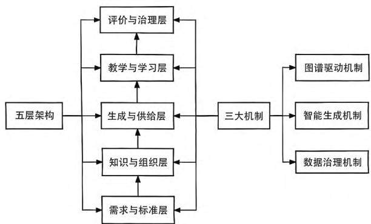

# AIGC驱动下高职图形图像处理课程资源智能化开发体系构建

殷大雷1 张洪梅1 陈 泉2（1.沙洲职业工学院,江苏张家港 215600;2.张家港市龙媒广告策划有限公司,江苏张家港 215600）

摘要：AIGC作为数字经济时代的核心技术引擎，正深刻重塑职业教育课程开发逻辑与教学实施形态，为破解课程资源供给与岗位能力需求不匹配的现实困境提供了革命性路径。文章以高职图形图像处理课程为实践载体，紧扣“岗课赛证”一体化改革要求，构建了“需求牵引—知识组织—资源生成—教学实施—评价治理”全链路智能化开发体系。该体系的核心特征体现为AI全流程融入与“双助手”角色定位：AI既辅助教师高效完成教学资源生成、教学设计优化等工作，又为学生提供个性化导学服务与助学支持；同时明确人机协同边界，强调教师需结合学情主导教学决策，学生以AI为工具强化自主思考与实践能力，避免技术过度依赖。实证研究表明，该体系可显著提升教学资源生产效率、教学内容适配性与学生学习成效，形成了科学可行的高职课程资源智能化开发范式，为职业教育数字化转型提供了具有参考价值的实践案例。

关键词：AIGC；高职教育；图形图像处理；课程资源智能化；人机协同；双助手；教学适配

中图分类号：G712

文献标识码：A

文章编号：1007-5828(2026)04-0147-03

DOI:10.20112/j.cnki.ISSN1007-5828.2026.04.049

在国家教育数字化战略与人工智能技术迅猛发展的双重驱动下，职业教育正在加速从传统“资源导向”向“能力+数据导向”深度转型。教育部2024年3月启动的“人工智能赋能教育行动”，明确提出推动智能技术与教育教学全流程深度融合的发展目标。截至2024年7月，我国完成备案并上线的生成式AI大模型已达190余个，其中行业专用大模型占比达70%[1]，这为职业教育课程资源的智能化开发提供了坚实的政策支撑与技术基础。图形图像处理课程作为艺术设计大类专业的核心课程，其教学质量直接影响学生的职业竞争力与岗位适配能力。然而，传统的课程资源开发与教学实施模式存在显著短板：课程内容与岗位需求脱节、资源开发效率低且适配性不足、教学组织形式固化、评价机制不健全。AIGC技术的核心价值在于能够全流程融入教学各环节并发挥“双助手”作用——对教师而言，它能释放教学创造力；对学生而言，能提升自主学习效率。但需明确的是，AI的本质是教学辅助工具而非替代者：教师应基于学情主导教学决策；学生需强化自主思考与实践能力，杜绝以AI直接生成作品替代学习过程。基于此，本文立足职业教育人才培养规律与行业岗位能力需求，构建以AIGC为驱动的课程资源智能化开发体系，坚守“人机协同、以人为主”的核心原则，以期为高职课程数字化转型与高质量发展提供理论参考与实践范式。

## 一、资源开发与教学实施现状及问题

高职图形图像处理课程在资源开发与教学实施方面存在四大突出问题：一是课程内容与岗位任务关联不足。教学多沿用传统模式，内容以软件操作步骤与孤立知识点罗列为主，缺乏对行业典型工作任务、核心能力要求与最新标准的系统映射，导致学生所学知识、技能与企业实际工作流程及岗位需求脱节，形成“最后一公里”落差。二是资源生产效率与质量不均衡。优质实训案例、个性化课件等资源的开发成本高，且受限于教师精力难以快速迭代；现有资源多为标准化内容，缺乏适配性，难以支撑学生的个性化学习需求。值得关注的是，部分教学实践中已出现“重AI生成、轻人工优化”的倾向，未能结合学情对AI生成资源进行精准调整[2]。三是教学组织与学习方式滞后。传统课堂以教师讲授、学生被动接受为主，互动性弱、即时反馈缺失，难以有效培养学生岗位所需的问题分解、提示工程设计等新型技能[3]。同时，部分学生出现“过度依赖AI”的倾向，忽视自主思考与实践锻炼，导致其技术应用能力与创新思维发展不平衡。四是评价与治理机制不健全。现行评价体系以终结性评价为主，评价维度单一；学习过程数据未有效采集与分析，无法为教学优化提供支撑；缺乏针对AI工具使用的评价引导机制，未能区分“AI辅助创作”与“AI替代创作”，不利于引导学生正确发挥AI工具的价值。上述问题相互交织，共同制约了教学质量的提升。因此，亟须依托AIGC技术重构课程资源开发体系与教学治理机制，强化教师主导地位与学生主体作用，实现课程全方位升级。

## 二、AIGC驱动型课程资源智能化开发体系的总体框架设计

针对高职图形图像处理课程资源开发的现实困境，本文构建了“五层架构+三大机制”的AIGC驱动型课程资源智能化开发体系（见图1）。该体系以岗位能力需求为导向AI全流程融入与人机协同为核心，以数据驱动为支撑，明确AI的“双助手”定位，界定教师主导与学生主体之间的人机协同边界，实现课程资源设计、生成、实施、评价全链路智能化升级。

  
图1 “五层架构+三大机制”的AIGC 驱动型课程资源智能化开发体系图

## （一）五层架构框架

1.学情需求与教学标准层。本层作为体系基础与导向，其核心任务是实现课程目标与岗位需求、学情的双重适配。教师联合行业企业专家，共同梳理岗位典型工作任务、核心能力要求与行业标准，以此构建涵盖知识、技能、素养三维度的课程能力图谱，制定学习标准[4]。在此过程中，AI主要提供行业数据参考与标准匹配建议，教师基于学情分析结果，对图谱与标准进行个性化调整，确保课程资源的精准适配。

2.专业知识与教学组织层。本层以知识图谱技术为核心，对知识点、技能点、工具方法、实践情境等要素进行结构化梳理与关联建模，形成“概念—原理—方法—案例—任务”的知识结构[5]。AI辅助教师完成知识点关联分析、内容筛选与结构化呈现；教师主导模块划分、技能界定与情境设计，并结合教学经验补充隐性知识与行业前沿内容，避免AI生成的知识体系脱离教学实际。

3.AI生成与资源供给层。依托职教专有大模型与多模态工具链，构建智能化资源生成平台。AI作为“教师助手”，可以批量生成教案、课件、实训案例等资源初稿，提供适配方案，减少教师的重复性劳动；核心决策权归教师所有，教师结合学情，对AI生成内容进行人机协同编辑，确保资源精准适配教学需求。对学生而言，AI基于其学习画像提供个性化资源推荐，但所推荐内容均需经教师审核，避免学生接触不适配资源或过度依赖推荐。

4.辅助教学与辅助学习层。本层旨在构建“AI助手+师生主导”的线上线下混合式教学模式。在线上教学中，AI作为“学习助手”，通过学习智能体提供实时答疑、错误诊断、创意启发，坚持“引导而非替代”原则。在线下教学中，教师主导项目研讨、实践指导与价值引导，AI则辅助进行过程数据采集、个性化任务分配与即时反馈。教师基于AI数据洞察学生状态，实施针对性辅导，从而真正实现“人机协同、精准育人”。

5.教学评价与教学管理层。本层旨在构建“AI辅助+人工主导”的全流程评价机制。AI辅助教师完成客观题批改、作品数据统计、学习行为分析等重复性工作，生成初步评价报告；教师主导评价标准制定、主观题评审与能力达成度评估，结合学情修正AI评价结果。评价体系明确纳入“AI工具使用规范”，严格区分“AI辅助创作”与“AI替代创作”，引导学生正确发挥AI的工具价值。基于评价数据，教师可以持续优化课程内容与教学策略，形成“教—学—评—管”闭环管理体系。

## （二）三大机制框架

1.图谱驱动机制。本机制以知识图谱与能力图谱为双轮驱动，建立课程内容与岗位能力的精准映射关系[6]。在这一过程中，教师主导图谱构建与迭代，并结合学情动态调整知识模块与能力要求；AI辅助完成图谱可视化呈现、关联关系分析与数据更新，确保图谱既符合行业标准，又能适配教学实际，为AI“双助手”功能的实现提供了基础框架。

2.智能生成机制。本机制构建了“教师主导+AI协同”的资源生产流水线：AI基于模板库生成资源初稿，通过质量评估器保障基础质量；教师基于学情与教学需求，对资源进行个性化调整与质量把关，明确AI生成内容的修改、补充与舍弃标准，从而杜绝“AI生成即使用”的被动依赖现象[7]。

3.数据管理机制。本机制旨在建立“数据采集—AI分析—教师决策—优化迭代”的闭环流程[8]。AI采集学生学习行为、资源使用、作品成果等多源数据，生成数据报告；教师基于报告洞察学情差异、教学痛点与资源适配问题，主导教学策略调整与资源优化决策，确保数据驱动的精准性与教学决策的主导性。该机制框架强调“AI全流程融入”与“人机协同边界”的辩证统一，在充分发挥AI赋能价值的同时，坚守教育本质，推动课程资源从静态统一供给向动态个性适配转型。

## 三、核心支撑技术与体系推行路径

## （一）核心支撑技术

支撑技术包括三类：一是图谱构建技术，采用“人工标注+机器抽取”模式，由教师主导核心知识界定、能力分解与评价标准制定；AI辅助完成知识抽取、冗余过滤与行业对标分析，通过图谱关联实现教学与岗位能力、学生个性化发展的精准对接；二是以国产基础大模型为依托的技术，教师主导数据并明确教学适配方向，技术团队负责模型微调以支持文生图、图生图、教学设计等核心场景，同时围绕“AI双助手”定位构建涵盖导学、设计评审、教学辅助等功能的“智能体超市”，坚守“辅助而非替代”原则[9]；三是多模态资源生成技术，AI依托大模型与知识图谱自动生成教案、素材、微课等资源并提供适配方案，教师结合学情优化内容，并借助数字人技术生成标准化微课并补充个性化讲解，兼顾资源生产效率与教学针对性。

## （二）体系推行路径

第一，在课程分析与平台部署阶段，教师与行业专家主导岗位需求分析、图谱构建及项目库建设，AI辅助完成数据整理与资源收集，技术团队同步部署模型算力、集成支持人机协同功能的教学平台，并制定AIGC使用规范，明确教师“生成—审核—优化—应用”的操作流程与学生“辅助学习而非替代学习”的使用边界。第二，在资源生成与课堂组织阶段，教师基于图谱与学情，由AI批量生成初稿并经人机协同优化后投入使用，AI同时为学生推荐个性化资源包，经教师审核推送后引导学生自主规划学习。在线上教学中，AI主要引导学生进行自主学习，教师实时监控并对过度依赖AI的学生进行针对性引导；线下教学则由教师主导项目研讨与创意点评，AI辅助过程数据采集与即时反馈，实现精准辅导。第三，在全流程评价与体系迭代阶段，AI在过程性评价中采集学习行为、作品迭代、AI使用情况等多源数据并生成分析报告，教师结合教学观察开展针对性引导；终结性评价采用“AI初评+人工终审+企业评价”模式，重点考查学生创意能力与AI工具使用规范性，教师后续基于评价数据、教学反思与学生反馈主导课程资源与教学策略优化，AI辅助跟踪优化效果，形成闭环迭代机制[10]。

## 四、结论与展望

针对高职图形图像处理课程的教学实际与行业需求，本文构建了AIGC驱动的课程资源智能化开发体系。该体系的创新性在于明确了AI全流程融入的“双助手”定位，坚守“教师主导、学生主体、人机协同”原则。体系以“需求牵引—知识组织—资源生成—教学实施—评价治理”为全链路框架，融合图谱驱动、智能生成、数据治理三大核心机制，实现了AI辅助教学与防止学生过度依赖的平衡。该体系可推动“智课程—智课堂—智评价”一体化落地，形成兼具理论创新性与实践可操作性的职教资源开发范式，为职业教育数字化转型提供了可行解决方案。

未来研究可从三方面深化：一是探索多模态大模型在复杂设计任务中的可解释性与可控性，提升AI辅助的精准度，从而有效支撑个性化教学设计与学生自主创意；二是构建跨院校资源共享与协同开发机制，建立统一的人机协同教学标准，推动优质资源规模化推广与AI工具的规范使用；三是完善AIGC教育应用的伦理评价框架与质量标准，进一步明确AI工具使用边界，推动职业教育实现高质量、可持续发展。

## 参考文献：

[1]杨海乐,危起伟,陈家宽.选择容量价值：一个新的生态系统服务价值指标[J].生态学报,2020,40(10):13.

[2]陈晓锋,赵芳.生成式人工智能赋能高校思政教育：表现,挑战与应对[J].世纪桥,2024(18):93-95.

[3]陈晓珊.人工智能时代教师应如何存在?——基于技术现象学视角的思考[J].开放教育研究,2024,30(1):73-82.

[4]薄璐.高职院校现代产业学院校企合作课程开发模式研究与实践[J].陕西教育:高教版,2022(11):65-67.

[5]刘崇文.产教融合背景下知识图谱技术在教学资源库建设中的应用研究[J].中国多媒体与网络教学学报（中旬刊）,2025(6):25-28.

[6]钱力,谢靖,常志军,等.基于科技大数据的智能知识服务体系研究设计[J].现代图书情报技术,2019,3(01):3-14.

[7]魏海燕.教育信息化背景下数字化学习资源的整合研究[J].学周刊,2024(23):10-12.

[8]顾小清,李世瑾.人工智能教育大脑：以数据驱动教育治理与教学创新的技术框架[J].中国电化教育,2021(01):80-88.

[9]曾荣芳,陈水平.聚焦“生成式课堂”——生成式AI赋能信息技术课堂教学的新思路[J].名师在线（中英文）,2025,11(27):19-21.

[10]饶琬苹.数字科技赋能大学体育高效教学的思考与实践[C]//陕西省体育科学学会,陕西省学生体育协会.第二届陕西省体育科学大会论文摘要集（墙报）.西安：陕西师范大学体育学院,2024:325.

## 课题项目：

本文系2025年江苏省高等教育教改研究课题“AIGC驱动下高职教学资源协同创新实践研究——以图形图像处理课程为例”研究成果，课题编号：2025JGYB565。

## 作者简介：

殷大雷（1977.08— ），男，汉族，籍贯：黑龙江五常，硕士，副教授，研究方向：艺术设计；

张洪梅（1979.05— ），女，汉族，籍贯：黑龙江齐齐哈尔，硕士，教授，研究方向：艺术设计；

陈泉（1976.04— ），男，汉族，籍贯：黑龙江齐齐哈尔，本科学历，高级平面设计师，研究方向：艺术设计。