ARTICLE

# ChatGPT-Assisted Lesson Planning for Children’s STEAM Arts Education: An Experimental Study on Benefits, Challenges, Methods, and a Prompt Framework

Zhihua Luo1 · Rabail Tahir1

Received: 2 March 2025 / Accepted: 3 September 2025 / Published online: 15 October 2025   
© The Author(s) 2025

## Abstract

This study focuses on art-led STEAM education to cultivate ‘21st-century 4C skills’ (communication, collaboration, critical thinking, and creativity). It explores the potential of ChatGPT in enhancing lesson planning within STEAM art education. An experimental study was conducted comparing traditional lesson plans with ChatGPT-assisted plans, involving 13 teachers and 6 professors. A mixed-methods approach was employed: qualitative data (semi-structured interviews, ChatGPT interaction records, etc.) were analyzed thematically, while quantitative data (questionnaire surveys) were examined using descriptive and inferential statistical analyses. Results demonstrate that ChatGPT significantly improved the quality of lesson planning, with ChatGPT-assisted plans achieving an average score of 21.0 compared to 17.0 for traditional plans. In addition, ChatGPT also offers benefits such as enhanced efficiency and supported interdisciplinary and creative approaches. However, challenges remain regarding content personalization, usability, and logical reasoning in image generation. Beyond these findings, the study proposes key methods for AI-assisted lesson planning, highlighting steps in generating lesson plans and searching for multimedia resources. In addition, a prompt framework is also developed to guide the generation process, including structured initial prompts and iterative optimization based on evaluation dimensions. Overall, the results provide both theoretical and practical insights into the application of generative AI in education.

Keywords Generative AI · ChatGPT · STEAM Education · Lesson Plan · Children’s Art Teacher · Prompt Framework

## Introduction

Artificial Intelligence (AI) technology has significantly enhanced various aspects of life, driving social development and leading society into a new era (Qin et al., 2023). The impact of AI on the arts is particularly rapid and evident. Artificial Intelligence Generated Content (AIGC) is infiltrating various artistic fields such as visual arts, design, and 3D models. Traditional art education methods will not be sufficient to meet the demands of the AI-driven art and design market. AI is reshaping how we teach and learn, fostering innovative methods and enhancing learning experiences (Luckin et al., 2016; Holmes et al., 2019). So there is a pressing need to transform and upgrade art education, and educators should cultivate students’ solid understanding of AI concepts and technologies, along with the cultivation of AI literacy, such as creative and critical thinking.

STEM is an educational framework established by American scholars that integrates science, technology, engineering, and mathematics, emphasizing their interconnectedness. The addition of the arts has transformed STEM into STEAM, where the ‘A’ encompasses a diverse range of cultural disciplines, including design, art, and the humanities (Chang and Chou, 2020). STEAM education enables students to explore artistic concepts while connecting them to other disciplines, promoting holistic development. The curricula in STEAM education are often project-based, allowing students to cultivate problem-solving skills through exploration, discussion, collaboration, and the effective use of tools, equipping students to navigate the challenges posed by the rapid advancement of AI technologies confidently. This approach aligns with the core competencies that the education system should prioritize in the age of AI, often referred to as the ‘4Cs of the 21 st Century’: communication, collaboration, critical thinking, and creativity (Thornhill-Miller et al., 2023).

However, Sanz-Camarero et al. (2023) highlighted that despite the expansion and positive outcomes of STEAM education, the quality of arts integration within its curricula varies significantly. Often, the arts are incorporated superficially or overshadowed by other disciplines, resulting in inconsistencies in STEAM education quality across different contexts and countries. To improve this problem, effective pre-teaching preparation, including lesson plans, syllabi, and the organization of instructional content, is a key factor in ensuring course quality and teaching.

AI in education has opened numerous possibilities for lesson planning, activities, evaluation, and feedback. Research has shown that ChatGPT can help create lesson plans, generate educational content, and provide personalized feedback in different educational settings. However, these studies typically do not delve into specific subjects such as arts education but rather focus on general educational support and the development of critical thinking and teaching strategies (Rahman and Watanobe, 2023). Therefore, more targeted research is needed to explore how ChatGPT can be effectively used to specifically enhance lesson planning in arts education.

This study focuses on children’s art education for students aged approximately 6–12 years (K1–K6) at the primary school level. The scope of instruction includes drawing, painting, crafts, simple electronic devices, and STEAM-related creative activities. The research seeks to explore the potential of Gen-AI tools, particularly ChatGPT, in optimizing lesson planning for children’s art educators. Specifically, it examines both the challenges and benefits of teacher–AI collaboration for content generation, with an emphasis on strategies that teachers can employ to enhance the quality of lesson plans. Furthermore, this study introduces an innovative prompt framework designed to support teachers in practice. The following research questions guide the investigation:

● RQ1. What are the challenges and benefits of using ChatGPT in lesson planning for children’s art teachers?

● RQ2. How can teachers use ChatGPT to improve the lesson planning process?

● RQ3. What types of prompts can generate higher-quality lesson plan content when using ChatGPT?

To address these questions, two comparative lesson planning experiments will be conducted. In Experiment 1, children’s art education teachers will be invited to develop lesson plans on the same thematic content using both traditional and ChatGPT-assisted approaches. Each lesson plan will include key components such as instructional objectives, course content, teaching methods, outcome evaluation, and resource materials. ChatGPT’s capabilities in text and image generation will support teachers in enriching and refining these elements. In Experiment 2, experienced professors will evaluate all lesson plans based on a unified assessment rubric consisting of six dimensions.

The rest of the paper is structured as follows: Sect. "Related Work" presents the related work, Sect. 3 describes the methodology outlining the research questions, Sect. 4 highlights results, Sect. 5 presents discussion and design suggestions and finally Sect. 6 concludes the paper.

## Related Work

The rapid evolution of generative AI (Gen AI) technologies has generated significant interest in their applications within education. Artificial Intelligence in Education (AIEd) involves the integration of AI technologies (such as chatbots, automated grading systems, intelligent tutoring systems, and predictive analytics for student performance) to enhance educational quality and efficiency (Chiu et al., 2023). Gen AI tools, utilize sophisticated language models to engage users in human-like interactions, enhancing learning experiences across diverse disciplines (Dwivedi et al., 2023; Kasneci et al., 2023). For instance, ChatGPT has gained significant attention for its advanced writing and comprehension capabilities (Firuz Kamalov et al., 2023). Similarly, Midjourney facilitates the creation of artistic images tailored to user requests, demonstrating the profound impact of AI on contemporary art practices (Chiu, 2023). A systematic review highlights that AI has been deeply embedded across four main areas: teaching, learning, assessment, and management (Chiu et al., 2023). Similarly, a comprehensive overview by Holt (2024) details state-of-the-art generative technologies and their roles in supporting educational practices mainly categorized into teacher practice support, classroom material, evaluation feedback, and student support.

Recent studies have highlighted the transformative potential of generative AI in various educational contexts. Luckin et al. (2016) argue that AI technologies can enhance personalized learning experiences, enabling students to engage more deeply with content. Holmes et al. (2019) emphasize that AI can provide real-time feedback, thereby fostering critical thinking and problem-solving skills. These findings suggest that generative AI can play a pivotal role in optimizing teaching and learning processes across disciplines. Mishra, Henriksen, and Richardson (2023) argue that educators must creatively incorporate AI into their pedagogical practices to remain effective. Holmes et al. (2019) categorize AIEd tools into three overlapping areas: student-focused, teacher-focused, and institution-focused. This paper concentrates on teacher-focused AIEd, as Luckin and Holmes (2016) emphasize its potential to deliver more personalized, flexible, inclusive, and engaging learning experiences.

## STEAM Education

STEAM education extends the STEM framework by incorporating the arts, emphasizing the importance of creativity and interdisciplinary learning to foster critical thinking and adaptability in response to rapid technological advancements (Conradty, Sotiriou & Bogner, 2020; Herro & Quigley, 2016). Voogt & Roblin (2012) emphasize that mastering key 21st-century skills such as collaboration, communication, critical thinking, and creativity is crucial for success in the modern labor market, driving significant shifts in educational curricula. Multiple studies have demonstrated that STEAM education is particularly effective in fostering 4Cs skills (Hadinugrahaningsih et al. 2017).

Although STEAM education has gained attention, research highlights a persistent issue in effectively integrating the arts into curricula. Arts are often either marginalized or treated as secondary to other disciplines like science and technology (Bequette and Bequette, 2012; Land, 2013). Sanz-Camarero et al. (2023) emphasize that the development of arts should not be sidelined, but rather integrated as a core element in STEAM education to promote holistic problem-solving and interdisciplinary learning. Hunter-Doniger’s (2018) two art-oriented STEAM pilot projects, which were highly praised by teachers, parents, and students, offer a compelling example of effective arts integration in STEAM education. These projects combined visual arts, mathematics, and science within a marine-themed framework, where kindergarten students engaged in multidisciplinary learning by exploring the beach as ‘researchers’ and ‘artists’, collecting objects, and creating artworks. Research has consistently shown that students achieve deeper learning when the arts are central to the curriculum (Baxter, 2014; Hetland et al., 2013; Winner & Cooper, 2000).

Additionally, the quality of STEAM curricula fluctuates significantly, and it is difficult to find exemplary STEAM educational resources. Due to a lack of standardized guidelines, varying interpretations of STEAM principles, and unequal implementation across regions (Marín-Marín et al., 2021). Kang (2019) stresses that the success of STEAM education depends heavily on quality lesson planning and teachers’ ability to implement it effectively, which further underscores the need for more robust curricular frameworks. To address this gap, AI can play a critical role in improving lesson planning and ensuring a more meaningful and balanced integration of the arts within STEAM.

Therefore, this study specifically focuses on the arts within the STEAM context, ongoing research is helpful to incorporate the arts alongside other disciplines to achieve genuine interdisciplinary research.

## Lesson Planning and the Role of Generative AI

Instructional design refers to a systematic process of creating well-structured learning materials that incorporate clear objectives, teaching strategies, and methods for feedback and evaluation (Moore & Kearsley, 1996). Henderson and Gornik (2007) emphasize that the quality of lesson plans, teacher proficiency, and the learning environment are interconnected, contributing to effective teaching outcomes. A lesson plan is foundational to the curriculum’s success, as it directly influences students’ engagement and learning experiences. According to Alanazi (2019), effective lesson planning is an art form that reflects the educator’s creativity and instructional vision, underscoring its role in shaping meaningful and engaging learning experiences. Crafting detailed lesson plans allows teachers to align their lessons with specific educational goals, ensuring pedagogical coherence (Craft & Bland, 2004). They not only assist teachers in refining their teaching methods but also serve as valuable resources for new educators.

However, developing high-quality plans demands multidisciplinary knowledge and significant time investment (Falloon et al., 2020). It involves more than simply filling out a template; rather, it requires the thoughtful design of lessons that translate theoretical content into practical application. Huizinga et al. (2014) emphasize that lesson design requires both general design expertise and specific content knowledge, while Quigley et al. (2020) add that teachers must also integrate curriculum coherence into their planning. Research by (Mahasen Sehweil, Mahmoud and Jeidi, 2022) suggests that teachers with formal educational qualifications are more effective in lesson planning and therefore teachers should obtain educational qualification certificates.

Integrating generative AI into lesson planning provides a promising avenue for enhancing the effectiveness of art education. Research has shown that AI can support teachers by streamlining complex planning processes, offering personalized suggestions, and creating diverse creative prompts, thus reducing the time and cognitive load associated with lesson design (Chen, Liao & Yu, 2024). Generative AI tools, like DALL-E and MidJourney, allow educators to experiment with AI-generated content and incorporate it into their curricula, thereby fostering creativity and engagement (Hutson & Cotroneo, 2023). This integration offers teachers the flexibility to create dynamic, student-centered learning experiences while maintaining pedagogical rigor. The use of AI in STEAM education can also address gaps in teacher preparation, as AI can guide educators through the interdisciplinary demands of crafting lessons that bridge technology, art, and creativity (Pavlik & Pavlik, 2024).

Recent research highlights the potential of generative AI tools in lesson planning across various educational contexts. For instance, Kehoe (2023) investigated the use of generative AI in initial teacher education, emphasizing its ability to produce tailored lesson plans efficiently while underscoring that human teachers remain essential for contextualizing AI-generated content with their pedagogical insights. In a similar vein, Moundridou et al. (2024) explored how generative AI can assist educators in developing Inquiry-Based Learning (IBL) lesson plans, categorizing the AI tools based on their application in different phases of the IBL framework. They provide practical examples to showcase the integration of AI in designing effective learning experiences. Furthermore, Boughaddou and Chorfi (2024) focused on teachers' perceptions of AI tools in middle school English lesson planning, revealing that while educators recognize the benefits of AI, there are concerns among inspectors regarding its unregulated use. Adding to this discourse, Acquah et al. (2024) assessed preservice teachers’ intentions to utilize AI in lesson planning through a comprehensive survey, identifying social influence and performance expectancy as significant factors affecting their adoption of AI tools. Their findings suggest that increasing familiarity with AI could positively influence future educators’ integration of technology in their practice. Meanwhile, Zhang et al. (2022) presented the Artificial Intelligence-assisted Effective Art Teaching Framework (AIEATF), which illustrates the successful implementation of AI in art education, indicating that AI can enhance teaching capabilities and student outcomes in creative fields.

However, while these studies demonstrate the utility of AI-generated lesson plans, there remains a notable gap in evaluating human-AI collaboration in this domain. For example, Atchley et al. (2024) explore the broader context of human-AI interactions in higher education but do not specifically compare the effectiveness of lesson plans created solely by human educators versus those developed in collaboration with AI. Kim (2024) discusses teachers' perspectives on optimizing teacher-AI collaboration, but empirical data comparing the quality of lesson plans produced by humans alone versus those co-created with AI is still lacking. Furthermore, Vartiainen and Tedre (2023) examine the use of AI in craft education, yet they also highlight significant concerns such as algorithmic bias and copyright violations, which necessitate further investigation into the collaborative potential of AI and human educators. This absence of empirical research focusing on the comparative effectiveness of lesson planning through human-AI collaboration presents a significant opportunity for future studies. Exploring this gap could help illuminate how AI tools can best support educators, enhancing both teaching practices and student learning outcomes.

## The use of ChatGPT in Educational Research Particularly Lesson Planning

Artificial Intelligence-Generated Content (AIGC) enables users to create content like text, images, and video using AI, tailored to their specific needs (Du et al., 2023; Ming et al., 2022). A key example is ChatGPT, an advanced AI chatbot capable of performing various language tasks, including machine translation, code debugging, and narrative generation. Unlike earlier models, ChatGPT can retain conversational context, enhancing its ability to sustain coherent dialogue and respond effectively to user input (Jiao et al., 2023), significantly enriching educational experiences across various fields (Dwivedi et al., 2023; Kasneci et al., 2023). Firuz Kamalov et al. (2023) emphasized ChatGPT’s growing prominence, particularly for its ability to support complex writing and comprehension tasks, further demonstrating its potential in enhancing instructional content creation.

Asher and Rospigliosi (2023) reviewed the broader educational impacts of ChatGPT, while others have particularly focused on content creation and lesson planning. For instance, Rahman and Watanobe (2023) emphasized ChatGPT’s versatility in generating lesson plans across a range of disciplines such as mathematics, science, and engineering. Furthermore, Adamu and Garba (2024) explored teachers’ use of ChatGPT for lesson planning through mixed-method research, concluding that while ChatGPT offers personalized, time-efficient lesson plans, its impact varies across individual users. However, this study focused solely on educators with prior experience using ChatGPT and did not delve into how the tool performs in specific subject areas or educational contexts.

These studies mainly emphasize content generation rather than comprehensive curriculum design or structured lesson planning that integrates pedagogy and subject coherence. In this context, Karaman (2024) conducted an experimental study to evaluate the effectiveness of ChatGPT-generated lesson plans in improving primary school students’ math achievement, finding a notable but not statistically significant enhancement in academic performance. This suggests that while ChatGPT can produce effective lesson plans, its impact on learning outcomes may require further exploration. Lee and Zhai (2024) further contributed to this discourse by examining lesson plans developed by pre-service elementary teachers integrating ChatGPT into science learning activities. Their analysis revealed diverse applications of ChatGPT across various science domains and highlighted the teachers' high scores on a modified TPACK rubric, although they noted a need for better utilization of ChatGPT's functionalities. Opara et al. (2023) emphasized ChatGPT’s potential to enhance personalized learning experiences but also identified significant challenges, including a lack of citation capabilities. Additionally, Tunç (2024) explored how pre-service mathematics teachers utilized ChatGPT in lesson plan development, finding that while it served as a valuable resource for various aspects of lesson planning, it should complement, rather than replace, the teachers’ expertise.

Collectively, these studies underscore a significant gap in research regarding the comprehensive integration of generative AI tools like ChatGPT in curriculum design, highlighting the necessity for further investigation into best practices that merge pedagogical principles with technology in lesson planning. Similarly, Berg and Plessis (2023) highlighted the potential of generative AI tools like ChatGPT to enrich lesson planning and critical thinking in teacher education. However, they also caution that to realize the full educational benefits, it is essential to critically evaluate the limitations and biases of these tools. This underscores a notable gap in existing research on the integration of generative AI in comprehensive curriculum design, emphasizing the need for further investigation into how these technologies can best support pedagogical practices in lesson planning. Furthermore, while tools like ChatGPT have been praised for their ability to support teaching, such as through personalized feedback (Adamu & Garba, 2024), research focusing on AI’s role in co-creating curriculum frameworks, particularly in collaboration with teachers, remains scarce. Existing studies tend to concentrate on the automated generation of instructional materials (Mishra et al., 2023) rather than addressing how generative AI could augment collaborative lesson planning. This indicates a need for further study into its collaborative use between educators and AI for enhanced lesson quality.

Moreover, some scholars have also raised concerns about potential over-reliance on such tools (Sallam et al., 2023). Despite the rapid growth of ChatGPT, its user base remains concentrated among the 20–35 age group, with limited uptake by older populations and professionals (Ahmed, 2023). Additionally, the effectiveness of ChatGPT’s language processing depends on well-crafted prompts. Poorly constructed prompts can yield vague or irrelevant results, reducing the tool's practical utility and user experience (Ahmed A. 2023). This highlights the need for improved prompt design to enhance applications in education, particularly in curriculum design and lesson planning.

The existing research reveals that as Gen AI tools like ChatGPT gain prominence in education, understanding their role in enhancing lesson planning is crucial (Lee & Zhai, 2024; Berg & Plessis, 2023). While AI can streamline lesson preparation, challenges such as content quality and user engagement remain (Opara et al., 2023; Karaman, 2024). This study will investigate the potential benefits and challenges of using ChatGPT in children’s art education by comparing traditional lesson planning with ChatGPT-assisted lesson planning. Given that initial difficulties in generating expected content can discourage users from continued engagement with AI tools (Sallam et al., 2023; Opara et al., 2023), we provided a prompt framework to guide. Therefore, this research not only highlights the potential of ChatGPT in lesson planning but also provides practical insights for teachers to use ChatGPT on lesson planning, ultimately contributing to the ongoing discourse on the role of technology in education (Tunç, 2024).

## Methods

## Research Study Design

The research study design is shown in Fig. 1. The study was divided into three main sections: Pre-study, Experiment 1, and Experiment 2.

Pre-study: it was designed to learn about children’s art educators’ experiences with lesson planning, their perceptions of AI, and its potential application to teaching. The data was collected through questionnaires and interviews with art teachers. Results of the pre-study helped refine the research questions and laid the groundwork for the design and implementation of the experimental study.

## Experimental Study Process

The comparative experimental study was conducted in two phases (Experiment 1 and Experiment 2) with participants including teachers and professors respectively. The purpose of this experimental study was to compare Traditional (teacher-generated) lesson plan with AI-assisted (teacher-AI collaboratively generated) lesson plan to understand and investigate how we can use Gen AI technology to optimize lesson planning for teachers of STEAM art education.

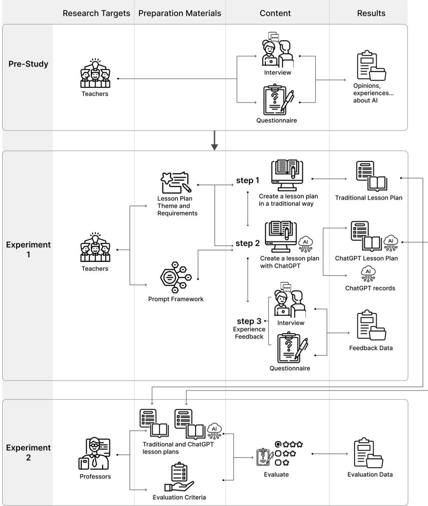  
Fig. 1 Research study design

Experiment 1: Teachers were invited to participate in the experiment and provided with a link to the online meeting and account information for GPT-4o after communicating the time of the experiment. After the participants read and signed the ethical consent form, they were introduced to the experimental procedure. All participating teachers were asked to create 2 lesson plans using both traditional and ChatGPT-assisted methods. The teachers were provided with a lesson planning theme and requirements and a prompt framework to interact with ChatGPT. The specific steps of the experiment are as follows:

● Step 1: Traditional way of lesson preparation (Teachers prepared the lesson in their usual way.)

● Step 2: Using ChatGPT to help with lesson preparation (Teachers were introduced to the ChatGPT Prompts Theory Model before they started lesson preparation.)

● Step 3: Providing feedback (Participating in interviews and completing questionnaires.)

Since participant No.7 was very familiar with ChatGPT and uses it daily to create lesson plans, only 1 lesson plan was generated by this participant, so the total sample size of lesson plans was 25.

Experiment 2: Subsequently, professors were invited to evaluate all created lesson plans based on provided evaluation criteria and give feedback. 25 lesson plans (12 traditional and 13 ChatGPT-assisted) were evaluated by professors, who graded the lesson plans without knowing which methodology had been used in order to ensure the fairness of the evaluation.

## Experimental Study Participants

The experimental study consisted of two experiments. This study aimed to simulate real-world teaching scenarios in children’s art education. Due to constraints in participant recruitment and project timeline, the final sample comprised 13 art teachers and 6 university professors. Similar to previous studies, a feasibility-based sampling method was adopted, where a limited sample size was deemed sufficient to ensure the relevance of the research when the participants closely matched the target population (Adamu and Garba, 2024).

Experiment 1 Participants: 13 participants for Experiment 1 were teachers or educators with a background in children’s art education. They have experience in lesson planning or teaching and are willing to explore and experiment with new methods and tools for lesson planning. The teachers were mainly invited by releasing the experimental recruitment information through social media, such as posting in the children’s art and art education community on Facebook, and the children’s art teacher recruitment group on WeChat, as well as meeting other children’s art teachers through the introductions of the teachers who came to participate in the experimental study.

As shown in Table 1, these teachers had more than 1 year of teaching experience in the field of art education, and 2 teachers had experience in STEAM education. They taught a range of ages centered on 6–12 years (K1-K6). Additionally, 11 teachers had used AI technology before, though their level of proficiency varied, while 2 had no AI experience. This variability reflects the heterogeneous reality of AI adoption in educational practice. While this may serve as a potential confounding factor, it also allows the study to capture a broader spectrum of user interactions with AI-assisted lesson planning.

Experiment 2 Participants: 6 professors with an art education background and experience in cultivating talents in this field were invited to participate, through the contact information provided by the undergraduate supervisor of first author, they were from Guangzhou Academy of Fine Arts, and are undergraduate teachers and postgraduate supervisors in the School of Fine Arts Education and the School of Industrial Design. All professors received standardized training prior to evaluation to align their understanding of the structured scoring rubric. Each lesson plan was independently evaluated by all six professors. To examine the consistency of the ratings and support score validity, the inter-rater reliability will be assessed using the Intraclass Correlation Coefficient (ICC).

Table 1 Experiment 1 Participants
<table><tr><td>No</td><td>Teaching Experience</td><td>Age Group</td><td>Course</td><td>Environment</td><td>AI Usage Experience</td></tr><tr><td>1</td><td>Passed teaching cert</td><td>6–12 years</td><td>Art class</td><td>School</td><td>Homework, Design</td></tr><tr><td>2</td><td>1 year</td><td>6–12 years</td><td>Volunteering, Art class</td><td>School</td><td>Graduation thesis</td></tr><tr><td>3</td><td>1 year</td><td>6–12 years</td><td>Art class</td><td>Organization</td><td>Homework</td></tr><tr><td>4</td><td>8 years</td><td>6–12 years</td><td>STEAM</td><td>School, Organization</td><td>Cover letter</td></tr><tr><td>5</td><td>1 year</td><td>6–12 years</td><td>Art class</td><td>Organization</td><td>Homework</td></tr><tr><td>6</td><td>4 years</td><td>4–10 years</td><td>Chinese painting</td><td>Organization</td><td>Never used</td></tr><tr><td>7</td><td>2 years</td><td>6–12 years</td><td>Art class</td><td>Organization, School</td><td>Homework, Design, Lesson plan</td></tr><tr><td>8</td><td>1 year</td><td>4–12 years</td><td>Art class</td><td>Organization</td><td>Thesis, Design</td></tr><tr><td>9</td><td>2 years</td><td>6–12 years</td><td>STEAM Pottery</td><td>Community, School</td><td>Homework</td></tr><tr><td>10</td><td>2 months</td><td>6–12 years</td><td>Art class</td><td>Organization</td><td>Homework, Design</td></tr><tr><td>11</td><td>2 years</td><td>6–12 years</td><td>Art class</td><td>Organization</td><td>Course summary</td></tr><tr><td>12</td><td>2 years</td><td>7–10 years</td><td>Art class</td><td>Organization</td><td>Graduation thesis</td></tr><tr><td>13</td><td>2 years</td><td>6–18 years</td><td>STEAM Pottery</td><td>School</td><td>Never used</td></tr></table>

To ensure the consistency of the sample and data, all participating teachers and professors are from China and have teaching and research experience based on Chinese children's art education. The experiment was conducted either online or offline, depending on the location of the participants.

## Experimental Study Materials

This section presents the material used in the experimental study that included lesson planning content details and a ChatGPT prompt framework in order to ensure the consistency of the experimental results, and all participants used the same model, ChatGPT-4o.

## Lesson Planning Content Details

The teachers were provided with a lesson planning content detail document that described the themes and requirements of the lesson plans as follows:

● Lesson theme: Color Art

● Age: K3 children (7–9 years old)

● Duration: 60 min

● Core literacy: Developing children's creativity, critical thinking, communication and collaborative skills

Course Design Requirements: The course proposition is decided and played by the participants, and can be integrated into different selected topics, as well as interdisciplinary synthesis for course design.

Output content: The course design outline should include the course theme, teaching objectives, course content, teaching methodology, teaching process, effect estimation, and material resources.

## ChatGPT Prompt Framework

In the realm of AI and Natural Language Processing (NLP), prompts serve as the catalysts that ignite meaningful interactions between humans and machines, it's essential to approach prompt writing in a structured manner. Frameworks offer a systematic way to construct prompts, ensuring that they are clear, focused, and effective in eliciting the desired response from AI models (Ahmed A. 2023). Therefore, a ChatGPT prompt framework was developed for children’s art teachers (see Fig. 2).

This framework outlines four main steps based on the logic of teachers' thinking about lesson planning, including determining the theme, generating a lesson plan, optimizing design, and filling content. Before the formal experiment, the framework was tested by creating a sample lesson plan that met the requirements of the experiment. During the experimental study, data were also collected on the use of the Prompt Framework through feedback from participants to further refine it. The refined ChatGPT prompt framework will provide a reference for future teachers using ChatGPT to create lesson plans.

## Data Collection

This study used a mixed-methods approach, combining qualitative and quantitative research methods. The quantitative data was collected through questionnaires and evaluation forms from teachers and professors, and qualitative data was collected through interviews with teachers, ChatGPT interactions, observation notes and session recordings.

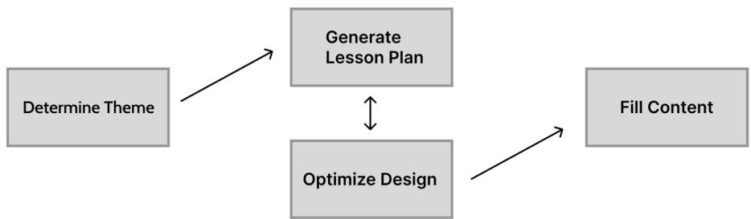  
Fig. 2 ChatGPT Prompt Framework

## Quantitative Data

Feedback Questionnaire: Teachers were asked to fill a feedback questionnaire to assess the efficiency, quality, and usefulness of GPT-4o in generating lesson plans. The questionnaire focused on collecting data on challenges, ease of use, and overall experience of using ChatGPT, as well as feedback on multiple dimensions of the Prompts Theory Model. A 5-point Likert scale was used that ranged from 1 (unacceptable) to 5 (excellent).

Evaluation Form: The professors evaluated the lesson plans produced by participating teachers using a structured evaluation form (see Appendix for details). The evaluation criteria were adapted from the 5E Inquiry Lesson Plan (ILP) rubric developed by M. Jenice Goldston et al. (2009). The 5E model is a widely used instructional framework comprising five phases that guide students’ learning: Engage (capture students’ interest), Explore (students investigate and experiment), Explain (develop students’ conceptual understanding), Elaborate (students apply knowledge in new contexts), and Evaluate (assess students’ understanding and skills). Based on this framework, six dimensions were assessed: Introduction, Teaching Method, Practical Method, Interdisciplinary, After-Class, and Core Competencies. Each dimension was rated on a 5-point Likert scale ranging from 1 (strongly disagree) to 5 (strongly agree).

## Qualitative Data

● Recording: Cameras were used to record teachers' behaviors and interactions during lesson preparation.

Observation: Observation notes were taken to record in detail the specific operations of teachers (such as teachers looking for resources in different platforms) in the two modes of lesson preparation.

GPT-4o Interaction records: Participants were asked to use researcher’s GPT-4o account in order to access the complete log of participants’ questions and generated content responses.

Interviews: After task completion, semi-structured interviews were conducted with teachers to give comments addressing specific challenges and needs, etc., with additional questions as appropriate. (Specific interviews are in the appendix)

## Data Analysis

In this study, qualitative and quantitative data were collected after two experiments. Both datasets were analyzed independently, and the results were subsequently integrated during the discussion stage. This integration involved using qualitative findings to explain and contextualize quantitative trends, while quantitative outcomes served to validate and reinforce themes emerging from the qualitative analysis.

The qualitative data were analyzed thematically, following the approach suggested by Braun and Clarke (2006), who emphasize that thematic analysis is an essential qualitative method, as it provides core skills that will be useful for conducting many other kinds of analysis. The analysis adhered to Maguire and Delahunt’s (2017) six-step framework for qualitative data processing and analysis, which includes: becoming familiar with the data, generating initial codes, searching for themes, reviewing themes, defining themes, and producing the final write-up.

Descriptive analysis was employed for the quantitative data, and intuitive charts were used to facilitate clear visualization. In addition, to draw robust conclusions regarding effectiveness, inferential statistical analysis was further conducted. Since each teacher developed both a traditional lesson plan and a ChatGPT-assisted lesson plan on the same topic, the resulting observations were correlated. Therefore, we applied the Wilcoxon signed-rank test, the non-parametric equivalent of the paired t-test, to compare the two sets of scores.

## Ethical Considerations

This study adhered to the guidelines for research integrity and ethics provided by Goldsmiths, University of London. Participants were informed of the experimental procedure, ethical guidelines and their rights and their written consent was obtained prior to conducting the experimental study. In addition, all data were anonymized to ensure the privacy and security of the participants.

## Results and Analysis

This section presents the findings from the pre-study and two subsequent experiments, which explored the use of ChatGPT to optimize lesson planning for art education teachers working with children. The results of the experiments were analyzed in relation to the research questions, and the findings were systematically organized to provide comprehensive answers to these questions.

## Pre-Study Results- The Role of Lesson Planning and Expectations for Al in Education

In the pre-study, we collected 48 valid questionnaires and conducted three in-depth interviews with teachers. The findings highlighted the pivotal role of lesson planning in shaping the quality of teaching and classroom outcomes. For instance, a teacher from a children's arts organization remarked, ‘I don't plan or rehearse lessons. My lessons are flexible, but sometimes the classroom results are unsatisfactory, such as unsatisfactory student work and a flat classroom atmosphere.’ While this unstructured teaching approach offers some benefits, it often results in inconsistent classroom outcomes. In contrast, a teacher who integrated AI into her STEAM art program shared,‘When designing course content, we consider the focus and challenges of each lesson. For example, we enhance students' imagination through AI. An AI-driven curriculum is different from a traditional curriculum and requires teachers to be more explicit in conveying core ideas and instructing students in new skills.’These insights underscore that effective lesson planning not only improves classroom effectiveness but also enhances student engagement and acceptance.

The findings reveal that most teachers dedicate 1–3 h daily to lesson planning but encounter challenges related to the availability and quality of resources. 70.8% teachers reported difficulties in integrating resources from multiple platforms, highlighting the fragmentation of teaching and learning materials. In addition, 60.4% teachers reported difficulties in assessing the quality and relevance of available resources (see Fig. 3). These difficulties highlight a critical issue: how teachers can efficiently identify and utilize high-quality, adaptable teaching resources within a limited timeframe. Such challenges directly affect the efficiency of lesson planning and, consequently, the overall effectiveness of teaching.

The pre-study results also revealed that teachers are optimistic about the potential of AI to address these challenges. Approximately 30% of teachers have already integrated AI tools into their teaching practices, reflecting the gradual expansion of AI adoption in education. Moreover, over 50% of teachers expressed a positive outlook on the future use of AI in educational settings. Teachers showed particular interest in AI-generated course outlines, lesson plans, and supplementary materials, such as images, videos, and presentations, with an average rating of 3.7 out of 5 (see Fig. 4). These findings suggest that educators hold high expectations for AI's ability to streamline course planning process, enhance resource quality, and improve classroom outcomes.

Overall, this initial feedback not only informed the design of the experimental study but also reinforced the feasibility and necessity of exploring the application of AI technology in education.

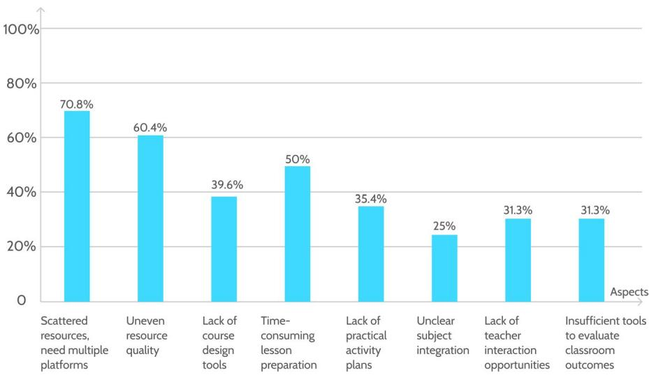  
Fig. 3 (Left) Challenges in Lesson Preparation

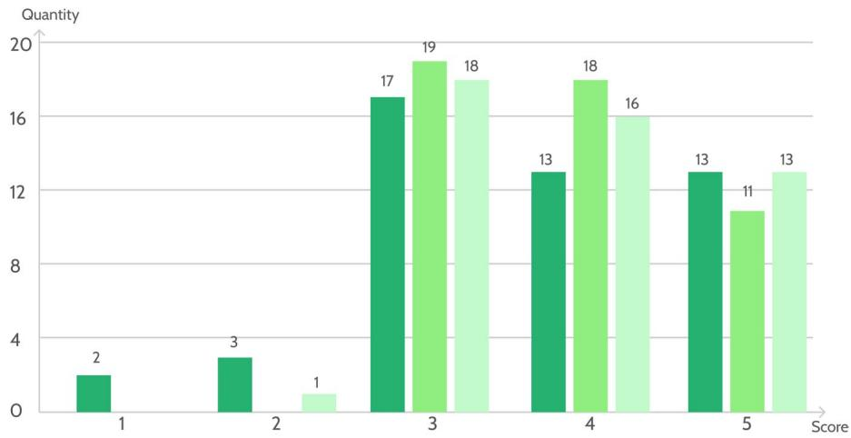  
Course Development: Al-generated outlines, lesson plans, and multimedia resources. Effect Prediction: Al analyzes content, predicts outcomes, and suggests improvements. Data Evaluation: Collects and analyzes feedback to assess course effectiveness

Fig. 4 (Right) Functional Expectations for Al Technology

## Qualitative Results- Insights into Traditional vs AI-Assisted Lesson Planning process

This section presents the analysis of qualitative data collected through interviews with teachers, ChatGPT interactions, observation notes and session recording.

## Traditional Lesson Planning Process

Qualitative data analysis revealed the traditional approach employed by teachers in lesson preparation (see Fig. 5). Qualitative data were gathered through interviews with teachers, where they were asked about their typical planning processes, including the challenges they face and the resources they utilize. Their responses highlighted key stages and decision-making strategies that are characteristic of traditional lesson planning.

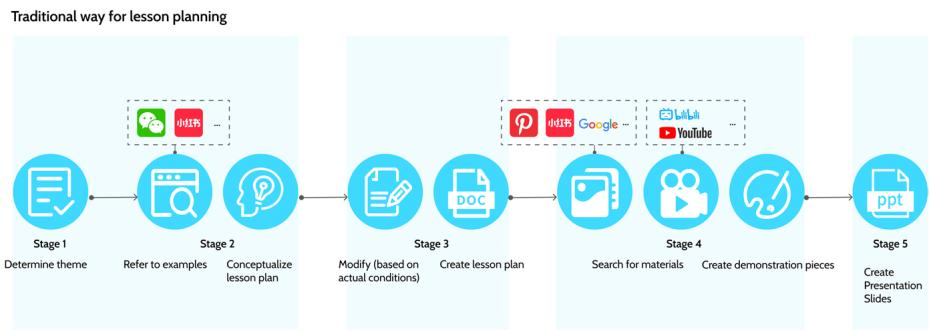  
Fig. 5 Traditional Way of Lesson Planning

The traditional lesson planning process consists of five stages (see Fig. 5): Stage 1 determines the theme, Stage 2 conceptualizes the lesson plan, Stage 3 modifies and finalizes it, Stage 4 searches for materials and creates demonstration pieces, and Stage 5 prepares presentation slides. While the entire lesson planning process typically takes between 30 min to 2 h, some teachers reported that it can take up to 7–12 days, depending on the complexity of the content, the teacher's experience, and the requirements of the course (daily, open or competitive). For example, one STEAM teacher mentioned that ‘it took our team 12 days to brainstorm and finalize the content of an original and innovative STEAM ceramics course, and another 4 days or so to create the lesson plan and presentation slides’.

Many teachers said that the most difficult part of lesson planning was Stages 1–2, where they had to determine the direction of teaching and conceptualize the content of the lesson, a stage that often required a lot of brainstorming and was time-consuming. For example, teachers need to incorporate content from different subjects to enhance students' creative thinking, and think about knowledge points, and directions of interest to students. Common sources of inspiration and reference come from the Internet (e.g., Little Red Book, WeChat) to find examples of good, appropriate lessons, and modify them by combining their own experiences and observations of students. These sources are convenient and quick, but vary in quality and need to be carefully screened. Course examples shared by other curriculum development teams and colleagues are of higher quality but are only suitable for learning about teaching methods and development experiences and cannot be applied as templates or used directly. In addition, some teachers chose to maintain their curiosity about art by studying essays, books, observing details in daily life and visiting art galleries, which are useful habits for gaining inspiration for curriculum development, but this takes a long time to accumulate.

Another cumbersome and time-consuming part of the process is Stage 4: Search for Materials, as teachers have to sift through a lot of non-compliant lesson content on the internet, some of which lacks materials, and some of which is too difficult for the age range of the students.

## AI-Assisted Lesson Planning Process

Qualitative data collected through interviews also inquired about how teachers’ lesson planning processes changed with the integration of ChatGPT. Teachers described a shift from the extensive brainstorming and manual resource-gathering characteristic of traditional methods to a more streamlined approach facilitated by AI. After using ChatGPT, the planning process evolved significantly, as illustrated in Figs. 6, 7, 8. The blue color represents the retention of steps of traditional lesson plans and the green color represents the changes from ChatGPT lesson plans. Teachers reported three distinct methods for incorporating AI assistance:

Method A (see Fig. 6): Teachers began by reflecting and outlining a framework for the lesson, then used ChatGPT to refine details, fill content gaps, and explore additional ideas.

Method B Teachers prepared the lesson in the traditional way and then gave the lesson plan to ChatGPT for checking and provided suggestions for improvement to make the lesson plan better.

## Method A

Teachers determine the topic through personal ideas or refer to platforms, describe the needs and ideas to ChatGPT, ChatGPT generates a lesson plan and allows ChatGPT to generate pictures or provide links to pictures and videos to create a PPT, and if the pictures provided by ChatGPT are inappropriate If the pictures provided by ChatGPT were not suitable, they would look for resources on the Internet themselves.

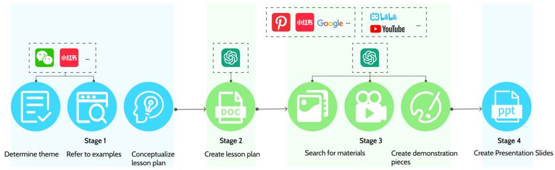  
Fig. 6 ChatGPT Assisted Method A

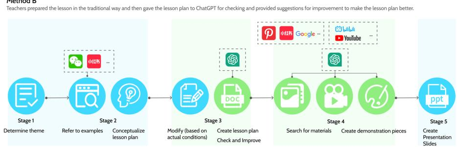  
Fig. 7 ChatGPT Assisted Method B  
Teachers use ChatGPT generate lesson plans directly, providing ideas for inspiration and saving preparation time

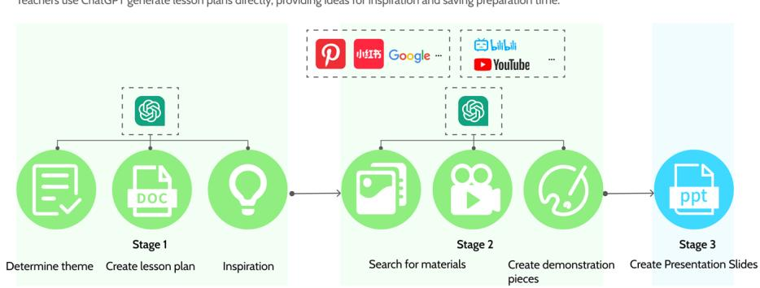  
Fig. 8 ChatGPT Assisted Method C

Method B (see Fig. 7): Teachers created a complete lesson plan themselves and then used ChatGPT to check, improve, and optimize it.

Method C (see Fig. 8): Teachers relied entirely on ChatGPT to generate a lesson plan, which they later reviewed and adapted to suit their needs.

These approaches demonstrate the flexibility of AI-assisted lesson planning and its potential to align with individual teaching styles while reducing time and effort. Most teachers favored Method A, as it retained elements of personal reflection and allowed them to leverage ChatGPT to enhance efficiency and creativity. 60% of teachers chose Method A, 20% chose B, and a further 20% chose C. The commonality of these methods is that ChatGPT helps to streamline the lesson planning process from the traditional five stages to three or four, allowing teachers to focus on refining and enhancing the content. The difference lies in which stage of the process ChatGPT is initiated, with A being where the teacher thinks about it and then lets ChatGPT generate the lesson plan, B being where the teacher completes the lesson plan and then gives it to ChatGPT for checking, and C being where ChatGPT generates the lesson plan directly.

Ultimately, the choice of approach reflects teachers' individual preferences and established practices. Nevertheless, it is evident that educators are already identifying innovative and effective strategies to harness ChatGPT for lesson preparation. Tasks traditionally regarded as time-intensive and complex, such as conducting exhaustive searches and organizing resources, have been streamlined through AI integration. This shift allows teachers to concentrate on designing precise and well-structured prompts, enabling ChatGPT to produce customized, standards-compliant lesson plans that align with their specific instructional goals.

## Benefits and Challenges of AI-assisted Lesson Planning

The qualitative data results of the thematic analysis demonstrate the advantages and challenges of AI-assisted course planning for art teachers. These data were collected through semi-structured interviews, which included questions about the major challenges teachers encountered in using ChatGPT for lesson planning, such as familiarizing themselves with the tool, learning how to use it effectively, and difficulties in screening and modifying the generated content. The analysis of teachers’ feedback also pointed out the importance of some aspects of traditional lesson planning that reinforce the idea of Human-AI collaboration rather than AI replacing the teachers.

The data analysis results are color-coded (see Fig. 9): ‘blue’ represents traditional lesson plans, ‘green’ represents the benefits of ChatGPT, and ‘purple’ represents the challenges of ChatGPT. The results of teachers’ interviews were categorized into different aspects, including content provision, graphic resources, interdisciplinarity, innovation, practicality, personalization, westernization and applicability, and were further categorized into efficiency, quality, and challenges.

Content generation, resource provision/image generation, interdisciplinarity, and innovation are mostly linked to benefits, significantly enhancing teachers’ efficiency in lesson planning and optimizing the quality of lesson plans. However, aspects such as practicality, personalization, westernization, and applicability present more challenges.

Benefits: Qualitative data highlights the diverse applications of ChatGPT in education and its support for enhancing teaching practices. For instance, teachers reported being inspired by ChatGPT to develop new lessons or refine their teaching methods by incorporating extended ideas. One teacher shared, ‘ChatGPT inspired me that I can extend my curriculum with flying mural colors combined with new age elements to do some special craft or material lessons, which provides a new direction for my curriculum design.’ Another teacher commented on the usefulness of preclass guides, stating, ‘I was inspired by the game introduction, which was more fun than usual.’ While these elements reflect insights that ChatGPT has synthesized from other educators’ shared experiences on the internet, rather than original innovations, they can be particularly impactful for teachers who may not have previously encountered these ideas. In moments of need, ChatGPT serves as a quick and effective tool to broaden a teacher’s perspective and inspire creativity.

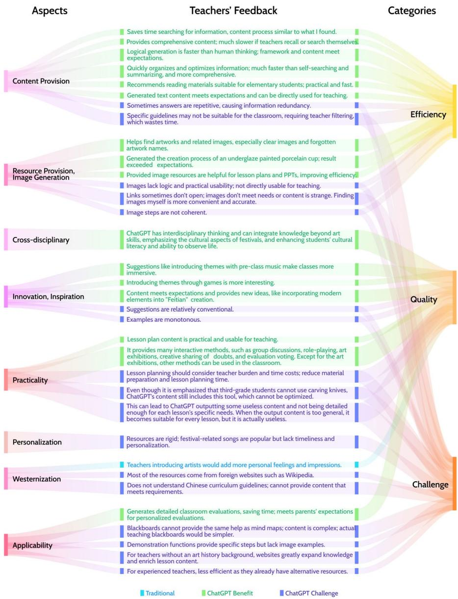  
Fig. 9 Thematic Analysis of Qualitative Data Results from interviews with teachers

Teachers highlighted additional features of ChatGPT that make it particularly applicable in educational settings, including its ability to generate detailed classroom critiques and meet the expectations of students and parents for personalized assessments. One teacher remarked, ‘ChatGPT expands my brief descriptions into vivid, engaging sentences with an approachable tone, making the expression rich and interesting.’ Furthermore, ChatGPT offers detailed and constructive suggestions for student critiques, along with practical tips, which are especially beneficial for teachers who may struggle with effective communication.

Challenges: One key challenge is ChatGPT’s practicality. While it can generate generalized content that applies to many lessons, it often falls short of meeting the specific needs of each one. ‘When designing lesson plans, it is necessary to consider the burden and time cost for teachers in actual operations. For example, the preparation of materials and lesson preparation time should be minimized to allow teachers to conduct teaching more easily. It should not be a utopian perfect lesson detached from reality.’ In practice, ChatGPT frequently produces overly idealized and polished lesson plans that may be suitable for competitions or open classes but prove impractical in daily teaching. Such outputs often overlook the simplicity, feasibility, and operational aspects that are essential for real-world classrooms.

Also, ChatGPT often overlooks security issues. For instance, ‘even though it is emphasized that third-grade students cannot use carving knives, ChatGPT’s content still includes this tool, which cannot be optimized.’ For primary school art teachers working with children aged 6–12, this omission is particularly problematic, as safety considerations must remain a top priority in lesson preparation.

Thus, teachers often need to spend considerable time revising and adjusting ChatGPT-generated lesson plans to correct impractical content. This undermines the intended efficiency of AI assistance. As noted by participants, ‘These specific guidelines may not necessarily apply to the classroom and require teachers to filter them, which can waste time,’ and ‘Sometimes, when ChatGPT answers questions, the content is repetitive, leading to information redundancy and reduced efficiency.’ To address these challenges, a well-structured prompt framework may help guide ChatGPT toward generating higher quality, more contextually appropriate lesson content, thereby improving both efficiency and effectiveness in practice.

## Quantitative Results- Impact of Integrating ChatGPT in Lesson Planning

This section analyzes teachers’ experiences with ChatGPT during the lesson planning process, as well as professors’ evaluations of the generated lesson plans. Consistent with the qualitative research findings, the quantitative results further highlight the advantages and challenges of using ChatGPT for lesson planning.

## Teachers’ Experiences of Using Chatgpt for Lesson Planning

The quantitative data were obtained from a survey designed to conduct a multidimensional assessment of teachers’ experiences with ChatGPT. The assessment covered various dimensions, including teaching efficiency, content quality, practicality, ease of use, challenges faced, overall experience, and feedback on the prompt framework. The findings revealed that, beyond its innovativeness, teachers provided positive feedback on various aspects of ChatGPT, including its efficiency, content quality, and support for interdisciplinarity.

The significant impact of ChatGPT on improving lesson planning efficiency is evident in several areas (see Fig. 10): the accelerated speed of topic selection (average score: 3.7), the rapid generation of high-quality instructional content (average score: 3.8), and the reduction of lesson planning time (average score: 4.2). These improvements can be attributed to ChatGPT's ability to quickly generate content, create images, and provide links to relevant resources.

Teachers generally agreed that ChatGPT improved the quality of lesson planning (see Fig. 11). This is particularly evident in the high average ratings for the sub-questions ‘The content generated by ChatGPT is accurate’ and ‘The lesson plan generated by ChatGPT meets my requirements’, with scores of 4 and 3.9 respectively. These scores indicate that teachers found the content provided by ChatGPT to be both high-quality and useful.

For the two items related to interdisciplinary aspects (see Fig. 12), 61% of respondents provided ratings of 4 or above, highlighting ChatGPT’s effectiveness in integrating content across different disciplines. Notably, in scenarios requiring the rapid generation of interdisciplinary teaching resources, ChatGPT demonstrates robust data processing capabilities that facilitate multidisciplinary integration.

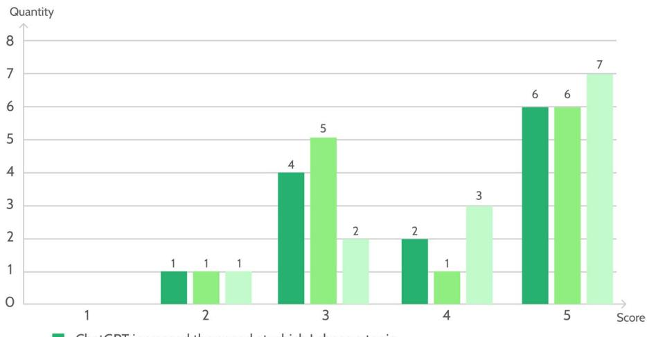  
ChatGPT increased the speed at which I chose a topic.  
ChatGPT helped me quickly generate high-quality teaching content.  
Using ChatGPT for lesson planning saved more time compared to traditional methods

Fig. 10 (Left) ChatGPT's Impact on Teaching Efficiency

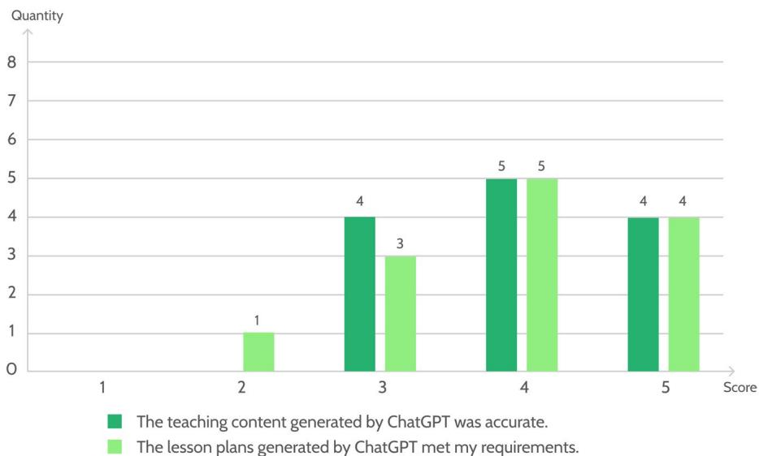  
Fig. 11 (Right) ChatGPT's Content Quality

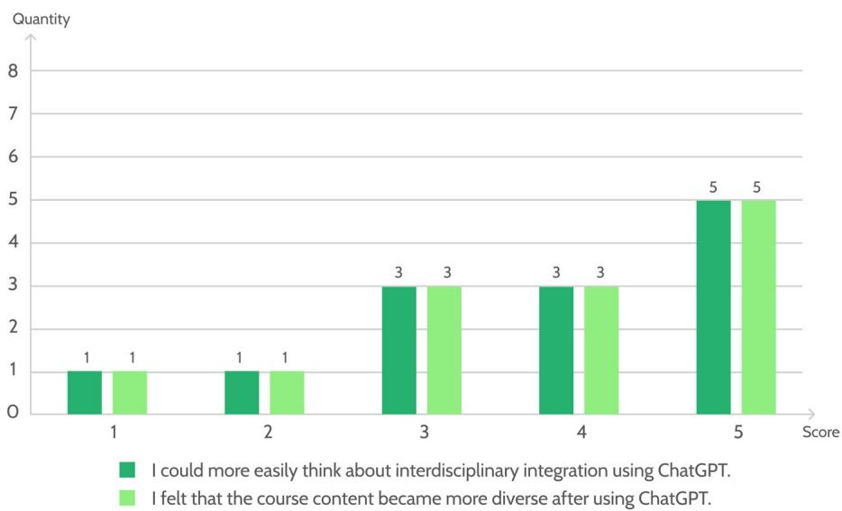  
Fig. 12 (Left) ChatGPT’s Impact on Interdisciplinary Integration

However, the data suggests that users are neutral regarding ChatGPT's role in fostering innovation (see Fig. 13). Rather than being able to generate entirely innovative content, ChatGPT is more likely to serve as a source of inspiration. Thus, ChatGPT's greatest help to teachers in lesson planning lies in its ability to stimulate thinking and identify gaps. This limitation is due to its operational and iterative model; ChatGPT uses the Transformer architecture, which requires a large amount of data for training to produce optimal results. The database used by ChatGPT consists of information collected by OpenAI from the Internet, rather than content created independently. Therefore, the inspiration for teachers to develop courses still comes from human communication, experience and discovery. This highlights that ChatGPT cannot replace teachers, who must continue to observe, think, and learn to foster true innovation.

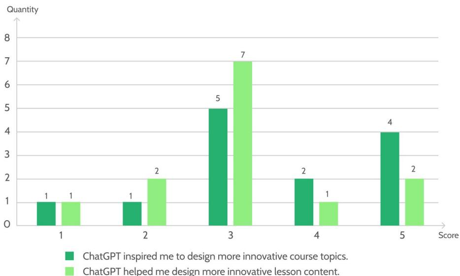  
Fig. 13 (Right) ChatGPT’s Role in Innovation

Overall, teachers provided positive feedback regarding their experience using ChatGPT for lesson planning (see Fig. 14). Based on Likert scale ratings from 13 teachers, the results demonstrated both a high level of satisfaction and a strong willingness to use ChatGPT for lesson planning in the future.

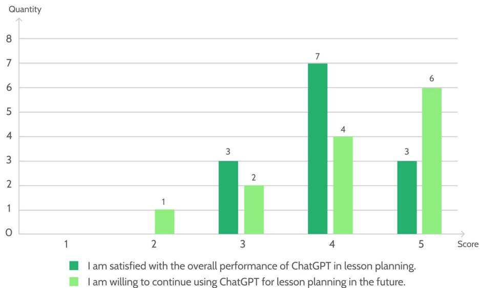  
Fig. 14 (Left) ChatGPT Satisfaction and Continuation

Regarding satisfaction, 7 teachers rated it a 4 (agree), and 3 teachers rated it a 5 (strongly agree), with an average score of 3.9. This reflects an overall positive perception of ChatGPT's performance in lesson planning, despite some challenges and areas for improvement. Similarly, for future use, 4 teachers rated it a 4, and 6 teachers rated it a 5, resulting in an average score of 4.1, further reflecting the teachers' strong preference for continued use.

In addition, as part of this study, a ChatGPT Prompt Framework was developed specifically for children’s art teachers, and its validity was evaluated through the experimental study presented in this paper. The data in Fig. 15 indicate that teachers' ratings predominantly ranged between 3 and 5, with an average score exceeding 4 across all questions. This demonstrates a high level of acceptance of the framework among teachers. A detailed analysis of the Prompt Framework and its application will be provided in the Discussion section.

## Traditional vs ChatGPT-assisted Lesson Plan Evaluation Results

The professors’ assessments of the lesson plans further validated the previous results and findings. To evaluate the consistency of the six professors’ ratings across 25 lesson plans, we calculated the intraclass correlation coefficient (ICC) using a two-way random, absolute agreement, average-measures [ICC (2, K)]. The results indicated good inter-rater reliability (ICC = 0.847, 95% CI [0.736, 0.923]), supporting that evaluation scores are consistent and reliable. To enhance the reliability of the evaluation, we further used ICC to calculate six dimensions, the results demonstrate moderate to excellent, with more details shown in Appendix 1.

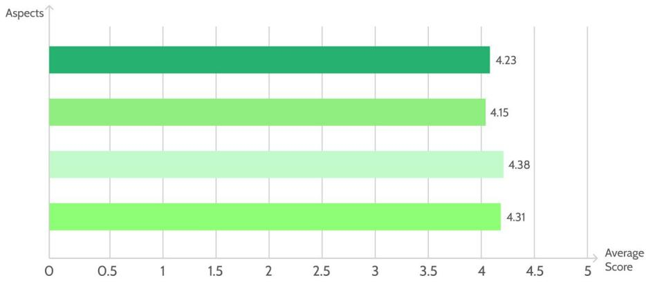  
The Prompt Framework guidance and examples helped me quickly get started.  
The Prompt Framework is clear and easy to operate.  
The Prompt Framework is structured reasonably, helping to systematize lesson planning.  
The Prompt Framework provided substantial guidance for me to use ChatGPT for lesson planning.

Fig. 15 (Right) ChatGPT Prompt Framework Evaluation

Through descriptive analyses, the line graph (see Fig. 16) illustrates that all 13 ChatGPT-assisted lesson plans scored higher than their traditional counterparts. Analyzing the scores of the two lesson plans prepared by each of the 13 teachers, the distribution of ChatGPT-assisted scores ranged from 18 to 24, whereas the traditional scores ranged from 11 to 20. A notable exception was observed with the 7th teacher, who originally relied on ChatGPT for lesson planning and therefore created only one lesson plan, making direct comparison impossible.

Furthermore, traditional and ChatGPT-assisted lesson plans were compared across 6 specific aspects of lesson planning (see Fig. 17): core competency, after-class, interdisciplinary, practical methods, teaching methods, and introduction. The evaluation indicates that the quality of ChatGPT-assisted lesson plans is superior across multiple dimensions.

To strengthen the validity of these conclusions, a paired design was adopted, enabling within-subject comparisons. As the difference scores did not meet the assumption of normality, the Wilcoxon signed-rank test was conducted to compare the total scores of lesson plans created by the same teachers using the two methods. The analysis revealed a statistically significant difference (see Table 2). Specifically, ChatGPT-assisted lesson plans (Median = 20.500, IQR = [19.4, 22.5]) achieved higher scores than traditional lesson plans (Median = 17.585, IQR = [15.1, 18.9]), z = 3.059, $\mathsf { p } { = } 0 . 0 0 2 { < } 0 . 0 1$ The effect size was large, r = 0.883, n = 12, 95% CI [0.627, 0.967], indicating a robust improvement associated with ChatGPT assistance. As illustrated in Fig. 18, the boxplot provides a visual representation of the score distributions, further highlighting the performance gap between AI-assisted and traditional lesson plans.

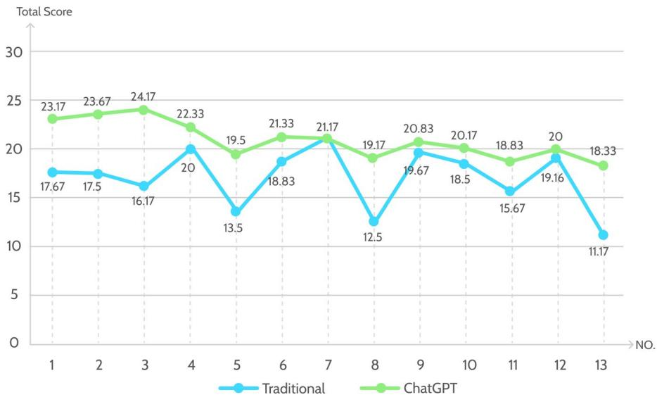  
Fig. 16 (Left) Score Comparison for Each Lesson Plan

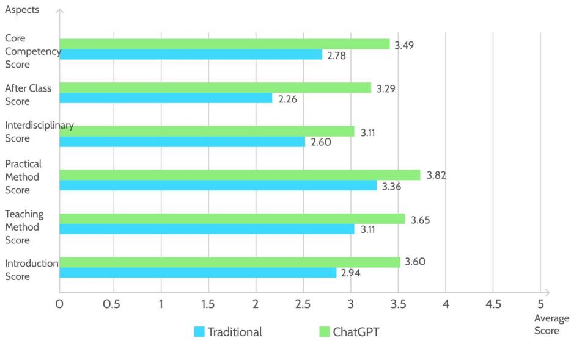  
Fig. 17 (Right) Specific Aspect Score Comparison: Traditional vs. ChatGPT

These findings demonstrate that, under the same lesson theme and structural requirements, Gen AI assistance exerts a strong and meaningful impact on lesson design.

## Discussion and Design Implications

This section presents a detailed discussion of the study’s findings, addressing each research question regarding the use of ChatGPT in children’s art lesson planning. It explores the challenges and benefits, examines how ChatGPT enhances lesson planning, and identifies the types of prompts that generate higher-quality content. This section also provides design recommendations for improving ChatGPT’s personalization, multimedia resources, and user interface. Finally, it highlights the study’s limitations and suggests directions for future research in AI-enhanced education.

a RQ1: What are the challenges and benefits of using ChatGPT in lesson planning for children's art teachers?

Table 2 Wilcoxon Signed-Rank Test Result
<table><tr><td colspan="7">Wilcoxon Signed-Rank Test Result</td></tr><tr><td>Traditional (n=12)</td><td>ChatGPT (n=12)</td><td>Median Difference (Pair1—Pair2)</td><td>Z</td><td>p</td><td>r</td><td>95% CI</td></tr><tr><td>17.585 (15.1, 18.9)</td><td>20.500 (19.4, 22.5)</td><td>-2.915</td><td>3.059</td><td>0.002**</td><td>0.883</td><td>0.627~0.967</td></tr></table>

\* p<0.05 \*\* p<0.01

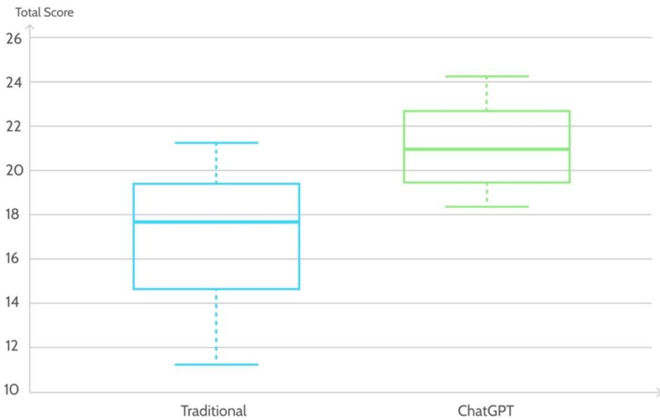  
Fig. 18 Lesson Plan Average Total Score: Traditional vs. ChatGPT

The key benefits and challenges of using ChatGPT in lesson planning, as identified in this study, are presented in Figs. 9, 10, 11, 12, 13, 14, 16,17 and 18. In this section, we will further discuss these findings in light of existing research to provide a deeper understanding of their implications.

Benefits: Based on the analysis of the experimental results, the use of ChatGPT in children’s art education lesson planning yielded promising outcomes, highlighting AI's potential to enhance and support educational practices. These findings are consistent with the work of scholars like Adamu and Garba (2024), reinforcing the significance and usability of AI in education, particularly in aiding children’s art teachers with lesson planning. A similar study by Karaman and Göksu (2024) also validated the effectiveness of ChatGPT-generated lesson plans in improving academic achievement in primary school mathematics after the lessons were delivered. This supports the findings of the current study and also addresses a gap in this study where lesson plans were not implemented to assess their direct impact.

Moreover, both quantitative and qualitative analyses highlighted several key benefits of using ChatGPT in lesson planning. Quantitative results revealed improvements in areas such as core competency development, after-class activities, interdisciplinary integration, teaching efficiency, and content quality. Meanwhile, qualitative findings emphasized ChatGPT’s role in content provision, access to graphic resources, interdisciplinarity, innovation, and providing practical inspiration for lesson planning. Expanding on its role in enhancing lesson plans, ChatGPT provides significant benefits in meeting the interdisciplinary and multi-skilled demands that are closely linked to STEAM education (Quigley et al., 2020). With its vast corpus, ChatGPT can quickly retrieve domain-specific knowledge, analyze it logically, and link concepts from various disciplines to create a cohesive teaching system, which makes it a powerful tool for STEAM teachers (Li et al., 2024). Consequently, ChatGPT can effectively assist children's art teachers in developing art-themed courses that integrate multiple disciplines, foster the advancement of curricula for the modern era, support the interdisciplinary framework of STEAM education, and cultivate 21st-century 4C talents (see Fig. 19).

On the other hand, the extent to which ChatGPT assists in lesson planning varies by teacher experience level as shown in Fig. 20. For junior and intermediate teachers, ChatGPT acts as a gap-finding and inspirational tool, enhancing both the efficiency and quality of lesson plans (Adamu, I. and Haroun, H.G., 2024). The specifics of how this manifests in the lesson planning process will be discussed further below. As van and Elize du Plessis (2023) pointed out, these content resources are rich and egalitarian, helping teachers to learn collaboratively and gain experience on a level playing field. Despite the capabilities of ChatGPT, there is no concern that it will replace the work of teachers (Sallam et al., 2023). As Lee (2023) emphasizes, teaching is a creative and individualized process, requiring curriculum development that is tailored to students’ needs. While ChatGPT can generate lesson plans, it operates based on the teacher’s input, considering factors such as student ability and parental feedback. In addition, AI cannot completely replace face-to-face communication and interaction between people, which is essential. Therefore, teachers will not rely solely on ChatGPT for educational aspects that require personal connection and service.

Challenge: In contrast, previous research has highlighted several limitations of ChatGPT, including inaccuracy, potential bias, the risk of misuse, and privacy concerns (Crompton and Burke, 2024). However, the present study indicates that the primary challenges of using ChatGPT in lesson planning are more closely related to the practicality of content generation, such as insufficient personalization, over-reliance on Western-centric perspectives, and not quite related visual resources, as well as the difficulties in interaction manipulation.

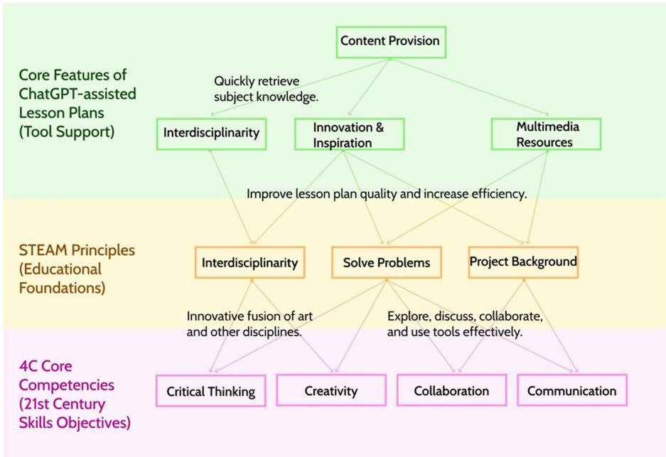  
Fig. 19 Theoretical and Conceptual Framework

<table><tr><td>Teacher Type</td><td>Experience Level</td><td>Helpful Level</td><td>Details</td></tr><tr><td>Junior Teacher</td><td>★★★★★</td><td></td><td>ChatGPT is both a guide and a reviewer. It offers many insights they may never have encountered before, acting like a well-matched encyclopedia, providing the quickest answers and the most specific instructions on how to operate it in the shortest possible time. In constant use and reflection, these teachers are also learning and improving. When novice teachers are unsure about a topic, they may worry about the accuracy of the information available online. In this case, they can use ChatGPT to repeatedly validate and evaluate the information, thereby increasing their self-confidence.</td></tr><tr><td>Intermediate Teacher</td><td>★★★★☆</td><td>O</td><td>ChatGPT provides rich content support. On the one hand, it provides content they have already thought of, saving them the time needed for editing. On the other hand, it helps broaden their thinking by providing content they may know about but haven't immediately thought of.</td></tr><tr><td>Senior Teacher</td><td>★★★★☆</td><td>OO    O</td><td>ChatGPT's help was relatively limited. They tend to have a wealth of knowledge stored in their minds and have established ways of finding resources. They may also have fixed templates for lesson planning. In this case, using the current version of ChatGPT may require a significant amount of time to train the AI to generate the required content, which may increase rather than decrease the time spent.</td></tr></table>

Fig. 20 Impact of Teacher Experience on ChatGPT’s Helpfulness in Lesson Planning

Despite the promising potential for personalized education highlighted in many studies (Opara, Theresa and Aduke, Tolorunleke Caroline, 2023; Areej ElSayary, 2023), teacher feedback in this study revealed that the content generated by ChatGPT lacks of personalization. For example, ‘the information it provides is somewhat rigid, and when asked for holiday-related songs, it may provide answers that are popular but lack topical relevance.’ When the output becomes overly generic, it risks being applicable to every lesson in a superficial sense, but in practice, it offers little pedagogical value.

Additionally, as a ‘multilingual but monocultural’ software (Trust, Whalen and Mouza, 2023), ChatGPT’s data predominantly comes from a Western cultural context, which limits its ability to provide localized content, especially in the context of China in this study. As a result, its generated content is biased towards internationalization and lacks emotional understanding of local customs and cultural nuances. In this regard, Chinese AI-generated platforms may be better suited for Chinese art teachers, as they are likely to provide content that aligns more closely with local cultural expectations. Alternatively, to improve its effectiveness in diverse contexts, ChatGPT could be enhanced by incorporating a broader range of multicultural data. Studies also have highlighted the importance of adapting AI tools to local cultural and educational contexts. For instance, research on generative AI in music emphasizes the need for AI systems to resonate with the cultural diversity of stakeholders, suggesting that AI should be continuously adapted to accommodate individual preferences and socio-cultural specificities (Correia, 2024). Additionally, other studies have stressed the significance of culturally responsive AI, urging the development of AI models that are adaptable to multicultural societies to enhance their effectiveness (Ożegalska-Łukasik, N., & Łukasik, S, 2023). By including content that reflects global cultural diversity, ChatGPT could become a more versatile tool for teachers across various regions.

Another prominent challenge lies in image generation and resource provision, where issues such as inaccessible links and irrelevant images were commonly reported, which is in line with the results of (Mosaiyebzadeh et al., 2023). As shown in Fig. 21, while the images generated may appear visually appealing, they often fail to align with the specific needs of the lesson, leaving teachers uncertain about how to effectively integrate them into their teaching. As one teacher remarked, ‘These resources are not as good as the ones I find myself’.

About interactive experience with ChatGPT, on a more positive note, in terms of user interface, ChatGPT is widely regarded as user-friendly and easy to navigate. The average rating for statements like ‘ChatGPT’s interface is friendly and easy to use’ was 4.5, while ‘I can easily understand how to ask questions and generate content using ChatGPT’ received a rating of 4.4. These results are consistent with the findings of Nielsen (2023) findings, which suggest that interacting through natural language dialogue does not present significant barriers or learning costs. However, qualitative feedback from the thematic analysis revealed challenges in ChatGPT's applicability, where some participants reported that content is complex which may relate to findings from Bansal et al. (2024). The teachers’ feedback from the actual use of ChatGPT in a multi-round dialogue mode highlighted the limitations of its linear, single-path interaction (Bansal et al., 2024). While ChatGPT effectively follows a topic in-depth, it struggles to adapt when users wish to pivot to a different direction. Teachers often need to restate their initial instructions for ChatGPT to adjust its focus, which adds operational complexity and reduces efficiency.

The challenges identified in this study offer valuable guidance for the future development of ChatGPT for educational use, and addressing these issues will be further explored in the design recommendations section.

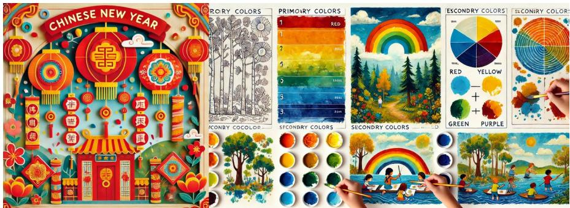  
Fig. 21 ChatGPT Generate Image Reverse Case

## o RQ2: How can we use ChatGPT to improve the lesson planning process?

Generative AI is significantly influencing fields like education, with profound implications for the way teachers prepare lessons in the future (van and Elize du Plessis, 2023). In the results section, briefly introduced three methods to ChatGPT-assisted lesson planning. Method A was chosen to answer this research question because it emphasizes a balance between teacher autonomy and the efficiency provided by ChatGPT, making it a practical and scalable approach for enhancing the lesson planning process. This method ensures that teachers retain their personal reflections and learning experiences for long-term professional development, a factor that is preferred by most educators.

Practical Implications: For teachers who wish to integrate ChatGPT into their lesson planning, this section offers a comprehensive and detailed description that can serve as a practical guide. It outlines the human–AI collaboration process, highlights two key steps in effectively using ChatGPT, and incorporates authentic experiences and case examples from participating teachers. These insights can provide references for educators, enabling them to adapt and extend the use of Method A in their own instructional contexts.

## A Collaborative Approach of Integrating Chatgpt to Improve the Lesson Planning Process

Method A involves a collaborative process where teachers first determine the lesson theme, often drawing from personal ideas or external platforms for inspiration. Teachers then describe their lesson needs and ideas to ChatGPT, which helps generate a lesson plan and suggest multimedia resources, including images, videos, or links to relevant content. If the images or resources provided by ChatGPT are deemed unsuitable, teachers can further refine the search or seek out resources independently.

The main stages of ChatGPT-assisted lesson planning are as follows:

● Stage 1: Determining the Theme – Teachers reflect on the lesson theme, which can be based on personal ideas, institutional requirement or external references.

● Stage 2: Generating the Lesson Plan – ChatGPT helps organize and generate a detailed lesson plan based on the teacher's reflections and requirements.

● Stage 3: Searching for Multimedia Resources – ChatGPT assists in locating and providing relevant images, videos, and other media to enhance the lesson content.

● Stage 4: Creating Presentation Slides – Teachers use the resources gathered in the previous stages to create presentation slides, sometimes with further assistance from ChatGPT.

The primary stages where ChatGPT-assisted support is most beneficial are Stage 2: Generating Lesson Plans and Stage 3: Searching for Multimedia Resources. These stages correspond to the more time-consuming and challenging elements of traditional lesson planning, as previously discussed.

## Stage 2: Generating Lesson Plans

Results from comparative experiments (traditional vs. ChatGPT-assisted lesson planning) indicate that in Stage 2, ChatGPT was particularly effective in helping clarify ideas and saving teachers’ considerable time. This finding aligns with previous studies (Areej ElSayary, 2023). Teachers reported that ChatGPT’s generated lesson plans were logical, detailed, and aligned with their expectations, with some mentioning that ‘The content is very similar, if not identical, to my own thought process.’

One notable aspect that has not been fully explored in prior research is ChatGPT’s ability to quickly provide information when teachers are uncertain or lack experience. In cases where teachers struggle to recall details or specific knowledge, ChatGPT offers quick, accurate answers. By leveraging its vast database, ChatGPT can overcome the limitations of teachers’ knowledge and search capabilities. This function eliminates time spent sifting through advertisements and irrelevant content, delivering valuable and well-organized information.

Thus, ChatGPT not only clarifies and refines lesson ideas but also provides crucial support in areas where teachers may face challenges due to gaps in memory or experience. This functionality significantly enhances lesson planning efficiency, allowing teachers to focus more on pedagogical aspects rather than administrative tasks.

## Stage 3: Searching for Multimedia Resources

In Stage 3, ChatGPT demonstrates its potential to revolutionize the way teachers locate and use multimedia content. This study highlights the features and findings of ChatGPT that have not been fully explored in previous studies. Children's art teachers often need to introduce multimedia resources, such as pictures and videos, into their classrooms, and traditionally, finding suitable images, videos, and other media for lessons has been a time-consuming and often frustrating task. However, with the advent of GPT-4, ChatGPT now offers advanced image generation and input functions, which allow it to create visuals or provide direct links to relevant resources based on the teacher’s specific needs. For example, when teachers cannot recall the name or author of a particular artwork, they can describe it to ChatGPT, which will assist in locating the resource. One teacher shared, ‘I didn’t know ChatGPT had this function, it was a very novel experience, and it made finding materials incredibly easy.’

Furthermore, in the case of art education, ChatGPT can generate relevant visual content based on teachers’ descriptions, making it especially useful for children’s art teachers who need visual aids for their lessons. In one instance, a teacher used ChatGPT to generate a step-by-step process for creating a small ceramic underglaze cup. The result exceeded expectations, with the content being so effective that it could be directly integrated into the lesson. This case is illustrated in Fig. 22. Therefore, ChatGPT plays a crucial role in Stage 3 by simplifying the previously tedious tasks of browsing websites and searching for specific content. Instead of spending hours sifting through multiple resources, teachers can rely on ChatGPT to quickly provide the necessary materials, streamlining the process and saving valuable time.

While ChatGPT currently plays a significant role in Stages 2 and 3 of lesson planning, there is potential for further integration in Stage 4: Creating Presentation Slides. Currently, this stage is mostly handled manually by teachers, who incorporate the resources found in the earlier stages into their slides. However, ChatGPT could further streamline this process by assisting with the organization and formatting of slide content, or even generating slide content based on the generated lesson plan. Such enhancements would allow teachers to save even more time and enhance the integration of multimedia resources in their lessons. This idea aligns with findings from other researchers (Zawacki-Richter, Bäcker, and Vogt 2019) (Mansoor, M., Chandar, S. and Srinath, R., 2021) (Jadhav, D., Agrawal, S., Jagdale, S., Salunkhe, P. and Salunkhe, R., 2024), which highlights the growing role of AI in automating educational tasks, including content creation and presentation design, thereby improving teaching efficiency and effectiveness.

  
Fig. 22 ChatGPT Image Generation Positive Case: Step-by-Step Process of Crafting a Small Ceramic Underglaze Cup

This study summarizes teachers’ experiences with and use of ChatGPT as a teaching aid in the digital age, echoing the findings of Areej ElSayary (2023) and other scholars. However, the author expands upon this research by exploring ChatGPT’s practical applications in the field of children's art education, revealing that its utility extends beyond text-based lesson plans to include image generation and other multimedia resources.

o RQ3: What types of prompts can generate higher quality lesson plan content when using ChatGPT?

A well-structured prompt is essential to unlocking the full potential of an AI system, enabling it to produce precise and valuable outputs (Ahmed A., 2023). Therefore, to support children’s art teachers in utilizing ChatGPT effectively, this study developed a dedicated ChatGPT Prompt Framework (see Fig. 2), whose validity was tested through the experimental study. In this section, a case study of a teacher using the prompt framework will be presented, followed by an analysis of teachers’ feedback to refine and improve the framework based on their experiences.

## Case Study of Using Prompt Framework

Based on the evaluation of 13 teachers’ lesson plans by six professors, the third teacher achieved the highest overall average score using ChatGPT, with an average score for each criterion exceeding 3.5 out of 5 (see Table 3). This result suggests that the teacher was able to generate high-quality lesson plans through effective interactions with ChatGPT. Consequently, as a case study, the interactions between this teacher and ChatGPT were analyzed to identify the types of prompts that contribute to generating higher-quality lesson plans.

Table 3 Lesson Plan Evaluation details
<table><tr><td>Lesson plan ID</td><td>Introduction score</td><td>Teaching method score</td><td>Partial method score</td><td>Interdisciplinary score</td><td>After class score</td><td>Core competency score</td><td>Total score</td></tr><tr><td>4</td><td>4.17</td><td>4</td><td>4.5</td><td>3.83</td><td>3.67</td><td>4</td><td>24.17</td></tr></table>

Firstly, this teacher followed the Determine Theme step of the Prompt Framework (see Fig. 2), clearly explaining the role, instructions, and end goal to ChatGPT and then generating the lesson plan.

● Role: I am a primary school art teacher working on a lesson plan.

Instructions: 3rd-grade primary school (7–9 years old), on the topic of color art, the curriculum calls for developing children’s creativity, communication skills, critical thinking, and collaboration skills.

● End Goal: Please help me think of a specific lesson selection that is age appropriate.

Secondly, the teacher optimized the lesson plan, she reviewed and enhanced the content to make the lesson introduction more engaging and designed a more effective and captivating prompt. Next, she selected an interesting direction to further extend the lesson, adding depth and creativity. Finally, the teacher refined the plan by requesting additional resources and adjusting the content to ensure it met her specific educational goals and standards. The complete interaction and prompts used in this case are detailed in the Appendix 2.

## Improved Prompt Framework

By comparing the prompts of high-scoring lesson plan teachers with others, it was observed that clearly defining requirements and providing references significantly improved ChatGPT's responses. Additionally, teachers highlighted the need for clearer guidance during the lesson plan optimization step, such as incorporating evaluation criteria. Based on these insights, the framework was refined by adding a new step—Clear Requirements/Provide References: RIE Framework and enhancing the Optimize Lesson Plan step with structured evaluation standards.

As shown in Fig. 23, the improved ChatGPT Prompt Framework consists of five key steps designed to guide teachers through the process of generating high-quality lesson plans with ChatGPT. These steps include determining the theme, providing clear requirements and references, generating the lesson plan, optimizing the lesson plan, and filling in the content. Each step is integral to ensuring the effectiveness of the lesson planning process, with a structured progression that incorporates teacher input, AI capabilities, and iterative refinement.

Firstly, teachers clearly defined the role, instructions, and end goal when crafting prompts for ChatGPT. This approach can be summarized as the RIE Framework, which was adapted from The RISEN Framework: Structuring Complex Tasks for Better Execution (Ahmed A. 2023). The RISEN Framework, originally developed for structuring complex tasks like blog posts, research projects, or business plans, was simplified and customized for a pilot study involving children’s art teachers. The RIE Framework provides a structured method for guiding AI to execute tasks with multiple layers. The components of RIE framework prompt template include:

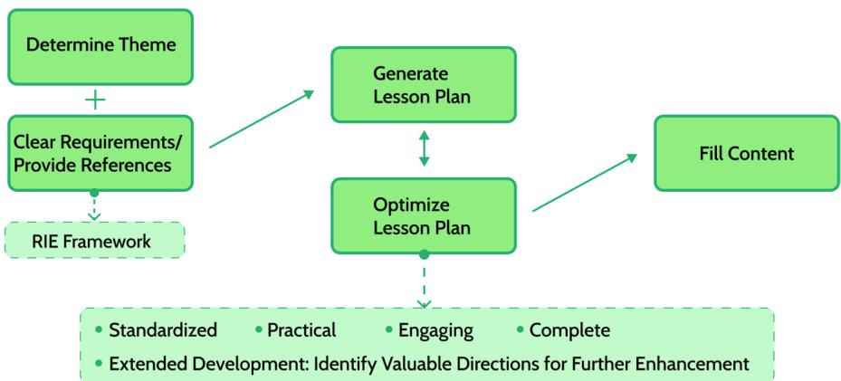  
Fig. 23 ChatGPT Prompt Framework

● Role (R): Define the role you want the AI to take. This sets the tone and expertise level for the output.

● Instructions (I): Clearly state your requirements, including scope, subject matter, etc.

● End Goal (E): Specify the goal of the output, what you aim to achieve with it.

Additionally, among the steps in the ChatGPT-assisted lesson planning process, the Optimize Lesson Plan step is identified as the most critical. Through analysis and synthesis, lesson plans generated by ChatGPT can be evaluated based on the following four core areas, along with an additional dimension for extended development. These four areas are:

● Standardized: Ensures that lesson plans align with educational standards and have clearly defined objectives.

● Practical: Emphasizes ease of implementation for teachers while ensuring clarity and understandability for students.

● Engaging: Focuses on maintaining student interest and active participation throughout the lesson.

● Complete: Guarantees that the lesson plan covers all essential instructional steps and components comprehensively.

In addition to these core areas, the framework includes an Extension dimension:

● Extension: Guides teachers to identify valuable directions for developing and continuously refining lesson content.

This is summarized as the ‘four points and one line’ of lesson plan optimization, enabling teachers to iteratively evaluate and enhance the lesson plans generated by ChatGPT for improved outcomes. It is evident that when a teacher clearly articulates their needs, ChatGPT can rapidly generate responses, significantly saving the teacher’s time (van and Elize du Plessis, 2023). However, the practical application of this content ultimately relies on the teacher’s professional judgment (Greenfield, 2023). During the optimization process, it is essential for teachers to critically evaluate the content provided by ChatGPT to ensure its relevance and accuracy. Thus, the effectiveness of ChatGPT-assisted lesson planning hinges on the ability to craft well-structured and specific prompts. Clear and precise prompts enable teachers to access the most useful and relevant information for their instructional needs.

The prompt framework not only enables art education teachers to use ChatGPT for high-quality lesson planning, but also demonstrates potential generalizability to broader educational contexts. It can be applied and tested across different subject domains (e.g., science, engineering, mathematics), educational levels (e.g., primary, secondary, higher education), and instructional formats (e.g., online courses, flipped classrooms). Within this process, two steps warrant particular attention: the initial RIE structure for prompt construction, and the mid-stage optimization guided by the ‘four points and one line’ evaluation criteria. Future external validation and replication studies will be essential to assess the generalizability and robustness of the proposed framework, as well as to identify the context-specific adaptations required to maximize its effectiveness in meeting the diverse needs of teachers and learners across various educational settings.

## Design Suggestions

Based on the challenges teachers face when using ChatGPT for lesson planning, this study proposes three design suggestions to enhance ChatGPT’s functionality and effectiveness.

While ChatGPT can provide specific and personalized instruction (van and Elize du Plessis, 2023), there remains significant potential for enhancing its personalization capabilities, an area largely unexplored by previous studies One key to improving ChatGPT's ability to deliver personalized content lies in providing it with sufficient and relevant information. If teachers regularly share art education-related course content and materials with ChatGPT, the system could learn and integrate this data, effectively functioning as a teacher’s personalized resource bank. Through continuous interaction and sharing, ChatGPT could adapt to individual teachers’ styles and preferences, enabling it to better understand their needs. Consequently, when teachers plan lessons, ChatGPT would be able to offer more accurate, relevant, and customized responses, tailored to specific teaching methods and requirements, eliminating the need to repeatedly specify details during each interaction.

ChatGPT’s ability to generate images directly or provide links to resources has proven invaluable for children’s art teachers, who express high expectations for the future development of this feature. However, the multimedia resource functionality is currently underdeveloped and has not yet been extensively researched in academic literature. Enhancing the logical accuracy of image generation is merely the starting point for ChatGPT’s image technology, which holds significant potential for diverse applications in children's art education. For example, teachers envision generating example artworks tailored to various curriculum themes to inspire and visually guide students during lessons. They also hope to create neat, clear examples of blackboard writing and to receive recommendations for reading materials, complete with cover images, for a more intuitive selection process. In terms of result presentation, teachers overwhelmingly prefer the direct display of images rather than links. This approach eliminates the need for less tech-savvy educators to navigate external pages, thereby reducing the likelihood of errors. By improving image generation, ChatGPT can significantly enhance the teacher preparation experience by offering high-quality visual aids that support all aspects of teaching and learning (Armianu, 2024).

The extension of the ‘four points and one line’ concept in the ChatGPT Prompt Framework is highly effective for helping teachers optimize their lesson plans However, a current limitation in ChatGPT's interaction model is its inability to explore multiple conversational directions simultaneously. This issue stems from how ChatGPT processes and generates responses (Hu et al., 2020). While the model excels at maintaining focus within a single dialogue thread, it struggles to recognize when users intend to branch into different topics or explore multiple pathways concurrently. Midjourney, although fundamentally different from ChatGPT in operation (Derevyanko, N., & Zalevska, O, 2023) serves as a valuable reference for interaction design. Midjourney allows the user to progressively optimize among four choices and retains the possibility of re-selecting other options at any time. To enhance flexibility and user satisfaction, ChatGPT could adopt similar strategies. First, introducing a mind map or tree view in the user interface could visually display all dialogue paths and branches, helping users navigate the conversation more intuitively. Second, implementing multipath tracking and management at a technical level would enable ChatGPT to simultaneously generate and manage multiple conversational threads in the background. Additionally, integrating features for direct content manipulation, such as text selection, highlighting, and editing, would empower users to better organize and refine ChatGPT’s responses. These functionalities would make the optimization process more interactive and adaptable, enabling teachers to filter content, eliminate redundancies, and integrate responses seamlessly into their lesson planning workflow.

## Limitation and Future Work

This study has several limitations. First, the small number of participants resulted in a limited sample size, which may impact the accuracy and generalizability of the findings. However, this study collected both qualitative and quantitative data to compensate for this limitation. Qualitative data often relies on smaller sample sizes, as its focus is on gaining deep insights rather than broad generalizability. Therefore, in this study, the combination of qualitative and quantitative data provided a more holistic understanding, with qualitative insights capturing the nuanced experiences of teachers and quantitative evaluations offering measurable comparisons of lesson plan quality. While the study focused on STEAM arts education, only two participants had STEAM-related backgrounds and experience. As a result, the findings may not offer a comprehensive understanding of STEAM arts education. However, efforts were made to ensure the relevance of the data by selecting participants with professional experience in art education. Therefore, all participants had professional expertise in art education, which ensured that the findings remained relevant to the study's aim of better integrating art into STEAM education.

Another notable limitation is the potential bias inherent in self-reported data. Since the study relied on surveys and interviews, participants may have provided socially desirable responses or expressed personal biases regarding the benefits and challenges of using ChatGPT. To mitigate this, the study also incorporated objective data by having professors independently evaluate the lesson plans generated by ChatGPT, adding a layer of external validation.

Furthermore, this study did not include feedback from students regarding their experiences and reactions to lesson plans created with the assistance of ChatGPT. This omission leaves an important perspective unexplored, as students' engagement and learning outcomes are crucial to evaluating the effectiveness of these lesson plans. Future studies should address this gap by collecting student feedback to better understand the impact of ChatGPT-generated lesson plans on learning experiences and outcomes. Future studies should also explore its broader implications from diverse perspectives, incorporating teachers’ and students’ practical experiences to provide a richer evidence base. Lastly, one of the limitations is in regard to the rapid evolution of AI technology which poses a challenge to the timeliness and relevance of such research. Therefore, future investigations should aim to capture the dynamic nature of AI applications in education and specific application of AI in children's art education lesson planning.

In addition to addressing the limitations of this study, future research could explore ChatGPT’s use in comparison with other AI tools, such as specialized educational AI systems, to understand its relative strengths and limitations in educational settings. Furthermore, investigations could examine the feasibility and benefits of creating customizable ChatGPT models tailored to specific educational domains, such as art education or STEAM education, by incorporating user-provided training data. These enhancements could enable ChatGPT to deliver more domain-specific, personalized, and effective lesson planning support, further advancing its potential as a transformative educational tool.

## Conclusion

This study explored the potential of generative AI, specifically ChatGPT, in optimizing lesson planning for STEAM arts education. By comparing traditional lesson planning methods with ChatGPT-assisted approaches through a mixed-methods design, the research highlighted both the strengths and limitations of AI in this context.

The findings demonstrate that ChatGPT can significantly streamline lesson planning, foster cross-disciplinary integration, and enhance the efficiency and quality of lesson content. However, challenges remain, including insufficient personalization and usefulness of generated content, illogical image generation and resource provision, and limited interactivity, such as the unidirectional nature of interactions. Addressing these issues is crucial for broader implementation.

Furthermore, a detailed analysis of three AI-assisted lesson planning methods (A, B, and C) provided valuable insights into their practical applications, helping to identify the most effective strategies for integrating ChatGPT into the lesson planning process. Key stages for ChatGPT integration are proposed, focusing on content generation and resource discovery. Additionally, based on the ChatGPT-assisted process, a Prompt Framework is introduced to offer teachers clear guidance, enabling them to leverage ChatGPT more effectively and create engaging, practical lesson content. These results contribute to the ongoing development of generative AI in education, particularly in the context of children's art education. Future research should focus on refining AI tools to address current limitations, with the aim of enhancing their role in educational settings and ensuring that AI technology can be fully utilized to benefit both educators and students.

## Appendix 1

Table 4 Intraclass Correlation Coefficient Results
<table><tr><td colspan="4">Intraclass Correlation Coefficient Results</td></tr><tr><td>Two-way random absolute agreement average measure ICC(2,k)</td><td>ICC</td><td>95% CI</td><td>Reli- ability</td></tr><tr><td>Total Score</td><td>0.869</td><td>0.769~0.935</td><td>excellent</td></tr><tr><td>Introduction Score</td><td>0.762</td><td>0.588~0.880</td><td>good</td></tr><tr><td>Teaching Method Score</td><td>0.616</td><td>0.369~0.799</td><td>moderate</td></tr><tr><td>Practical Method Score</td><td>0.713</td><td>0.514~0.853</td><td>good</td></tr><tr><td>Interdisciplinary Score</td><td>0.695</td><td>0.480~0.845</td><td>moderate</td></tr><tr><td>After Class Score</td><td>0.853</td><td>0.745~0.926</td><td>excellent</td></tr><tr><td>Core Competency Score</td><td>0.789</td><td>0.641~0.892</td><td>good</td></tr><tr><td colspan="4">ICC values&lt;0.5 indicate poor reliability, 0.5—0.75 indicate moderate reliability, 0.75—0.9 indicate good reliability, and&gt;0.9 indicate excellent reliability</td></tr></table>

## Appendix 2

<table><tr><td>Role</td><td>Details</td></tr><tr><td>Prompts</td><td>theme of color art. The course aims to cultivate children&#x27;s creativity, communication skills, critical thinking, I am an elementary school art teacher, currently preparing a course for third graders (7-9 years old) on the and collaboration skills. Can you help me come up with a specific course topic that fits the age group?</td></tr><tr><td>ChatGPT Answers</td><td>A Specific Lesson Plan Suitable for Third Grade (Ages 7-9) on Color Art, Titled &quot;Exploring the World of Rainbows&quot;</td></tr><tr><td></td><td>This topic is not only fun but also cultivates children&#x27;s creativity, communication skills, critical thinking, and collaboration abilities. Below is a detailed lesson plan:</td></tr><tr><td></td><td>Course Goals:</td></tr><tr><td></td><td>• Understand the basics of color theory (e.g., primary colors, secondary colors, complementary colors).</td></tr><tr><td></td><td>• Comprehend color mixing and matching techniques through observation and practice.</td></tr><tr><td></td><td>• Foster students&#x27; creativity by encouraging them to express their emotions and imagination through colors.</td></tr><tr><td></td><td>• Promote collaboration and communication among students through team projects.</td></tr><tr><td></td><td>Course Content:</td></tr><tr><td></td><td>Introduction: Basics of Color</td></tr><tr><td></td><td>• Introduce the three primary colors (red, yellow, blue) and the secondary colors (orange, green, purple) formed by mixing them.</td></tr><tr><td></td><td>• Demonstrate complementary color relationships and discuss how colors affect each other.</td></tr><tr><td></td><td></td></tr><tr><td></td><td>• Students work in groups to perform color mixing experiments, using paints or colored paper</td></tr><tr><td></td><td>to observe color changes. • Through hands-on activities, students learn how to blend different colors.</td></tr><tr><td></td><td>Creation: Rainbow Artwork</td></tr><tr><td></td><td>• Each student creates a piece of artwork themed &quot;Rainbow World,&quot; encouraging them to use</td></tr><tr><td></td><td>their color knowledge and imagination. • Students can use various drawing tools such as watercolors, crayons, colored pencils, etc.</td></tr><tr><td></td><td>Presentation and Discussion</td></tr><tr><td></td><td>• Students showcase their artwork and give a brief introduction, sharing their creative process and color choices.</td></tr><tr><td></td><td>• Classmates can ask questions and provide comments, fostering critical thinking and communication skills.</td></tr><tr><td></td><td>Collaborative Project: Class Rainbow Mural</td></tr><tr><td></td><td>• The entire class collaborates to create a large rainbow mural. Each group is responsible for a section of the mural, and all sections are assembled to form a complete rainbow.</td></tr><tr><td></td><td>• Through teamwork, students enhance their collaborative skills and experience the joy of</td></tr><tr><td></td><td>collective creation. Teaching Tools and Materials:</td></tr><tr><td></td><td>• Colored paper, paints, brushes, palettes</td></tr><tr><td></td><td>• Watercolors, crayons, colored pencils</td></tr><tr><td></td><td>• Canvas or large sheets of paper (for the class mural)</td></tr><tr><td></td><td>• Teaching PPT, including images and videos about color theory</td></tr><tr><td>Extension Activities:</td><td></td></tr><tr><td></td><td>• Encourage students to continue exploring color usage at home, such as categorizing</td></tr><tr><td></td><td>everyday objects by color or designing their own rainbow decorations. • Suggest parents engage in simple color experiments with their children to increase parent-</td></tr><tr><td>child interaction. various key skills through creation and collaboration.</td><td>Through this course, students not only gain a rich understanding of color theory but also improve</td></tr></table>

Fig. 24 ChatGPT Dialogue Records 1

<table><tr><td>Role</td><td>Details</td></tr><tr><td>Prompts</td><td>Help me design the introduction part of the course to make it engaging and interesting, naturally leading into the course content.</td></tr><tr><td>ChatGPT</td><td>To design a lively and interesting course introduction, interactive activities that capture children&#x27;s attention can be used. Below is a detailed introduction section design:</td></tr><tr><td>Answers</td><td>Course Introduction Design</td></tr><tr><td></td><td>1. Welcome and Guidance • Teacher&#x27;s Greeting: Start the class with an enthusiastic greeting, such as: &quot;Hello everyone!</td></tr><tr><td></td><td>Today we are going to enter a colorful world together and see how magical colors can be!&quot;</td></tr><tr><td></td><td>• Classroom Rules: Briefly introduce classroom rules, such as staying quiet, participating actively, and respecting others.</td></tr><tr><td></td><td>2. Magical Color Show • Magic Performance: The teacher can prepare three bottles of clear water and add red,</td></tr><tr><td></td><td>yellow, and blue food coloring to them. Then, in a magical way (like adding water or stirring), demonstrate how these three primary colors mix to form orange, green, and purple.</td></tr><tr><td></td><td>• Teacher Demonstration: Mix red and yellow to make orange, yellow and blue to make green, and blue and red to make purple.</td></tr><tr><td></td><td>• Interactive Questions: Before each mix, the teacher can ask students: &quot;Can you quess what<!-- 存疑：疑为 guess 的 OCR 误识，源为 Fig. 25 图片内对话，pypdf 无法核验 --></td></tr><tr><td></td><td>color these two will make when mixed?&quot; 3. Rainbow Story Time</td></tr><tr><td></td><td>• Storytelling: The teacher can tell a story about rainbows, such as &quot;The Rainbow Fish&quot; or</td></tr><tr><td></td><td>another color-related children&#x27;s story, to capture students&#x27; attention. • Visual Display: Use picture books or a projector to show colorful images from the story,</td></tr><tr><td></td><td>letting students visually appreciate the beauty of colors. 4. Game: Color Adventure</td></tr><tr><td></td><td>• Game Setup: Arrange various items or pictures with different colors in the classroom, representing the three primary colors (red, yellow, blue) and the three secondary colors</td></tr><tr><td></td><td>(orange, green, purple). • Task Assignment: Divide students into groups and give each group a task card, which</td></tr><tr><td></td><td>specifies the color items they need to find. • Adventure Begins: Students search for the specified color items in the classroom and bring</td></tr><tr><td></td><td>them back to their group. After completing the task, each group presents the color items they found. • Teacher Guidance: During each group&#x27;s presentation, the teacher briefly explains how these</td></tr><tr><td></td><td>colors are formed.</td></tr><tr><td></td><td>5. Introducing the Course Theme • Summary and Transition: The teacher summarizes the colors involved in the game and transitions to the course theme: &quot;We just found many colors in our game. Now we are going to</td></tr><tr><td></td><td>learn the secrets of these colors, see how they are made, and use them to paint a beautiful rainbow world!&quot;</td></tr><tr><td></td><td>• Course Goals: Briefly introduce the learning objectives of this lesson so that students know what they will be learning next, sparking their interest.</td></tr><tr><td></td><td>Required Materials</td></tr><tr><td></td><td>• Three bottles of clear water and food coloring (red, yellow, blue)</td></tr><tr><td></td><td>• Picture books or a rainbow storybook</td></tr><tr><td></td><td>• Various colored items or pictures</td></tr><tr><td></td><td>• Task cards</td></tr><tr><td></td><td>Interaction and Motivation • Praise and Rewards: Throughout the activities, promptly praise students who participate</td></tr><tr><td></td><td>actively. Prepare small prizes or stickers as rewards. • Stimulate Curiosity: Use questions and interactions to stimulate students&#x27; curiosity about</td></tr><tr><td></td><td>colors, making them eager to learn the upcoming content.</td></tr><tr><td>introduce the course content.</td><td>This design allows students to understand the basics of colors in a relaxed and enjoyable atmosphere, while interaction and games stimulate their interest in learning and naturally</td></tr></table>

Fig. 25 ChatGPT Dialogue Records 2

<table><tr><td>Role</td><td>Details</td></tr><tr><td>Prompts</td><td>The idea of the game: Color Exploration is good. Can you redesign a course topic using this as the introduction?</td></tr><tr><td>ChatGPT Answers</td><td>Course Topic: Color Adventure Team Course Goals:</td></tr><tr><td></td><td>• Understand the basics of color theory (e.g., primary colors, secondary colors, complementary colors). • Comprehend color mixing and matching techniques through games and experiments.</td></tr><tr><td></td><td>• Foster students&#x27; creativity by encouraging them to express their emotions and imagination through colors.</td></tr><tr><td></td><td>• Promote collaboration and communication among students through team projects.</td></tr><tr><td>Course Content:</td><td></td></tr><tr><td></td><td>Introduction: Color Adventure Game • Game Setup: Arrange various items or pictures with different colors in the classroom,</td></tr><tr><td></td><td>representing the three primary colors (red, yellow, blue) and the three secondary colors (orange, green, purple).</td></tr><tr><td></td><td>• Task Assignment: Divide students into groups and give each group a task card, which</td></tr><tr><td></td><td>specifies the color items they need to find. • Adventure Begins: Students search for the specified color items in the classroom and bring</td></tr><tr><td></td><td>them back to their group. After completing the task, each group presents the color items they found.</td></tr><tr><td></td><td>• Teacher Guidance: During each group&#x27;s presentation, the teacher briefly explains how these</td></tr><tr><td></td><td>colors are formed. Basic Color Knowledge</td></tr><tr><td></td><td>• Explanation and Display: Use PPT or a projector to introduce the three primary colors (red, yellow, blue) and the secondary colors (orange, green, purple) formed by mixing them.</td></tr><tr><td></td><td>• Interactive Questions: During the explanation, the teacher can ask students: &quot;Which colors do you think can be mixed to create new colors?&quot;</td></tr><tr><td></td><td>Practical Part: Color Mixing Experiment</td></tr><tr><td></td><td>• Experiment Steps: Each group receives paint and a palette and follows the teacher&#x27;s instructions to conduct color mixing experiments and observe color changes.</td></tr><tr><td></td><td>• Recording and Discussion: Students record the colors created from each mix and discuss</td></tr><tr><td></td><td>the reasons for the color changes with their group members. Creative Part: Rainbow Adventure Artwork</td></tr><tr><td></td><td>• Individual Creation: Each student creates a piece of artwork themed &quot;Rainbow Adventure,&quot; using their color knowledge and imagination.</td></tr><tr><td></td><td>• Sharing and Evaluation: Students showcase their artwork and give a brief introduction, sharing their creative process and color choices. Other students can ask questions and</td></tr><tr><td></td><td>Collaborative Project: Class Rainbow Mural</td></tr><tr><td></td><td>• Division of Labor and Cooperation: The entire class collaborates to create a large rainbow mural. Each group is responsible for one section, and all sections are assembled to form a</td></tr><tr><td></td><td>complete rainbow. • Display and Summary: Display the completed rainbow mural, with each group presenting</td></tr><tr><td></td><td>their creative process and feelings. The teacher concludes by emphasizing the importance of cooperation.</td></tr><tr><td></td><td>Teaching Tools and Materials</td></tr><tr><td></td><td>• Various colored items or pictures (for the game) • Paint, palettes, brushes</td></tr><tr><td></td><td>• Watercolors, crayons, colored pencils</td></tr><tr><td></td><td></td></tr><tr><td></td><td>• Canvas or large sheets of paper (for the mural) • Teaching PPT, including images and videos about color theory</td></tr><tr><td></td><td></td></tr><tr><td></td><td>Extension Activities</td></tr><tr><td></td><td>• Encourage students to continue exploring the use of colors at home by categorizing everyday items by color or designing their own rainbow decorations.</td></tr><tr><td></td><td>• Suggest parents engage in simple color experiments with their children to increase parent-</td></tr><tr><td></td><td>child interaction.</td></tr><tr><td>teamwork.</td><td>Through this course design, students can easily and happily understand the basics of color theory through games, improve various key skills through practice and creation, and experience the joy of</td></tr></table>

Fig. 26 ChatGPT Dialogue Records 3

<table><tr><td rowspan=1 colspan=1>Role</td><td rowspan=1 colspan=1>Details (selection)</td></tr><tr><td rowspan=1 colspan=1>Prompts</td><td rowspan=1 colspan=1>Remove the collaboration project and add a part for appreciating artworks, and redesign a teaching plan.</td></tr><tr><td rowspan=1 colspan=1>ChatGPTAnswers</td><td rowspan=1 colspan=1>Appreciation Section: Color Art Appreciation• Artwork Display: The teacher displays some famous paintings, especially those known fortheir unique use of color (such as Van Gogh&#x27;s &quot;Starry Night&quot; and Mondrian&#x27;s &quot;Compositionwith Red, Yellow, and Blue&quot;).• Appreciation Discussion: Guide students to observe and discuss the use of colors in thesepaintings, asking questions such as: &quot;Do you like the colors in this painting? Why?&quot; and &quot;Howdo these colors make you feel?&quot;• Inspiring Thoughts: Through discussion, help students understand the significance and roleof different colors in artistic creation.</td></tr><tr><td rowspan=1 colspan=1>Prompts</td><td rowspan=1 colspan=1>Can you generate image materials for the part where the three primary colors and their mixed secondarycolors are demonstrated.</td></tr><tr><td rowspan=1 colspan=1>ChatGPTAnswers</td><td rowspan=1 colspan=1>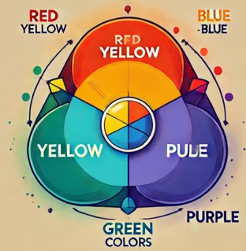</td></tr><tr><td rowspan=1 colspan=1>Prompts</td><td rowspan=1 colspan=1>Can you provide relevant links for the artwork appreciation part?</td></tr><tr><td rowspan=1 colspan=1>ChatGPTAnswers</td><td rowspan=1 colspan=1>Here are some links you can use for the artwork appreciation section, containing famous paintingsand their descriptions:Van Gogh&#x27;s &quot;Starry Night&quot;:• Wikipedia: &quot;Starry Night&quot;• MoMA - Museum of Modern Art, New YorkMondrian&#x27;s &quot;Composition with Red, Yellow, and Blue&quot;:• Wikipedia: &quot;Composition with Red, Yellow, and Blue&quot;• Tate - Tate MuseumThrough these links, students can learn more about the background knowledge and artistic valueof these famous paintings.</td></tr></table>

Fig. 27 ChatGPT Dialogue Records 4

## Appendix 3

## Conduct semi-structured interviews template

1. What are some of the major challenges you have encountered in using ChatGPT for lesson planning? What were the specific challenges? (e.g., technical issues, quality of generated content, etc.

2. What difficulties did you encounter in screening and modifying the content generated by ChatGPT? How did these difficulties affect the efficiency and effectiveness of your lesson planning?

3. What problems have you encountered in familiarizing yourself with and learning how to use ChatGPT? Did these problems affect your experience of using it? How did they affect it?

4. What do you think are the shortcomings of the instructional content generated by ChatGPT? (Accuracy, usefulness and innovation of content).

5. Do you think there is room for improvement in the resources provided by ChatGPT (e.g., images, videos, PPTs, etc.)? Which aspect specifically?

6. What are your unmet needs in using ChatGPT for lesson planning?

## Appendix 4

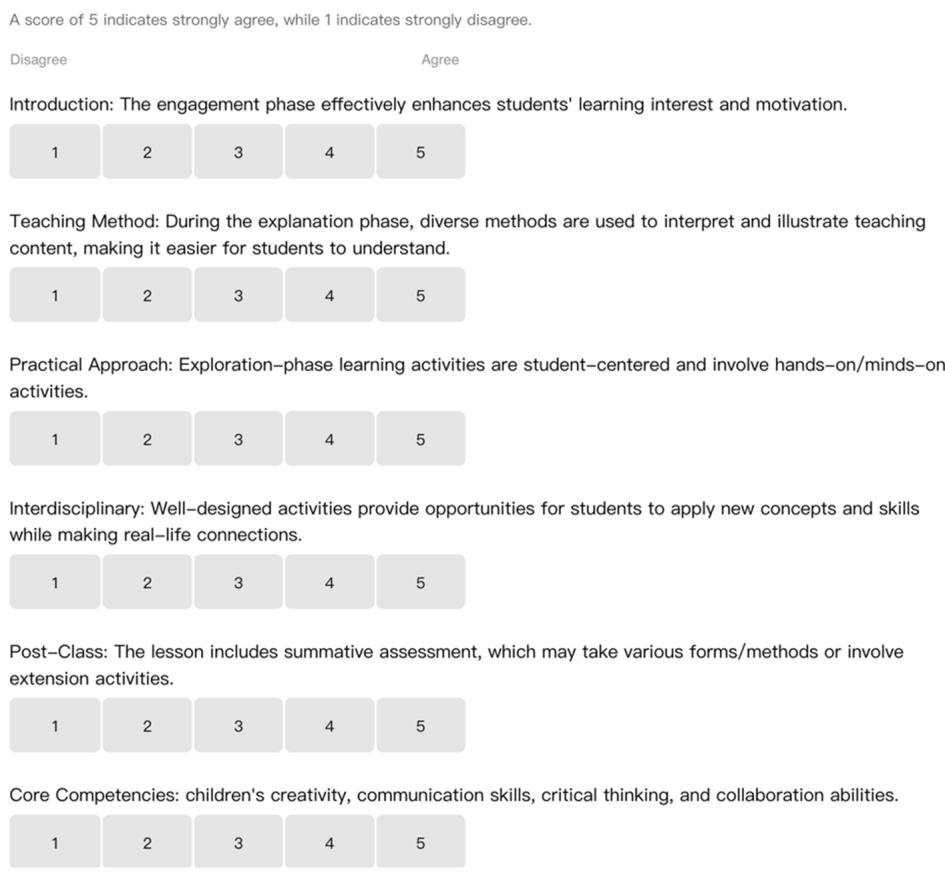  
Fig. 28 Evaluation form used by the professor

Author Contribution ZH.L. and R.T. wrote the main manuscript text and ZH.L. prepared Figs. 1–28. All authors reviewed the manuscript.

Funding No external funding was received for this study. The article processing charge was supported by Goldsmiths, University of London.

Data Availability No datasets were generated or analysed during the current study.

## Declarations

Competing interests The authors declare no competing interests.

Open Access This article is licensed under a Creative Commons Attribution 4.0 International License, which permits use, sharing, adaptation, distribution and reproduction in any medium or format, as long as you give appropriate credit to the original author(s) and the source, provide a link to the Creative Commons licence, and indicate if changes were made. The images or other third party material in this article are included in the article’s Creative Commons licence, unless indicated otherwise in a credit line to the material. If material is not included in the article’s Creative Commons licence and your intended use is not permitted by statutory regulation or exceeds the permitted use, you will need to obtain permission directly from the copyright holder. To view a copy of this licence, visit http://creativecommons.org/licenses/by/4.0/.

## References

Acquah, B. Y. S., Arthur, F., Salifu, I., Quayson, E., & Nortey, S. A. (2024). Preservice teachers’ behavioural intention to use artificial intelligence in lesson planning: A dual-staged PLS-SEM-ANN approach. Computers and Education: Artificial Intelligence. https://doi.org/10.1016/j.caeai.2024.100307

Adamu, I., & Garba, H. (2024). Implementing ChatGPT-4 in educational technologies: A detailed guide to developing lesson plans. Journal of Economics, Business, and Market Research, 3(1), 580–594. https://www.scitcentral.com/documents/f7005060714892492a10d38a8a2733ac.pdf.

Ahmed A. (2023). Exploring Different Prompt Frameworks and Their Applications. LinkedIn. [online] Available at: https://www.linkedin.com/pulse/exploring-different-prompt-frameworks-applications-ahmed-albadri-kwj9f/.

Armianu, I. (2024). AI TEXT TO IMAGE GENERATORS IN EDUCATION TECHNOLOGY, THE POSTMODERN BREAKTHROUGH. EDULEARN proceedings. [online] https://doi.org/10.21125/edulearn.2024.0124.

Atchley, P., Pannell, H., Wofford, K., Hopkins, M., & Atchley, R. A. (2024). Human and AI collaboration in the higher education environment: Opportunities and concerns. Cognitive Research: Principles and Implications, 9(1), 20.

Bansal, G., Vinay Chamola, Hussain, A., Mohsen Guizani and Dusit Niyato (2024). Transforming Conversations with AI—A Comprehensive Study of ChatGPT. Cognitive Computation. [online] https://doi.org/10.1007/s12559-023-10236-2.

Baxter, K. (2014). A Convergence of Three: The Reflexive Capacity of Art Practice, Curriculum Design, and Pedagogy. Art Education, 67(6), 28–34. https://doi.org/10.1080/00043125.2014.11519295

Bequette, J. W., & Bequette, M. B. (2012). A place for art and design education in the STEM conversation. Art Education, 65(2), 40–47. https://doi.org/10.1080/00043125.2012.11519167

Boughaddou, H. and Chorfi, K.I., 2024. Exploring Middle School English Teachers’ and Inspectors Perceptions of Using Artificial Intelligence Tools as Lesson Planning Resources in the City of Tiaret (Doctoral dissertation, Ibn Khaldoun University-Tiaret).

Braun, V., & Clarke, V. (2006). Using thematic analysis in psychology. Qualitative Research in Psychology, 3(2), 77–101. https://doi.org/10.1191/1478088706qp063oa

Cathérine Conradty, Sotiriou, S.A. and Bogner, F.X. (2020). How Creativity in STEAM Modules Intervenes with Self-Efficacy and Motivation. Education sciences, [online] 10(3), pp.70–70. https://doi.org/10.3390/educsci10030070.

Chang, Y.-S. and Chou, C. (2020). Integrating Artificial Intelligence into STEAM Education. Communications in computer and information science, [online] pp.469–474. https://doi.org/10.1007/978-981-15-6113-9\_52.

Chen, X., Liao, Y. and Yu, W., 2024, April. Generative AI in Higher Art Education. In 2024 6th International Conference on Computer Science and Technologies in Education (CSTE) (pp. 135–140).

Chiu, T. K. F. (2023). The impact of Generative AI (GenAI) on practices, policies and research direction in education: A case of ChatGPT and Midjourney. Interactive Learning Environments, 32(10), 6187. https://doi.org/10.1080/10494820.2023.2253861

Chiu, T. K. F., Xia, Q., Zhou, X., Chai, C. S., & Cheng, M. (2023). Systematic literature review on opportunities, challenges, and future research recommendations of artificial intelligence in education. Computers and Education: Artificial Intelligence, 4, Article 100118. https://doi.org/10.1016/j.caeai.2022.100118

Correia, A. (2024). On the Human-AI Metaphorical Interplay for Culturally Sensitive Generative AI Design in Music Co-Creation. [online] CEUR Workshop Proceedings. https://converis.jyu.fi/convers/portal/detail/Publication/213728619

Craft, H., & Bland, P. D. (2004). Ensuring lessons teach the curriculum with a lesson plan resource. The Clearing House: A Journal of Educational Strategies, Issues and Ideas, 78(2), 88–94. https://doi.org/10.3200/tchs.78.2.88-94

Crompton, H., & Burke, D. (2024). The educational affordances and challenges of ChatGPT: State of the field. Techtrends, 68(2), 380–392. https://doi.org/10.1007/s11528-024-00939-0

Derevyanko, N., & Zalevska, O. (2023). Comparative analysis of neural networks Midjourney, Stable Diffusion, and DALL-E and ways of their implementation in the educational process of students of design specialities. Scientific Bulletin of Mukachevo State University Series “pedagogy and Psychology,” 9(3), 36–44. https://doi.org/10.52534/msu-pp3.2023.36. Internet Archive.

Du, H., Li, Z., Niyato, D., Kang, J., Xiong, Z., Xuemin, Shen and Kim, D.I. (2023). Enabling AI-Generated Content (AIGC) Services in Wireless Edge Networks. [online] arXiv.org. Available at: https://arxiv.org/abs/2301.03220.

Dwivedi, Y. K., Kshetri, N., Hughes, L., Slade, E. L., Jeyaraj, A., Kar, A. K., Baabdullah, A. M., Koohang, A., Raghavan, V., Ahuja, M., Albanna, H., Albashrawi, M. A., Al-Busaidi, A. S., Balakrishnan, J., Barlette, Y., Basu, S., Bose, I., Brooks, L., Buhalis, D., … Wright, R. (2023). Opinion Paper: “So what if ChatGPT wrote it?” Multidisciplinary perspectives on opportunities, challenges and implications of generative conversational AI for research, practice and policy. International Journal of Information Management, 71, 102642. https://doi.org/10.1016/j.ijinfomgt.2023.102642

ElSayary, A. (2023). An investigation of teachers’ perceptions of using ChatGPT as a supporting tool for teaching and learning in the digital era. Journal of Computer Assisted Learning. https://doi.org/10.1111/jcal.12926

Falloon, G., Hatzigianni, M., Bower, M., Forbes, A. and Stevenson, M. (2020). Craft, H. and Bland, P.D. (2004). Ensuring Lessons Teach the Curriculum with a Lesson Plan Resource. The Clearing House: A Journal of Educational Strategies, Issues and Ideas, 78(2):88–94. https://doi.org/10.3200/tchs.78.2.88-94.

Fatemeh Mosaiyebzadeh, Seyedamin Pouriyeh, Parizi, R.M., Nasrin Dehbozorgi, Mohsen Dorodchi and Daniel Macêdo Batista (2023). Exploring the Role of ChatGPT in Education: Applications and Challenges. https://doi.org/10.1145/3585059.3611445.

Goldston, M. J., Day, J. B., Sundberg, C., & Dantzler, J. (2009). Psychometric analysis of a 5E learning cycle lesson plan assessment instrument. International Journal of Science and Mathematical Education/international Journal of Science and Mathematics Education, 8(4), 633–648. https://doi.org/10.1007/s10763-009-9178-7

Greenfield, N.M. (2023). Facing Facts: ChatGPT Can Be a Tool for Critical Thinking. University World News. Available online: https://www.universityworldnews.com/post.php?story=20230222131416630.

Hadinugrahaningsih, T., Rahmawati, Y., & Sastrapraja, A. (2017). Developing 21st century skills in chemistry classrooms: Opportunities and challenges of STEAM integration. AIP Conference Proceedings, 1868, Article 030008. https://doi.org/10.1063/1.4995107

Hejji Alanazi, M. (2019). A study of the pre-service trainee teachers problems in designing lesson plans. Arab World English Journal, 10(1), 166–182. https://doi.org/10.24093/awej/vol10no1.15

Henderson, J. G., & Gornik, R. (2007). Transformative curriculum leadership (3rd edition). Pearson Education.

Herro, D., & Quigley, C. (2016). Exploring teachers’ perceptions of STEAM teaching through professional development: Implications for teacher educators. Professional Development in Education, 43(3), 416–438. https://doi.org/10.1080/19415257.2016.1205507

Hetland, L., Winner, S., & Sheridan, K. (2013). Studio Thinking 2: The Real Benefits of Visual Arts Education. New York: Teachers College Press.

Holmes, W., Bialik, M. and Fadel, C. (2019). Artificial Intelligence in Education Promises and Implications for Teaching and Learning - UCL Discovery. Ucl.ac.uk. [online] https://discovery.ucl.ac.uk/id/eprint/10139722/.

Holt, L. (2024). A Map of Generative AI for Education - Laurence Holt - Medium. [online] Medium. Available at: https://medium.com/@LaurenceHolt/a-map-of-generative-ai-for-education-6598e85a172e.

Hu, Z., Dong, Y., Wang, K., Chang, K.-W. and Sun, Y. (2020). GPT-GNN. Proceedings of the 26th ACM SIGKDD International Conference on Knowledge Discovery & Data Mining. https://doi.org/10.1145/3394486.3403237.

Huizinga, T., Handelzalts, A., Nieveen, N., & Voogt, J. (2014). Teacher involvement in curriculum design: Need for support to enhance teachers’ design expertise. Journal of Curriculum Studies, 1(46), 33–57. https://doi.org/10.1080/00220272.2013.834077

Hunter-Doniger, T. (2018). Art infusion: Ideal conditions for STEAM. Art Education, 71(2), 22–27. https ://doi.org/10.1080/00043125.2018.1414534

Hutson, J., & Cotroneo, P. (2023). Generative AI tools in art education: Exploring prompt engineering and iterative processes for enhanced creativity. Metaverse, 4(1), 14.

Jadhav, D., Agrawal, S., Jagdale, S., Salunkhe, P. and Salunkhe, R., 2024, October. AI-Driven Text-to-Multimedia Content Generation: Enhancing Modern Content Creation. In 2024 8th International Conference on I-SMAC (IoT in Social, Mobile, Analytics and Cloud)(I-SMAC) (pp. 1610–1615). IEEE.

Jiao, W., Wang, W., Huang, J., Wang, X., Shi, S. and Tu, Z. (2023). Is ChatGPT A Good Translator? Yes With GPT-4 As The Engine. [online] arXiv.org. Available at: https://arxiv.org/abs/2301.08745.

Kamalov, F., Santandreu Calonge, D., & Gurrib, I. (2023). New era of artificial intelligence in education: Towards a sustainable multifaceted revolution. Sustainability, 15(16), 12451–12451. https://doi.org/10.3390/su151612451

Kang, N.-H. (2019). A review of the effect of integrated STEM or STEAM (science, technology, engineering, arts, and mathematics) education in South Korea. Asia-Pacific Science Education. https://doi.org/10.1186/s41029-019-0034-y

Kasneci, E., Sessler, K., Küchemann, S., Bannert, M., Dementieva, D., Fischer, F., Gasser, U., Groh, G., Günnemann, S., Hüllermeier, E., Krusche, S., Kutyniok, G., Michaeli, T., Nerdel, C., Pfefer, J., Poquet, O., Sailer, M., Schmidt, A., Seidel, T., … Kasneci, G. (2023). ChatGPT for good? On opportunities and challenges of large language models for education. Learning and Individual Differences, 103, Article 102274. https://doi.org/10.1016/j.lindif.2023.102274

Kehoe, F. (2023). Leveraging generative AI tools for enhanced lesson planning in initial teacher education at post primary. Irish Journal of Technology Enhanced Learning, 7(2), 172–182.

Kim, J. (2024). Leading teachers’ perspective on teacher-AI collaboration in education. Education and Information Technologies, 29(7), 8693–8724.

Land, M. H. (2013). Full STEAM ahead: The benefits of integrating the arts into STEM. Procedia Computer Science, 20, 547–552. https://doi.org/10.1016/j.procs.2013.09.317

Lee, G. G., & Zhai, X. (2024). Using chatgpt for science learning: A study on pre-service teachers’ lesson planning. IEEE Transactions on Learning Technologies. https://doi.org/10.1109/TLT.2024.3401457

Lee, J. (2023). ChatGPT and Assessment in Higher Education. [online] Available at: https://s1.c21u.gatech.edu/sites/default/files/publication/2023/03/C21U%20ChatGPT%20White%20Paper\_Final.pdf.

Li, X., Ju, P., Zhang, J. and Zhao, S. (2024). Research on the Application of ChatGPT in the Interdisciplinary of Higher Education. Journal of Artificial Intelligence Practice, 7(1). https://doi.org/10.23977/jaip.2024.070107.

Luckin, R., Holmes, W., Griffiths, M. and Laurie B Forcier Pearson (2016). Intelligence Unleashed An argument for AI in Education. [online] Available at: https://www.pearson.com/content/dam/corporate/global/pearson-dot-com/files/innovation/Intelligence-Unleashed-Publication.pdf.

Maguire, M. and Delahunt, B. (2017). Doing a thematic analysis: A practical, step-by-step guide for learning and teaching scholars. All Ireland Journal of Higher Education, [online] 9(3). Available at: https: //ojs.aishe.org/index.php/aishe-j/article/view/335.

Mahasen Sehweil, Mahmoud, S. and Jeidi, M. (2022). The Importance of the Lesson Plan Elements in Education and Teachers’ Practices of Them. Lecture notes in educational technology, [online] pp.87– 99. https://doi.org/10.1007/978-981-19-0101-0\_8.

Mansoor, M., Chandar, S. and Srinath, R., 2021. AI based Presentation Creator With Customized Audio Content Delivery. arXiv preprint arXiv:2106.14213.

Marín-Marín, J.-A., Moreno-Guerrero, A.-J., Dúo-Terrón, P., & López-Belmonte, J. (2021). Steam in education: A bibliometric analysis of performance and co-words in web of science. International Journal of STEM Education. https://doi.org/10.1186/s40594-021-00296-x

Ming, Y., Hu, N., Fan, C., Feng, F., Zhou, J., & Yu, H. (2022). Visuals to text: A comprehensive review on automatic image captioning. IEEE/CAA Journal of Automatica Sinica, 9(8), 1339–1365. https://doi.org/10.1109/jas.2022.105734

Mishra, P., Henriksen, D., & Richardson, C. (2023). From crayons to AI: Widening the lens on educational technology and creativity. TechTrends, 67(2), 207–212. https://doi.org/10.1007/s11528-023-00839-9

Moore, M. G., & Kearsley, G. G. (1996). Distance education: A system view.

Moundridou, M., Matzakos, N., & Doukakis, S. (2024). Generative AI tools as educators’ assistants: Designing and implementing inquiry-based lesson plans. Computers and Education: Artificial Intelligence, 7, Article 100277.

Nielsen, J. (2023). AI: First New UI Paradigm in 60 Years. [online] Nielsen Norman Group. Available at: https://www.nngroup.com/articles/ai-paradigm/.

Opara, E., Mfon-Ette Theresa, A. and Aduke, T.C., 2023. ChatGPT for teaching, learning and research: Prospects and challenges. Opara Emmanuel Chinonso, Adalikwu Mfon-Ette Theresa, Tolorunleke Caroline Aduke (2023). ChatGPT for Teaching, Learning and Research: Prospects and Challenges. Glob Acad J Humanit Soc Sci, 5.

Opara, E., Theresa, M.-E. and Aduke, Tolorunleke Caroline (2023). ChatGPT for Teaching, Learning and Research: Prospects and Challenges. [online] Ssrn.com. Available at: https://papers.ssrn.com/sol3/papers.cfm?abstract\_id=4375470

Ożegalska-Łukasik, N., & Łukasik, S. (2023). Culturally responsive artificial intelligence-problems, challenges and solutions. Intercultural Relations. https://doi.org/10.12797/RM.02.2023.14.07

Pavlik, J. V., & Pavlik, O. M. (2024). Art education and generative AI: An exploratory study in constructivist learning and visualization automation for the classroom. Creative Education, 15(04), 601–616.

Qin, Y., Xu, Z., Wang, X., & Skare, M. (2023). Artificial intelligence and economic development: An evolutionary investigation and systematic review. Journal Of The Knowledge Economy. https://doi.org/10.1007/s13132-023-01183-2

Quigley, C. F., Herro, D., King, E., & Plank, H. (2020). STEAM designed and enacted: Understanding the process of design and implementation of STEAM curriculum in an elementary school. Journal of Science Education and Technology, 29(4), 499–518. https://doi.org/10.1007/s10956-020-09832-w

Rahman, M. M., & Watanobe, Y. (2023). ChatGPT for education and research: Opportunities, threats, and strategies. Applied Sciences, 13(9), Article 5783. https://doi.org/10.3390/app13095783

Rospigliosi, P. (2023). Artificial intelligence in teaching and learning: What questions should we ask of ChatGPT? Interactive Learning Environments, 31(1), 1–3. https://doi.org/10.1080/10494820.2023.2180191

Sallam, M., Salim, N., Barakat, M. and Alaa Al-Tammemi (2023). ChatGPT applications in medical, dental, pharmacy, and public health education: A descriptive study highlighting the advantages and limitations. Narra J, 3(1):e103. https://doi.org/10.52225/narra.v3i1.103.

Sanz-Camarero, R., Ortiz-Revilla, Jairo, & Greca, I. M. (2023). The impact of integrated STEAM education on arts education: A systematic review. Education Sciences, 13(11), 1139. https://doi.org/10.3390/educsci13111139

Thornhill-Miller, B., Camarda, A., Mercier, M., Burkhardt, J.-M., Morisseau, T., Bourgeois-Bougrine, S., Vinchon, F., Hayek, S. E., Augereau-Landais, M., Mourey, F., Feybesse, C., Sundquist, D., & Lubart, T. (2023). Creativity, critical thinking, communication, and collaboration: Assessment, certification, and promotion of 21st century skills for the future of work and education. Journal of Intelligence, 11(3), 54–54. https://doi.org/10.3390/jintelligence11030054

Trust, T., Whalen, J. and Chrystalla Mouza (2023). Editorial: ChatGPT: Challenges, Opportunities, and Implications for Teacher Education. Contemporary Issues in Technology and Teacher Education, [online] 23(1), pp.1–23. Available at: https://www.learntechlib.org/p/222408/

Tunç, M. P. (2024). Examining pre-service mathematics teachers’ purposes of using ChatGPT in lesson plan development. Sakarya University Journal of Education, 14(2), 391–406.

van den Berg, G. and du Plessis, E. (2023) ChatGPT and Generative AI: Possibilities for Its Contribution to Lesson Planning, Critical Thinking and Openness in Teacher Education. Education Sciences, 13, Article 998. https://doi.org/10.3390/educsci13100998

Vartiainen, H., & Tedre, M. (2023). Using artificial intelligence in craft education: Crafting with text-toimage generative models. Digital Creativity, 34(1), 1–21.

Voogt, J., & Roblin, N. P. (2012). A comparative analysis of international frameworks for 21st century competences: Implications for national curriculum policies. Journal of Curriculum Studies, 44(3), 299–321. https://doi.org/10.1080/00220272.2012.668938

Winner, E., & Cooper, M. (2000). Mute Those Claims: No Evidence (Yet) for a Casual Link between Arts Study and Academic Achievement. Journal of Aesthetic Education, 34, 11-75. http://dx.doi.org/10. 2307/3333637

Zawacki-Richter, O., Marín, V. I., Bond, M., & Gouverneur, F. (2019). Systematic review of research on artificial intelligence applications in higher education–where are the educators? International Journal of Educational Technology in Higher Education, 16(1), 1–27.

Zhang, W., Shankar, A., & Antonidoss, A. (2022). Modern art education and teaching based on artificial intelligence. Journal of Interconnection Networks, 22(Supp01), 2141005.

Publisher's Note Springer Nature remains neutral with regard to jurisdictional claims in published maps and institutional affiliations.