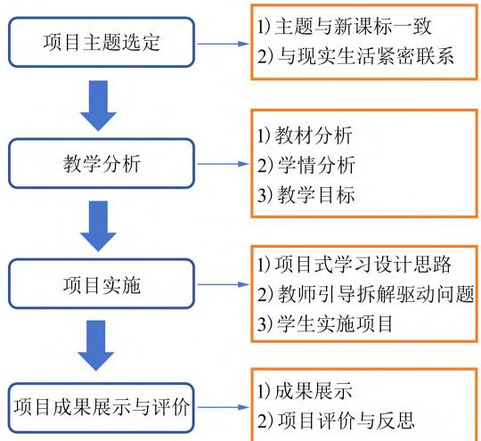
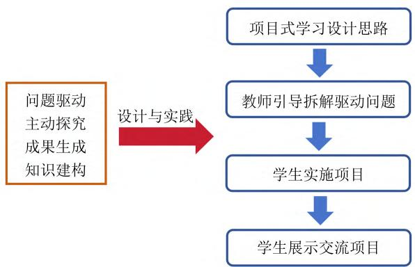
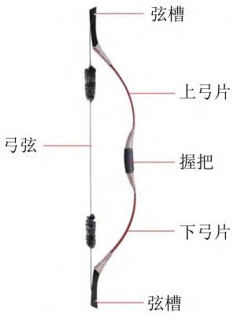
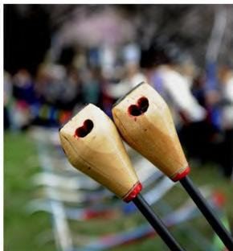
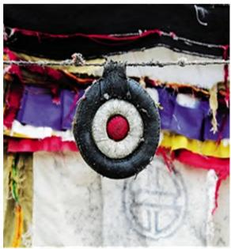

文章编号 ：1005－4642（2024）04－0058－06

# 基于项目式学习的高中物理实验教学———以“自制响箭”为例

崔 悦，杨晓荣（西藏大学 理学院 ，西藏 拉萨850000）

摘 要 项目式学习是一种全新的教学模式 是全面促进中学生核心素养发展的有效途径和手段 能够体现基础教育改革所倡导的“做中学”课程理念．在本研究中 项目式学习包含“主题选定 教学分析 项目实施 项目成果展示与评价”4个阶段 以此为基础在高中物理必修二“机械能守恒定律”一节中设计自制响箭项目．自制响箭项目不仅能够促进学生建构知识 还能够增强学生模型建构和科学推理能力 并能够弘扬中华优秀传统文化 使学生体会到物理学的生活性和文化内涵 从而有效提高物理教学质量

关键词 ：项目式学习 ；机械能守恒定律 ；响箭

中图分类号 ：G633．7

文献标识码 ：B

DOI：10．19655／j．cnki．1005－4642．2024．04．011

《普通高中物理课程标准（2017年版2020年修订） 》［1］明确提出“促进学生物理学科核心素养全面发展的基本理念 对学生能力与素养的发展提出了更高的要求”．近年来，如何培养中学生的物理学科核心素养成为研究热点 并不断探索新的培养策略或模式，而起源于20世纪初的项目式学习受到了基础教育领域研究者的广泛关注．在20世纪90年代 项目式学习迅速发展 成为被广泛应用的科学教育模式．项目式学习集中关注学科核心概念和原理 旨在把学生融入有意义的任务中，让学生积极学习 自主建构知识．在项目式学习中 学生以小组形式解决具有一定挑战性的真实问题 自主决定解决问题的方法 需要进行的活动，并展示交流项目成果［2］ ，教师则在整个过程中扮演指导者与建议者的角色

尽管项目式学习展示出了很好的发展能力与素养教学效果 且受到基础教育领域的广泛重视但在中学物理教学中多用于课外实践活动和研究性学习 并非是常用的课堂教学模式 而在理科教育相对薄弱的西藏地区对其认识与使用就更加缺乏［3］．

为了更好地促进学生核心素养全面发展促进西藏地区物理教育质量的提升 本文尝试将基于项目式学习流程 （图1） 应用于高中物理教学 在高中物理必修二“机械能守恒定律”一节中设计了“制作响箭”项目 并将其应用于教学实践为提升学生的物理学科核心素养提供借鉴

  
图1 项目式学习流程

## 1 项目主题选定

## 1．1 主题与新课标一致

机械能守恒定律作为高中的重点内容 在人教版课程中 其位置在动能定理之后．普通高中物理新课标对机械能守恒的要求是 通过实验 验证机械能守恒定律，理解机械能守恒定律 ，能用机械能守恒定律分析生产生活中的有关问题．项目式学习正好能够通过实验探究的过程 让学生深刻理解能量守恒的规律 并将该规律应用于生活

## 1．2 与现实生活联系紧密

响箭是广泛流行于西藏工布地区的传统特色体育项目 属于射箭的一种 最早从打猎中演变而来 经过1000多年的发展 已成为工布地区在庆祝丰收 迎接新年等重要节庆活动中必不可少的竞技娱乐活动 被国家列为少数民族体育项目之一．响箭在运动过程中 ， 涉及势能和动能之间能量转化问题 受此启发 本项目试图从分析响箭的原理和制作寻找合适的驱动问题 吸引学生的兴趣 意图通过学生建构知识和设计制作响箭的过程，加深学生对机械能守恒定律的理解 ，提升学生的科学探究水平

## 2 教学分析

## 2．1 教材分析

机械能守恒定律是人教版高中物理必修二第7章第8节的内容．机械能守恒定律属于物理规律教学 是对功能关系的进一步认识 是学生理解能量转化与守恒的铺垫 是今后学习动量守恒 电荷守恒的基础．回顾该章第1节“追寻守恒量”并通过响箭这一实例说明势能和动能可以相互转化 引出机械能守恒的概念 探究机械能守恒定律及守恒条件 由实例到定性分析再到定量计算 逐步深入 得出结论 最后通过应用使学生领会守恒定律在解决实际问题时的优势

## 2．2 学情分析

学生从生活经验中积累了大量的能量转化实例 例如跳水 蹦极 射击比赛等体育运动．这些实例使得学生对不同能量转化以及能量在转化过程中的守恒有了初步了解 有助于学生理解机械能守恒定律．但学生的认识是表面的 不完全的还没有上升到理性的认识高度 没有达到定量认识．此外 学生的数学推导能力和逻辑思维能力相对于高一上学期有了大幅度提高 ， 这有助于学生掌握机械能守恒定律的推导．教学应在学生已有认知基础上，结合传统体育运动———响箭，利用动能定理推导机械能守恒定律 熟练应用机械能守恒分析各种案例 以帮助学生全面地理解机械能守恒定律 建立能量守恒观念

## 2．3 教学目标

依据新课标要求 将项目课程目标落实到物理学科核心素养的4个维度， 设计教学目标如表1所示

表1 物理学科核心素养与教学目标
<table><tr><td>核心素养</td><td>教学目标</td></tr><tr><td>物理观念</td><td>理解机械能守恒的含义，明确在机械能守恒 的情况下动能与势能之间相互转化，建构能 量观念.</td></tr><tr><td>科学思维</td><td>能基于一定的事实，利用分析、抽象和概括 等思维方法建构模型，并对现象做出合理解 释，解决真实情境中能量守恒问题，从而培 养学生科学思维的自主性和创造性．例如， 通过分析响箭运动过程，理解机械能守恒定 律的推导过程；能利用机械能守恒解释响箭 射中靶心脱落时的能量转化问题.</td></tr><tr><td>科学探究</td><td>设计简单的响箭模型并实验探究机械能守 恒定律，自主或合作完成简单的探究任务， 培养学生的探究意识和动手实践能力.</td></tr><tr><td>科学态度 与责任</td><td>关注生活中机械能守恒的案例，树立运用物 理知识解决实际问题的意识，培养协作精 神，弘扬中华优秀传统文化.</td></tr></table>

## 3 项目实施

如图2所示 以“问题驱动 主动探究 成果生成 知识建构”4个特征为基础 进行机械能守恒定律项目式学习设计与实践 其过程可以分为4个阶段 ：项目式学习设计思路 教师引导拆解驱动问题 学生实施项目 学生展示交流项目［4］

  
图2 项目实施设计基础（左）与阶段（右）

## 3．1 项目式学习设计思路

以“自制响箭”为项目主题，以“响箭比赛的原理是什么”作为本节课学习的驱动问题．确定驱动问题之后 需要对响箭比赛模型进行简化．首先 将响箭近似看作质点； 其次 考虑到高一学生对平抛运动有一定基础 且对守恒量有一定了解故将响箭比赛中的箭矢运动看作平抛运动 并分析其中的能量转化问题［5］．在对响箭比赛建立简化模型的基础上 为了帮助学生建构知识 将项目分解为4个驱动问题 即探究响箭的组成结构 箭矢的飞行原理 响箭为什么会响以及箭矢飞行过程和撞击靶子时的能量转化［6］．问题设计应以响箭比赛情景来贯穿，构成探究过程．最后，以制作“响箭模型”作为项目成果．此模型包含响箭的运动轨迹 能量转化等内容 以回应驱动问题 深化学生对机械能守恒定律及其他综合知识的理解

## 3．2 教师引导拆解驱动问题

教师通过播放响箭比赛视频 演示响箭实物来引入驱动问题 引导学生思考得出在射中靶子之前箭身的平抛运动轨迹 进而引导学生生成驱动问题：a．探讨响箭的组成结构 b．探讨箭矢的飞行原理及运动轨迹；c．探讨响箭在飞行过程中为什么会响？d．实验探究箭矢飞行过程中的能量转化．通过探究这4个驱动问题 学生建构出响箭的发声原理以及平抛运动中的能量转化

## 活动1：探讨响箭的组成结构

教师通过展示响箭实物 介绍响箭的背景以及播放响箭比赛视频 引导学生认识响箭的组成结构并分析其运动轨迹

组成结构（图3） 响箭由箭矢（箭身和箭头）弓身 靶子等组成．其中，箭头“毕秀”仍保留着古老传统，其材料除了本地特有的硬杂木 ，还有动物的骨头．响箭的箭头一般是方形或椭圆形 上面钻有若干个小孔 箭靶由牦牛毛或毛呢编制而成直径约30cm，由3个不同颜色的圆环套在一起比赛时箭中靶心 “玛尔帝”红心脱落得2分 黑圈脱落得1分 离靶不得分．箭靶后约1m处 设有挡箭牌，以阻止箭矢与靶心向前飞行

  
（a）弓身

  
（b）箭头

  
（c）箭靶  
图3 响箭模型［7－8］

## 活动2：探讨箭矢的飞行原理及运动轨迹

飞行原理 首先引导学生分析箭矢初速度的来源即箭矢为什么会飞行．当人用力拉弓弦使其发生形变时 自身的能量转化为弓弦的弹性势能 ；瞄准松手放开弓弦时 ， 弓弦的弹性势能迅速释放并转化为箭矢的动能 ， 箭矢具有了初速度后便开始飞行

运动轨迹 ：演示箭矢飞行 让学生分组讨论其受力和运动情况．将箭靶置于前方且稍低于人站立握住箭矢时箭矢所在的高度 保证箭矢水平射出 可观察到箭矢的运动轨迹与所学平抛运动的轨迹相似 故可依据平抛运动规律来分析箭矢的运动情况

## 活动3：探讨响箭在飞行过程中为什么会响？

学生小组讨论 教师提示学生联系初中学习过的“声现象”等相关知识．由于响箭的箭头处有多个小孔，同时响箭在射出后在空气中高速运动 ，会导致穿过小孔的空气产生振动 ，从而产生声音

## 活动4：实验探究箭矢飞行过程中的能量转化

类比小球的平抛运动引导学生分析响箭的运动情况 进而分析箭矢飞行过程中的能量转化

以箭矢刚离开弓弦到箭矢射中靶心时的过程作为研究过程 将箭矢离开弓弦后的运动近似看作平抛运动.设箭矢质量为 m 水平方向速度为$\mathcal { V } _ { x }$ 水平方向运动距离为 x 竖直方向的速度为$\mathcal { V } _ { y }$ 初始时箭矢距地面的竖直高度为 H 靶心距地面的高度为 h， 箭矢刚接触靶心时的合速度为$\scriptstyle \mathcal { V } _ { \widehat { \mathbf { H } } }$ 运动时间为 t 该过程中重力做功为 W.上述 x，H，h 可直接通过测量得出 满足关系 <!-- 存疑：合速度 $\mathcal { V } _ { \widehat { \mathbf { H } } }$ 及式(3)(4)(6) 中的 $v _ { \widehat { \mathbf { u } } }$、$v _ { \widehat { \mathbf { a } } }$ 均为 OCR 误识，PDF 原文为 v_合（下标"合"字），按规则保留 $...$ 结构未改 -->

$$
x = v _ { x } t \ ,\tag{1}
$$

$$
H - h = \frac { 1 } { 2 } g t ^ { 2 } ,\tag{2}
$$

联立式（1）和式（2）则可求出箭矢水平方向的速度$\mathcal { V } _ { x }$ ；在竖直方向上 ${ \boldsymbol { v } } _ { y } = g { \boldsymbol { t } }$ ，则箭矢刚接触靶心时的合速度为

$$
\begin{array} { r } { v _ { \widehat { \mathbf { u } } } = \sqrt { v _ { x } ^ { 2 } + v _ { y } ^ { 2 } } \ . } \end{array}\tag{3}
$$

根据动能定理可知 在此过程中箭矢所受重力做正功 等于其动能的增加 即

$$
W { = } \frac { 1 } { 2 } m v _ { \widehat { \mathbf { u } } } ^ { 2 } { - } \frac { 1 } { 2 } m v _ { x } ^ { 2 } ;\tag{4}
$$

另一方面 重力做正功的能量来源于箭矢重力势能的减少 即

$$
W { = } m g H { - } m g h .\tag{5}
$$

联立式（4）和式（5）可得

$$
\frac { 1 } { 2 } m v _ { x } ^ { 2 } + m g H { = } \frac { 1 } { 2 } m v _ { \widehat { \mathbf { a } } } ^ { 2 } + m g h ,\tag{6}
$$

该等式左边为箭矢刚离开弓弦时所具有的能量等式右边为箭矢刚接触箭靶时所具有的能量 所以在该过程中 只有重力做功时 箭矢的动能与重力势能互相转化时 其总的机械能保持不变 即机械能守恒

## 3．3 学生实施项目

学生在驱动问题的引导下 ， 开始设计和制作响箭．各小组运用相关知识进行项目设计 主要运用平抛运动的相关规律来建立模型 解决能量转化问题．该过程能够促进学生对基础知识的理解和应用 并能有效提升学生的模型建构 科学推理等能力

## 3．3．1 制定计划

项目任务的规划主要包括小组人员分工 任务器材的储备 项目实施步骤等

1）项目小组的划分．小组划分可以依据学生的兴趣 特长 认知水平等 将不同层次学习水平的学生进行异质整合分组

2）任务器材的储备．教师在课前准备制作所需材料包 每小组1份 涉及的器材有 ：弹力绳 木材 刻刀 锯子 绳子 布 靶子 双面胶等

3）项目实施步骤．学生根据响箭模型图将零件组装成实物 然后射击靶子 检验制作成果

该活动要求学生按照响箭模型图制定设计方案．在此过程中 学生不仅要查阅资料了解响箭的结构 还要掌握响箭运行的原理 并在组内讨论响箭运动轨迹和能量转化．通过制定设计方案能够提升学生解决实际问题的能力．同时 绘制设计图的活动能够增强学生掌握运用图像表征表达设计思路的能力 通过应用所学的科学原理设计模型 学生能够进一步深化相关概念的理解和应用

## 3．3．2 响箭制作

首先制作响箭零部件 将制作好的零件进行编号 再根据响箭原理图组装响箭 然后进行安全性能测试 指导学生找出其中的不足之处并进行改进 直到每组的响箭模型都完成测试．最后 对学生进行响箭射击指导 并强调动作要领 避免学生出现意外

学生依据约束条件选取安全材料并根据设计图制作响箭模型的过程中 ， 应注意模型必须符合安全标准 依据实验效果和安全标准进行改进例如 学生制作箭矢的箭头不能太过锋利 对学生制作的响箭模型必须进行安全测试．制作响箭项目，能够提升学生使用工具和常见材料制作实物模型的能力 进一步深化物理知识的学习 让学生感受到物理知识的实用性 ， 从而提高学生学习物理的兴趣

## 3．3．3 响箭比赛

学生制作完成响箭后 教师逐个检查其科学性与安全性 检查无误后 每个小组按照射箭员测量员（需测量 x，H，h） 录像员 记分员进行分工．随后便可开展响箭比赛 3局过后汇总得分情况并进行比赛名次排名 ， 教师将比赛情况计入到项目评价当中

## 3．3．4 箭矢运动情况分析

比赛结束后 教师引导学生仔细观看箭矢运动的录像视频 根据视频简述箭矢运动的特点 画出其运动轨迹 再类比平抛运动的规律 按照活动4的分析过程 深入分析箭矢的运动情况 代入所测量的数据计算箭矢在刚离开弓弦时和箭矢刚接触箭靶时所具有的能量 检验二者能量是否相等从而验证箭矢在该运动过程中的机械能是否守恒

## 4 项目成果展示与评价

## 4．1 成果展示

以小组为单位进行成果汇报 时间不超过8min 其他组根据该组表现记录相关问题 提出疑问进行交流．汇报内容包括 ：项目完成过程 项目成果和参与项目的体会心得

1）组员分别介绍自己的工作 制作的过程 遇到的问题以及解决方法

2）展示响箭的工作情况 对箭矢的运动过程做动态分析 并总结响箭的能量转化过程

## 4．2 项目评价与反思

教师针对学生的信息搜集情况 组员合作情况 项目实施时间管理情况 汇报语言表达情况和学生知识掌握情况等进行综合评价．项目评价包括项目成品 即响箭的美观性 功能性 成果汇报时学生对物理知识的掌握情况 学生在阐述物理原理时的语言表达能力等［9］．项目具体评价标准如表2所示

表2 响箭制作项目评价表
<table><tr><td>评价项目</td><td>评价标准</td><td>赋分分值</td></tr><tr><td>工作原理</td><td>展示响箭的原理设计图，能准 确表达出响箭的设计理念及 工作原理.</td><td>20</td></tr><tr><td>团队管理</td><td>能合理规划、调整团队任务分 工和项目进度安排.</td><td>20</td></tr><tr><td>问题解决</td><td>能准确表达出响箭制作过程 中遇到的困难问题，以及问题 解决办法.</td><td>20</td></tr><tr><td>创意表现</td><td>创意设计响箭的外观，具有艺 术美感.</td><td>20</td></tr><tr><td>射击标靶</td><td>响箭是否精准、有力.</td><td>20</td></tr></table>

项目反思 ： 如何改进响箭以使其速度更快？学生从中学到了什么知识 ，掌握了哪些技能？小组协作是否有效？项目完成质量如何？哪些方面还需要改进？

## 5 结束语

通过课程项目式设计实施 可以发现项目式学习能够帮助学生克服物理知识理论学习与实践的割裂状况；能够培养学生的学习和实践等多种能力 体验积极沟通的氛围和协作关系 让不同学习风格和水平的学生都能够得到有效提升 ； 能够提高学生的学习兴趣 ；通过让学生参与复杂 新颖问题的解决过程 能够让学生对相关知识的理解和应用达到更高的水平．综上， 项目式学习在一定程度上能够有效地促进学生物理学科核心素养的发展

## 参考文献 ：

［1］ 中华人民共和国教育部．普通高中物理课程标准（2017年版2020年修订） ［S］．北京 ： 人民教育出版社 ，2020

［2］ 胡庆芳 ， 程可拉．美国项目研究模式的学习概论［J］．外国教育研究 2003（8） ：18－21

［3］ 丁宁 李振文．基于项目式教学的高中物理教学实践 ：以“制作反应时测量仪” 为例 ［J］．教育 ，2019（22） ：11－14

［4］ 罗莹 ，谢晓雨 ，韩思思 ，等．中学物理教学新模式 ： 基于项目的教学 ［J］．课程 · 教材 · 教法，2021，41（6）：103－109

［5］ 李振文 ，鹿英妮 ，宁文文．基于项目学习促进高中物理学科核心素养发展 ： 以牛顿第三定律“押加比赛”项目为例［J］．物理教师，2020，41（8）：12－15

［6］ 韩思思 ，杨杰．基于项目的初中物理与工程跨学科实践 ：以“制作潜水艇模型”项目为例 ［J］．物理教师，2023，44（1）：40－43

［7］ 天上西藏．工布民间传统活动 ：响箭比赛［EB／OL］（2015－11－06） ［2024－02－05］．http： ／／www．souxz．cn／culture／zdwh／201511／t20151105＿902299．html

［8］ 西藏新闻网．打猎中演变而来的工布响箭 ［EB／OL］．（2020－06－15） ［2024－02－05］．https： ／／www．tibetcul．com／zhuanti／whzt／33812．html

［9］ 宁文文 李振文．基于项目式教学的高中物理教学实践 ：以“制作欧姆表”为例 ［J］．教育 ，2019（13） ：60－65

# Physicsexperimentsteachingbasedonproject－basedlearning Takingself－madewhistlingarrowasanexample

CUIYue， YANGXiaorong（SchoolofScience， TibetUniversity， Lhasa850000， China）

Abstract： Project－basedlearningisanewteachingmode， aneffectivewayandmeanstopromote thedevelopmentofstudents’corequality andcantrulyreflectthecurriculumconceptoflearningby doing”advocatedbythereformofbasiceducation．Inthisstudy project－basedlearningconsistedof fourstages：themeselection，teachinganalysis， projectimplementation， projectresultsdisplayande－ valuation．Onthisbasis， theself－madewhistlingarrowprojectwasdesignedintheconservationlaw ofmechanicalenergy whichwasatraditionalTibetansportsactivity．Theself－madewhistlingarrow projectcouldnotonlypromotestudentstoconstructknowledge， butalsoenhancedstudents’ ability ofmodelconstructionandscientificreasoning，aswellcarriedforwardtheexcellenttraditionalChinese culture．Thestudentscouldexperiencethelifeandculturalconnotationofphysics soastoeffectively improvethequalityofphysicsteaching

Keywords： project－basedlearning；lawofconservationofmechanicalenergy； whistlingarrow

（上接57页）

［2］ 黄晓 项于晴 汪晓东．聚焦新课标与新教材 把握高中物理实验教学方向 ［J］．物理实验 ，2023，43

（3） ：50－56

［3］ 熊建文．普通高中教科书 · 物理 （必修第二册）［M］．广州 ：广东教育出版社 2020：1－50

# Designindependentexperimentstocultivatescientificinquiryliteracy Takingcurvedmotionasanexample

SUNQing1， LIUChangcan2， LIDean1   
（1．SchoolofPhysicsandTelecommunicationsEngineering，   
SouthChinaNormalUniversity， Guangzhou510006China； 2．PanyuMiddleSchool， Guangzhou511483China）

Abstract： Inordertoimplementtherequirementsofcurriculumstandardstocultivatestudents’ scientificinquiryliteracyandovercomethephenomenonofstudents’ routineandrigidexperiments， thispaperproposedthedesignofstudents’independentexperimentsbasedonscientificinquiry．Ac－ cordingtothefourelementsofscientificinquiry， namelyquestion， evidence， explanationandcommu－ nication， fourstepsofstudents’ independentexperimentswereproposed： creatingsituationsand stimulatingconjecturesandhypotheses； developplansandenhancepracticalskills； processdataand developinterpretationskills；evaluateandreflect， developcommunicationliteracy．Andwetookcurve movementasanexampletoelaborate

Keywords：independentexperiment； scientificinquiry； curvedmotion

［编辑 ：龙玉梅］