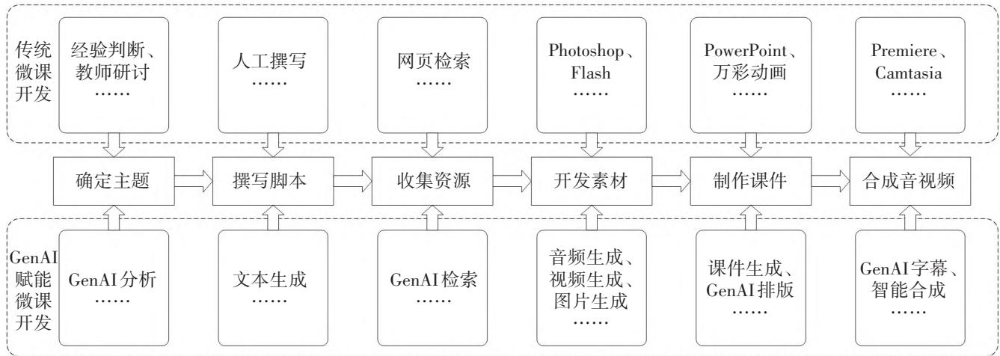
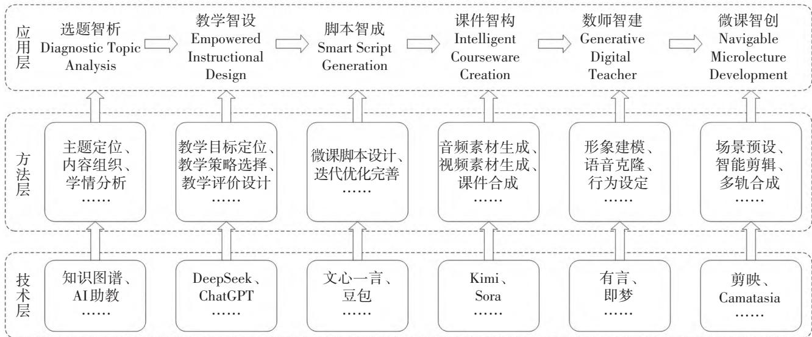

> 来源：MinerU 二次 OCR 精校（2026-08-12）；依据本地 PDF 交叉修正 OCR 错字，保留图1、图2及参考文献

# 【专题研究：数智技术与人工智能应用研究】

DOI:10.26996/j.cnki.1674-3083.26.4.009

引用格式:林雯，李朝锋，李雨欣，等.生成式人工智能赋能的数字人微课DESIGN开发模式研究J.广西职业技术学院学报，2026,19(4):55-60.

# 生成式人工智能赋能的数字人微课DESIGN开发模式研究

林 雯a，李朝锋a，李雨欣a，郑小军b

(南宁师范大学 a.人工智能学院，b.职业技术师范学院，广西 南宁 530001)

摘要：生成式人工智能技术的迅猛发展为数字人技术迭代创新注入强劲动力，催生了数字人微课这一全新教学资源形态。本研究立足数字人微课的应用优势，系统剖析生成式人工智能赋能微课研发的技术路径，构建数字人微课DESIGN开发模式并开展实践应用。该模式以“三层六步”为核心框架：“三层”涵盖应用层、方法层、技术层，“六步”包含选题智析、教学智设、脚本智成、课件智构、数师智建和微课智创六大开发环节。该开发模式的构建旨在为数字人微课的高效研发提供理论支撑与实操指引。

关键词：生成式人工智能；数字人微课；开发模式；智慧课程；教育数字化；教学资源

中图分类号：G434

文献标识码：A

文章编号：1674-3083（2026）04-0055-06

人工智能技术的蓬勃发展，正以前所未有的速度推动教育数字化进程。2025年世界数字教育大会强调，要坚持精品集成、广泛汇聚并高效开发优质教育资源1；大会发布的《数字教育合作武汉倡议》也提出，要探索人机协作的优质数字资源开发模式[2]。这凸显了利用人工智能技术赋能教育资源开发、优化教育生态的重要性与迫切性，使其成为当前教育领域的关键研究课题。微课作为教育数字化背景下广泛应用的教学资源，传统开发多依赖“人工+通用技术”模式，存在成本高、周期长、技术门槛高的问题。随着生成式人工智能深度融入教育教学实践，数字人技术依托生成式人工智能与轻量化建模工具，逐步从专业领域走向大众化应用，数字人微课应运而生，成为新型数字化教学资源。此类微课的开发具有成本低、效率高、效果好的显著优势，应用前景广阔。目前，学界关于数字人微课开发技术路径的研究较为匮乏，且缺乏理实一体化开发模式的指导。本研究致力于探索数字人微课开发的技术路径与高效模式，为一线教师提供理论指导与方法借鉴。

## 一、数字人微课的兴起及其优势

微课作为重要的数字化教学资源，已在教学实践中得到广泛应用，相关研究成果也较为丰富。

有研究表明，呈现教师形象的微课比无教师形象的微课教学效果更优[3]；对国内外主流网络课程平台的课程进行统计，结果显示，94.5%的开放课程教学视频选择呈现教师形象[4]。这些研究结果充分说明，在微课及教学视频中呈现教师形象，是提升教学效果的重要策略。微课中的教师形象主要发挥3个方面的作用：其一，教师作为解说者与引导者，可有效缓解学习者线上学习的疏离感，增强其心理归属感与学习沉浸感；其二，教师的肢体语言、表情变化等非言语符号，与语言信息形成协同效应，提升知识传递效率，助力学生理解与吸收知识；其三，教师形象搭建师生间的情感纽带，激发学生的内在学习动机，推动其主动参与学习过程。因此，在微课设计与开发过程中，应重点关注教师形象的呈现。

传统微课呈现教师形象的方式主要有两种：卡通人物替代或真人出镜录制。前者虽制作成本低、场景适配性强且易于修改，但存在人物形象呆板、情感传递失真等问题；后者通过真人出镜、绿幕抠像等方式录制，完整保留教师个人形象与风采，情感交流更为充分，却存在制作成本高、拍摄耗时长、后期修改困难等不足。近年来，随着生成式人工智能技术的飞速发展，语音合成、人脸捕捉、动作捕捉等技术日趋成熟，加之实时渲染技术与轻量化3D建模工具的迭代升级，数字人技术应运而生，并催生了以数字人形象替代教师出镜的数字人微课。数字人不仅突破了传统微课在制作成本、技术门槛、内容复用及动态修改上的局限，而且保留了教师的个性化风格，有效弥补了情感传递真实性不足的短板。相关研究指出，数字人能够重塑学习的行动场域、实践模式、认知路径与学习理念，广泛适用于中小学及高等教育等多元场景[5]。数字人微课有效融合了传统真人出镜与卡通人物微课的优势，同时规避了二者的缺陷，其核心优势可归纳为以下3点。

## 1.形象高度仿真，情感连接增强

在数字人微课中，借助先进的3D建模技术，可精准还原教师的独特形象、声音、表情及肢体动作，实现数字人教师的高度仿真，从而更有效地传递情感，提升学生学习兴趣。有研究对比不同形象的教育数字人发现，人工智能男孩组在知识保持、知识迁移及学习兴趣等方面表现更优[6]。通过多样化镜头组合与虚拟场景构建，数字人微课能为学生营造沉浸式学习环境，使其仿佛置身于真实课堂，从而有效提升学习体验感。

## 2.技术门槛降低，教师减负增效

数字人微课可将教师从繁重的视频录制工作中解放出来，使其能将更多精力投入教学设计与内容优化过程中。当前，3D建模平台呈现轻量化、大众化发展趋势，让教师数字人形象的制作更高效、更便捷，教师无需具备深厚的技术背景，即可快速创建个人数字人形象。此外，生成式人工智能技术为数字人微课制作提供了有力支撑，进一步简化制作流程、降低技术门槛，让更多教师能够轻松上手，参与数字人微课创作。

## 3.制作成本降低，迭代更新便利

基于生成式人工智能的数字人建模平台具有显著成本优势，借助高效的建模工具与模板，可大幅降低微课制作成本，使学校和教师以更少的资金投入开发数字人微课。同时，数字人模板的可复用性有效提升了微课的制作效率，一旦创建数字人模板，无论是制作新微课还是迭代旧微课，仅需修改内容与解说词。这种高效制作模式大幅缩短了微课开发周期，确保教学内容能及时更新与优化，满足动态变化的教学需求。

尽管数字人微课具有显著的应用优势，但其开发与应用实践仍处于起步阶段，生成式人工智能赋能数字人微课开发的模式与技术路径尚不明晰，亟须在理论与实践层面进一步深入探讨。

## 二、生成式人工智能赋能微课开发的技术路径

传统微课开发模式与技术已较为成熟，学者基于不同理论、应用场景及学科特点，提出了多种微课开发模式。有学者提出，微课设计模式包含前期准备、内容设计、资源设计、微学习与评价4个环节[7]；有学者构建了基于ADDIE模型的微课开发模式，将开发流程划分为分析、设计、开发、实施、评价5个阶段[8]；有学者结合高职工科微课的特点，总结了其构成要素，包括整体规划、教学设计、动画图片、系列课件、系列测试、系列视频和系列反思等方面[9]。此外，还有一些学者基于史密斯一雷根教学模式，设计了适配生物学科的微课开发模式[10]。生成式人工智能技术出现后，学界开始探索二者融合的开发模式：有学者研发了人工智能全科教师的微课教学设计[11]；有学者分析了生成式人工智能在教育资源开发中的应用价值，提出“人机共创”微课开发模式[12]；另有部分学者探讨了虚拟数字人在特定教育场景的应用实践流程[13]。综合梳理前人研究成果，可将微课开发过程归纳为确定主题、撰写脚本、收集资源、开发素材、制作课件及合成音视频6个核心环节。

在技术路径层面，传统微课开发以“人工+通用技术”为主，过程繁琐且耗时耗力。选题依赖教师的教学经验筛选重难点，脚本撰写以人工撰稿为主，资源收集主要通过网页检索获取，素材加工需运用Adobe Photoshop(简称“Photoshop")、Adobe Flash(简称“Flash”)等专业软件，课件制作依托Microsoft

PowerPoint(简称“PowerPoint”)、万彩动画等工具，最终通过Adobe Premiere(简称“Premiere”)等视频编辑软件完成视音频合成。整个开发过程需掌握多种专业软件，技术门槛较高，普通教师难以熟练驾驭。

随着生成式人工智能技术的快速普及，微课开发技术迎来变革。合理运用该技术赋能微课开发，可有效提升其开发效率与质量。首先，通过生成式人工智能技术分析教学主题，将教师“经验判断”转化为“经验+数据”双核驱动，规避选题的主观性；依托生成式人工智能文本生成功能辅助脚本撰写，可快速产出高质量初稿，缩短撰写周期；借助生成式人工智能检索技术收集资源，提升资源获取的效率与精准度；利用音频生成、视频生成和图片生成等功能开发素材，降低制作门槛，丰富素材类型与表现形式。其次，课件制作中，通过生成式人工智能的课件生成与排版功能实现初稿一键制作，提高制作效率。最后，借助生成式人工智能的智能字幕、智能合成等功能，快速完成视音频合成。传统微课开发技术与生成式人工智能赋能的微课开发技术路径对比总结见图1。

  
注：“GenAI”为生成式人工智能(Generative Artificial Intelligence)的简写。  
图1传统微课开发技术与生成式人工智能赋能的微课开发技术路径对比

生成式人工智能赋能的微课开发，在继承传统微课制作经验与方法优势的基础上，能有效弥补传统技术短板，进一步提升了微课开发的便捷性与内容呈现的丰富性，逐步形成了微课开发的新模式。

## 三、生成式人工智能赋能的数字人微课DESIGN开发模式构建

当前，数字人微课开发需求旺盛、应用前景广阔。随着生成式人工智能技术的迭代升级，数字人技术及开发平台日益亲民，数字人微课的制作与开发更加便捷。在此背景下，生成式人工智能赋能数字人微课开发的技术路线、开发模式等亟待深入研究。本研究在探索生成式人工智能赋能微课开发技术路径的基础上，结合数字人微课开发实践，构建覆盖微课开发全流程的DESIGN开发模式(图2)，该模式以“三层六步”为核心框架。其中，“三层”分别为应用层、方法层、技术层：应用层明确数字人微课开发的核心环节；方法层阐明各环节的核心工作内容及方法与策略选择；技术层则对应方法层需求，确定适配的生成式人工智能技术与工具软件。“六步”则确定了数字人微课开发的6个关键步骤，分别为选题智析(DiagnosticTopic Analysis)、教学智设(Empowered InstructionalDesign)、脚本智成(Smart Script Generation)、课件智构(Intelligent Courseware Creation)、数师智建（Gen-erative Digital Teacher)(数字人教师简称“数师”)和微课智创(Navigable Microlecture Development)。该模式取6个核心步骤的英文首字母组成其名称，即DESIGN。

  
图2 数字人微课DESIGN开发模式

## 1. 选题智析(Diagnostic Topic Analysis)

选题智析是数字人微课开发的首要环节。微课主题选择需遵循“使用价值高”“适合视频传播”“内容相对独立”“信息量适中”等原则[14]。传统微课选题多依赖教师的经验判断，而生成式人工智能赋能下的选题可结合智慧课程知识图谱，分析主题使用价值与内容独立性；同时依托智慧课程AI助教分析学情，结合平台数据研判知识点掌握情况，精准定位教学重难点，为微课选题提供科学参考。

## 2.教学智设(Empowered Instructional Design)

教学智设是数字人微课开发的第二个环节，即利用生成式人工智能辅助完成微课教学设计。具体而言，可借助DeepSeek、ChatGPT等工具，按照教学设计逻辑与框架，分析教学内容、拟定教学目标、选择教学策略、设计教学评价，并撰写完整教案；教师再对教案进行审核优化，确保教

学设计科学合理。

## 3. 脚本智成(Smart Script Generation)

脚本智成是数字人微课开发的第三个环节，核心是完成微课脚本撰写。详细的脚本是微课开发的核心依据，撰写过程中可借助文心一言、豆包等具备“文本生成”功能的工具辅助完成初稿；再经教师优化完善，使其更贴合教师个人教学风格，适配数字人微课呈现需求。

## 4. 课件智构(Intelligent Courseware Creation)

课件智构是数字人微课开发的第四个环节，主要完成微课课件制作。课件作为微课教学内容的核心载体，涵盖文字、音频、视频及图片等多模态资源，因此课件智构需完成音频素材生成、视频素材生成、图片素材生成及课件合成等核心工作。在技术层面，可运用Sora、Kimi等具备音频、视频、图片及课件生成功能的生成式人工智能工具，高效完成素材生成与课件制作。

## 5.数师智建(Generative Digital Teacher)

数师智建是数字人微课开发的第五个环节，即数字人教师的制作。数字人教师基于教师真人形象与声音特征打造，主要从形象建模、行为设定、口型同步和声音特征提取等方面完成制作。在技术层面，可依托有言、即梦等兼具3D形象生成与视频合成功能的轻量化建模平台，精细优化人物面部与体态细节，嵌入行走、摊手等动作行为，提升数字人物形象逼真度；同时，借助豆包、即梦、蝉镜等具备语音特征提取功能的平台，实现教师声音克隆，增强数字人的语音表现力。

## 6. 微课智创(Navigable Microlecture Development)

微课智创作为数字人微课开发的收尾环节，核心是完成数字人微课视频的合成。该环节依次经过“场景创设”“智能剪辑”“多轨合成”等关键步骤，将课件、数字人和音视频等各类素材进行整合。技术层面可选用接入生成式人工智能的剪辑平台或内嵌剪辑功能的3D建模平台，如剪映、Camtasia、Adobe Premiere Pro等，添加镜头运镜效果、字幕和片头片尾等元素，最终实现数字人微课的完整合成。

综上所述，数字人微课DESIGN开发模式以“三层六步”为框架，各环节层层递进、环环相扣，明确了数字人微课开发的具体步骤、详尽方法与适配技术，为数字人微课高效开发提供了可靠的技术路径与方法指导。

## 四、DESIGN开发模式的应用案例

为检验数字人微课DESIGN开发模式的有效性，本研究选取“教学系统设计”智慧课程部分内容，运用该模式开展数字人微课开发，同步对其进行优化完善。以下以“五步教学模式”微课为案例，详细说明其开发过程。

第一步，选题智析。结合“教学系统设计”智慧课程知识图谱分析，确定“五步教学模式”为开发主题。该知识点作为课程重点内容，使用频率高且内容相对独立，适配微课呈现形式；同时，通过课程平台AI助教分析学情发现，学生对教学策略章节知识点兴趣浓厚，学习频次与页面停留时间均较高，相关提问也较为集中，将该知识点开发为数字人微课，可有效满足学生自主学习需求。

第二步，教学智设。将“五步教学模式”的核心知识点以文件形式上传至DeepSeek，输入提示语：“我是一名高校教师，需制作主题为五步教学模式’的微课，面向教育类专业大学生，请提炼教学目标、选择合适教学策略，并生成完整教学设计方案。”输入提示语时，应明确主题、受众、要求及格式等细节，确保生成的内容贴合实际需求；同时启用DeepSeek的“深度思考”功能，提升内容生成的精准度。

第三步，脚本智成。将优化完善后的教学设计上传至文心一言，输入提示语：“我是一名高校教师，结合该教学设计，撰写面向教育类师范生的微课讲稿，字数约1200字，要求表达科学、通俗易懂。”输入提示语时，明确讲稿受众、字数及语言风格等要求；生成讲稿初稿后，将其转化为分镜头脚本，确保与课件内容、动画设计精准对应，完成脚本设计。

第四步，课件智构。依据脚本内容，利用生成式人工智能制作多模态资源：将分镜头脚本或讲稿上传至Kimi平台生成课件大纲，选用适配教学内容的PPT模板完成课件制作；同时借助TTSMAK-ER的音频生成功能，选择适配音色，根据不同教学环节需求设计差异化语速，完成音频素材制作。

第五步，数师智建。依托“有言”数字人平台搭建教师专属数字人模型。该平台既可以选用平台内置数字人形象快速建模，也可以根据教师个人特征，通过脸型塑造、发型设计、肤色选择和服装搭配等功能定制建模。本案例采用定制建模方式，通过微调脸型参数提升数字人形象的逼真度；借助平台内置功能为数字人添加“抬手”“点头”等行为特征，克隆教师声音生成解说音频，并完成口型与音频的比对校准，实现音形协调。

第六步，微课智创。在“有言”平台中选择教室场景，导入PPT课件与数字人模型，优化细节后导出场景、课件、数字人一体化合成视频；随后将该视频、解说音频、背景音乐、字幕及片头片尾等元素导入Camtasia剪辑软件，添加适配的运镜效果，实现音画同步、音画协调，最终导出数字人微课视频，完成开发。

实践表明，运用数字人微课DESIGN开发模式，可实现课程资源的快速迭代更新，助力敏捷高效的智慧课程建设。开发测算数据显示，该模式可使数字人微课整体开发效率提升约40%，其中文本编辑时间节约50%、课件开发时间节约30%、教师形象录制时间节约80%、音视频合成时间节约30%。该系列数字人微课在N大学教育技术专业的教学系统设计课程中应用后，平台学习数据显示，其点击率与学习完成度较其他微课高出20%，相关知识点掌握度高于课程整体平均值。学生访谈反馈显示，学生对数字人讲解兴趣浓厚，认为数字人教师形象贴近真实、生动活泼，学习体验与效果良好；同时学生也提出个性化建议，如希望能为数字人教师自主换装、调整语言风格及教姿教态等。这些建议反映出数字时代学生对学习资源的个性化偏好与自主选择需求，值得教学资源开发者重点关注与完善。

## 五、结束语

随着生成式人工智能技术的迅猛发展，数字人技术的应用门槛已经显著降低。以数字人形象替代传统教师出镜的数字人微课，已逐渐成为教育领域重要的新型教学资源。本研究探索了生成式人工智能赋能数字人微课敏捷开发的技术路径，构建了以“三层六步”为核心框架的数字人微课DE-SIGN开发模式，为数字人微课开发实践提供了坚实的理论指导与可操作的实践指南。需要指出的是，本文提出的DESIGN开发模式具有较好的普适性，面对基础教育、职业教育、高等教育、特殊教育和成人教育等不同教育阶段以及不同学科、不同教育场景的资源开发需求，其应用可能存在变式与拓展，需结合实际教学情境灵活调整。同时，本研究已通过开发实践初步证实，该模式具有一定有效性与高效性；后续研究可依托大样本数据，强化数字人微课应用效果的量化研究与深度分析，并针对不同教育阶段、不同学科数字人微课的特殊性与适用性，开展更为深入的实证研究。总而言之，数字人微课应用前景广阔，不仅能够有效提升教学质量与学习效果，还能显著降低教育成本，推动教育资源的均衡分配。未来，随着面向教育垂直领域的专业化生成式人工智能技术与数字人制作平台不断成熟，数字人微课开发将更加便捷高效，其有望在教育领域发挥更大作用，成为教育创新发展的重要方向。

## 参考文献：

[1]教育部.怀进鹏在2025世界数字教育大会作主旨演讲[EB/OL](2025-05-15)[2025-08-04].http://www.moe.gov.cn/jyb\_xwfb/gzdt\_gzdt/moe\_1485/202505/t20250515\_1190601.html.

[2]中国教育报.数字教育合作武汉倡议发布[EB/OL].(2025-05-17)[2025-08-04].http://www.moe.gov.cn/jyb\_xwfb/xw\_zt/moe\_357/2025/2025\_zt06/dongtai/202505/t20250517\_1190914.html.

[3]曹建霞，傅安娜，王锐，等.教学视频中教师呈现方式对学习者社会存在感和学习效果的影响[J].现代教育技术，2017,27(7):75-81.

[4]杨九民，陶彦，罗丽君.在线开放课程教学视频中的教师图像分析：现实状况与未来课题[J].中国电化教育，2015(6):59-63.

[5]余越凡，赵志群.AIGC时代数字人赋能人机协同学习：价值、框架与路径[J].远程教育杂志,2025,43(2):45-52.

[6]吴长城，胡双武，蒋雨江，等.GenAI驱动的教育数字人架构设计与实证研究[J].现代教育技术,2024,34(9):26-36.

[7]尹合栋.微课程的设计、开发与评价[J].现代教育技术，2015,25(1):46-52.

[8]莫健樱，杨满福.基于ADDIE模型的微课设计与开发[J].中国教育信息化,2020(14):81-84.

[9]于辉，白洁.高职工科系列微课开发模式研究[J].产业与科技论坛,2017,16(1):159-161.

[10]章潞妮，陈秉初，葛孙亮.基于史密斯一雷根教学设计模式的生物学微课开发[J].绍兴文理学院学报(教育版)，2015,35(12):79–81,105.

[11]李浩然，杨一格，康慧，等.AI全科教师微课教学设计开发研究[J].广东第二师范学院学报,2019,39(6):2-11.

[12]杨易频，杨上影，郑小军，等.生成式人工智能在微课开发中的应用研究[J].广西开放大学学报,2024,35(1):33-38.

[13]魏小东，习鹏飞.大语言模型驱动下的虚拟数字人第二语言教育应用研究[J].电化教育研究,2024,45(5):75-82.

[14]林雯.微课教学设计的原则与三个关键问题探讨[J].中国教育信息化,2016(6):26-30.

(编辑:黄莉新 唐梅樑)

