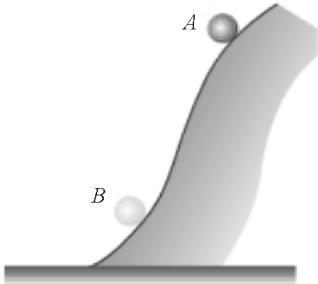
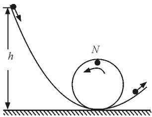
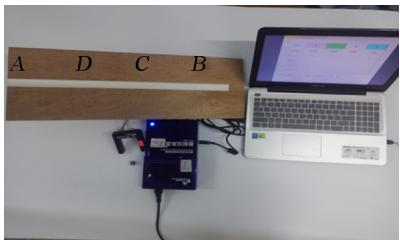
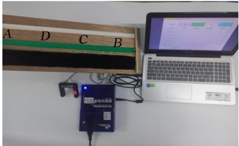
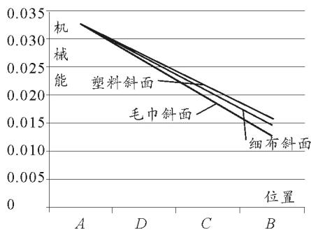
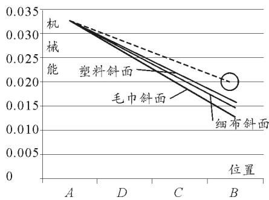
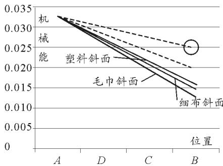
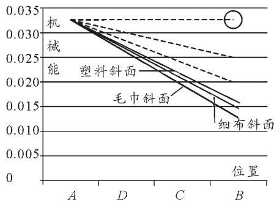

# 实验支持下的问题驱动式学习——机械能守恒定律的别样教学

郑秀玲 刘小兵

（广西师范大学物理科学与技术学院 广西 桂林 541004）（收稿日期：2020－03－13）

摘 要：基于学生存在的物体受到摩擦力、拉力时机械能为什么不守恒的疑惑，通过模拟物理学家伽利略研究斜面实验时采用的理想实验方法，以可靠的实验事实为基础，突出主要因素，忽略次要因素，通过推理得出机械能守恒定律．对机械能守恒定律进行了全新的教学探索，提供了一种全新的教学方案，有利于充分促进学生的深度学习，培养学生的推理能力、分析归纳能力和探索发现能力．

关键词：问题驱动 创新教学 自制教具 机械能守恒

机械能守恒定律是学生进入高中系统学习物理学后第一次遇到的守恒定律，渗透了功是能量转化的量度的重要物理思想，是必须牢固掌握的一个重要规律．通过分析教材发现，旧教材是在物体做自由落体运动的物理情境下推导出机械能守恒定律，新教材是在光滑曲面的情形下推导出机械能守恒定律．但在两种情境中都是只有重力做功，仅在只有重力对物体做功的情况下推导出机械能守恒定律，学完学生仍会疑惑：为什么物体受到摩擦力、拉力或者摩擦力、拉力对物体做功时，物体的机械能就不守恒？不能使学生真正理解机械能守恒定律．

传统教学是在只有重力做功的情形下推导机械能守恒定律的．如物体沿图1所示光滑曲面滑下的情形，物体在某一时刻处在位置A，这时它的动能是$E _ { \mathrm { k } 1 }$，重力势能是$E _ { \mathrm { p } 1 }$，机械能是$E _ { 1 } = E _ { \mathrm { k } 1 } + E _ { \mathrm { p } 1 }$．［1］当物体运动到另一位置B，它的动能是$E _ { \mathrm { k 2 } }$，重力势能是$E _ { \mathrm { p 2 } }$，机械能是$E _ { 2 } = E _ { \mathrm { k } 2 } + E _ { \mathrm { p } 2 }$［1］．

  
图1 物体沿光滑曲面下滑

以W表示这一过程中重力做的功．根据动能定理，有$W = E _ { \mathrm { k } 2 } - E _ { \mathrm { k } 1 }$．另一方面，根据重力做功与重力势能的关系，有$W = E _ { \mathrm { p } 1 } - E _ { \mathrm { p } 2 }$［1］．从以上两式得，$E _ { \mathrm { k } 2 } - E _ { \mathrm { k } 1 } = E _ { \mathrm { p } 1 } - E _ { \mathrm { p } 2 }$，移项后，有$E _ { \mathrm { k 2 } } + E _ { \mathrm { p 2 } } = E _ { \mathrm { k 1 } } + E _ { \mathrm { p 1 } }$，即$E _ { 2 } = E _ { 1 }$，也就是机械能守恒．但是仅在只有重力对物体做功的情况下推导出机械能守恒定律，学完学生仍会疑惑为什么物体在只受重力或只有重力做功时机械能才守恒，物体受到摩擦力、拉力时，它的机械能就不守恒了吗？为什么不守恒了呢？

下面介绍一种可以解决学生此种疑惑的教学新思路．

## 1 教学创新

现代教学论研究指出，通过提问可以激发学生的求知欲，使学生积极投入到思考与学习中［2］．同时，新课程理念强调学生是学习的主体，教师应在学生的学习中发挥主导作用，引导学生学习而不能对学生的学习与探究包办代替，要将探究的权利交还给学生［2］．基于以上两点，本课设计两条主线，一是以问题为主线，将知识问题化，设计多个环环相扣的问题，使学生产生学习动机，积极思考［2］．；二是以探究性活动突破本节课的难点，在实验探究当中，首先选择一个粗糙的斜面，用DIS实验系统测出钢球在斜面上4个不同点的机械能值，得出结论一：钢球在粗糙斜面上运动，机械能损失．接着选择3个粗糙程度不同的斜面，让钢球受到的摩擦力逐渐减小，用DIS实验系统测出钢球在每一个斜面上4个点的机械能值，并转化为机械能－位置图像．将实验数据转化为图像，可以很直观地看到，斜面粗糙程度越小，机械能损失越少，即结论二．根据3个机械能－位置图像及结论二，最终推导出斜面完全光滑的情况．当斜面完全光滑，也就是摩擦力为零时，机械能守恒，突破本节的难点，解决学生存在的疑惑：为什么存在摩擦力时，机械能就不守恒了呢？通过采用理想实验方法，以可靠的实验事实为基础，突出主要因素，忽略次要因素［3］，抽象思维得出机械能守恒．让学生在探究、推理过程中得出结论，消除疑惑，真正理解机械能守恒定律并领悟理想研究方法［4］．

## 1.1 实验引入 激发兴趣

演示小实验，导入新课．如图2所示．

  
图2 钢球过山车

教师演示一：钢球过山车

问题1：钢球在运动过程中动能和重力势能如何变化［5］？

问题2：钢球的动能和重力势能相互转化的过程中，机械能是否发生变化呢［5］？

分析：在课堂导入环节，教师利用圆形轨道演示钢球过山车实验，引导学生知道动能和重力势能可以相互转化，并提出问题：动能和重力势能相互转化的过程中，机械能是否发生变化呢？引起学生思考与讨论，激发学生学习兴趣，引入本节课的探究主题．

## 1.2 师生合作 探究新知

学生实验1：探究钢球在粗糙斜面滚下，机械能是否变化．

实验原理：$W = { \frac { 1 } { 2 } } m v ^ { 2 } + m g h$．

实验器材：一个塑料斜面、已知质量与直径的钢球一个、直尺、光电门传感器、数据采集器、电脑．如图3所示．

实验步骤：从斜面顶端自由释放小球，分别测出小球在斜面A，D，C，B 4个位置上的机械能值．

  
图3 探究钢球在粗糙斜面滚下，机械能是否变化

分析实验数据得到结论一：机械能损失．

分析：教学第一环节，探究钢球在粗糙斜面下滑的过程中机械能是否变化．为了消除学生的疑惑：为什么物体受到摩擦力时机械能就不守恒，教师提供一个粗糙的斜面和DIS实验系统，引导学生进行实验探究后得出结论一：机械能损失．

问题3：那么在粗糙程度不同的斜面上钢球的机械能损失程度一样吗［5］？有什么规律呢？

分析：问题3使学生带着疑问进行深入探究．

教师演示二＋学生分组实验：探究钢球从粗糙程度不同的斜面滚下，机械能减少量是否一样．

实验原理：$W = { \frac { 1 } { 2 } } m v ^ { 2 } + m g h$．

实验器材：毛巾斜面、细布斜面、塑料斜面、光电门传感器、数据采集器、电脑、直尺、已知质量与直径的钢球．如图4所示．

  
图4 探究钢球在粗糙程度不同的斜面滚下，机械能减少量是否一样

实验步骤：

（1）钢球从毛巾斜面自由滚下，测A，D，C，B 4点的机械能；

（2）钢球从细布斜面自由滚下，测A，D，C，B 4点的机械能；

（3）钢球从塑料斜面自由滚下，测A，D，C，B 4点的机械能；

（注意：为了比较性，选择的4个位置应确定）

（4）为了直观地描述实验现象，我们用图像来表示，将刚才测得的数据转化为机械能－位置图像．为了更好地比较钢球在毛巾斜面、细布斜面、塑料斜面这3个粗糙程度不同的斜面上运动时机械能的损失程度，将3条图线放在同一个坐标系中，如图5所示［5］．

  
图5 钢球沿不同粗糙程度斜面滚下的机械能对比图像

问题4：请学生们观察并互相讨论，从这3条图线中发现了什么？

问题5：如果斜面的粗糙程度再小一些，那么所对应的图线会怎么样［5］？

问题6：如果粗糙程度更小呢［5］？

问题7：如果我们这样依次类推，大家想一下，你会发现什么？

分析：第二环节，探究钢球在粗糙程度不同的斜面下滑，机械能损失程度有何规律．笔者自制了毛巾、细布、塑料3个粗糙程度不同的斜面．由笔者演示钢球在毛巾斜面自由滚下，用DIS实验系统测出钢球在斜面4个位置的机械能值，接下来由学生分组进行实验，测出钢球在细布、塑料斜面滚下的机械能值．并且，为了更加直观地描述实验现象，笔者将测得的机械能值输入Excel表格，转化成机械能－位置图像，引导学生观察分析图像，得出结论二：粗糙程度越小，对应图线越趋近水平，机械能损失越少．紧接着，教师通过进阶提问引导学生们推理得出如果斜面光滑，钢球的机械能守恒，如图6，7，8中用圆圈标志的图线所示．

  
图6 如果斜面比较光滑所得的图线

  
图7 如果斜面更光滑所得的图线

  
图8 如果斜面完全光滑所得的图线

问题8：光滑的斜面是一种理想模型，是不存在的，我们是根据“斜面粗糙程度越小，对应图线越趋近水平，钢球的机械能损失越少”推导出“在光滑斜面上运动的物体的机械能守恒”，这与我们学过的哪个实验的思维方式相似［5］？

分析：学生们在伽利略理想斜面实验中已经了解过理想化方法，这里进一步感受运用理想实验研究物理问题的科学方法，有利于培养学生在研究问题时突出主要矛盾，忽略次要因素的思维方法［3］．

## （3）验证推论

根据动能定理$W _ { \text{合} } = \Delta E _ { \mathrm { k } }$推导出在钢球斜面上运动，有

$$
E _ { 1 } - \mu m g l \cos \theta = E _ { 2 }
$$

若$\mu = 0$，有$E _ { 1 } = E _ { 2 }$，即如果斜面光滑，钢球的机械能守恒．

分析：教学第三环节验证推论．师生利用动能定理，验证如果斜面光滑，钢球机械能守恒．将实验推理与理论知识很好地结合．

## 1.3 教师引导 归纳条件

问题9：我们知道功是能变化的量度，那么实验结果中钢球机械能损失的根本原因是什么？

问题10：物体只要不受到摩擦力，机械能就守恒吗？

问题11：用一绳子拉着小车在光滑的斜面上匀速前进，小车的机械能守恒吗？

问题12：机械能在什么情况下会增大？

分析：为了防止学生通过前面的斜面实验，存在只要物体不受到摩擦力机械能就守恒的错误认识，教师通过设置一个拉着小车在光滑的斜面上匀速前进的物理情境，引导学生们想到功是能变化的量度和提出一系列问题从而引导学生得出机械能守恒的条件不仅仅是摩擦力不做功．

问题13：那么机械能守恒的条件究竟是什么？

分析：紧接着教师提问机械能守恒的条件，学生小组讨论得到：动能和重力势能相互转化，由于功是能变化的量度，因此重力做功，再对在光滑斜面上自由滚下的钢球受力分析得到只有重力做功．从而归纳出机械能守恒的条件是只有重力做功．从而突破本节课又一难点．在这一过程中学生们经历了在不同现象中寻找共性的物理研究方法，也得到了机械能守恒定律．

## 1.4 课堂延伸 巩固知识

学生实验2：重锤碰鼻实验

问题14：重锤从鼻子处静止释放，返回来会不会碰到鼻子？请学生们试一下，并解释现象．

分析：学生参与活动并解释现象，体会物理来源于生活并反馈于生活的教育理念．

## 2 教学反思

本节对于学生存在的物体受到摩擦力、拉力时机械能为什么不守恒的疑惑不回避，从学生的思维和视角出发，引导学生利用实验进行深入研究，利用理想化的方法，对实验现象进行总结归纳并进行进一步的推理，从而得到如果斜面完全光滑，机械能守恒的结论．并且运用动能定理进行验证，将实验探究与理论推导很好地结合．并且为了防止学生通过前面的斜面实验，存在只要物体不受到摩擦力机械能就守恒的错误认识，教师通过设置一个拉着小车在光滑的斜面上匀速前进的物理情境并提出一系列问题，从而引导学生得出机械能守恒的条件不仅仅是摩擦力不做功，接着通过提问引导学生归纳机械能守恒的条件．整个教学过程将实验探究与理论知识很好地结合，让学生经历了运用理想研究方法研究物理问题的过程，让学生在探究与推理、验证中消除了“物体受到摩擦力、拉力等力时，或者摩擦力、拉力等力对物体做功时，物体的机械能就不守恒了吗？为什么不守恒？”的疑惑，是一次较成功的教学探索．

## 参 考 文 献

1　张大昌，彭前程，张维善．普通高中课程标准实验教科书物理·必修2［M］．北京：人民教育出版社，2004．70

2　曲学成．浅谈问题引导下的探究式学习［J］．新校园：理论版，2012（7）：105

3　朱传兵，邱友志．物理学中常用的几种研究方法［J］．政治思想史，2001（8）：11～12

4　满孝旭．《机械能守恒定律》的教学设计［J］．物理教学探讨，2012，30（04）：63～66

5　张文静．机械能守恒定律教学设计［DB／OL］．https://www.docin.com/p-2186175039.html

作者简介：郑秀玲（1997－　），女，在读硕士研究生，曾在第十届全国大学生与研究生物理教学技能活动中被评为“教学技能标兵”．

## Problem Driven Learning Supported by Experiments

———Different Teaching of Conservation Law of Mechanical Energy

Zheng Xiuling　Liu Xiaobing

（College of Physical Science and Technology, Guangxi Normal University, Guilin, Guangxi 541004）

Abstract: Based on the students′ doubts about why the mechanical energy is not conserved when the object is subject to friction and tension, the ideal experimental method adopted by Galileo, a physicist, is simulated. Based on the reliable experimental facts, the main factors are highlighted and the secondary factors are ignored. The conservation law of Mechanical energy is obtained through reasoning. This paper makes a new teaching exploration on the law of conservation of mechanical energy, and provides a new teaching scheme, which is conducive to fully promoting students′ deep learning and cultivating their reasoning ability, analysis and induction ability and exploration and discovery ability.

Key words: problem driven; innovation teaching; self made teaching aids; mechanical energy conservation
