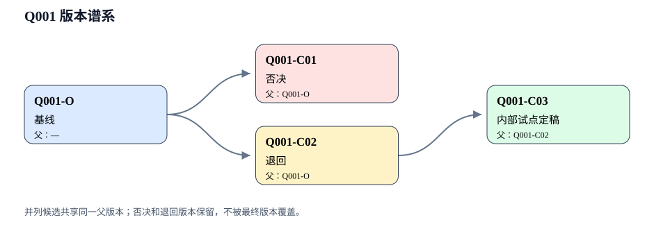

# 派生任务中的后续交流：推进新书并行研发项目 S3“素养导向题目改编流水线”。目标是形成一套一线高中物理教师能理解、复核和复用的最小工作流，并尽可能做出可运行原型：从一道自编/公开/明确授权的高中物理题

任务：01a04d5f-e8e8-7530-ab1f-ae909c178bb7

本任务可见交流全文。

北京时间。只呈现用户与 AI 的可见交流；运行指令、自动审核和子任务不进入正文。

## 用户 · 2026-08-29 19:58:42

'/Users/yaril/Documents/“AI赋能教师”专项培训/讲座录音整理（完整版）.md'

'/Users/yaril/Documents/“AI赋能教师”专项培训/培训期间图片内容整理.md'
从这里能找到有价值的参考吗？

来源

/Users/yaril/.codex/sessions/2026/08/29/rollout-2026-08-29T19-55-26-01a04d5f-e8e8-7530-ab1f-ae909c178bb7.jsonl · 第95行 · 字节1036906 · 记录指纹 4f4621f29c3121efc2ec74df847ca003b8283c41f0ff369156d93475df5ef8f6

## AI · 2026-08-29 19:58:50

可以，这两份材料最适合当“问题来源”和“流程参照”，不适合直接当作 S3 已验证方法或照抄专家项目。我现在会重点提取其中与题目改编、审核环节、题库边界有关的原话和图示关系，核对哪些能转成我们自己的任务书与门禁，哪些只能保留为待验证假设。不会复写讲座中的详细方案。

来源

/Users/yaril/.codex/sessions/2026/08/29/rollout-2026-08-29T19-55-26-01a04d5f-e8e8-7530-ab1f-ae909c178bb7.jsonl · 第100行 · 字节1041384 · 记录指纹 193a6d4b2e02f43b490b15524ba485723de21e23fb97e1f92093ae36df77785e

## 用户 · 2026-08-29 20:05:59

'/Users/yaril/Documents/“AI赋能教师”专项培训/培训汇报 PPT/AI赋能物理教学资源建设 V4-2'，这里的Md，PPT图片可能会有帮助

来源

/Users/yaril/.codex/sessions/2026/08/29/rollout-2026-08-29T19-55-26-01a04d5f-e8e8-7530-ab1f-ae909c178bb7.jsonl · 第152行 · 字节1418054 · 记录指纹 2edfc1d92fd27d39e765e0fc4aee44885248ed6e12e0fa4f5258c5d2de939d66

## AI · 2026-08-29 20:06:06

有帮助。我会把这个目录作为第三个“互证材料”：先读其中的 Markdown，定位与题目改编有关的页码，再只查看对应 PPT 图片，不全量处理图片。它可能帮助我们核对“候选生成维度”和专家原始表达，但仍只抽取通用方法与边界，不复刻整套项目或题库配方。S3 原型已经搭起，接下来会据此修正材料取用说明和审核逻辑。

来源

/Users/yaril/.codex/sessions/2026/08/29/rollout-2026-08-29T19-55-26-01a04d5f-e8e8-7530-ab1f-ae909c178bb7.jsonl · 第157行 · 字节1423194 · 记录指纹 7fb62e85977a49f5ad603fcb02088d7b7c1bf193c85dc3381a5a9a445625cf4a

## AI · 2026-08-29 20:06:46

这套 PPT 的价值比前两份材料更“靠近可执行证据”，但不是直接的改题模板：

- 第 18—27 页把“题面、标准解析、学生表达、思维表征、评价报告”分开，提醒 S3 不能仅凭题目标签断言学生会产生哪种思维；我们应检查题目要求的可观察动作，真实思维效果留到试测。
- 工作流截图显示标准解析与学生解题过程是两条输入，适合后续把“设计审核”和“学生证据”分层，不在小样本阶段虚构学生反应。
- 第 28 页的“可用、可信、可迭代”可以转成 S3 的发布门：课堂可执行、物理与证据可信、保留版本反馈。
- PPT 中的具体卫星题、SOLO 成效数据和平台流程属于专家项目，本试点不复制，也不拿来证明 S3 有效。

我会把这几条作为新增边界写入方法说明。

来源

/Users/yaril/.codex/sessions/2026/08/29/rollout-2026-08-29T19-55-26-01a04d5f-e8e8-7530-ab1f-ae909c178bb7.jsonl · 第188行 · 字节2422044 · 记录指纹 4dcc7cec5c2672b33735e55325a684d1027ab5b0c49a77d8ff0bfc630b25062f

## AI · 2026-08-29 20:07:55

原型已具备完整数据链和 8 个自动测试用例。我现在开始第一次实际运行：先执行测试，再生成报告；若发现记录与图示不一致，会保留失败信息并修正原型，不会把“脚本能跑”当作方法已经通过。

来源

/Users/yaril/.codex/sessions/2026/08/29/rollout-2026-08-29T19-55-26-01a04d5f-e8e8-7530-ab1f-ae909c178bb7.jsonl · 第207行 · 字节2455881 · 记录指纹 e5f05e4b8f194c0085c896bd43afbea4250ba4ff5e49dc2f277f48d046b3300e

## 用户 · 2026-08-29 20:08:29

'/Users/yaril/个人文档/3 写作/图书出版/新项目推进'，项目可以落盘在这个本地文件夹里，新建一个S3的文件夹，作为工作目录，有价值的东西要及时落盘。过程性的东西也可以记录下来，只要有分析价值。

来源

/Users/yaril/.codex/sessions/2026/08/29/rollout-2026-08-29T19-55-26-01a04d5f-e8e8-7530-ab1f-ae909c178bb7.jsonl · 第234行 · 字节2545857 · 记录指纹 7a8206c9ed2214d32f450c85042741dd15de961ddce7f5b0b611657d7ec6e372

## AI · 2026-08-29 20:08:43

收到。我会把正式工作目录切换到：

`/Users/yaril/个人文档/3 写作/图书出版/新项目推进/S3_素养导向题目改编流水线`

先检查“新项目推进”里的项目规则和是否已有同名目录；确认无冲突后，把当前已形成的任务书、原型、失败记录与生成报告完整复制过去。旧工作树版本先保留为可回滚快照，不删除；此后的新增分析、运行记录和交接只落在新 S3 目录。

来源

/Users/yaril/.codex/sessions/2026/08/29/rollout-2026-08-29T19-55-26-01a04d5f-e8e8-7530-ab1f-ae909c178bb7.jsonl · 第239行 · 字节2552037 · 记录指纹 85a0f8471b43a5a75af0f66f9f9cc3fe71ad68896b1907d9adeda851017dbf92

## AI · 2026-08-29 20:10:29

正式目录已经迁入“新项目推进”，迁移前后逐项比较无差异；旧副本只保留回滚，不再编辑。接下来我会在新目录补齐三类能长期保留的材料：教师／同事人工审读单、可入书的方法提炼、主会话回流说明。过程记录只保留影响判断的内容，不堆命令流水。

来源

/Users/yaril/.codex/sessions/2026/08/29/rollout-2026-08-29T19-55-26-01a04d5f-e8e8-7530-ab1f-ae909c178bb7.jsonl · 第279行 · 字节2625037 · 记录指纹 49ddf484460960aa7906b542176e26095e4cdc1fcf941d2a81d0bff4ab43cff7

## AI · 2026-08-29 20:12:09

第一次实际运行已通过，版本谱系图也已人工查看：原题分出“情境候选”和“数据候选”，修订版只继承被退回的数据候选，关系没有画错。检查过程中发现一个值得及时修正的模型问题：最终题同时含唯一数值小问和开放评价小问，不能简单归为“开放题”。我会把原型的答案门扩展为“唯一／开放／混合”三种，避免为了适配工具而扭曲题型。

来源

/Users/yaril/.codex/sessions/2026/08/29/rollout-2026-08-29T19-55-26-01a04d5f-e8e8-7530-ab1f-ae909c178bb7.jsonl · 第310行 · 字节2772122 · 记录指纹 1acd7b0fabc88f3d8b5cbd3a662b5f0226a1ec85901aa3be2dec8e4909c8f167

## AI · 2026-08-29 20:15:16

S3 已进入最后验收。我会在正式目录再做一次无缓存的完整测试、重新生成审核产物、检查 CSV／JSON／相对链接和文件范围，并核对 Git 只看到新增的 S3 目录。审阅材料会明确保留三项人工门：第二位物理教师审题、课堂试测、外发署名授权。

来源

/Users/yaril/.codex/sessions/2026/08/29/rollout-2026-08-29T19-55-26-01a04d5f-e8e8-7530-ab1f-ae909c178bb7.jsonl · 第403行 · 字节3018689 · 记录指纹 ba1521c02a9d9931871bb5147bf2b3b1af3f222ed978955382decee9525a4d31

## AI · 2026-08-29 20:16:17

S3 独立研发试点已完成并正式落盘：

[打开 S3 审阅入口](https://github.com/Yarubaobei321/ai-physics-teacher-book/blob/b30634077562be9e1787f913eb0f926167db43f4/book-project/%E6%96%B0%E9%A1%B9%E7%9B%AE%E6%8E%A8%E8%BF%9B/S3_%E7%B4%A0%E5%85%BB%E5%AF%BC%E5%90%91%E9%A2%98%E7%9B%AE%E6%94%B9%E7%BC%96%E6%B5%81%E6%B0%B4%E7%BA%BF/review/s3-pilot/review.md)

主要成果：

- 1 道自编题形成 4 个版本：基线、否决、退回、内部试点定稿。
- 建立学段、物理、条件、答案、认知、版权、可教性七道门。
- 原型支持唯一、开放、混合题型，生成审核报告、28 条门禁记录和 SVG 图。
- 提炼了培训材料的有效启发，同时排除未授权题库、专家详细项目和未经核验的成效数据。
- 已形成失败样例、人工审读单、过程记录、可入书方法和[主会话交接说明](https://github.com/Yarubaobei321/ai-physics-teacher-book/blob/b30634077562be9e1787f913eb0f926167db43f4/book-project/%E6%96%B0%E9%A1%B9%E7%9B%AE%E6%8E%A8%E8%BF%9B/S3_%E7%B4%A0%E5%85%BB%E5%AF%BC%E5%90%91%E9%A2%98%E7%9B%AE%E6%94%B9%E7%BC%96%E6%B5%81%E6%B0%B4%E7%BA%BF/05_HANDOFF/%E4%B8%BB%E4%BC%9A%E8%AF%9D%E4%BA%A4%E6%8E%A5%E8%AF%B4%E6%98%8E.md)。

验证结果：11 项测试全部通过，JSON、CSV、相对链接和 SVG 均已检查。Git 定向检查只显示新增 S3 目录；本轮未修改 B1 总入口、书的宪法或 S1。

仍需人工完成：主作者和另一位高中物理教师审题、小范围课堂试测、外发署名与授权确认。当前建议主会话先回流方法，不回流效果结论。

来源

/Users/yaril/.codex/sessions/2026/08/29/rollout-2026-08-29T19-55-26-01a04d5f-e8e8-7530-ab1f-ae909c178bb7.jsonl · 第430行 · 字节3081830 · 记录指纹 1bc75064a04e9227b2a5d7aabb89d6ed9bda137d7b095660782348c6b9502a2a

